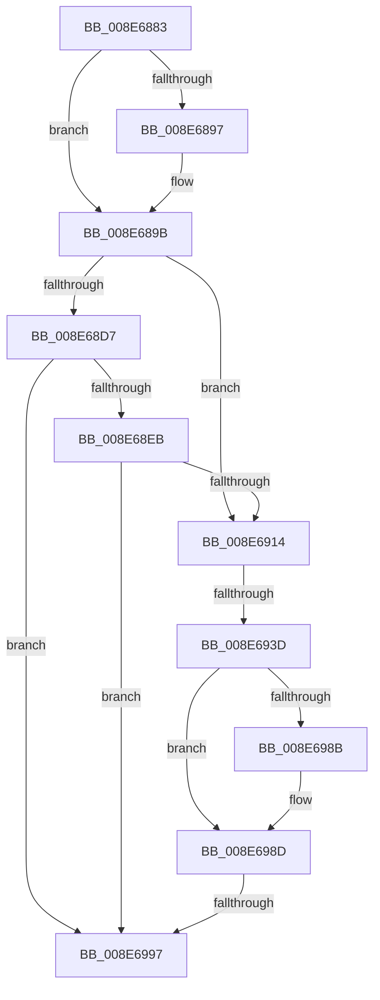

# sub_008E6883

- RVA: `0x008E6883`–`0x008E69C9` (길이 `326` bytes)
- VA: `0x00000001408E6883`
- 실행 섹션: `PAGE`
- PDB 이름 있음: `아니요`; PDB Function 태그: `아니요`
- unwind 정보 RVA: `0x00086780`
- 디코드: `70`개 명령, `326/326` bytes 표시
- 미해석 바이트: `0` (있으면 어셈블리에 `.byte`로 보존)

> 이 문서는 커널 이미지의 기계어와 PDB 기호를 분석해 생성했습니다. 4번과 5번은 함수 원형과 자료형을 바이너리 사용 방식에서 추정한 C 해석이며 원본 소스 복구 결과는 아닙니다.

## 1. Dependencies

- 직접 호출 지점: **8**; 고유 호출 대상: **8**
- 직접 호출자로 확인된 함수: **0**
- RIP 상대 이미지 참조: **3**

### Outgoing calls
- `0x008E68B2` → [ExAcquireResourceSharedLite](../../text/21/ExAcquireResourceSharedLite_function_00211BC0.md) (function, `0x00211BC0`)
- `0x008E68BF` → [ExReleaseResourceLite](../../text/25/ExReleaseResourceLite_function_0025FA10.md) (function, `0x0025FA10`)
- `0x008E68CD` → [KeLeaveCriticalRegionThread](../../text/25/KeLeaveCriticalRegionThread_function_0025EFF0.md) (function, `0x0025EFF0`)
- `0x008E68DA` → [PsGetSessionById](../../text/22/PsGetSessionById_function_00225150.md) (function, `0x00225150`)
- `0x008E68FE` → [ObfDereferenceObjectWithTag](../../text/2F/ObfDereferenceObjectWithTag_function_002F78E0.md) (function, `0x002F78E0`)
- `0x008E6906` → [PsGetServerSiloServiceSessionId](../../text/45/PsGetServerSiloServiceSessionId_function_0045ED00.md) (function, `0x0045ED00`)
- `0x008E697D` → [SeAccessCheck](../../text/3A/SeAccessCheck_function_003A6BC0.md) (function, `0x003A6BC0`)
- `0x008E69B0` → [PiPnpRtlApplyMandatoryDeviceFilters](PiPnpRtlApplyMandatoryDeviceFilters_function_008E5E90.md) (function, `0x008E5E90`)

### Direct callers
- 이 함수 시작 RVA로 연결되는 직접 call은 확인되지 않았습니다. 간접 호출은 완전히 역산할 수 없습니다.

### Static image references
- `0x008E688B` → RVA `0x00E66398` (`.data`; read)
- `0x008E6914` → RVA `0x00E663A0` (`.data`; read)
- `0x008E695B` → RVA `0x000114A8` (`.rdata`; read)

## 2. Other-region calls and transfers

- 다른 실행 섹션으로 향하는 call: **7**
  - `0x008E68B2` → [ExAcquireResourceSharedLite](../../text/21/ExAcquireResourceSharedLite_function_00211BC0.md) (`PAGE` → `.text`)
  - `0x008E68BF` → [ExReleaseResourceLite](../../text/25/ExReleaseResourceLite_function_0025FA10.md) (`PAGE` → `.text`)
  - `0x008E68CD` → [KeLeaveCriticalRegionThread](../../text/25/KeLeaveCriticalRegionThread_function_0025EFF0.md) (`PAGE` → `.text`)
  - `0x008E68DA` → [PsGetSessionById](../../text/22/PsGetSessionById_function_00225150.md) (`PAGE` → `.text`)
  - `0x008E68FE` → [ObfDereferenceObjectWithTag](../../text/2F/ObfDereferenceObjectWithTag_function_002F78E0.md) (`PAGE` → `.text`)
  - `0x008E6906` → [PsGetServerSiloServiceSessionId](../../text/45/PsGetServerSiloServiceSessionId_function_0045ED00.md) (`PAGE` → `.text`)
  - `0x008E697D` → [SeAccessCheck](../../text/3A/SeAccessCheck_function_003A6BC0.md) (`PAGE` → `.text`)
- call이 아닌 외부 분기/꼬리 이동: **2**
  - `0x008E6937` → [sub_008E6A44 + 0x7](Unknown_function_008E6A44.md) (`tail-transfer`)
  - `0x008E6991` → [sub_008E6A44](Unknown_function_008E6A44.md) (`tail-transfer`)

## 3. Assembly (complete function range)

```asm
008E6883  4D 89 63 18                     mov qword ptr [r11 + 0x18], r12
008E6887  4D 89 6B C8                     mov qword ptr [r11 - 0x38], r13
008E688B  4C 8B 2D 06 FB 57 00            mov r13, qword ptr [rip + 0x57fb06]
008E6892  48 85 DB                        test rbx, rbx
008E6895  75 04                           jne 0x1408e689b
008E6897  48 8B 5E 10                     mov rbx, qword ptr [rsi + 0x10]
008E689B  65 48 8B 04 25 88 01 00 00      mov rax, qword ptr gs:[0x188]
008E68A4  B2 01                           mov dl, 1
008E68A6  66 FF 88 E4 01 00 00            dec word ptr [rax + 0x1e4]
008E68AD  90                              nop
008E68AE  48 8B 4B 30                     mov rcx, qword ptr [rbx + 0x30]
008E68B2  E8 09 B3 92 FF                  call 0x140211bc0
008E68B7  48 8B 4B 30                     mov rcx, qword ptr [rbx + 0x30]
008E68BB  44 8B 7B 78                     mov r15d, dword ptr [rbx + 0x78]
008E68BF  E8 4C 91 97 FF                  call 0x14025fa10
008E68C4  65 48 8B 0C 25 88 01 00 00      mov rcx, qword ptr gs:[0x188]
008E68CD  E8 1E 87 97 FF                  call 0x14025eff0
008E68D2  45 85 FF                        test r15d, r15d
008E68D5  74 3D                           je 0x1408e6914
008E68D7  41 8B CF                        mov ecx, r15d
008E68DA  E8 71 E8 93 FF                  call 0x140225150
008E68DF  48 8B C8                        mov rcx, rax
008E68E2  48 85 C0                        test rax, rax
008E68E5  0F 84 AC 00 00 00               je 0x1408e6997
008E68EB  48 8B 80 E8 02 00 00            mov rax, qword ptr [rax + 0x2e8]
008E68F2  BA 50 73 51 79                  mov edx, 0x79517350
008E68F7  48 8B 98 A0 00 00 00            mov rbx, qword ptr [rax + 0xa0]
008E68FE  E8 DD 0F A1 FF                  call 0x1402f78e0
008E6903  48 8B CB                        mov rcx, rbx
008E6906  E8 F5 83 B7 FF                  call 0x14045ed00
008E690B  44 3B F8                        cmp r15d, eax
008E690E  0F 85 83 00 00 00               jne 0x1408e6997
008E6914  48 8B 0D 85 FA 57 00            mov rcx, qword ptr [rip + 0x57fa85]
008E691B  0F 57 C0                        xorps xmm0, xmm0
008E691E  C7 45 DF 00 00 00 00            mov dword ptr [rbp - 0x21], 0
008E6925  C7 45 DB 00 00 00 00            mov dword ptr [rbp - 0x25], 0
008E692C  0F 11 45 E7                     movups xmmword ptr [rbp - 0x19], xmm0
008E6930  0F 11 45 F7                     movups xmmword ptr [rbp - 9], xmm0
008E6934  48 85 C9                        test rcx, rcx
008E6937  0F 84 0E 01 00 00               je 0x1408e6a4b
008E693D  48 8D 45 DB                     lea rax, [rbp - 0x25]
008E6941  41 B9 00 00 0F 00               mov r9d, 0xf0000
008E6947  48 89 44 24 48                  mov qword ptr [rsp + 0x48], rax
008E694C  45 33 C0                        xor r8d, r8d
008E694F  48 8D 45 DF                     lea rax, [rbp - 0x21]
008E6953  48 8B D6                        mov rdx, rsi
008E6956  48 89 44 24 40                  mov qword ptr [rsp + 0x40], rax
008E695B  48 8D 05 46 AB 72 FF            lea rax, [rip - 0x8d54ba]
008E6962  C6 44 24 38 01                  mov byte ptr [rsp + 0x38], 1
008E6967  48 89 44 24 30                  mov qword ptr [rsp + 0x30], rax
008E696C  48 C7 44 24 28 00 00 00 00      mov qword ptr [rsp + 0x28], 0
008E6975  C7 44 24 20 00 00 00 00         mov dword ptr [rsp + 0x20], 0
008E697D  E8 3E 02 AC FF                  call 0x1403a6bc0
008E6982  83 7D DB 00                     cmp dword ptr [rbp - 0x25], 0
008E6986  0F B6 C8                        movzx ecx, al
008E6989  7D 02                           jge 0x1408e698d
008E698B  32 C9                           xor cl, cl
008E698D  33 C0                           xor eax, eax
008E698F  84 C9                           test cl, cl
008E6991  0F 85 AD 00 00 00               jne 0x1408e6a44
008E6997  48 8D 45 D7                     lea rax, [rbp - 0x29]
008E699B  4C 8B CE                        mov r9, rsi
008E699E  45 33 C0                        xor r8d, r8d
008E69A1  48 89 44 24 20                  mov qword ptr [rsp + 0x20], rax
008E69A6  48 8D 97 80 00 00 00            lea rdx, [rdi + 0x80]
008E69AD  49 8B CD                        mov rcx, r13
008E69B0  E8 DB F4 FF FF                  call 0x1408e5e90
008E69B5  0F B6 5D D7                     movzx ebx, byte ptr [rbp - 0x29]
008E69B9  4C 8B A4 24 F0 00 00 00         mov r12, qword ptr [rsp + 0xf0]
008E69C1  4C 8B AC 24 A0 00 00 00         mov r13, qword ptr [rsp + 0xa0]
```

## 4. C-style interpretation (structured pseudocode)

```c
__int64 __fastcall sub_008E6883(__int64 a1, __int64 a2, int a3, __int64 a4, __int64 a5, __int64 a6, __int64 a7, __int64 a8, __int64 a9, __int64 a10, __int64 a11, __int64 a12, __int64 a13, __int64 a14, __int64 a15, __int64 a16, __int64 a17, __int64 a18, __int64 a19, __int64 a20, __int64 a21, __int64 a22, __int64 a23, __int64 a24, __int64 a25, __int64 a26, __int64 a27, __int64 a28, __int64 a29, __int64 a30)
{
    __int64 result;
    __int64 v_rbx;
    unsigned int v_stack_p20;
    unsigned __int64 v_stack_p28;
    unsigned __int64 v_stack_p30;
    unsigned __int8 v_stack_p38;
    unsigned __int64 v_stack_p40;
    unsigned __int64 v_stack_p48;

    *(unsigned __int64 *)(v_r11 + 24) = v_r12;
    *(unsigned __int64 *)(v_r11 - 56) = v_r13;
    if (v_rbx == 0) {
        v_rbx = *(unsigned __int64 *)(v_rsi + 16);
    }
    result = ExAcquireResourceSharedLite(*(unsigned __int64 *)(v_rbx + 48), 1, a3, a4);
    result = ExReleaseResourceLite(*(unsigned __int64 *)(v_rbx + 48), 1, a3, a4);
    result = KeLeaveCriticalRegionThread(*(unsigned __int64 *)(gs_base + (0 + 392)), 1, a3, a4);
    if ((unsigned int)((unsigned int)(*(unsigned int *)(v_rbx + 120))) == 0) goto loc_008E6914;
    result = PsGetSessionById((unsigned int)((unsigned int)((unsigned int)(*(unsigned int *)(v_rbx + 120)))), 1, a3, a4);
    if (result == 0) goto loc_008E6997;
    result = ObfDereferenceObjectWithTag(result, (unsigned int)(0x79517350ULL), a3, a4);
    result = PsGetServerSiloServiceSessionId(*(unsigned __int64 *)(*(unsigned __int64 *)(result + 744) + 160), (unsigned int)(0x79517350ULL), a3, a4);
    if (((unsigned int)((unsigned int)(*(unsigned int *)(v_rbx + 120)))) != ((unsigned int)(result))) goto loc_008E6997;
loc_008E6914:
    *(unsigned int *)(v_rbp - 33) = 0;
    *(unsigned int *)(v_rbp - 37) = 0;
    *(unsigned __int64 *)(v_rbp - 25) = v_xmm0;
    *(unsigned __int64 *)(v_rbp - 9) = v_xmm0;
    v_stack_p48 = v_rbp - 37;
    a3 = 0;
    v_stack_p40 = v_rbp - 33;
    v_stack_p38 = 1;
    v_stack_p30 = v_rip - 9262266;
    v_stack_p28 = 0;
    v_stack_p20 = 0;
    result = SeAccessCheck(*(unsigned __int64 *)(v_rip + 5765765), v_rsi, a3, (unsigned int)(0xF0000ULL));
    if ((*(unsigned int *)(v_rbp - 37)) < 0) {
        a1 = 0;
    }
    result = 0;
loc_008E6997:
    a3 = 0;
    v_stack_p20 = v_rbp - 41;
    result = PiPnpRtlApplyMandatoryDeviceFilters(*(unsigned __int64 *)(v_rip + 5765894), v_rdi + 128, a3, v_rsi);
    return result;
}
```

## 5. (Beta) C Style

```c
int64_t sub_008E6883(int64_t Arg1, int64_t Arg2, int32_t Arg3, int64_t Arg4, uint64_t Arg5, uint64_t Arg6, uint64_t Arg7, uint64_t Arg8, uint64_t Arg9, uint64_t Arg10, uint64_t Arg11, uint64_t Arg12, uint64_t Arg13, uint64_t Arg14, uint64_t Arg15, uint64_t Arg16, uint64_t Arg17, uint64_t Arg18, uint64_t Arg19, int64_t Arg20, uint64_t Arg21, uint64_t Arg22, uint64_t Arg23, uint64_t Arg24, uint64_t Arg25, uint64_t Arg26, uint64_t Arg27, uint64_t Arg28, uint64_t Arg29, int64_t Arg30)
{
    int64_t result;
    int64_t local_rbx;
    uint32_t v_stack_p20;
    uint64_t v_stack_p28;
    uint64_t v_stack_p30;
    uint8_t v_stack_p38;
    uint64_t v_stack_p40;
    uint64_t v_stack_p48;

    *(uint64_t *)(local_r11 + 0x18) = local_r12;
    *(uint64_t *)(local_r11 - 0x38) = local_r13;
    if (local_rbx == 0) {
        local_rbx = *(uint64_t *)(local_rsi + 0x10);
    }
    result = ExAcquireResourceSharedLite(*(uint64_t *)(local_rbx + 0x30), 1, Arg3, Arg4);
    result = ExReleaseResourceLite(*(uint64_t *)(local_rbx + 0x30), 1, Arg3, Arg4);
    result = KeLeaveCriticalRegionThread(*(uint64_t *)(gs_base + (0 + 0x188)), 1, Arg3, Arg4);
    if ((uint32_t)((uint32_t)(*(uint32_t *)(local_rbx + 0x78))) == 0) goto loc_008E6914;
    result = PsGetSessionById((uint32_t)((uint32_t)((uint32_t)(*(uint32_t *)(local_rbx + 0x78)))), 1, Arg3, Arg4);
    if (result == 0) goto loc_008E6997;
    result = ObfDereferenceObjectWithTag(result, (uint32_t)(0x79517350ULL), Arg3, Arg4);
    result = PsGetServerSiloServiceSessionId(*(uint64_t *)(*(uint64_t *)(result + 0x2E8) + 0xA0), (uint32_t)(0x79517350ULL), Arg3, Arg4);
    if (((uint32_t)((uint32_t)(*(uint32_t *)(local_rbx + 0x78)))) != ((uint32_t)(result))) goto loc_008E6997;
loc_008E6914:
    *(uint32_t *)(local_rbp - 0x21) = 0;
    *(uint32_t *)(local_rbp - 0x25) = 0;
    *(uint64_t *)(local_rbp - 0x19) = v_xmm0;
    *(uint64_t *)(local_rbp - 0x9) = v_xmm0;
    v_stack_p48 = local_rbp - 37;
    Arg3 = 0;
    v_stack_p40 = local_rbp - 33;
    v_stack_p38 = 1;
    v_stack_p30 = v_rip - 9262266;
    v_stack_p28 = 0;
    v_stack_p20 = 0;
    result = SeAccessCheck(*(uint64_t *)(v_rip + 0x57FA85), local_rsi, Arg3, (uint32_t)(0xF0000ULL));
    if ((*(uint32_t *)(local_rbp - 0x25)) < 0) {
        Arg1 = 0;
    }
    result = 0;
loc_008E6997:
    Arg3 = 0;
    v_stack_p20 = local_rbp - 41;
    result = PiPnpRtlApplyMandatoryDeviceFilters(*(uint64_t *)(v_rip + 0x57FB06), local_rdi + 128, Arg3, local_rsi);
    return result;
}
```

## 6. Execution-region graph

[열기: 2D/3D 그래프와 함수 탐색 컨트롤 패널](../../../control-panel.html?section=page&rva=0x008E6883&view=graph)

- 2D 그래프는 위에서 아래로 흐르고, 3D 그래프는 빈 공간을 드래그해 회전합니다. Shift+드래그는 이동, 휠은 확대·축소, 함수 노드 선택은 대상 보고서 이동입니다.

### Static fallback


