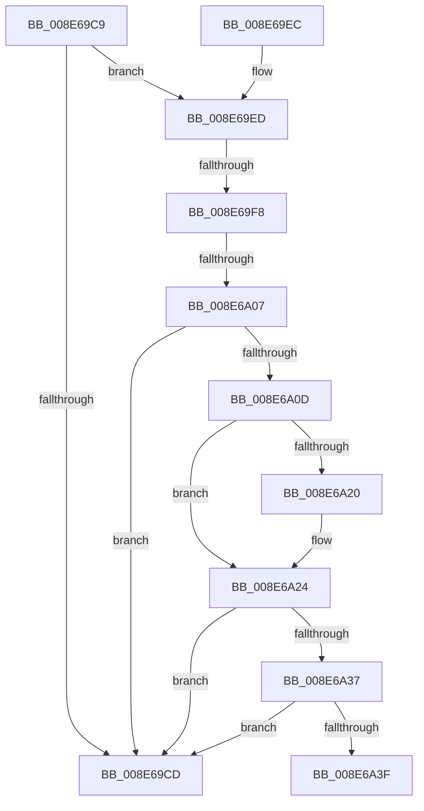

# sub_008E69C9

- RVA: `0x008E69C9`–`0x008E6A44` (길이 `123` bytes)
- VA: `0x00000001408E69C9`
- 실행 섹션: `PAGE`
- PDB 이름 있음: `아니요`; PDB Function 태그: `아니요`
- unwind 정보 RVA: `0x00086798`
- 디코드: `38`개 명령, `123/123` bytes 표시
- 미해석 바이트: `0` (있으면 어셈블리에 `.byte`로 보존)

> 이 문서는 커널 이미지의 기계어와 PDB 기호를 분석해 생성했습니다. 4번과 5번은 함수 원형과 자료형을 바이너리 사용 방식에서 추정한 C 해석이며 원본 소스 복구 결과는 아닙니다.

## 1. Dependencies

- 직접 호출 지점: **2**; 고유 호출 대상: **2**
- 직접 호출자로 확인된 함수: **0**
- RIP 상대 이미지 참조: **0**

### Outgoing calls
- `0x008E69D7` → [_security_check_cookie](../../text/6A/_security_check_cookie_function_006AC640.md) (function, `0x006AC640`)
- `0x008E6A2C` → [SeQuerySessionIdTokenEx](../9E/SeQuerySessionIdTokenEx_function_009E7680.md) (function, `0x009E7680`)

### Direct callers
- 이 함수 시작 RVA로 연결되는 직접 call은 확인되지 않았습니다. 간접 호출은 완전히 역산할 수 없습니다.

### Static image references
- 디코드된 RIP-relative 메모리 참조가 없습니다.

## 2. Other-region calls and transfers

- 다른 실행 섹션으로 향하는 call: **1**
  - `0x008E69D7` → [_security_check_cookie](../../text/6A/_security_check_cookie_function_006AC640.md) (`PAGE` → `.text`)
- call이 아닌 외부 분기/꼬리 이동: **3**
  - `0x008E69F2` → [sub_008E6A55 + 0x155](Unknown_function_008E6A55.md) (`tail-transfer`)
  - `0x008E6A01` → [sub_008E6A55 + 0x9B](Unknown_function_008E6A55.md) (`tail-transfer`)
  - `0x008E6A3F` → [sub_008E6A55 + 0x155](Unknown_function_008E6A55.md) (`tail-transfer`)

## 3. Assembly (complete function range)

```asm
008E69C9  85 C0                           test eax, eax
008E69CB  78 20                           js 0x1408e69ed
008E69CD  0F B6 C3                        movzx eax, bl
008E69D0  48 8B 4D 17                     mov rcx, qword ptr [rbp + 0x17]
008E69D4  48 33 CC                        xor rcx, rsp
008E69D7  E8 64 5C DC FF                  call 0x1406ac640
008E69DC  48 81 C4 A8 00 00 00            add rsp, 0xa8
008E69E3  41 5F                           pop r15
008E69E5  41 5E                           pop r14
008E69E7  5F                              pop rdi
008E69E8  5E                              pop rsi
008E69E9  5B                              pop rbx
008E69EA  5D                              pop rbp
008E69EB  C3                              ret
008E69EC  CC                              int3
008E69ED  3D 34 00 00 C0                  cmp eax, 0xc0000034
008E69F2  0F 85 B2 01 00 00               jne 0x1408e6baa
008E69F8  4C 8B 7F 30                     mov r15, qword ptr [rdi + 0x30]
008E69FC  B3 01                           mov bl, 1
008E69FE  4D 85 FF                        test r15, r15
008E6A01  0F 85 E9 00 00 00               jne 0x1408e6af0
008E6A07  83 7F 3C FF                     cmp dword ptr [rdi + 0x3c], -1
008E6A0B  74 C0                           je 0x1408e69cd
008E6A0D  48 8B 0E                        mov rcx, qword ptr [rsi]
008E6A10  C7 45 DB 00 00 00 00            mov dword ptr [rbp - 0x25], 0
008E6A17  C6 45 D7 00                     mov byte ptr [rbp - 0x29], 0
008E6A1B  48 85 C9                        test rcx, rcx
008E6A1E  75 04                           jne 0x1408e6a24
008E6A20  49 8B 4E 48                     mov rcx, qword ptr [r14 + 0x48]
008E6A24  4C 8D 45 D7                     lea r8, [rbp - 0x29]
008E6A28  48 8D 55 DB                     lea rdx, [rbp - 0x25]
008E6A2C  E8 4F 0C 10 00                  call 0x1409e7680
008E6A31  80 7D D7 00                     cmp byte ptr [rbp - 0x29], 0
008E6A35  75 96                           jne 0x1408e69cd
008E6A37  8B 47 3C                        mov eax, dword ptr [rdi + 0x3c]
008E6A3A  39 45 DB                        cmp dword ptr [rbp - 0x25], eax
008E6A3D  74 8E                           je 0x1408e69cd
008E6A3F  E9 66 01 00 00                  jmp 0x1408e6baa
```

## 4. C-style interpretation (structured pseudocode)

```c
__int64 __fastcall sub_008E69C9(void)
{
    __int64 result;
    __int64 v_rsp;

    if (sign_flag) goto loc_008E69ED;
loc_008E69CD:
    a1 = (*(unsigned __int64 *)(v_rbp + 23)) ^ (v_rsp);
    result = _security_check_cookie(a1, a2, a3, a4);
    v_rsp = (v_rsp) + (168);
    return result;
loc_008E69ED:
    if ((*(unsigned int *)(v_rdi + 60)) == -1) goto loc_008E69CD;
    *(unsigned int *)(v_rbp - 37) = 0;
    *(unsigned __int8 *)(v_rbp - 41) = 0;
    if (*(unsigned __int64 *)(v_rsi) == 0) {
        a1 = *(unsigned __int64 *)(v_r14 + 72);
    }
    result = SeQuerySessionIdTokenEx(a1, v_rbp - 37, v_rbp - 41, a4);
    if ((*(unsigned __int8 *)(v_rbp - 41)) != 0) goto loc_008E69CD;
    if ((*(unsigned int *)(v_rbp - 37)) == ((unsigned int)((unsigned int)(*(unsigned int *)(v_rdi + 60))))) goto loc_008E69CD;
}
```

## 5. (Beta) C Style

```c
void sub_008E69C9(void)
{
    int64_t result;
    int64_t local_rsp;

    if (sign_flag) goto loc_008E69ED;
loc_008E69CD:
    a1 = (*(uint64_t *)(local_rbp + 0x17)) ^ (local_rsp);
    result = _security_check_cookie(a1, a2, a3, a4);
    local_rsp = (local_rsp) + (168);
    return result;
loc_008E69ED:
    if ((*(uint32_t *)(local_rdi + 0x3C)) == -1) goto loc_008E69CD;
    *(uint32_t *)(local_rbp - 0x25) = 0;
    *(uint8_t *)(local_rbp - 0x29) = 0;
    if (*(uint64_t *)(local_rsi) == 0) {
        a1 = *(uint64_t *)(local_r14 + 0x48);
    }
    result = SeQuerySessionIdTokenEx(a1, local_rbp - 37, local_rbp - 41, a4);
    if ((*(uint8_t *)(local_rbp - 0x29)) != 0) goto loc_008E69CD;
    if ((*(uint32_t *)(local_rbp - 0x25)) == ((uint32_t)((uint32_t)(*(uint32_t *)(local_rdi + 0x3C))))) goto loc_008E69CD;
}
```

## 6. Execution-region graph

[열기: 2D/3D 그래프와 함수 탐색 컨트롤 패널](../../../control-panel.html?section=page&rva=0x008E69C9&view=graph)

- 2D 그래프는 위에서 아래로 흐르고, 3D 그래프는 빈 공간을 드래그해 회전합니다. Shift+드래그는 이동, 휠은 확대·축소, 함수 노드 선택은 대상 보고서 이동입니다.

### Static fallback


