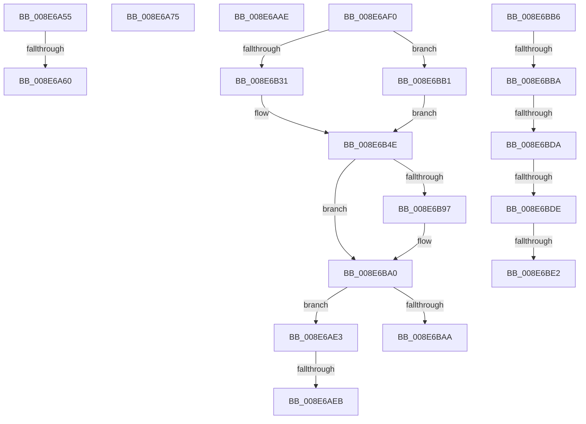

# sub_008E6A55

- RVA: `0x008E6A55`–`0x008E6BE4` (길이 `399` bytes)
- VA: `0x00000001408E6A55`
- 실행 섹션: `PAGE`
- PDB 이름 있음: `아니요`; PDB Function 태그: `아니요`
- unwind 정보 RVA: `0x000867C4`
- 디코드: `101`개 명령, `399/399` bytes 표시
- 미해석 바이트: `0` (있으면 어셈블리에 `.byte`로 보존)

> 이 문서는 커널 이미지의 기계어와 PDB 기호를 분석해 생성했습니다. 4번과 5번은 함수 원형과 자료형을 바이너리 사용 방식에서 추정한 C 해석이며 원본 소스 복구 결과는 아닙니다.

## 1. Dependencies

- 직접 호출 지점: **5**; 고유 호출 대상: **4**
- 직접 호출자로 확인된 함수: **0**
- RIP 상대 이미지 참조: **2**

### Outgoing calls
- `0x008E6AA0` → [PiPnpRtlApplyMandatoryFilters](PiPnpRtlApplyMandatoryFilters_function_008E5C80.md) (function, `0x008E5C80`)
- `0x008E6AD5` → [PiPnpRtlApplyMandatoryFilters](PiPnpRtlApplyMandatoryFilters_function_008E5C80.md) (function, `0x008E5C80`)
- `0x008E6B35` → [SeCaptureSubjectContext](../86/SeCaptureSubjectContext_function_0086B820.md) (function, `0x0086B820`)
- `0x008E6B8A` → [SeAccessCheck](../../text/3A/SeAccessCheck_function_003A6BC0.md) (function, `0x003A6BC0`)
- `0x008E6B9B` → [SeReleaseSubjectContext](../86/SeReleaseSubjectContext_function_0086B710.md) (function, `0x0086B710`)

### Direct callers
- 이 함수 시작 RVA로 연결되는 직접 call은 확인되지 않았습니다. 간접 호출은 완전히 역산할 수 없습니다.

### Static image references
- `0x008E6A60` → RVA `0x00000000` (`image boundary/outside`; read)
- `0x008E6A79` → RVA `0x00E66398` (`.data`; read)

## 2. Other-region calls and transfers

- 다른 실행 섹션으로 향하는 call: **1**
  - `0x008E6B8A` → [SeAccessCheck](../../text/3A/SeAccessCheck_function_003A6BC0.md) (`PAGE` → `.text`)
- call이 아닌 외부 분기/꼬리 이동: **10**
  - `0x008E6A5A` → [sub_008E69C9 + 0x4](Unknown_function_008E69C9.md) (`tail-transfer`)
  - `0x008E6AA9` → [sub_008E69C9](Unknown_function_008E69C9.md) (`tail-transfer`)
  - `0x008E6ADE` → [sub_008E69C9](Unknown_function_008E69C9.md) (`tail-transfer`)
  - `0x008E6AE5` → [sub_008E69C9 + 0x4](Unknown_function_008E69C9.md) (`tail-transfer`)
  - `0x008E6AEB` → [sub_008E69C9 + 0x3E](Unknown_function_008E69C9.md) (`tail-transfer`)
  - `0x008E6BAC` → [sub_008E69C9 + 0x4](Unknown_function_008E69C9.md) (`tail-transfer`)
  - `0x008E6BB8` → [PiUEventNotifyClient + 0x38](PiUEventNotifyClient_function_008E6BEC.md) (`tail-transfer`)
  - `0x008E6BD8` → [PiUEventNotifyClient + 0x58](PiUEventNotifyClient_function_008E6BEC.md) (`tail-transfer`)
  - `0x008E6BDC` → [PiUEventNotifyClient + 0x5C](PiUEventNotifyClient_function_008E6BEC.md) (`tail-transfer`)
  - `0x008E6BE0` → [PiUEventNotifyClient + 0x60](PiUEventNotifyClient_function_008E6BEC.md) (`tail-transfer`)

## 3. Assembly (complete function range)

```asm
008E6A55  FF C8                           dec eax
008E6A57  83 F8 0A                        cmp eax, 0xa
008E6A5A  0F 87 6D FF FF FF               ja 0x1408e69cd
008E6A60  48 8D 15 99 95 71 FF            lea rdx, [rip - 0x8e6a67]
008E6A67  48 98                           cdqe
008E6A69  8B 8C 82 B8 6B 8E 00            mov ecx, dword ptr [rdx + rax*4 + 0x8e6bb8]
008E6A70  48 03 CA                        add rcx, rdx
008E6A73  FF E1                           jmp rcx
008E6A75  CC                              int3
008E6A76  CC                              int3
008E6A77  CC                              int3
008E6A78  CC                              int3
008E6A79  48 8B 0D 18 F9 57 00            mov rcx, qword ptr [rip + 0x57f918]
008E6A80  48 8D 45 D7                     lea rax, [rbp - 0x29]
008E6A84  45 33 C9                        xor r9d, r9d
008E6A87  48 89 44 24 28                  mov qword ptr [rsp + 0x28], rax
008E6A8C  49 8D 76 38                     lea rsi, [r14 + 0x38]
008E6A90  48 8D 97 80 00 00 00            lea rdx, [rdi + 0x80]
008E6A97  48 89 74 24 20                  mov qword ptr [rsp + 0x20], rsi
008E6A9C  45 8D 41 01                     lea r8d, [r9 + 1]
008E6AA0  E8 DB F1 FF FF                  call 0x1408e5c80
008E6AA5  0F B6 5D D7                     movzx ebx, byte ptr [rbp - 0x29]
008E6AA9  E9 1B FF FF FF                  jmp 0x1408e69c9
008E6AAE  48 8B 0D E3 F8 57 00            mov rcx, qword ptr [rip + 0x57f8e3]
008E6AB5  48 8D 45 D7                     lea rax, [rbp - 0x29]
008E6AB9  45 33 C9                        xor r9d, r9d
008E6ABC  48 89 44 24 28                  mov qword ptr [rsp + 0x28], rax
008E6AC1  49 8D 76 38                     lea rsi, [r14 + 0x38]
008E6AC5  48 8D 97 90 00 00 00            lea rdx, [rdi + 0x90]
008E6ACC  48 89 74 24 20                  mov qword ptr [rsp + 0x20], rsi
008E6AD1  45 8D 41 03                     lea r8d, [r9 + 3]
008E6AD5  E8 A6 F1 FF FF                  call 0x1408e5c80
008E6ADA  0F B6 5D D7                     movzx ebx, byte ptr [rbp - 0x29]
008E6ADE  E9 E6 FE FF FF                  jmp 0x1408e69c9
008E6AE3  84 DB                           test bl, bl
008E6AE5  0F 84 E2 FE FF FF               je 0x1408e69cd
008E6AEB  E9 17 FF FF FF                  jmp 0x1408e6a07
008E6AF0  C7 45 07 01 00 02 00            mov dword ptr [rbp + 7], 0x20001
008E6AF7  0F 57 C0                        xorps xmm0, xmm0
008E6AFA  C7 45 0B 00 00 02 00            mov dword ptr [rbp + 0xb], 0x20000
008E6B01  0F B6 C3                        movzx eax, bl
008E6B04  C7 45 0F 00 00 02 00            mov dword ptr [rbp + 0xf], 0x20000
008E6B0B  C7 45 13 01 00 0F 00            mov dword ptr [rbp + 0x13], 0xf0001
008E6B12  C7 45 DF 00 00 00 00            mov dword ptr [rbp - 0x21], 0
008E6B19  C7 45 DB 00 00 00 00            mov dword ptr [rbp - 0x25], 0
008E6B20  0F 11 45 E7                     movups xmmword ptr [rbp - 0x19], xmm0
008E6B24  0F 11 45 F7                     movups xmmword ptr [rbp - 9], xmm0
008E6B28  48 85 F6                        test rsi, rsi
008E6B2B  0F 85 80 00 00 00               jne 0x1408e6bb1
008E6B31  48 8D 4D E7                     lea rcx, [rbp - 0x19]
008E6B35  E8 E6 4C F8 FF                  call 0x14086b820
008E6B3A  65 48 8B 04 25 88 01 00 00      mov rax, qword ptr gs:[0x188]
008E6B43  48 8D 55 E7                     lea rdx, [rbp - 0x19]
008E6B47  0F B6 80 32 02 00 00            movzx eax, byte ptr [rax + 0x232]
008E6B4E  48 8D 4D DB                     lea rcx, [rbp - 0x25]
008E6B52  41 B9 01 00 00 00               mov r9d, 1
008E6B58  48 89 4C 24 48                  mov qword ptr [rsp + 0x48], rcx
008E6B5D  45 33 C0                        xor r8d, r8d
008E6B60  48 8D 4D DF                     lea rcx, [rbp - 0x21]
008E6B64  48 89 4C 24 40                  mov qword ptr [rsp + 0x40], rcx
008E6B69  49 8B CF                        mov rcx, r15
008E6B6C  88 44 24 38                     mov byte ptr [rsp + 0x38], al
008E6B70  48 8D 45 07                     lea rax, [rbp + 7]
008E6B74  48 89 44 24 30                  mov qword ptr [rsp + 0x30], rax
008E6B79  48 C7 44 24 28 00 00 00 00      mov qword ptr [rsp + 0x28], 0
008E6B82  C7 44 24 20 00 00 00 00         mov dword ptr [rsp + 0x20], 0
008E6B8A  E8 31 00 AC FF                  call 0x1403a6bc0
008E6B8F  0F B6 D8                        movzx ebx, al
008E6B92  48 85 F6                        test rsi, rsi
008E6B95  75 09                           jne 0x1408e6ba0
008E6B97  48 8D 4D E7                     lea rcx, [rbp - 0x19]
008E6B9B  E8 70 4B F8 FF                  call 0x14086b710
008E6BA0  83 7D DB 00                     cmp dword ptr [rbp - 0x25], 0
008E6BA4  0F 8D 39 FF FF FF               jge 0x1408e6ae3
008E6BAA  32 DB                           xor bl, bl
008E6BAC  E9 1C FE FF FF                  jmp 0x1408e69cd
008E6BB1  48 8B D6                        mov rdx, rsi
008E6BB4  EB 98                           jmp 0x1408e6b4e
008E6BB6  66 90                           nop
008E6BB8  79 6A                           jns 0x1408e6c24
008E6BBA  8E 00                           mov es, word ptr [rax]
008E6BBC  AE                              scasb al, byte ptr [rdi]
008E6BBD  6A 8E                           push -0x72
008E6BBF  00 79 6A                        add byte ptr [rcx + 0x6a], bh
008E6BC2  8E 00                           mov es, word ptr [rax]
008E6BC4  CD 69                           int 0x69
008E6BC6  8E 00                           mov es, word ptr [rax]
008E6BC8  CD 69                           int 0x69
008E6BCA  8E 00                           mov es, word ptr [rax]
008E6BCC  CD 69                           int 0x69
008E6BCE  8E 00                           mov es, word ptr [rax]
008E6BD0  CD 69                           int 0x69
008E6BD2  8E 00                           mov es, word ptr [rax]
008E6BD4  CD 69                           int 0x69
008E6BD6  8E 00                           mov es, word ptr [rax]
008E6BD8  79 6A                           jns 0x1408e6c44
008E6BDA  8E 00                           mov es, word ptr [rax]
008E6BDC  79 6A                           jns 0x1408e6c48
008E6BDE  8E 00                           mov es, word ptr [rax]
008E6BE0  79 6A                           jns 0x1408e6c4c
008E6BE2  8E 00                           mov es, word ptr [rax]
```

## 4. C-style interpretation (structured pseudocode)

```c
__int64 __fastcall sub_008E6A55(__int64 a1, __int64 a2, __int64 a3, int a4)
{
    __int64 result;
    unsigned __int64 v_stack_p20;
    unsigned __int64 v_stack_p28;
    unsigned __int64 v_stack_p30;
    unsigned __int8 v_stack_p38;
    unsigned __int64 v_stack_p40;
    unsigned __int64 v_stack_p48;

    result = (unsigned int)((result) - 1);
    a1 = ((unsigned int)(*(unsigned int *)(v_rip - 9333351 + result * 4 + 9333688))) + (v_rip - 9333351);
}
```

## 5. (Beta) C Style

```c
int64_t sub_008E6A55(int64_t Arg1, int64_t Arg2, int64_t Arg3, int32_t Arg4)
{
    int64_t result;
    uint64_t v_stack_p20;
    uint64_t v_stack_p28;
    uint64_t v_stack_p30;
    uint8_t v_stack_p38;
    uint64_t v_stack_p40;
    uint64_t v_stack_p48;

    result = (uint32_t)((result) - 1);
    Arg1 = ((uint32_t)(*(uint32_t *)(v_rip - 0x8E6A67 + result * 4 + 0x8E6BB8))) + (v_rip - 9333351);
}
```

## 6. Execution-region graph

[열기: 2D/3D 그래프와 함수 탐색 컨트롤 패널](../../../control-panel.html?section=page&rva=0x008E6A55&view=graph)

- 2D 그래프는 위에서 아래로 흐르고, 3D 그래프는 빈 공간을 드래그해 회전합니다. Shift+드래그는 이동, 휠은 확대·축소, 함수 노드 선택은 대상 보고서 이동입니다.

### Static fallback


