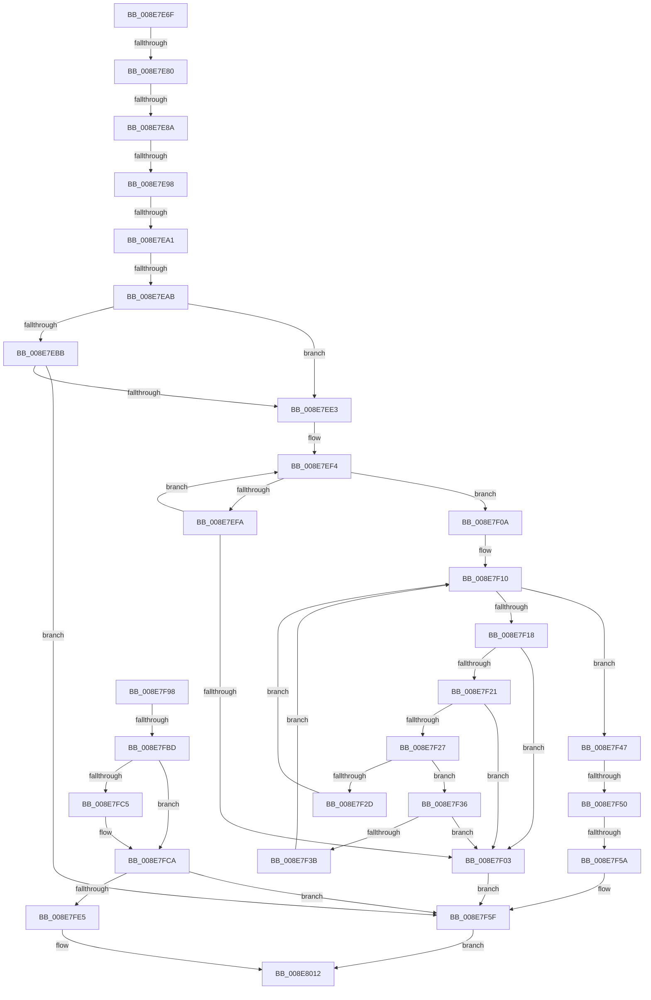

# sub_008E7E6F

- RVA: `0x008E7E6F`–`0x008E802B` (길이 `444` bytes)
- VA: `0x00000001408E7E6F`
- 실행 섹션: `PAGE`
- PDB 이름 있음: `아니요`; PDB Function 태그: `아니요`
- unwind 정보 RVA: `0x0008693C`
- 디코드: `113`개 명령, `444/444` bytes 표시
- 미해석 바이트: `0` (있으면 어셈블리에 `.byte`로 보존)

> 이 문서는 커널 이미지의 기계어와 PDB 기호를 분석해 생성했습니다. 4번과 5번은 함수 원형과 자료형을 바이너리 사용 방식에서 추정한 C 해석이며 원본 소스 복구 결과는 아닙니다.

## 1. Dependencies

- 직접 호출 지점: **2**; 고유 호출 대상: **2**
- 직접 호출자로 확인된 함수: **0**
- RIP 상대 이미지 참조: **0**

### Outgoing calls
- `0x008E7EC8` → [ExAllocatePool2](../../poolcode/B8/ExAllocatePool2_function_00B820F0.md) (function, `0x00B820F0`)
- `0x008E8017` → [PiCMReturnBufferResultData](PiCMReturnBufferResultData_function_008ED6D0.md) (function, `0x008ED6D0`)

### Direct callers
- 이 함수 시작 RVA로 연결되는 직접 call은 확인되지 않았습니다. 간접 호출은 완전히 역산할 수 없습니다.

### Static image references
- 디코드된 RIP-relative 메모리 참조가 없습니다.

## 2. Other-region calls and transfers

- 다른 실행 섹션으로 향하는 call: **1**
  - `0x008E7EC8` → [ExAllocatePool2](../../poolcode/B8/ExAllocatePool2_function_00B820F0.md) (`PAGE` → `POOLCODE`)
- call이 아닌 외부 분기/꼬리 이동: **9**
  - `0x008E7E7A` → [sub_008E80AE + 0x111](Unknown_function_008E80AE.md) (`tail-transfer`)
  - `0x008E7E84` → [sub_008E80AE + 0x111](Unknown_function_008E80AE.md) (`tail-transfer`)
  - `0x008E7E92` → [sub_008E80AE + 0x111](Unknown_function_008E80AE.md) (`tail-transfer`)
  - `0x008E7E9B` → [sub_008E80AE + 0x111](Unknown_function_008E80AE.md) (`tail-transfer`)
  - `0x008E7EA5` → [sub_008E80AE + 0x111](Unknown_function_008E80AE.md) (`tail-transfer`)
  - `0x008E7F4A` → [sub_008E80AE](Unknown_function_008E80AE.md) (`tail-transfer`)
  - `0x008E7F54` → [sub_008E80AE + 0xA](Unknown_function_008E80AE.md) (`tail-transfer`)
  - `0x008E7FB7` → [sub_008E80AE + 0x139](Unknown_function_008E80AE.md) (`tail-transfer`)
  - `0x008E8029` → [sub_008E802B + 0xD](Unknown_function_008E802B.md) (`tail-transfer`)

## 3. Assembly (complete function range)

```asm
008E7E6F  48 89 B4 24 D8 00 00 00         mov qword ptr [rsp + 0xd8], rsi
008E7E77  4D 85 FF                        test r15, r15
008E7E7A  0F 84 3F 03 00 00               je 0x1408e81bf
008E7E80  39 6C 24 7C                     cmp dword ptr [rsp + 0x7c], ebp
008E7E84  0F 85 35 03 00 00               jne 0x1408e81bf
008E7E8A  83 BC 24 80 00 00 00 01         cmp dword ptr [rsp + 0x80], 1
008E7E92  0F 85 27 03 00 00               jne 0x1408e81bf
008E7E98  48 85 FF                        test rdi, rdi
008E7E9B  0F 84 1E 03 00 00               je 0x1408e81bf
008E7EA1  41 83 FD 14                     cmp r13d, 0x14
008E7EA5  0F 82 14 03 00 00               jb 0x1408e81bf
008E7EAB  33 F6                           xor esi, esi
008E7EAD  41 8D 45 EC                     lea eax, [r13 - 0x14]
008E7EB1  83 F8 02                        cmp eax, 2
008E7EB4  0F 43 F0                        cmovae esi, eax
008E7EB7  85 F6                           test esi, esi
008E7EB9  74 28                           je 0x1408e7ee3
008E7EBB  8B D6                           mov edx, esi
008E7EBD  B9 00 01 00 00                  mov ecx, 0x100
008E7EC2  41 B8 50 6E 70 34               mov r8d, 0x34706e50
008E7EC8  E8 23 A2 29 00                  call 0x140b820f0
008E7ECD  48 85 C0                        test rax, rax
008E7ED0  48 8B E8                        mov rbp, rax
008E7ED3  B8 9A 00 00 C0                  mov eax, 0xc000009a
008E7ED8  0F 44 D8                        cmove ebx, eax
008E7EDB  85 DB                           test ebx, ebx
008E7EDD  0F 88 7C 00 00 00               js 0x1408e7f5f
008E7EE3  33 DB                           xor ebx, ebx
008E7EE5  B9 C8 00 00 00                  mov ecx, 0xc8
008E7EEA  44 8B C3                        mov r8d, ebx
008E7EED  49 8B C7                        mov rax, r15
008E7EF0  44 8D 4B 01                     lea r9d, [rbx + 1]
008E7EF4  66 44 39 20                     cmp word ptr [rax], r12w
008E7EF8  74 10                           je 0x1408e7f0a
008E7EFA  48 83 C0 02                     add rax, 2
008E7EFE  49 2B C9                        sub rcx, r9
008E7F01  75 F1                           jne 0x1408e7ef4
008E7F03  BB 33 00 00 C0                  mov ebx, 0xc0000033
008E7F08  EB 55                           jmp 0x1408e7f5f
008E7F0A  49 8B D7                        mov rdx, r15
008E7F0D  0F 1F 00                        nop dword ptr [rax]
008E7F10  0F B7 02                        movzx eax, word ptr [rdx]
008E7F13  66 85 C0                        test ax, ax
008E7F16  74 2F                           je 0x1408e7f47
008E7F18  8D 48 DF                        lea ecx, [rax - 0x21]
008E7F1B  66 83 F9 5E                     cmp cx, 0x5e
008E7F1F  77 E2                           ja 0x1408e7f03
008E7F21  66 83 F8 2C                     cmp ax, 0x2c
008E7F25  74 DC                           je 0x1408e7f03
008E7F27  66 83 F8 5C                     cmp ax, 0x5c
008E7F2B  74 09                           je 0x1408e7f36
008E7F2D  41 FF C0                        inc r8d
008E7F30  48 83 C2 02                     add rdx, 2
008E7F34  EB DA                           jmp 0x1408e7f10
008E7F36  45 85 C0                        test r8d, r8d
008E7F39  74 C8                           je 0x1408e7f03
008E7F3B  41 FF C1                        inc r9d
008E7F3E  44 8B C3                        mov r8d, ebx
008E7F41  48 83 C2 02                     add rdx, 2
008E7F45  EB C9                           jmp 0x1408e7f10
008E7F47  45 85 C0                        test r8d, r8d
008E7F4A  0F 84 5E 01 00 00               je 0x1408e80ae
008E7F50  41 83 F9 03                     cmp r9d, 3
008E7F54  0F 84 5E 01 00 00               je 0x1408e80b8
008E7F5A  BB 33 00 00 C0                  mov ebx, 0xc0000033
008E7F5F  48 8B 84 24 F8 00 00 00         mov rax, qword ptr [rsp + 0xf8]
008E7F67  43 8D 14 24                     lea edx, [r12 + r12]
008E7F6B  48 89 44 24 40                  mov qword ptr [rsp + 0x40], rax
008E7F70  48 8B 84 24 E0 00 00 00         mov rax, qword ptr [rsp + 0xe0]
008E7F78  44 89 6C 24 38                  mov dword ptr [rsp + 0x38], r13d
008E7F7D  48 89 44 24 30                  mov qword ptr [rsp + 0x30], rax
008E7F82  8B 84 24 98 00 00 00            mov eax, dword ptr [rsp + 0x98]
008E7F89  89 44 24 28                     mov dword ptr [rsp + 0x28], eax
008E7F8D  33 C0                           xor eax, eax
008E7F8F  89 44 24 20                     mov dword ptr [rsp + 0x20], eax
008E7F93  45 33 C9                        xor r9d, r9d
008E7F96  EB 7A                           jmp 0x1408e8012
008E7F98  48 85 D2                        test rdx, rdx
008E7F9B  48 8D 41 FE                     lea rax, [rcx - 2]
008E7F9F  BE 05 00 00 80                  mov esi, 0x80000005
008E7FA4  48 0F 45 C1                     cmovne rax, rcx
008E7FA8  33 C9                           xor ecx, ecx
008E7FAA  48 85 D2                        test rdx, rdx
008E7FAD  0F 45 F1                        cmovne esi, ecx
008E7FB0  66 89 08                        mov word ptr [rax], cx
008E7FB3  8B DE                           mov ebx, esi
008E7FB5  85 F6                           test esi, esi
008E7FB7  0F 88 2A 02 00 00               js 0x1408e81e7
008E7FBD  81 FB 05 00 00 80               cmp ebx, 0x80000005
008E7FC3  75 05                           jne 0x1408e7fca
008E7FC5  BB 23 00 00 C0                  mov ebx, 0xc0000023
008E7FCA  44 8B 64 24 50                  mov r12d, dword ptr [rsp + 0x50]
008E7FCF  48 8B BC 24 E0 00 00 00         mov rdi, qword ptr [rsp + 0xe0]
008E7FD7  41 D1 EC                        shr r12d, 1
008E7FDA  41 FF C4                        inc r12d
008E7FDD  85 DB                           test ebx, ebx
008E7FDF  0F 88 7A FF FF FF               js 0x1408e7f5f
008E7FE5  48 8B 84 24 F8 00 00 00         mov rax, qword ptr [rsp + 0xf8]
008E7FED  43 8D 14 24                     lea edx, [r12 + r12]
008E7FF1  48 89 44 24 40                  mov qword ptr [rsp + 0x40], rax
008E7FF6  4C 8B CD                        mov r9, rbp
008E7FF9  8B 84 24 98 00 00 00            mov eax, dword ptr [rsp + 0x98]
008E8000  44 89 6C 24 38                  mov dword ptr [rsp + 0x38], r13d
008E8005  48 89 7C 24 30                  mov qword ptr [rsp + 0x30], rdi
008E800A  89 44 24 28                     mov dword ptr [rsp + 0x28], eax
008E800E  89 54 24 20                     mov dword ptr [rsp + 0x20], edx
008E8012  45 33 C0                        xor r8d, r8d
008E8015  8B CB                           mov ecx, ebx
008E8017  E8 B4 56 00 00                  call 0x1408ed6d0
008E801C  48 8B B4 24 D8 00 00 00         mov rsi, qword ptr [rsp + 0xd8]
008E8024  8B D8                           mov ebx, eax
008E8026  48 85 ED                        test rbp, rbp
008E8029  74 0D                           je 0x1408e8038
```

## 4. C-style interpretation (structured pseudocode)

```c
__int64 __fastcall sub_008E7E6F(__int64 a1, __int64 a2, __int64 a3, __int64 a4, __int64 a5, __int64 a6, __int64 a7, __int64 a8, __int64 a9, __int64 a10, __int64 a11, __int64 a12, __int64 a13, __int64 a14, __int64 a15, unsigned int a16, __int64 a17, __int64 a18, unsigned int a19, __int64 a20, __int64 a21, __int64 a22, __int64 a23, __int64 a24, __int64 a25, __int64 a26, __int64 a27, __int64 a28, __int64 a29, __int64 a30, __int64 a31)
{
    __int64 result;
    __int64 v_rbx;
    __int64 v_rsi;
    unsigned int v_stack_p20;
    unsigned int v_stack_p28;
    unsigned __int64 v_stack_p30;
    unsigned int v_stack_p38;
    unsigned __int64 v_stack_p40;
    unsigned int v_stack_p50;
    unsigned int v_stack_p7C;
    unsigned int v_stack_p98;
    unsigned __int64 v_stack_pD8;
    unsigned __int64 v_stack_pE0;
    unsigned __int64 v_stack_pF8;

    v_stack_pD8 = v_rsi;
    v_rsi = 0;
    if (((unsigned int)(v_r13 - 20)) >= 2) { v_rsi = (unsigned int)(v_r13 - 20); }
    if ((unsigned int)(v_rsi) == 0) goto loc_008E7EE3;
    result = ExAllocatePool2(256, (unsigned int)((unsigned int)(v_rsi)), (unsigned int)(0x34706E50ULL), a4);
    if (result == 0) { v_rbx = (unsigned int)((unsigned int)(0xC000009AULL)); }
    if (sign_flag) goto loc_008E7F5F;
loc_008E7EE3:
    v_rbx = 0;
loc_008E7EF4:
    if ((*(unsigned __int16 *)(v_r15)) == ((unsigned __int16)(v_r12))) goto loc_008E7F0A;
    result = (v_r15) + (2);
    a1 = (200) - (v_rbx + 1);
    if (condition_is_not_equal) goto loc_008E7EF4;
loc_008E7F03:
    goto loc_008E7F5F;
loc_008E7F0A:
loc_008E7F10:
    if ((unsigned __int16)(*(unsigned __int16 *)(v_r15)) == 0) goto loc_008E7F47;
    if (((unsigned __int16)(*(unsigned __int16 *)(v_r15) - 33)) > 94) goto loc_008E7F03;
    if (((unsigned __int16)(*(unsigned __int16 *)(v_r15))) == 44) goto loc_008E7F03;
    if (((unsigned __int16)(*(unsigned __int16 *)(v_r15))) == 92) goto loc_008E7F36;
    a3 = (unsigned int)((0) + 1);
    a2 = (v_r15) + (2);
    goto loc_008E7F10;
loc_008E7F36:
    if ((unsigned int)(a3) == 0) goto loc_008E7F03;
    a4 = (unsigned int)((v_rbx + 1) + 1);
    a2 = (a2) + (2);
    goto loc_008E7F10;
loc_008E7F47:
loc_008E7F5F:
    v_stack_p40 = a31;
    v_stack_p38 = (unsigned int)(v_r13);
    v_stack_p30 = a28;
    v_stack_p28 = (unsigned int)((unsigned int)(a19));
    result = 0;
    v_stack_p20 = 0;
    a4 = 0;
    goto loc_008E8012;
loc_008E8012:
    a3 = 0;
    result = PiCMReturnBufferResultData((unsigned int)((unsigned int)((unsigned int)(0xC0000033ULL))), v_r12 + v_r12 * 1, a3, a4);
}
```

## 5. (Beta) C Style

```c
int64_t sub_008E7E6F(int64_t Arg1, int64_t Arg2, int64_t Arg3, int64_t Arg4, uint64_t Arg5, uint64_t Arg6, uint64_t Arg7, uint64_t Arg8, uint64_t Arg9, uint64_t Arg10, uint64_t Arg11, uint64_t Arg12, uint64_t Arg13, uint64_t Arg14, uint64_t Arg15, uint32_t Arg16, uint64_t Arg17, uint64_t Arg18, uint32_t Arg19, uint64_t Arg20, uint64_t Arg21, uint64_t Arg22, uint64_t Arg23, uint64_t Arg24, uint64_t Arg25, uint64_t Arg26, int64_t Arg27, int64_t Arg28, uint64_t Arg29, uint64_t Arg30, int64_t Arg31)
{
    int64_t result;
    int64_t local_rbx;
    int64_t local_rsi;
    uint32_t v_stack_p20;
    uint32_t v_stack_p28;
    uint64_t v_stack_p30;
    uint32_t v_stack_p38;
    uint64_t v_stack_p40;
    uint32_t v_stack_p50;
    uint32_t v_stack_p7C;
    uint32_t v_stack_p98;
    uint64_t v_stack_pD8;
    uint64_t v_stack_pE0;
    uint64_t v_stack_pF8;

    v_stack_pD8 = local_rsi;
    local_rsi = 0;
    if (((uint32_t)(local_r13 - 20)) >= 2) { local_rsi = (uint32_t)(local_r13 - 20); }
    if ((uint32_t)(local_rsi) == 0) goto loc_008E7EE3;
    result = ExAllocatePool2(256, (uint32_t)((uint32_t)(local_rsi)), (uint32_t)(0x34706E50ULL), Arg4);
    if (result == 0) { local_rbx = (uint32_t)((uint32_t)(0xC000009AULL)); }
    if (sign_flag) goto loc_008E7F5F;
loc_008E7EE3:
    local_rbx = 0;
loc_008E7EF4:
    if ((*(uint16_t *)(local_r15)) == ((uint16_t)(local_r12))) goto loc_008E7F0A;
    result = (local_r15) + (2);
    Arg1 = (200) - (local_rbx + 1);
    if (condition_is_not_equal) goto loc_008E7EF4;
loc_008E7F03:
    goto loc_008E7F5F;
loc_008E7F0A:
loc_008E7F10:
    if ((uint16_t)(*(uint16_t *)(local_r15)) == 0) goto loc_008E7F47;
    if (((uint16_t)(*(uint16_t *)(local_r15) - 33)) > 94) goto loc_008E7F03;
    if (((uint16_t)(*(uint16_t *)(local_r15))) == 44) goto loc_008E7F03;
    if (((uint16_t)(*(uint16_t *)(local_r15))) == 92) goto loc_008E7F36;
    Arg3 = (uint32_t)((0) + 1);
    Arg2 = (local_r15) + (2);
    goto loc_008E7F10;
loc_008E7F36:
    if ((uint32_t)(Arg3) == 0) goto loc_008E7F03;
    Arg4 = (uint32_t)((local_rbx + 1) + 1);
    Arg2 = (Arg2) + (2);
    goto loc_008E7F10;
loc_008E7F47:
loc_008E7F5F:
    v_stack_p40 = Arg31;
    v_stack_p38 = (uint32_t)(local_r13);
    v_stack_p30 = Arg28;
    v_stack_p28 = (uint32_t)((uint32_t)(Arg19));
    result = 0;
    v_stack_p20 = 0;
    Arg4 = 0;
    goto loc_008E8012;
loc_008E8012:
    Arg3 = 0;
    result = PiCMReturnBufferResultData((uint32_t)((uint32_t)((uint32_t)(0xC0000033ULL))), local_r12 + local_r12 * 1, Arg3, Arg4);
}
```

## 6. Execution-region graph

[열기: 2D/3D 그래프와 함수 탐색 컨트롤 패널](../../../control-panel.html?section=page&rva=0x008E7E6F&view=graph)

- 2D 그래프는 위에서 아래로 흐르고, 3D 그래프는 빈 공간을 드래그해 회전합니다. Shift+드래그는 이동, 휠은 확대·축소, 함수 노드 선택은 대상 보고서 이동입니다.

### Static fallback


