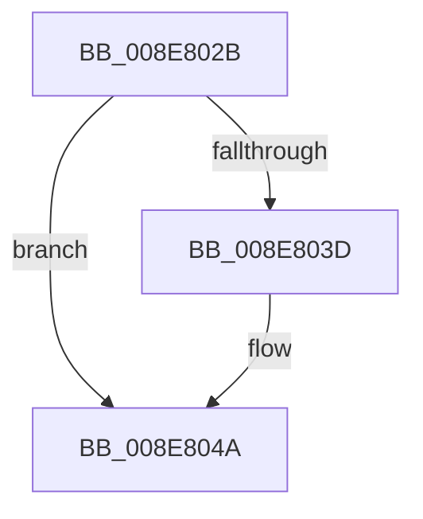

# sub_008E802B

- RVA: `0x008E802B`–`0x008E807F` (길이 `84` bytes)
- VA: `0x00000001408E802B`
- 실행 섹션: `PAGE`
- PDB 이름 있음: `아니요`; PDB Function 태그: `아니요`
- unwind 정보 RVA: `0x00086950`
- 디코드: `16`개 명령, `84/84` bytes 표시
- 미해석 바이트: `0` (있으면 어셈블리에 `.byte`로 보존)

> 이 문서는 커널 이미지의 기계어와 PDB 기호를 분석해 생성했습니다. 4번과 5번은 함수 원형과 자료형을 바이너리 사용 방식에서 추정한 C 해석이며 원본 소스 복구 결과는 아닙니다.

## 1. Dependencies

- 직접 호출 지점: **2**; 고유 호출 대상: **1**
- 직접 호출자로 확인된 함수: **0**
- RIP 상대 이미지 참조: **0**

### Outgoing calls
- `0x008E8033` → [ExFreePoolWithTag](../../poolcode/B8/ExFreePoolWithTag_function_00B82870.md) (function, `0x00B82870`)
- `0x008E8045` → [ExFreePoolWithTag](../../poolcode/B8/ExFreePoolWithTag_function_00B82870.md) (function, `0x00B82870`)

### Direct callers
- 이 함수 시작 RVA로 연결되는 직접 call은 확인되지 않았습니다. 간접 호출은 완전히 역산할 수 없습니다.

### Static image references
- 디코드된 RIP-relative 메모리 참조가 없습니다.

## 2. Other-region calls and transfers

- 다른 실행 섹션으로 향하는 call: **2**
  - `0x008E8033` → [ExFreePoolWithTag](../../poolcode/B8/ExFreePoolWithTag_function_00B82870.md) (`PAGE` → `POOLCODE`)
  - `0x008E8045` → [ExFreePoolWithTag](../../poolcode/B8/ExFreePoolWithTag_function_00B82870.md) (`PAGE` → `POOLCODE`)
- call이 아닌 외부 분기/꼬리 이동: **1**
  - `0x008E807D` → [sub_008E807F + 0x12](Unknown_function_008E807F.md) (`tail-transfer`)

## 3. Assembly (complete function range)

```asm
008E802B  BA 50 6E 70 34                  mov edx, 0x34706e50
008E8030  48 8B CD                        mov rcx, rbp
008E8033  E8 38 A8 29 00                  call 0x140b82870
008E8038  4D 85 F6                        test r14, r14
008E803B  74 0D                           je 0x1408e804a
008E803D  BA 50 6E 70 34                  mov edx, 0x34706e50
008E8042  49 8B CE                        mov rcx, r14
008E8045  E8 26 A8 29 00                  call 0x140b82870
008E804A  4C 8B B4 24 A8 00 00 00         mov r14, qword ptr [rsp + 0xa8]
008E8052  4D 85 FF                        test r15, r15
008E8055  4C 8B BC 24 A0 00 00 00         mov r15, qword ptr [rsp + 0xa0]
008E805D  4C 8B AC 24 B0 00 00 00         mov r13, qword ptr [rsp + 0xb0]
008E8065  4C 8B A4 24 B8 00 00 00         mov r12, qword ptr [rsp + 0xb8]
008E806D  48 8B BC 24 E8 00 00 00         mov rdi, qword ptr [rsp + 0xe8]
008E8075  48 8B AC 24 D0 00 00 00         mov rbp, qword ptr [rsp + 0xd0]
008E807D  74 12                           je 0x1408e8091
```

## 4. C-style interpretation (structured pseudocode)

```c
__int64 __fastcall sub_008E802B(__int64 a1, __int64 a2, __int64 a3, __int64 a4, __int64 a5, __int64 a6, __int64 a7, __int64 a8, __int64 a9, __int64 a10, __int64 a11, __int64 a12, __int64 a13, __int64 a14, __int64 a15, __int64 a16, __int64 a17, __int64 a18, __int64 a19, __int64 a20, __int64 a21, __int64 a22, __int64 a23, __int64 a24, __int64 a25, __int64 a26, __int64 a27, __int64 a28, __int64 a29)
{
    __int64 result;

    result = ExFreePoolWithTag(v_rbp, (unsigned int)(0x34706E50ULL), a3, a4);
    if (v_r14 != 0) {
        a2 = 0x34706E50ULL;
        a1 = v_r14;
        result = ExFreePoolWithTag(a1, a2, a3, a4);
    }
}
```

## 5. (Beta) C Style

```c
int64_t sub_008E802B(int64_t Arg1, int64_t Arg2, int64_t Arg3, int64_t Arg4, uint64_t Arg5, uint64_t Arg6, uint64_t Arg7, uint64_t Arg8, uint64_t Arg9, uint64_t Arg10, uint64_t Arg11, uint64_t Arg12, uint64_t Arg13, uint64_t Arg14, uint64_t Arg15, uint64_t Arg16, uint64_t Arg17, uint64_t Arg18, uint64_t Arg19, int64_t Arg20, int64_t Arg21, int64_t Arg22, int64_t Arg23, uint64_t Arg24, uint64_t Arg25, int64_t Arg26, uint64_t Arg27, uint64_t Arg28, int64_t Arg29)
{
    int64_t result;

    result = ExFreePoolWithTag(local_rbp, (uint32_t)(0x34706E50ULL), Arg3, Arg4);
    if (local_r14 != 0) {
        Arg2 = 0x34706E50ULL;
        Arg1 = local_r14;
        result = ExFreePoolWithTag(Arg1, Arg2, Arg3, Arg4);
    }
}
```

## 6. Execution-region graph

[열기: 2D/3D 그래프와 함수 탐색 컨트롤 패널](../../../control-panel.html?section=page&rva=0x008E802B&view=graph)

- 2D 그래프는 위에서 아래로 흐르고, 3D 그래프는 빈 공간을 드래그해 회전합니다. Shift+드래그는 이동, 휠은 확대·축소, 함수 노드 선택은 대상 보고서 이동입니다.

### Static fallback


