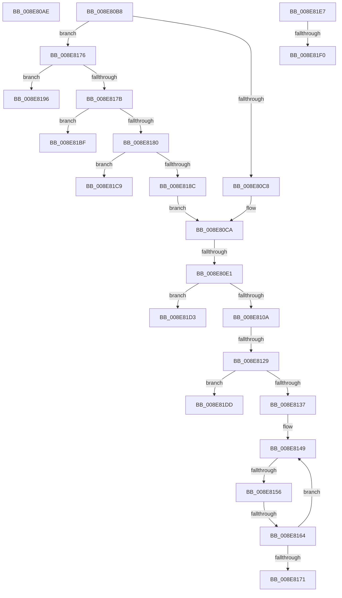

# sub_008E80AE

- RVA: `0x008E80AE`–`0x008E8217` (길이 `361` bytes)
- VA: `0x00000001408E80AE`
- 실행 섹션: `PAGE`
- PDB 이름 있음: `아니요`; PDB Function 태그: `아니요`
- unwind 정보 RVA: `0x00086974`
- 디코드: `86`개 명령, `361/361` bytes 표시
- 미해석 바이트: `0` (있으면 어셈블리에 `.byte`로 보존)

> 이 문서는 커널 이미지의 기계어와 PDB 기호를 분석해 생성했습니다. 4번과 5번은 함수 원형과 자료형을 바이너리 사용 방식에서 추정한 C 해석이며 원본 소스 복구 결과는 아닙니다.

## 1. Dependencies

- 직접 호출 지점: **6**; 고유 호출 대상: **6**
- 직접 호출자로 확인된 함수: **0**
- RIP 상대 이미지 참조: **1**

### Outgoing calls
- `0x008E80D2` → [RtlInitUnicodeStringEx](../../text/46/RtlInitUnicodeStringEx_function_00463960.md) (function, `0x00463960`)
- `0x008E80F9` → [ExAllocatePool2](../../poolcode/B8/ExAllocatePool2_function_00B820F0.md) (function, `0x00B820F0`)
- `0x008E811A` → [PiGetRelatedDevice](PiGetRelatedDevice_function_008E846C.md) (function, `0x008E846C`)
- `0x008E8183` → [CmIsRootDevice](../93/CmIsRootDevice_function_009325E4.md) (function, `0x009325E4`)
- `0x008E81AE` → [CmGetDeviceParent](../93/CmGetDeviceParent_function_00932368.md) (function, `0x00932368`)
- `0x008E820D` → [RtlStringExHandleOtherFlagsW](../../text/41/RtlStringExHandleOtherFlagsW_function_0041E3F0.md) (function, `0x0041E3F0`)

### Direct callers
- 이 함수 시작 RVA로 연결되는 직접 call은 확인되지 않았습니다. 간접 호출은 완전히 역산할 수 없습니다.

### Static image references
- `0x008E8196` → RVA `0x00E66398` (`.data`; read)

## 2. Other-region calls and transfers

- 다른 실행 섹션으로 향하는 call: **3**
  - `0x008E80D2` → [RtlInitUnicodeStringEx](../../text/46/RtlInitUnicodeStringEx_function_00463960.md) (`PAGE` → `.text`)
  - `0x008E80F9` → [ExAllocatePool2](../../poolcode/B8/ExAllocatePool2_function_00B820F0.md) (`PAGE` → `POOLCODE`)
  - `0x008E820D` → [RtlStringExHandleOtherFlagsW](../../text/41/RtlStringExHandleOtherFlagsW_function_0041E3F0.md) (`PAGE` → `.text`)
- call이 아닌 외부 분기/꼬리 이동: **13**
  - `0x008E80B3` → [sub_008E7E6F + 0xF0](Unknown_function_008E7E6F.md) (`tail-transfer`)
  - `0x008E80DB` → [sub_008E7E6F + 0xF0](Unknown_function_008E7E6F.md) (`tail-transfer`)
  - `0x008E8123` → [sub_008E7E6F + 0xF0](Unknown_function_008E7E6F.md) (`tail-transfer`)
  - `0x008E8150` → [sub_008E7E6F + 0x129](Unknown_function_008E7E6F.md) (`tail-transfer`)
  - `0x008E815E` → [sub_008E7E6F + 0x129](Unknown_function_008E7E6F.md) (`tail-transfer`)
  - `0x008E8171` → [sub_008E7E6F + 0x129](Unknown_function_008E7E6F.md) (`tail-transfer`)
  - `0x008E81BA` → [sub_008E7E6F + 0x16E](Unknown_function_008E7E6F.md) (`tail-transfer`)
  - `0x008E81C4` → [sub_008E7E6F + 0xF0](Unknown_function_008E7E6F.md) (`tail-transfer`)
  - `0x008E81CE` → [sub_008E7E6F + 0xF0](Unknown_function_008E7E6F.md) (`tail-transfer`)
  - `0x008E81D8` → [sub_008E7E6F + 0xF0](Unknown_function_008E7E6F.md) (`tail-transfer`)
  - `0x008E81E2` → [sub_008E7E6F + 0x15B](Unknown_function_008E7E6F.md) (`tail-transfer`)
  - `0x008E81EA` → [sub_008E7E6F + 0x14E](Unknown_function_008E7E6F.md) (`tail-transfer`)
  - `0x008E8212` → [sub_008E7E6F + 0x14E](Unknown_function_008E7E6F.md) (`tail-transfer`)

## 3. Assembly (complete function range)

```asm
008E80AE  BB 33 00 00 C0                  mov ebx, 0xc0000033
008E80B3  E9 A7 FE FF FF                  jmp 0x1408e7f5f
008E80B8  8B 8C 24 94 00 00 00            mov ecx, dword ptr [rsp + 0x94]
008E80BF  83 F9 02                        cmp ecx, 2
008E80C2  0F 85 AE 00 00 00               jne 0x1408e8176
008E80C8  8B F9                           mov edi, ecx
008E80CA  49 8B D7                        mov rdx, r15
008E80CD  48 8D 4C 24 68                  lea rcx, [rsp + 0x68]
008E80D2  E8 89 B8 B7 FF                  call 0x140463960
008E80D7  8B D8                           mov ebx, eax
008E80D9  85 C0                           test eax, eax
008E80DB  0F 88 7E FE FF FF               js 0x1408e7f5f
008E80E1  BA 90 01 00 00                  mov edx, 0x190
008E80E6  C7 44 24 50 90 01 00 00         mov dword ptr [rsp + 0x50], 0x190
008E80EE  B9 00 01 00 00                  mov ecx, 0x100
008E80F3  41 B8 50 6E 70 34               mov r8d, 0x34706e50
008E80F9  E8 F2 9F 29 00                  call 0x140b820f0
008E80FE  4C 8B F0                        mov r14, rax
008E8101  48 85 C0                        test rax, rax
008E8104  0F 84 C9 00 00 00               je 0x1408e81d3
008E810A  44 8B CF                        mov r9d, edi
008E810D  4C 8D 44 24 50                  lea r8, [rsp + 0x50]
008E8112  48 8B D0                        mov rdx, rax
008E8115  48 8D 4C 24 68                  lea rcx, [rsp + 0x68]
008E811A  E8 4D 03 00 00                  call 0x1408e846c
008E811F  8B D8                           mov ebx, eax
008E8121  85 C0                           test eax, eax
008E8123  0F 88 36 FE FF FF               js 0x1408e7f5f
008E8129  8B D6                           mov edx, esi
008E812B  48 D1 EA                        shr rdx, 1
008E812E  44 8B D6                        mov r10d, esi
008E8131  0F 84 A6 00 00 00               je 0x1408e81dd
008E8137  41 B8 FE FF FF 7F               mov r8d, 0x7ffffffe
008E813D  4D 8B CE                        mov r9, r14
008E8140  4C 2B C2                        sub r8, rdx
008E8143  48 8B CD                        mov rcx, rbp
008E8146  4C 2B CD                        sub r9, rbp
008E8149  49 8D 04 10                     lea rax, [r8 + rdx]
008E814D  48 85 C0                        test rax, rax
008E8150  0F 84 42 FE FF FF               je 0x1408e7f98
008E8156  41 0F B7 04 09                  movzx eax, word ptr [r9 + rcx]
008E815B  66 85 C0                        test ax, ax
008E815E  0F 84 34 FE FF FF               je 0x1408e7f98
008E8164  66 89 01                        mov word ptr [rcx], ax
008E8167  48 83 C1 02                     add rcx, 2
008E816B  48 83 EA 01                     sub rdx, 1
008E816F  75 D8                           jne 0x1408e8149
008E8171  E9 22 FE FF FF                  jmp 0x1408e7f98
008E8176  83 E9 01                        sub ecx, 1
008E8179  74 1B                           je 0x1408e8196
008E817B  83 F9 02                        cmp ecx, 2
008E817E  75 3F                           jne 0x1408e81bf
008E8180  49 8B CF                        mov rcx, r15
008E8183  E8 5C A4 04 00                  call 0x1409325e4
008E8188  84 C0                           test al, al
008E818A  75 3D                           jne 0x1408e81c9
008E818C  BF 03 00 00 00                  mov edi, 3
008E8191  E9 34 FF FF FF                  jmp 0x1408e80ca
008E8196  48 8B 0D FB E1 57 00            mov rcx, qword ptr [rip + 0x57e1fb]
008E819D  4C 8D 4C 24 50                  lea r9, [rsp + 0x50]
008E81A2  D1 EE                           shr esi, 1
008E81A4  4C 8B C5                        mov r8, rbp
008E81A7  49 8B D7                        mov rdx, r15
008E81AA  89 74 24 50                     mov dword ptr [rsp + 0x50], esi
008E81AE  E8 B5 A1 04 00                  call 0x140932368
008E81B3  44 8B 64 24 50                  mov r12d, dword ptr [rsp + 0x50]
008E81B8  8B D8                           mov ebx, eax
008E81BA  E9 1E FE FF FF                  jmp 0x1408e7fdd
008E81BF  BB 0D 00 00 C0                  mov ebx, 0xc000000d
008E81C4  E9 96 FD FF FF                  jmp 0x1408e7f5f
008E81C9  BB 0E 00 00 C0                  mov ebx, 0xc000000e
008E81CE  E9 8C FD FF FF                  jmp 0x1408e7f5f
008E81D3  BB 9A 00 00 C0                  mov ebx, 0xc000009a
008E81D8  E9 82 FD FF FF                  jmp 0x1408e7f5f
008E81DD  BB 0D 00 00 C0                  mov ebx, 0xc000000d
008E81E2  E9 E3 FD FF FF                  jmp 0x1408e7fca
008E81E7  4D 85 D2                        test r10, r10
008E81EA  0F 84 CD FD FF FF               je 0x1408e7fbd
008E81F0  48 8D 44 24 58                  lea rax, [rsp + 0x58]
008E81F5  C7 44 24 28 00 08 00 00         mov dword ptr [rsp + 0x28], 0x800
008E81FD  4C 8D 4C 24 60                  lea r9, [rsp + 0x60]
008E8202  48 89 44 24 20                  mov qword ptr [rsp + 0x20], rax
008E8207  49 8B D2                        mov rdx, r10
008E820A  48 8B CD                        mov rcx, rbp
008E820D  E8 DE 61 B3 FF                  call 0x14041e3f0
008E8212  E9 A6 FD FF FF                  jmp 0x1408e7fbd
```

## 4. C-style interpretation (structured pseudocode)

```c
__int64 __fastcall sub_008E80AE(void)
{
    unsigned __int64 v_stack_p20;
    unsigned int v_stack_p28;
    unsigned int v_stack_p50;
    unsigned __int64 v_stack_p58;
    unsigned __int64 v_stack_p60;
    unsigned __int64 v_stack_p68;
    unsigned int v_stack_p94;
}
```

## 5. (Beta) C Style

```c
void sub_008E80AE(void)
{
    uint64_t v_stack_p20;
    uint32_t v_stack_p28;
    uint32_t v_stack_p50;
    uint64_t v_stack_p58;
    uint64_t v_stack_p60;
    uint64_t v_stack_p68;
    uint32_t v_stack_p94;
}
```

## 6. Execution-region graph

[열기: 2D/3D 그래프와 함수 탐색 컨트롤 패널](../../../control-panel.html?section=page&rva=0x008E80AE&view=graph)

- 2D 그래프는 위에서 아래로 흐르고, 3D 그래프는 빈 공간을 드래그해 회전합니다. Shift+드래그는 이동, 휠은 확대·축소, 함수 노드 선택은 대상 보고서 이동입니다.

### Static fallback


