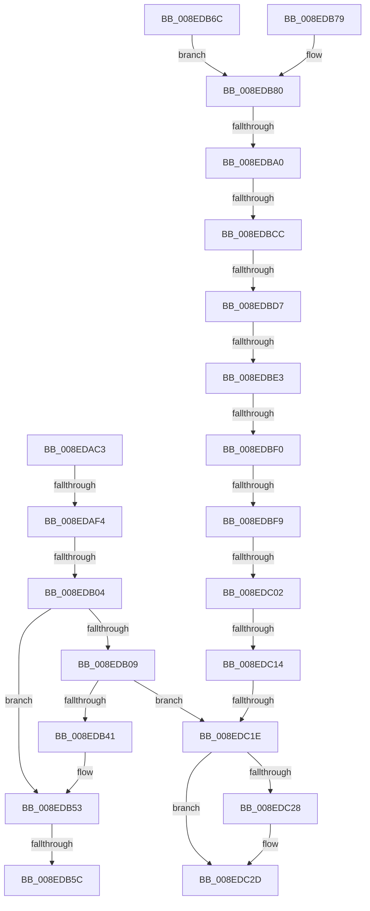

# sub_008EDAC3

- RVA: `0x008EDAC3`–`0x008EDC3F` (길이 `380` bytes)
- VA: `0x00000001408EDAC3`
- 실행 섹션: `PAGE`
- PDB 이름 있음: `아니요`; PDB Function 태그: `아니요`
- unwind 정보 RVA: `0x00086E30`
- 디코드: `90`개 명령, `380/380` bytes 표시
- 미해석 바이트: `0` (있으면 어셈블리에 `.byte`로 보존)

> 이 문서는 커널 이미지의 기계어와 PDB 기호를 분석해 생성했습니다. 4번과 5번은 함수 원형과 자료형을 바이너리 사용 방식에서 추정한 C 해석이며 원본 소스 복구 결과는 아닙니다.

## 1. Dependencies

- 직접 호출 지점: **3**; 고유 호출 대상: **3**
- 직접 호출자로 확인된 함수: **0**
- RIP 상대 이미지 참조: **3**

### Outgoing calls
- `0x008EDB32` → [_CmOpenDeviceRegKey](_CmOpenDeviceRegKey_function_008EE540.md) (function, `0x008EE540`)
- `0x008EDBBC` → [PnpRegQueryValueIndirect](PnpRegQueryValueIndirect_function_008EE210.md) (function, `0x008EE210`)
- `0x008EDC28` → [ZwClose](../../text/6A/ZwClose_function_006AD2B0.md) (function, `0x006AD2B0`)

### Direct callers
- 이 함수 시작 RVA로 연결되는 직접 call은 확인되지 않았습니다. 간접 호출은 완전히 역산할 수 없습니다.

### Static image references
- `0x008EDAF4` → RVA `0x00000000` (`image boundary/outside`; read)
- `0x008EDB70` → RVA `0x006D1300` (` ?? ::FNODOBFM::`string'`; read)
- `0x008EDB79` → RVA `0x006D1320` (` ?? ::FNODOBFM::`string'`; read)

## 2. Other-region calls and transfers

- 다른 실행 섹션으로 향하는 call: **1**
  - `0x008EDC28` → [ZwClose](../../text/6A/ZwClose_function_006AD2B0.md) (`PAGE` → `.text`)
- call이 아닌 외부 분기/꼬리 이동: **12**
  - `0x008EDAEE` → [sub_008EDC5D + 0xDB](Unknown_function_008EDC5D.md) (`tail-transfer`)
  - `0x008EDAFE` → [sub_008EDC5D + 0xD2](Unknown_function_008EDC5D.md) (`tail-transfer`)
  - `0x008EDB56` → [sub_008EDC5D + 0x1B](Unknown_function_008EDC5D.md) (`tail-transfer`)
  - `0x008EDB9A` → [sub_008EDF25 + 0x106](Unknown_function_008EDF25.md) (`tail-transfer`)
  - `0x008EDBC6` → [sub_008EDC5D + 0xBE](Unknown_function_008EDC5D.md) (`tail-transfer`)
  - `0x008EDBD1` → [sub_008EDC5D + 0xBE](Unknown_function_008EDC5D.md) (`tail-transfer`)
  - `0x008EDBE1` → [sub_008EDC5D](Unknown_function_008EDC5D.md) (`tail-transfer`)
  - `0x008EDBEE` → [sub_008EDC5D + 0xF](Unknown_function_008EDC5D.md) (`tail-transfer`)
  - `0x008EDBF3` → [sub_008EDC5D + 0xE5](Unknown_function_008EDC5D.md) (`tail-transfer`)
  - `0x008EDBFC` → [sub_008EDC5D + 0xBE](Unknown_function_008EDC5D.md) (`tail-transfer`)
  - `0x008EDC0E` → [sub_008EDC5D + 0xC8](Unknown_function_008EDC5D.md) (`tail-transfer`)
  - `0x008EDC18` → [sub_008EDC5D + 0xC8](Unknown_function_008EDC5D.md) (`tail-transfer`)

## 3. Assembly (complete function range)

```asm
008EDAC3  48 89 B4 24 58 01 00 00         mov qword ptr [rsp + 0x158], rsi
008EDACB  85 D2                           test edx, edx
008EDACD  4C 89 A4 24 00 01 00 00         mov qword ptr [rsp + 0x100], r12
008EDAD5  49 8B F3                        mov rsi, r11
008EDAD8  44 8D 63 FF                     lea r12d, [rbx - 1]
008EDADC  45 89 1F                        mov dword ptr [r15], r11d
008EDADF  48 0F 45 F1                     cmovne rsi, rcx
008EDAE3  89 54 24 60                     mov dword ptr [rsp + 0x60], edx
008EDAE7  45 89 18                        mov dword ptr [r8], r11d
008EDAEA  41 83 FC 24                     cmp r12d, 0x24
008EDAEE  0F 87 44 02 00 00               ja 0x1408edd38
008EDAF4  4C 8D 05 05 25 71 FF            lea r8, [rip - 0x8edafb]
008EDAFB  83 FB 25                        cmp ebx, 0x25
008EDAFE  0F 85 2B 02 00 00               jne 0x1408edd2f
008EDB04  4D 85 ED                        test r13, r13
008EDB07  75 4A                           jne 0x1408edb53
008EDB09  4C 89 5C 24 38                  mov qword ptr [rsp + 0x38], r11
008EDB0E  48 8D 44 24 78                  lea rax, [rsp + 0x78]
008EDB13  48 89 44 24 30                  mov qword ptr [rsp + 0x30], rax
008EDB18  45 8D 45 10                     lea r8d, [r13 + 0x10]
008EDB1C  40 88 7C 24 28                  mov byte ptr [rsp + 0x28], dil
008EDB21  45 33 C9                        xor r9d, r9d
008EDB24  49 8B D2                        mov rdx, r10
008EDB27  C7 44 24 20 01 00 00 02         mov dword ptr [rsp + 0x20], 0x2000001
008EDB2F  49 8B CE                        mov rcx, r14
008EDB32  E8 09 0A 00 00                  call 0x1408ee540
008EDB37  8B F8                           mov edi, eax
008EDB39  85 C0                           test eax, eax
008EDB3B  0F 88 DD 00 00 00               js 0x1408edc1e
008EDB41  8B 54 24 60                     mov edx, dword ptr [rsp + 0x60]
008EDB45  4C 8D 05 B4 24 71 FF            lea r8, [rip - 0x8edb4c]
008EDB4C  4C 8B 55 80                     mov r10, qword ptr [rbp - 0x80]
008EDB50  45 33 DB                        xor r11d, r11d
008EDB53  83 FB 1D                        cmp ebx, 0x1d
008EDB56  0F 85 1C 01 00 00               jne 0x1408edc78
008EDB5C  49 63 C4                        movsxd rax, r12d
008EDB5F  41 8B 8C 80 98 E0 8E 00         mov ecx, dword ptr [r8 + rax*4 + 0x8ee098]
008EDB67  49 03 C8                        add rcx, r8
008EDB6A  FF E1                           jmp rcx
008EDB6C  CC                              int3
008EDB6D  CC                              int3
008EDB6E  CC                              int3
008EDB6F  CC                              int3
008EDB70  4C 8D 05 89 37 DE FF            lea r8, [rip - 0x21c877]
008EDB77  EB 07                           jmp 0x1408edb80
008EDB79  4C 8D 05 A0 37 DE FF            lea r8, [rip - 0x21c860]
008EDB80  49 8B 86 08 02 00 00            mov rax, qword ptr [r14 + 0x208]
008EDB87  4D 85 ED                        test r13, r13
008EDB8A  89 54 24 64                     mov dword ptr [rsp + 0x64], edx
008EDB8E  48 8B 54 24 78                  mov rdx, qword ptr [rsp + 0x78]
008EDB93  49 0F 45 D5                     cmovne rdx, r13
008EDB97  48 85 C0                        test rax, rax
008EDB9A  0F 85 8B 04 00 00               jne 0x1408ee02b
008EDBA0  4C 89 5C 24 30                  mov qword ptr [rsp + 0x30], r11
008EDBA5  48 8D 44 24 64                  lea rax, [rsp + 0x64]
008EDBAA  48 89 44 24 28                  mov qword ptr [rsp + 0x28], rax
008EDBAF  4C 8D 4C 24 68                  lea r9, [rsp + 0x68]
008EDBB4  49 8B CE                        mov rcx, r14
008EDBB7  48 89 74 24 20                  mov qword ptr [rsp + 0x20], rsi
008EDBBC  E8 4F 06 00 00                  call 0x1408ee210
008EDBC1  3D 34 00 00 C0                  cmp eax, 0xc0000034
008EDBC6  0F 84 4F 01 00 00               je 0x1408edd1b
008EDBCC  3D 7C 01 00 C0                  cmp eax, 0xc000017c
008EDBD1  0F 84 44 01 00 00               je 0x1408edd1b
008EDBD7  BA 00 00 00 80                  mov edx, 0x80000000
008EDBDC  8D 0C 10                        lea ecx, [rax + rdx]
008EDBDF  85 CA                           test edx, ecx
008EDBE1  74 7A                           je 0x1408edc5d
008EDBE3  8B 4C 24 68                     mov ecx, dword ptr [rsp + 0x68]
008EDBE7  8B 54 24 64                     mov edx, dword ptr [rsp + 0x64]
008EDBEB  83 F9 01                        cmp ecx, 1
008EDBEE  74 7C                           je 0x1408edc6c
008EDBF0  83 F9 07                        cmp ecx, 7
008EDBF3  0F 85 49 01 00 00               jne 0x1408edd42
008EDBF9  83 FA 02                        cmp edx, 2
008EDBFC  0F 82 19 01 00 00               jb 0x1408edd1b
008EDC02  41 89 17                        mov dword ptr [r15], edx
008EDC05  48 8B 54 24 70                  mov rdx, qword ptr [rsp + 0x70]
008EDC0A  89 0A                           mov dword ptr [rdx], ecx
008EDC0C  85 C0                           test eax, eax
008EDC0E  0F 85 11 01 00 00               jne 0x1408edd25
008EDC14  39 44 24 60                     cmp dword ptr [rsp + 0x60], eax
008EDC18  0F 84 07 01 00 00               je 0x1408edd25
008EDC1E  48 8B 4C 24 78                  mov rcx, qword ptr [rsp + 0x78]
008EDC23  48 85 C9                        test rcx, rcx
008EDC26  74 05                           je 0x1408edc2d
008EDC28  E8 83 F6 DB FF                  call 0x1406ad2b0
008EDC2D  8B C7                           mov eax, edi
008EDC2F  48 8B B4 24 58 01 00 00         mov rsi, qword ptr [rsp + 0x158]
008EDC37  4C 8B A4 24 00 01 00 00         mov r12, qword ptr [rsp + 0x100]
```

## 4. C-style interpretation (structured pseudocode)

```c
__int64 __fastcall sub_008EDAC3(__int64 a1, int a2, __int64 a3, int a4, __int64 a5, __int64 a6, __int64 a7, __int64 a8, __int64 a9, __int64 a10, __int64 a11, unsigned int a12, __int64 a13, __int64 a14, __int64 a15, __int64 a16, __int64 a17, __int64 a18, __int64 a19, __int64 a20, __int64 a21, __int64 a22, __int64 a23, __int64 a24, __int64 a25, __int64 a26, __int64 a27, __int64 a28, __int64 a29, __int64 a30, __int64 a31, __int64 a32, __int64 a33, __int64 a34, __int64 a35, __int64 a36, __int64 a37, __int64 a38, __int64 a39, __int64 a40, __int64 a41, __int64 a42, __int64 a43)
{
    __int64 result;
    __int64 v_r11;
    __int64 v_rsi;
    unsigned __int64 v_stack_p100;
    unsigned __int64 v_stack_p158;
    unsigned int v_stack_p20;
    unsigned __int8 v_stack_p28;
    unsigned __int64 v_stack_p30;
    unsigned __int64 v_stack_p38;
    unsigned int v_stack_p60;
    unsigned int v_stack_p64;
    unsigned __int64 v_stack_p68;
    unsigned __int64 v_stack_p70;
    unsigned __int64 v_stack_p78;

    v_stack_p158 = v_rsi;
    v_stack_p100 = v_r12;
    *(unsigned int *)(v_r15) = (unsigned int)(v_r11);
    v_rsi = v_r11;
    if (a2 != 0) { v_rsi = a1; }
    v_stack_p60 = a2;
    *(unsigned int *)(a3) = (unsigned int)(v_r11);
    if (v_r13 != 0) goto loc_008EDB53;
    v_stack_p38 = v_r11;
    v_stack_p30 = a15;
    v_stack_p28 = (unsigned __int8)(v_rdi);
    a4 = 0;
    v_stack_p20 = 0x2000001ULL;
    result = _CmOpenDeviceRegKey(v_r14, v_r10, v_r13 + 16, a4);
    if (sign_flag) goto loc_008EDC1E;
    v_r11 = 0;
loc_008EDB53:
    a1 = ((unsigned int)(*(unsigned int *)(v_rip - 9362252 + (int)((unsigned int)(v_rbx - 1)) * 4 + 9363608))) + (v_rip - 9362252);
loc_008EDC1E:
    result = (int)((unsigned int)(v_rbx - 1));
    if (a15 != 0) {
        result = ZwClose(a15, (unsigned int)(a12), v_rip - 9362252, a4);
    }
    return (unsigned int)((unsigned int)((unsigned int)((unsigned int)(result))));
}
```

## 5. (Beta) C Style

```c
int64_t sub_008EDAC3(int64_t Arg1, int32_t Arg2, void *Arg3, int32_t Arg4, uint64_t Arg5, uint64_t Arg6, uint64_t Arg7, uint64_t Arg8, uint64_t Arg9, uint64_t Arg10, uint64_t Arg11, uint32_t Arg12, uint64_t Arg13, uint64_t Arg14, int64_t Arg15, uint64_t Arg16, uint64_t Arg17, uint64_t Arg18, uint64_t Arg19, uint64_t Arg20, uint64_t Arg21, uint64_t Arg22, uint64_t Arg23, uint64_t Arg24, uint64_t Arg25, uint64_t Arg26, uint64_t Arg27, uint64_t Arg28, uint64_t Arg29, uint64_t Arg30, uint64_t Arg31, int64_t Arg32, uint64_t Arg33, uint64_t Arg34, uint64_t Arg35, uint64_t Arg36, uint64_t Arg37, uint64_t Arg38, uint64_t Arg39, uint64_t Arg40, uint64_t Arg41, uint64_t Arg42, int64_t Arg43)
{
    uint8_t *arg3 = (uint8_t *)Arg3;

    int64_t result;
    int64_t local_r11;
    int64_t local_rsi;
    uint64_t v_stack_p100;
    uint64_t v_stack_p158;
    uint32_t v_stack_p20;
    uint8_t v_stack_p28;
    uint64_t v_stack_p30;
    uint64_t v_stack_p38;
    uint32_t v_stack_p60;
    uint32_t v_stack_p64;
    uint64_t v_stack_p68;
    uint64_t v_stack_p70;
    uint64_t v_stack_p78;

    v_stack_p158 = local_rsi;
    v_stack_p100 = local_r12;
    *(uint32_t *)(local_r15) = (uint32_t)(local_r11);
    local_rsi = local_r11;
    if (Arg2 != 0) { local_rsi = Arg1; }
    v_stack_p60 = Arg2;
    *(uint32_t *)(arg3) = (uint32_t)(local_r11);
    if (local_r13 != 0) goto loc_008EDB53;
    v_stack_p38 = local_r11;
    v_stack_p30 = Arg15;
    v_stack_p28 = (uint8_t)(local_rdi);
    Arg4 = 0;
    v_stack_p20 = 0x2000001ULL;
    result = _CmOpenDeviceRegKey(local_r14, local_r10, local_r13 + 16, Arg4);
    if (sign_flag) goto loc_008EDC1E;
    local_r11 = 0;
loc_008EDB53:
    Arg1 = ((uint32_t)(*(uint32_t *)(v_rip - 0x8EDB4C + (int32_t)((uint32_t)(local_rbx - 0x1)) * 4 + 0x8EE098))) + (v_rip - 9362252);
loc_008EDC1E:
    result = (int32_t)((uint32_t)(local_rbx - 1));
    if (Arg15 != 0) {
        result = ZwClose(Arg15, (uint32_t)(Arg12), v_rip - 9362252, Arg4);
    }
    return (uint32_t)((uint32_t)((uint32_t)((uint32_t)(result))));
}
```

### 관측된 메모리 오프셋

구조체 형식이 확인되지 않은 접근은 인자 기준의 오프셋으로만 기록했습니다.

| 기준 인자 | 오프셋 표현 | 폭 (bit) | 접근 |
|---|---:|---:|---|
| `Arg3` | `+ 0x0` | `32` | `W` |

## 6. Execution-region graph

[열기: 2D/3D 그래프와 함수 탐색 컨트롤 패널](../../../control-panel.html?section=page&rva=0x008EDAC3&view=graph)

- 2D 그래프는 위에서 아래로 흐르고, 3D 그래프는 빈 공간을 드래그해 회전합니다. Shift+드래그는 이동, 휠은 확대·축소, 함수 노드 선택은 대상 보고서 이동입니다.

### Static fallback


