# sub_008EDC5D

- RVA: `0x008EDC5D`–`0x008EDF1B` (길이 `702` bytes)
- VA: `0x00000001408EDC5D`
- 실행 섹션: `PAGE`
- PDB 이름 있음: `아니요`; PDB Function 태그: `아니요`
- unwind 정보 RVA: `0x00086E5C`
- 디코드: `164`개 명령, `702/702` bytes 표시
- 미해석 바이트: `0` (있으면 어셈블리에 `.byte`로 보존)

> 이 문서는 커널 이미지의 기계어와 PDB 기호를 분석해 생성했습니다. 4번과 5번은 함수 원형과 자료형을 바이너리 사용 방식에서 추정한 C 해석이며 원본 소스 복구 결과는 아닙니다.

## 1. Dependencies

- 직접 호출 지점: **7**; 고유 호출 대상: **7**
- 직접 호출자로 확인된 함수: **0**
- RIP 상대 이미지 참조: **11**

### Outgoing calls
- `0x008EDCC1` → [CmGetDeviceRegProp](CmGetDeviceRegProp_function_008ED870.md) (function, `0x008ED870`)
- `0x008EDD09` → [CmGetInstallerClassRegProp](../99/CmGetInstallerClassRegProp_function_00994940.md) (function, `0x00994940`)
- `0x008EDDC4` → [RtlInitUnicodeStringEx](../../text/46/RtlInitUnicodeStringEx_function_00463960.md) (function, `0x00463960`)
- `0x008EDE08` → [guard_dispatch_icall](../../text/6B/guard_dispatch_icall_function_006BAAD0.md) (function, `0x006BAAD0`)
- `0x008EDE59` → [MapCmDevicePropertyToRegType](../../text/47/MapCmDevicePropertyToRegType_function_0047AE40.md) (function, `0x0047AE40`)
- `0x008EDE96` → [wcschr](../../text/50/wcschr_function_00501A60.md) (function, `0x00501A60`)
- `0x008EDECC` → [RtlStringCbCopyNExW](../../text/49/RtlStringCbCopyNExW_function_00494CC0.md) (function, `0x00494CC0`)

### Direct callers
- 이 함수 시작 RVA로 연결되는 직접 call은 확인되지 않았습니다. 간접 호출은 완전히 역산할 수 없습니다.

### Static image references
- `0x008EDD56` → RVA `0x006CB420` (` ?? ::FNODOBFM::`string'`; read)
- `0x008EDD62` → RVA `0x006D1190` (` ?? ::FNODOBFM::`string'`; read)
- `0x008EDD6E` → RVA `0x006D1220` (` ?? ::FNODOBFM::`string'`; read)
- `0x008EDD7A` → RVA `0x006D1110` (` ?? ::FNODOBFM::`string'`; read)
- `0x008EDE1E` → RVA `0x006D1240` (` ?? ::FNODOBFM::`string'`; read)
- `0x008EDE2A` → RVA `0x006D1180` (` ?? ::FNODOBFM::`string'`; read)
- `0x008EDE6A` → RVA `0x006D1390` (` ?? ::FNODOBFM::`string'`; read)
- `0x008EDE76` → RVA `0x006D1200` (` ?? ::FNODOBFM::`string'`; read)
- `0x008EDE82` → RVA `0x006D11E0` (` ?? ::FNODOBFM::`string'`; read)
- `0x008EDEF8` → RVA `0x006D11B0` (` ?? ::FNODOBFM::`string'`; read)
- `0x008EDF04` → RVA `0x006D12F0` (` ?? ::FNODOBFM::`string'`; read)

## 2. Other-region calls and transfers

- 다른 실행 섹션으로 향하는 call: **5**
  - `0x008EDDC4` → [RtlInitUnicodeStringEx](../../text/46/RtlInitUnicodeStringEx_function_00463960.md) (`PAGE` → `.text`)
  - `0x008EDE08` → [guard_dispatch_icall](../../text/6B/guard_dispatch_icall_function_006BAAD0.md) (`PAGE` → `.text`)
  - `0x008EDE59` → [MapCmDevicePropertyToRegType](../../text/47/MapCmDevicePropertyToRegType_function_0047AE40.md) (`PAGE` → `.text`)
  - `0x008EDE96` → [wcschr](../../text/50/wcschr_function_00501A60.md) (`PAGE` → `.text`)
  - `0x008EDECC` → [RtlStringCbCopyNExW](../../text/49/RtlStringCbCopyNExW_function_00494CC0.md) (`PAGE` → `.text`)
- call이 아닌 외부 분기/꼬리 이동: **33**
  - `0x008EDC62` → [sub_008EDAC3 + 0x120](Unknown_function_008EDAC3.md) (`tail-transfer`)
  - `0x008EDC6A` → [sub_008EDAC3 + 0x15B](Unknown_function_008EDAC3.md) (`tail-transfer`)
  - `0x008EDC6F` → [sub_008EDAC3 + 0x13F](Unknown_function_008EDAC3.md) (`tail-transfer`)
  - `0x008EDC76` → [sub_008EDAC3 + 0x15B](Unknown_function_008EDAC3.md) (`tail-transfer`)
  - `0x008EDCCD` → [sub_008EDF25 + 0x169](Unknown_function_008EDF25.md) (`tail-transfer`)
  - `0x008EDCD5` → [sub_008EDAC3 + 0x15B](Unknown_function_008EDAC3.md) (`tail-transfer`)
  - `0x008EDD15` → [sub_008EDAC3 + 0x15B](Unknown_function_008EDAC3.md) (`tail-transfer`)
  - `0x008EDD20` → [sub_008EDAC3 + 0x15B](Unknown_function_008EDAC3.md) (`tail-transfer`)
  - `0x008EDD2A` → [sub_008EDAC3 + 0x15B](Unknown_function_008EDAC3.md) (`tail-transfer`)
  - `0x008EDD32` → [sub_00B1DAC8](../B1/Unknown_function_00B1DAC8.md) (`tail-transfer`)
  - `0x008EDD3D` → [sub_008EDAC3 + 0x16C](Unknown_function_008EDAC3.md) (`tail-transfer`)
  - `0x008EDD45` → [sub_008EDAC3 + 0x13F](Unknown_function_008EDAC3.md) (`tail-transfer`)
  - `0x008EDD4E` → [sub_008EDAC3 + 0x13F](Unknown_function_008EDAC3.md) (`tail-transfer`)
  - `0x008EDD5D` → [sub_008EDAC3 + 0xBD](Unknown_function_008EDAC3.md) (`tail-transfer`)
  - `0x008EDD69` → [sub_008EDAC3 + 0xBD](Unknown_function_008EDAC3.md) (`tail-transfer`)
  - `0x008EDD75` → [sub_008EDAC3 + 0xBD](Unknown_function_008EDAC3.md) (`tail-transfer`)
  - `0x008EDD81` → [sub_008EDAC3 + 0xBD](Unknown_function_008EDAC3.md) (`tail-transfer`)
  - `0x008EDD92` → [sub_008EDF25 + 0x5C](Unknown_function_008EDF25.md) (`tail-transfer`)
  - `0x008EDD9E` → [sub_008EDF25 + 0xD7](Unknown_function_008EDF25.md) (`tail-transfer`)
  - `0x008EDDCD` → [sub_008EDAC3 + 0x15B](Unknown_function_008EDAC3.md) (`tail-transfer`)
  - `0x008EDDDD` → [sub_008EDF25 + 0x147](Unknown_function_008EDF25.md) (`tail-transfer`)
  - `0x008EDE25` → [sub_008EDAC3 + 0xBD](Unknown_function_008EDAC3.md) (`tail-transfer`)
  - `0x008EDE31` → [sub_008EDAC3 + 0xBD](Unknown_function_008EDAC3.md) (`tail-transfer`)
  - `0x008EDE4A` → [sub_008EDAC3 + 0x15B](Unknown_function_008EDAC3.md) (`tail-transfer`)
  - `0x008EDE65` → [sub_008EDAC3 + 0x15B](Unknown_function_008EDAC3.md) (`tail-transfer`)
  - `0x008EDE71` → [sub_008EDAC3 + 0xBD](Unknown_function_008EDAC3.md) (`tail-transfer`)
  - `0x008EDE7D` → [sub_008EDAC3 + 0xBD](Unknown_function_008EDAC3.md) (`tail-transfer`)
  - `0x008EDE89` → [sub_008EDAC3 + 0xBD](Unknown_function_008EDAC3.md) (`tail-transfer`)
  - `0x008EDEC1` → [sub_008EDF25](Unknown_function_008EDF25.md) (`tail-transfer`)
  - `0x008EDED3` → [sub_008EDAC3 + 0x15B](Unknown_function_008EDAC3.md) (`tail-transfer`)
  - `0x008EDEE8` → [sub_008EDAC3 + 0x15B](Unknown_function_008EDAC3.md) (`tail-transfer`)
  - `0x008EDEFF` → [sub_008EDAC3 + 0xBD](Unknown_function_008EDAC3.md) (`tail-transfer`)
  - `0x008EDF0B` → [sub_008EDAC3 + 0xBD](Unknown_function_008EDAC3.md) (`tail-transfer`)

## 3. Assembly (complete function range)

```asm
008EDC5D  3D 23 00 00 C0                  cmp eax, 0xc0000023
008EDC62  0F 84 7B FF FF FF               je 0x1408edbe3
008EDC68  8B F8                           mov edi, eax
008EDC6A  EB B2                           jmp 0x1408edc1e
008EDC6C  83 FA 02                        cmp edx, 2
008EDC6F  73 91                           jae 0x1408edc02
008EDC71  BF 25 02 00 C0                  mov edi, 0xc0000225
008EDC76  EB A6                           jmp 0x1408edc1e
008EDC78  83 FB 08                        cmp ebx, 8
008EDC7B  0F 85 05 01 00 00               jne 0x1408edd86
008EDC81  4C 8B 44 24 78                  mov r8, qword ptr [rsp + 0x78]
008EDC86  48 8D 44 24 64                  lea rax, [rsp + 0x64]
008EDC8B  44 89 5C 24 38                  mov dword ptr [rsp + 0x38], r11d
008EDC90  44 8D 4B 01                     lea r9d, [rbx + 1]
008EDC94  48 89 44 24 30                  mov qword ptr [rsp + 0x30], rax
008EDC99  4D 85 ED                        test r13, r13
008EDC9C  48 8D 45 A0                     lea rax, [rbp - 0x60]
008EDCA0  C7 44 24 64 4E 00 00 00         mov dword ptr [rsp + 0x64], 0x4e
008EDCA8  48 89 44 24 28                  mov qword ptr [rsp + 0x28], rax
008EDCAD  4D 0F 45 C5                     cmovne r8, r13
008EDCB1  48 8D 44 24 68                  lea rax, [rsp + 0x68]
008EDCB6  49 8B D2                        mov rdx, r10
008EDCB9  49 8B CE                        mov rcx, r14
008EDCBC  48 89 44 24 20                  mov qword ptr [rsp + 0x20], rax
008EDCC1  E8 AA FB FF FF                  call 0x1408ed870
008EDCC6  8B F8                           mov edi, eax
008EDCC8  3D 23 00 00 C0                  cmp eax, 0xc0000023
008EDCCD  0F 84 BB 03 00 00               je 0x1408ee08e
008EDCD3  85 C0                           test eax, eax
008EDCD5  0F 85 43 FF FF FF               jne 0x1408edc1e
008EDCDB  48 8B 54 24 70                  mov rdx, qword ptr [rsp + 0x70]
008EDCE0  33 C9                           xor ecx, ecx
008EDCE2  8B 44 24 60                     mov eax, dword ptr [rsp + 0x60]
008EDCE6  44 8B CB                        mov r9d, ebx
008EDCE9  4C 89 7C 24 30                  mov qword ptr [rsp + 0x30], r15
008EDCEE  45 33 C0                        xor r8d, r8d
008EDCF1  66 89 4D EC                     mov word ptr [rbp - 0x14], cx
008EDCF5  49 8B CE                        mov rcx, r14
008EDCF8  48 89 74 24 28                  mov qword ptr [rsp + 0x28], rsi
008EDCFD  48 89 54 24 20                  mov qword ptr [rsp + 0x20], rdx
008EDD02  48 8D 55 A0                     lea rdx, [rbp - 0x60]
008EDD06  41 89 07                        mov dword ptr [r15], eax
008EDD09  E8 32 6C 0A 00                  call 0x140994940
008EDD0E  8B F8                           mov edi, eax
008EDD10  3D 34 00 00 C0                  cmp eax, 0xc0000034
008EDD15  0F 85 03 FF FF FF               jne 0x1408edc1e
008EDD1B  BF 25 02 00 C0                  mov edi, 0xc0000225
008EDD20  E9 F9 FE FF FF                  jmp 0x1408edc1e
008EDD25  BF 23 00 00 C0                  mov edi, 0xc0000023
008EDD2A  E9 EF FE FF FF                  jmp 0x1408edc1e
008EDD2F  83 FB 19                        cmp ebx, 0x19
008EDD32  0F 85 90 FD 22 00               jne 0x140b1dac8
008EDD38  B8 30 02 00 C0                  mov eax, 0xc0000230
008EDD3D  E9 ED FE FF FF                  jmp 0x1408edc2f
008EDD42  83 FA 04                        cmp edx, 4
008EDD45  0F 84 B7 FE FF FF               je 0x1408edc02
008EDD4B  83 F9 04                        cmp ecx, 4
008EDD4E  0F 85 AE FE FF FF               jne 0x1408edc02
008EDD54  EB C5                           jmp 0x1408edd1b
008EDD56  4C 8D 05 C3 D6 DD FF            lea r8, [rip - 0x22293d]
008EDD5D  E9 1E FE FF FF                  jmp 0x1408edb80
008EDD62  4C 8D 05 27 34 DE FF            lea r8, [rip - 0x21cbd9]
008EDD69  E9 12 FE FF FF                  jmp 0x1408edb80
008EDD6E  4C 8D 05 AB 34 DE FF            lea r8, [rip - 0x21cb55]
008EDD75  E9 06 FE FF FF                  jmp 0x1408edb80
008EDD7A  4C 8D 05 8F 33 DE FF            lea r8, [rip - 0x21cc71]
008EDD81  E9 FA FD FF FF                  jmp 0x1408edb80
008EDD86  83 FB 17                        cmp ebx, 0x17
008EDD89  0F 84 FF 00 00 00               je 0x1408ede8e
008EDD8F  83 FB 24                        cmp ebx, 0x24
008EDD92  0F 84 E9 01 00 00               je 0x1408edf81
008EDD98  8D 43 F1                        lea eax, [rbx - 0xf]
008EDD9B  83 F8 14                        cmp eax, 0x14
008EDD9E  0F 87 58 02 00 00               ja 0x1408edffc
008EDDA4  48 98                           cdqe
008EDDA6  41 8B 8C 80 2C E1 8E 00         mov ecx, dword ptr [r8 + rax*4 + 0x8ee12c]
008EDDAE  49 03 C8                        add rcx, r8
008EDDB1  FF E1                           jmp rcx
008EDDB3  CC                              int3
008EDDB4  CC                              int3
008EDDB5  CC                              int3
008EDDB6  CC                              int3
008EDDB7  41 BC 01 00 00 00               mov r12d, 1
008EDDBD  49 8B D2                        mov rdx, r10
008EDDC0  48 8D 4D 90                     lea rcx, [rbp - 0x70]
008EDDC4  E8 97 5B B7 FF                  call 0x140463960
008EDDC9  8B F8                           mov edi, eax
008EDDCB  85 C0                           test eax, eax
008EDDCD  0F 88 4B FE FF FF               js 0x1408edc1e
008EDDD3  49 8B 86 00 01 00 00            mov rax, qword ptr [r14 + 0x100]
008EDDDA  48 85 C0                        test rax, rax
008EDDDD  0F 84 89 02 00 00               je 0x1408ee06c
008EDDE3  8B 54 24 60                     mov edx, dword ptr [rsp + 0x60]
008EDDE7  33 C9                           xor ecx, ecx
008EDDE9  89 4C 24 30                     mov dword ptr [rsp + 0x30], ecx
008EDDED  4C 8B CE                        mov r9, rsi
008EDDF0  48 8D 4C 24 60                  lea rcx, [rsp + 0x60]
008EDDF5  45 8B C4                        mov r8d, r12d
008EDDF8  48 89 4C 24 28                  mov qword ptr [rsp + 0x28], rcx
008EDDFD  49 8B CE                        mov rcx, r14
008EDE00  89 54 24 20                     mov dword ptr [rsp + 0x20], edx
008EDE04  48 8D 55 90                     lea rdx, [rbp - 0x70]
008EDE08  E8 C3 CC DC FF                  call 0x1406baad0
008EDE0D  48 8B F8                        mov rdi, rax
008EDE10  3D 05 00 00 80                  cmp eax, 0x80000005
008EDE15  75 1F                           jne 0x1408ede36
008EDE17  BF 23 00 00 C0                  mov edi, 0xc0000023
008EDE1C  EB 32                           jmp 0x1408ede50
008EDE1E  4C 8D 05 1B 34 DE FF            lea r8, [rip - 0x21cbe5]
008EDE25  E9 56 FD FF FF                  jmp 0x1408edb80
008EDE2A  4C 8D 05 4F 33 DE FF            lea r8, [rip - 0x21ccb1]
008EDE31  E9 4A FD FF FF                  jmp 0x1408edb80
008EDE36  3D 34 00 00 C0                  cmp eax, 0xc0000034
008EDE3B  0F 84 DA FE FF FF               je 0x1408edd1b
008EDE41  85 C0                           test eax, eax
008EDE43  79 0B                           jns 0x1408ede50
008EDE45  3D 23 00 00 C0                  cmp eax, 0xc0000023
008EDE4A  0F 85 CE FD FF FF               jne 0x1408edc1e
008EDE50  8B 44 24 60                     mov eax, dword ptr [rsp + 0x60]
008EDE54  8B CB                           mov ecx, ebx
008EDE56  41 89 07                        mov dword ptr [r15], eax
008EDE59  E8 E2 CF B8 FF                  call 0x14047ae40
008EDE5E  48 8B 54 24 70                  mov rdx, qword ptr [rsp + 0x70]
008EDE63  89 02                           mov dword ptr [rdx], eax
008EDE65  E9 B4 FD FF FF                  jmp 0x1408edc1e
008EDE6A  4C 8D 05 1F 35 DE FF            lea r8, [rip - 0x21cae1]
008EDE71  E9 0A FD FF FF                  jmp 0x1408edb80
008EDE76  4C 8D 05 83 33 DE FF            lea r8, [rip - 0x21cc7d]
008EDE7D  E9 FE FC FF FF                  jmp 0x1408edb80
008EDE82  4C 8D 05 57 33 DE FF            lea r8, [rip - 0x21cca9]
008EDE89  E9 F2 FC FF FF                  jmp 0x1408edb80
008EDE8E  BA 5C 00 00 00                  mov edx, 0x5c
008EDE93  49 8B CA                        mov rcx, r10
008EDE96  E8 C5 3B C1 FF                  call 0x140501a60
008EDE9B  48 85 C0                        test rax, rax
008EDE9E  74 43                           je 0x1408edee3
008EDEA0  4C 8B 45 80                     mov r8, qword ptr [rbp - 0x80]
008EDEA4  48 8B 54 24 70                  mov rdx, qword ptr [rsp + 0x70]
008EDEA9  41 2B C0                        sub eax, r8d
008EDEAC  8B 4C 24 60                     mov ecx, dword ptr [rsp + 0x60]
008EDEB0  83 C0 02                        add eax, 2
008EDEB3  41 89 07                        mov dword ptr [r15], eax
008EDEB6  C7 02 01 00 00 00               mov dword ptr [rdx], 1
008EDEBC  41 8B 07                        mov eax, dword ptr [r15]
008EDEBF  3B C8                           cmp ecx, eax
008EDEC1  72 62                           jb 0x1408edf25
008EDEC3  8B D1                           mov edx, ecx
008EDEC5  4C 8D 48 FE                     lea r9, [rax - 2]
008EDEC9  48 8B CE                        mov rcx, rsi
008EDECC  E8 EF 6D BA FF                  call 0x140494cc0
008EDED1  8B F8                           mov edi, eax
008EDED3  E9 46 FD FF FF                  jmp 0x1408edc1e
008EDED8  41 BC 04 00 00 00               mov r12d, 4
008EDEDE  E9 DA FE FF FF                  jmp 0x1408eddbd
008EDEE3  BF 0D 00 00 C0                  mov edi, 0xc000000d
008EDEE8  E9 31 FD FF FF                  jmp 0x1408edc1e
008EDEED  41 BC 06 00 00 00               mov r12d, 6
008EDEF3  E9 C5 FE FF FF                  jmp 0x1408eddbd
008EDEF8  4C 8D 05 B1 32 DE FF            lea r8, [rip - 0x21cd4f]
008EDEFF  E9 7C FC FF FF                  jmp 0x1408edb80
008EDF04  4C 8D 05 E5 33 DE FF            lea r8, [rip - 0x21cc1b]
008EDF0B  E9 70 FC FF FF                  jmp 0x1408edb80
008EDF10  41 BC 03 00 00 00               mov r12d, 3
008EDF16  E9 A2 FE FF FF                  jmp 0x1408eddbd
```

## 4. C-style interpretation (structured pseudocode)

```c
__int64 __fastcall sub_008EDC5D(__int64 a1, int a2)
{
    unsigned __int64 v_stack_p20;
    unsigned __int64 v_stack_p28;
    unsigned __int64 v_stack_p30;
    unsigned int v_stack_p38;
    unsigned int v_stack_p60;
    unsigned __int64 v_stack_p64;
    unsigned __int64 v_stack_p68;
    unsigned __int64 v_stack_p70;
    unsigned __int64 v_stack_p78;
}
```

## 5. (Beta) C Style

```c
int64_t sub_008EDC5D(int64_t Arg1, int32_t Arg2)
{
    uint64_t v_stack_p20;
    uint64_t v_stack_p28;
    uint64_t v_stack_p30;
    uint32_t v_stack_p38;
    uint32_t v_stack_p60;
    uint64_t v_stack_p64;
    uint64_t v_stack_p68;
    uint64_t v_stack_p70;
    uint64_t v_stack_p78;
}
```

## 6. Execution-region graph

[열기: 2D/3D 그래프와 함수 탐색 컨트롤 패널](../../../control-panel.html?section=page&rva=0x008EDC5D&view=graph)

- 2D 그래프는 위에서 아래로 흐르고, 3D 그래프는 빈 공간을 드래그해 회전합니다. Shift+드래그는 이동, 휠은 확대·축소, 함수 노드 선택은 대상 보고서 이동입니다.

### Static fallback

```mermaid
flowchart TD
  bb_008EDC5D[BB_008EDC5D]
  bb_008EDC68[BB_008EDC68]
  bb_008EDC6C[BB_008EDC6C]
  bb_008EDC71[BB_008EDC71]
  bb_008EDC78[BB_008EDC78]
  bb_008EDC81[BB_008EDC81]
  bb_008EDCD3[BB_008EDCD3]
  bb_008EDCDB[BB_008EDCDB]
  bb_008EDD1B[BB_008EDD1B]
  bb_008EDD25[BB_008EDD25]
  bb_008EDD2F[BB_008EDD2F]
  bb_008EDD38[BB_008EDD38]
  bb_008EDD42[BB_008EDD42]
  bb_008EDD4B[BB_008EDD4B]
  bb_008EDD54[BB_008EDD54]
  bb_008EDD56[BB_008EDD56]
  bb_008EDD62[BB_008EDD62]
  bb_008EDD6E[BB_008EDD6E]
  bb_008EDD7A[BB_008EDD7A]
  bb_008EDD86[BB_008EDD86]
  bb_008EDD8F[BB_008EDD8F]
  bb_008EDD98[BB_008EDD98]
  bb_008EDDA4[BB_008EDDA4]
  bb_008EDDB3[BB_008EDDB3]
  bb_008EDDBD[BB_008EDDBD]
  bb_008EDDD3[BB_008EDDD3]
  bb_008EDDE3[BB_008EDDE3]
  bb_008EDE17[BB_008EDE17]
  bb_008EDE1E[BB_008EDE1E]
  bb_008EDE2A[BB_008EDE2A]
  bb_008EDE36[BB_008EDE36]
  bb_008EDE41[BB_008EDE41]
  bb_008EDE45[BB_008EDE45]
  bb_008EDE50[BB_008EDE50]
  bb_008EDE6A[BB_008EDE6A]
  bb_008EDE76[BB_008EDE76]
  bb_008EDE82[BB_008EDE82]
  bb_008EDE8E[BB_008EDE8E]
  bb_008EDEA0[BB_008EDEA0]
  bb_008EDEC3[BB_008EDEC3]
  bb_008EDED8[BB_008EDED8]
  bb_008EDEE3[BB_008EDEE3]
  bb_008EDEED[BB_008EDEED]
  bb_008EDEF8[BB_008EDEF8]
  bb_008EDF04[BB_008EDF04]
  bb_008EDF10[BB_008EDF10]
  bb_008EDC5D -->|fallthrough| bb_008EDC68
  bb_008EDC6C -->|fallthrough| bb_008EDC71
  bb_008EDC78 -->|branch| bb_008EDD86
  bb_008EDC78 -->|fallthrough| bb_008EDC81
  bb_008EDC81 -->|fallthrough| bb_008EDCD3
  bb_008EDCD3 -->|fallthrough| bb_008EDCDB
  bb_008EDCDB -->|fallthrough| bb_008EDD1B
  bb_008EDD2F -->|fallthrough| bb_008EDD38
  bb_008EDD42 -->|fallthrough| bb_008EDD4B
  bb_008EDD4B -->|fallthrough| bb_008EDD54
  bb_008EDD54 -->|branch| bb_008EDD1B
  bb_008EDD86 -->|branch| bb_008EDE8E
  bb_008EDD86 -->|fallthrough| bb_008EDD8F
  bb_008EDD8F -->|fallthrough| bb_008EDD98
  bb_008EDD98 -->|fallthrough| bb_008EDDA4
  bb_008EDDB3 -->|flow| bb_008EDDBD
  bb_008EDDBD -->|fallthrough| bb_008EDDD3
  bb_008EDDD3 -->|fallthrough| bb_008EDDE3
  bb_008EDDE3 -->|branch| bb_008EDE36
  bb_008EDDE3 -->|fallthrough| bb_008EDE17
  bb_008EDE17 -->|branch| bb_008EDE50
  bb_008EDE36 -->|branch| bb_008EDD1B
  bb_008EDE36 -->|fallthrough| bb_008EDE41
  bb_008EDE41 -->|branch| bb_008EDE50
  bb_008EDE41 -->|fallthrough| bb_008EDE45
  bb_008EDE45 -->|fallthrough| bb_008EDE50
  bb_008EDE8E -->|branch| bb_008EDEE3
  bb_008EDE8E -->|fallthrough| bb_008EDEA0
  bb_008EDEA0 -->|fallthrough| bb_008EDEC3
  bb_008EDED8 -->|branch| bb_008EDDBD
  bb_008EDEED -->|branch| bb_008EDDBD
  bb_008EDF10 -->|branch| bb_008EDDBD
```


