# sub_008EDF25

- RVA: `0x008EDF25`–`0x008EE180` (길이 `603` bytes)
- VA: `0x00000001408EDF25`
- 실행 섹션: `PAGE`
- PDB 이름 있음: `아니요`; PDB Function 태그: `아니요`
- unwind 정보 RVA: `0x00086E84`
- 디코드: `138`개 명령, `603/603` bytes 표시
- 미해석 바이트: `1` (있으면 어셈블리에 `.byte`로 보존)

> 이 문서는 커널 이미지의 기계어와 PDB 기호를 분석해 생성했습니다. 4번과 5번은 함수 원형과 자료형을 바이너리 사용 방식에서 추정한 C 해석이며 원본 소스 복구 결과는 아닙니다.

## 1. Dependencies

- 직접 호출 지점: **2**; 고유 호출 대상: **2**
- 직접 호출자로 확인된 함수: **0**
- RIP 상대 이미지 참조: **12**

### Outgoing calls
- `0x008EDFC6` → [PnpGetObjectProperty](PnpGetObjectProperty_function_008E2180.md) (function, `0x008E2180`)
- `0x008EE057` → [guard_dispatch_icall](../../text/6B/guard_dispatch_icall_function_006BAAD0.md) (function, `0x006BAAD0`)

### Direct callers
- 이 함수 시작 RVA로 연결되는 직접 call은 확인되지 않았습니다. 간접 호출은 완전히 역산할 수 없습니다.

### Static image references
- `0x008EDF45` → RVA `0x006D12A0` (` ?? ::FNODOBFM::`string'`; read)
- `0x008EDF51` → RVA `0x006D12C0` (` ?? ::FNODOBFM::`string'`; read)
- `0x008EDF5D` → RVA `0x006D1370` (` ?? ::FNODOBFM::`string'`; read)
- `0x008EDF69` → RVA `0x006D1260` (` ?? ::FNODOBFM::`string'`; read)
- `0x008EDF75` → RVA `0x006D1280` (` ?? ::FNODOBFM::`string'`; read)
- `0x008EDFB5` → RVA `0x000116A0` (`.rdata`; read)
- `0x008EDFE5` → RVA `0x006D1130` (` ?? ::FNODOBFM::`string'`; read)
- `0x008EE013` → RVA `0x006D1160` (` ?? ::FNODOBFM::`string'`; read)
- `0x008EE01F` → RVA `0x006D1150` (` ?? ::FNODOBFM::`string'`; read)
- `0x008EE02B` → RVA `0x008EE210` (`PnpRegQueryValueIndirect`; read)
- `0x008EE076` → RVA `0x006CB400` (` ?? ::FNODOBFM::`string'`; read)
- `0x008EE082` → RVA `0x006D1340` (` ?? ::FNODOBFM::`string'`; read)

## 2. Other-region calls and transfers

- 다른 실행 섹션으로 향하는 call: **1**
  - `0x008EE057` → [guard_dispatch_icall](../../text/6B/guard_dispatch_icall_function_006BAAD0.md) (`PAGE` → `.text`)
- call이 아닌 외부 분기/꼬리 이동: **23**
  - `0x008EDF2A` → [sub_008EDAC3 + 0x15B](Unknown_function_008EDAC3.md) (`tail-transfer`)
  - `0x008EDF35` → [sub_008EDC5D + 0x160](Unknown_function_008EDC5D.md) (`tail-transfer`)
  - `0x008EDF40` → [sub_008EDC5D + 0x160](Unknown_function_008EDC5D.md) (`tail-transfer`)
  - `0x008EDF4C` → [sub_008EDAC3 + 0xBD](Unknown_function_008EDAC3.md) (`tail-transfer`)
  - `0x008EDF58` → [sub_008EDAC3 + 0xBD](Unknown_function_008EDAC3.md) (`tail-transfer`)
  - `0x008EDF64` → [sub_008EDAC3 + 0xBD](Unknown_function_008EDAC3.md) (`tail-transfer`)
  - `0x008EDF70` → [sub_008EDAC3 + 0xBD](Unknown_function_008EDAC3.md) (`tail-transfer`)
  - `0x008EDF7C` → [sub_008EDAC3 + 0xBD](Unknown_function_008EDAC3.md) (`tail-transfer`)
  - `0x008EDFDA` → [sub_008EDC5D + 0xB3](Unknown_function_008EDC5D.md) (`tail-transfer`)
  - `0x008EDFE0` → [sub_008EDAC3 + 0x15B](Unknown_function_008EDAC3.md) (`tail-transfer`)
  - `0x008EDFEC` → [sub_008EDAC3 + 0xBD](Unknown_function_008EDAC3.md) (`tail-transfer`)
  - `0x008EDFF7` → [sub_008EDC5D + 0x160](Unknown_function_008EDC5D.md) (`tail-transfer`)
  - `0x008EDFFF` → [sub_008EDAC3 + 0xB6](Unknown_function_008EDAC3.md) (`tail-transfer`)
  - `0x008EE00D` → [sub_008EDAC3 + 0x99](Unknown_function_008EDAC3.md) (`tail-transfer`)
  - `0x008EE01A` → [sub_008EDAC3 + 0xBD](Unknown_function_008EDAC3.md) (`tail-transfer`)
  - `0x008EE026` → [sub_008EDAC3 + 0xBD](Unknown_function_008EDAC3.md) (`tail-transfer`)
  - `0x008EE035` → [sub_008EDAC3 + 0xDD](Unknown_function_008EDAC3.md) (`tail-transfer`)
  - `0x008EE05C` → [sub_008EDAC3 + 0xFE](Unknown_function_008EDAC3.md) (`tail-transfer`)
  - `0x008EE067` → [sub_008EDC5D + 0x160](Unknown_function_008EDC5D.md) (`tail-transfer`)
  - `0x008EE071` → [sub_008EDAC3 + 0x15B](Unknown_function_008EDAC3.md) (`tail-transfer`)
  - `0x008EE07D` → [sub_008EDAC3 + 0xBD](Unknown_function_008EDAC3.md) (`tail-transfer`)
  - `0x008EE089` → [sub_008EDAC3 + 0xBD](Unknown_function_008EDAC3.md) (`tail-transfer`)
  - `0x008EE093` → [sub_008EDAC3 + 0x15B](Unknown_function_008EDAC3.md) (`tail-transfer`)

## 3. Assembly (complete function range)

```asm
008EDF25  BF 23 00 00 C0                  mov edi, 0xc0000023
008EDF2A  E9 EF FC FF FF                  jmp 0x1408edc1e
008EDF2F  41 BC 0A 00 00 00               mov r12d, 0xa
008EDF35  E9 83 FE FF FF                  jmp 0x1408eddbd
008EDF3A  41 BC 0B 00 00 00               mov r12d, 0xb
008EDF40  E9 78 FE FF FF                  jmp 0x1408eddbd
008EDF45  4C 8D 05 54 33 DE FF            lea r8, [rip - 0x21ccac]
008EDF4C  E9 2F FC FF FF                  jmp 0x1408edb80
008EDF51  4C 8D 05 68 33 DE FF            lea r8, [rip - 0x21cc98]
008EDF58  E9 23 FC FF FF                  jmp 0x1408edb80
008EDF5D  4C 8D 05 0C 34 DE FF            lea r8, [rip - 0x21cbf4]
008EDF64  E9 17 FC FF FF                  jmp 0x1408edb80
008EDF69  4C 8D 05 F0 32 DE FF            lea r8, [rip - 0x21cd10]
008EDF70  E9 0B FC FF FF                  jmp 0x1408edb80
008EDF75  4C 8D 05 04 33 DE FF            lea r8, [rip - 0x21ccfc]
008EDF7C  E9 FF FB FF FF                  jmp 0x1408edb80
008EDF81  4C 8B 4C 24 78                  mov r9, qword ptr [rsp + 0x78]
008EDF86  48 8D 45 88                     lea rax, [rbp - 0x78]
008EDF8A  44 89 5C 24 50                  mov dword ptr [rsp + 0x50], r11d
008EDF8F  4D 85 ED                        test r13, r13
008EDF92  4C 89 7C 24 48                  mov qword ptr [rsp + 0x48], r15
008EDF97  41 B8 01 00 00 00               mov r8d, 1
008EDF9D  89 54 24 40                     mov dword ptr [rsp + 0x40], edx
008EDFA1  4D 0F 45 CD                     cmovne r9, r13
008EDFA5  48 89 74 24 38                  mov qword ptr [rsp + 0x38], rsi
008EDFAA  49 8B D2                        mov rdx, r10
008EDFAD  48 89 44 24 30                  mov qword ptr [rsp + 0x30], rax
008EDFB2  49 8B CE                        mov rcx, r14
008EDFB5  48 8D 05 E4 36 72 FF            lea rax, [rip - 0x8dc91c]
008EDFBC  48 89 44 24 28                  mov qword ptr [rsp + 0x28], rax
008EDFC1  4C 89 5C 24 20                  mov qword ptr [rsp + 0x20], r11
008EDFC6  E8 B5 41 FF FF                  call 0x1408e2180
008EDFCB  48 8B 54 24 70                  mov rdx, qword ptr [rsp + 0x70]
008EDFD0  8B F8                           mov edi, eax
008EDFD2  C7 02 07 00 00 00               mov dword ptr [rdx], 7
008EDFD8  85 C0                           test eax, eax
008EDFDA  0F 88 30 FD FF FF               js 0x1408edd10
008EDFE0  E9 39 FC FF FF                  jmp 0x1408edc1e
008EDFE5  4C 8D 05 44 31 DE FF            lea r8, [rip - 0x21cebc]
008EDFEC  E9 8F FB FF FF                  jmp 0x1408edb80
008EDFF1  41 BC 02 00 00 00               mov r12d, 2
008EDFF7  E9 C1 FD FF FF                  jmp 0x1408eddbd
008EDFFC  83 FB 02                        cmp ebx, 2
008EDFFF  0F 84 74 FB FF FF               je 0x1408edb79
008EE005  83 FB 0A                        cmp ebx, 0xa
008EE008  74 15                           je 0x1408ee01f
008EE00A  83 FB 0B                        cmp ebx, 0xb
008EE00D  0F 85 49 FB FF FF               jne 0x1408edb5c
008EE013  4C 8D 05 46 31 DE FF            lea r8, [rip - 0x21ceba]
008EE01A  E9 61 FB FF FF                  jmp 0x1408edb80
008EE01F  4C 8D 05 2A 31 DE FF            lea r8, [rip - 0x21ced6]
008EE026  E9 55 FB FF FF                  jmp 0x1408edb80
008EE02B  48 8D 0D DE 01 00 00            lea rcx, [rip + 0x1de]
008EE032  48 3B C1                        cmp rax, rcx
008EE035  0F 84 65 FB FF FF               je 0x1408edba0
008EE03B  4C 89 5C 24 30                  mov qword ptr [rsp + 0x30], r11
008EE040  48 8D 4C 24 64                  lea rcx, [rsp + 0x64]
008EE045  48 89 4C 24 28                  mov qword ptr [rsp + 0x28], rcx
008EE04A  4C 8D 4C 24 68                  lea r9, [rsp + 0x68]
008EE04F  49 8B CE                        mov rcx, r14
008EE052  48 89 74 24 20                  mov qword ptr [rsp + 0x20], rsi
008EE057  E8 74 CA DC FF                  call 0x1406baad0
008EE05C  E9 60 FB FF FF                  jmp 0x1408edbc1
008EE061  41 BC 05 00 00 00               mov r12d, 5
008EE067  E9 51 FD FF FF                  jmp 0x1408eddbd
008EE06C  BF 02 00 00 C0                  mov edi, 0xc0000002
008EE071  E9 A8 FB FF FF                  jmp 0x1408edc1e
008EE076  4C 8D 05 83 D3 DD FF            lea r8, [rip - 0x222c7d]
008EE07D  E9 FE FA FF FF                  jmp 0x1408edb80
008EE082  4C 8D 05 B7 32 DE FF            lea r8, [rip - 0x21cd49]
008EE089  E9 F2 FA FF FF                  jmp 0x1408edb80
008EE08E  BF E5 00 00 C0                  mov edi, 0xc00000e5
008EE093  E9 86 FB FF FF                  jmp 0x1408edc1e
008EE098  70 DB                           jo 0x1408ee075
008EE09A  8E 00                           mov es, word ptr [rax]
008EE09C  EB DA                           jmp 0x1408ee078
008EE09E  B1 00                           mov cl, 0
008EE0A0  7A DD                           jp 0x1408ee07f
008EE0A2  8E 00                           mov es, word ptr [rax]
008EE0A4  EB DA                           jmp 0x1408ee080
008EE0A6  B1 00                           mov cl, 0
008EE0A8  56                              push rsi
008EE0A9  DD 8E 00 EB DA B1               fisttp qword ptr [rsi - 0x4e251500]
008EE0AF  00 EB                           add bl, ch
008EE0B1  DA B1 00 76 E0 8E               fidiv dword ptr [rcx - 0x711f8a00]
008EE0B7  00 E5                           add ch, ah
008EE0B9  DF 8E 00 EB DA B1               fisttp word ptr [rsi - 0x4e251500]
008EE0BF  00 EB                           add bl, ch
008EE0C1  DA B1 00 2A DE 8E               fidiv dword ptr [rcx - 0x7121d600]
008EE0C7  00 62 DD                        add byte ptr [rdx - 0x23], ah
008EE0CA  8E 00                           mov es, word ptr [rax]
008EE0CC  F8                              clc
008EE0CD  DE 8E 00 EB DA B1               fimul word ptr [rsi - 0x4e251500]
008EE0D3  00 82 DE 8E 00 76               add byte ptr [rdx + 0x76008ede], al
008EE0D9  DE 8E 00 6E DD 8E               fimul word ptr [rsi - 0x71229200]
008EE0DF  00 1E                           add byte ptr [rsi], bl
008EE0E1  DE 8E 00 EB DA B1               fimul word ptr [rsi - 0x4e251500]
008EE0E7  00 EB                           add bl, ch
008EE0E9  DA B1 00 EB DA B1               fidiv dword ptr [rcx - 0x4e251500]
008EE0EF  00 EB                           add bl, ch
008EE0F1  DA B1 00 69 DF 8E               fidiv dword ptr [rcx - 0x71209700]
008EE0F7  00 EB                           add bl, ch
008EE0F9  DA B1 00 75 DF 8E               fidiv dword ptr [rcx - 0x71208b00]
008EE0FF  00 45 DF                        add byte ptr [rbp - 0x21], al
008EE102  8E 00                           mov es, word ptr [rax]
008EE104  51                              push rcx
008EE105  DF 8E 00 04 DF 8E               fisttp word ptr [rsi - 0x7120fc00]
008EE10B  00 82 E0 8E 00 EB               add byte ptr [rdx - 0x14ff7120], al
008EE111  DA B1 00 EB DA B1               fidiv dword ptr [rcx - 0x4e251500]
008EE117  00 EB                           add bl, ch
008EE119  DA B1 00 5D DF 8E               fidiv dword ptr [rcx - 0x7120a300]
008EE11F  00 EB                           add bl, ch
008EE121  DA B1 00 EB DA B1               fidiv dword ptr [rcx - 0x4e251500]
008EE127  00 6A DE                        add byte ptr [rdx - 0x22], ch
008EE12A  8E 00                           mov es, word ptr [rax]
008EE12C  B7 DD                           mov bh, 0xdd
008EE12E  8E 00                           mov es, word ptr [rax]
008EE130  FC                              cld
008EE131  DF 8E 00 FC DF 8E               fisttp word ptr [rsi - 0x71200400]
008EE137  00 FC                           add ah, bh
008EE139  DF 8E 00 FC DF 8E               fisttp word ptr [rsi - 0x71200400]
008EE13F  00 F1                           add cl, dh
008EE141  DF 8E 00 10 DF 8E               fisttp word ptr [rsi - 0x7120f000]
008EE147  00 D8                           add al, bl
008EE149  DE 8E 00 FC DF 8E               fimul word ptr [rsi - 0x71200400]
008EE14F  00 FC                           add ah, bh
008EE151  DF 8E 00 FC DF 8E               fisttp word ptr [rsi - 0x71200400]
008EE157  00 FC                           add ah, bh
008EE159  DF 8E 00 FC DF 8E               fisttp word ptr [rsi - 0x71200400]
008EE15F  00 FC                           add ah, bh
008EE161  DF 8E 00 FC DF 8E               fisttp word ptr [rsi - 0x71200400]
008EE167  00 FC                           add ah, bh
008EE169  DF 8E 00 61 E0 8E               fisttp word ptr [rsi - 0x711f9f00]
008EE16F  00 ED                           add ch, ch
008EE171  DE 8E 00 2F DF 8E               fimul word ptr [rsi - 0x7120d100]
008EE177  00 FC                           add ah, bh
008EE179  DF 8E 00 3A DF 8E               fisttp word ptr [rsi - 0x7120c600]
008EE17F  00                              .byte 0x00
```

## 4. C-style interpretation (structured pseudocode)

```c
__int64 __fastcall sub_008EDF25(__int64 a1, int a2)
{
    unsigned __int64 v_stack_p20;
    unsigned __int64 v_stack_p28;
    unsigned __int64 v_stack_p30;
    unsigned __int64 v_stack_p38;
    unsigned int v_stack_p40;
    unsigned __int64 v_stack_p48;
    unsigned int v_stack_p50;
    unsigned __int64 v_stack_p64;
    unsigned __int64 v_stack_p68;
    unsigned __int64 v_stack_p70;
    unsigned __int64 v_stack_p78;
}
```

## 5. (Beta) C Style

```c
int64_t sub_008EDF25(int64_t Arg1, int32_t Arg2)
{
    uint64_t v_stack_p20;
    uint64_t v_stack_p28;
    uint64_t v_stack_p30;
    uint64_t v_stack_p38;
    uint32_t v_stack_p40;
    uint64_t v_stack_p48;
    uint32_t v_stack_p50;
    uint64_t v_stack_p64;
    uint64_t v_stack_p68;
    uint64_t v_stack_p70;
    uint64_t v_stack_p78;
}
```

## 6. Execution-region graph

[열기: 2D/3D 그래프와 함수 탐색 컨트롤 패널](../../../control-panel.html?section=page&rva=0x008EDF25&view=graph)

- 2D 그래프는 위에서 아래로 흐르고, 3D 그래프는 빈 공간을 드래그해 회전합니다. Shift+드래그는 이동, 휠은 확대·축소, 함수 노드 선택은 대상 보고서 이동입니다.

### Static fallback

```mermaid
flowchart TD
  bb_008EDF25[BB_008EDF25]
  bb_008EDF2F[BB_008EDF2F]
  bb_008EDF3A[BB_008EDF3A]
  bb_008EDF45[BB_008EDF45]
  bb_008EDF51[BB_008EDF51]
  bb_008EDF5D[BB_008EDF5D]
  bb_008EDF69[BB_008EDF69]
  bb_008EDF75[BB_008EDF75]
  bb_008EDF81[BB_008EDF81]
  bb_008EDFE0[BB_008EDFE0]
  bb_008EDFE5[BB_008EDFE5]
  bb_008EDFF1[BB_008EDFF1]
  bb_008EDFFC[BB_008EDFFC]
  bb_008EE005[BB_008EE005]
  bb_008EE00A[BB_008EE00A]
  bb_008EE013[BB_008EE013]
  bb_008EE01F[BB_008EE01F]
  bb_008EE02B[BB_008EE02B]
  bb_008EE03B[BB_008EE03B]
  bb_008EE061[BB_008EE061]
  bb_008EE06C[BB_008EE06C]
  bb_008EE076[BB_008EE076]
  bb_008EE082[BB_008EE082]
  bb_008EE08E[BB_008EE08E]
  bb_008EE098[BB_008EE098]
  bb_008EE09A[BB_008EE09A]
  bb_008EE09E[BB_008EE09E]
  bb_008EE0A2[BB_008EE0A2]
  bb_008EE0A6[BB_008EE0A6]
  bb_008EDF81 -->|fallthrough| bb_008EDFE0
  bb_008EDFFC -->|fallthrough| bb_008EE005
  bb_008EE005 -->|branch| bb_008EE01F
  bb_008EE005 -->|fallthrough| bb_008EE00A
  bb_008EE00A -->|fallthrough| bb_008EE013
  bb_008EE02B -->|fallthrough| bb_008EE03B
  bb_008EE098 -->|fallthrough| bb_008EE09A
  bb_008EE09E -->|fallthrough| bb_008EE0A2
```


