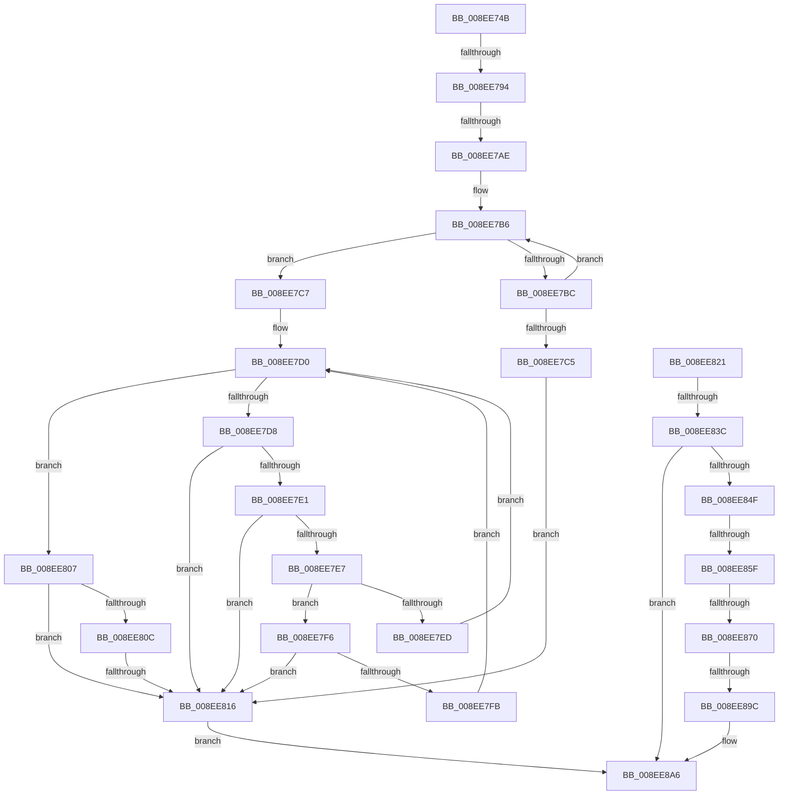

# sub_008EE74B

- RVA: `0x008EE74B`–`0x008EE8C3` (길이 `376` bytes)
- VA: `0x00000001408EE74B`
- 실행 섹션: `PAGE`
- PDB 이름 있음: `아니요`; PDB Function 태그: `아니요`
- unwind 정보 RVA: `0x00086F24`
- 디코드: `96`개 명령, `376/376` bytes 표시
- 미해석 바이트: `0` (있으면 어셈블리에 `.byte`로 보존)

> 이 문서는 커널 이미지의 기계어와 PDB 기호를 분석해 생성했습니다. 4번과 5번은 함수 원형과 자료형을 바이너리 사용 방식에서 추정한 C 해석이며 원본 소스 복구 결과는 아닙니다.

## 1. Dependencies

- 직접 호출 지점: **3**; 고유 호출 대상: **3**
- 직접 호출자로 확인된 함수: **0**
- RIP 상대 이미지 참조: **0**

### Outgoing calls
- `0x008EE783` → [ExAllocatePool2](../../poolcode/B8/ExAllocatePool2_function_00B820F0.md) (function, `0x00B820F0`)
- `0x008EE843` → [_PnpCtxGetCachedNodeBaseKey](_PnpCtxGetCachedNodeBaseKey_function_008EF9C0.md) (function, `0x008EF9C0`)
- `0x008EE88F` → [_RegRtlOpenKeyTransacted](_RegRtlOpenKeyTransacted_function_008EF810.md) (function, `0x008EF810`)

### Direct callers
- 이 함수 시작 RVA로 연결되는 직접 call은 확인되지 않았습니다. 간접 호출은 완전히 역산할 수 없습니다.

### Static image references
- 디코드된 RIP-relative 메모리 참조가 없습니다.

## 2. Other-region calls and transfers

- 다른 실행 섹션으로 향하는 call: **1**
  - `0x008EE783` → [ExAllocatePool2](../../poolcode/B8/ExAllocatePool2_function_00B820F0.md) (`PAGE` → `POOLCODE`)
- call이 아닌 외부 분기/꼬리 이동: **8**
  - `0x008EE78E` → [sub_008EE966 + 0x762](Unknown_function_008EE966.md) (`tail-transfer`)
  - `0x008EE7A8` → [sub_008EE966 + 0x219](Unknown_function_008EE966.md) (`tail-transfer`)
  - `0x008EE810` → [sub_008EE966 + 0x436](Unknown_function_008EE966.md) (`tail-transfer`)
  - `0x008EE836` → [sub_00B1DB46 + 0x50](../B1/Unknown_function_00B1DB46.md) (`tail-transfer`)
  - `0x008EE859` → [sub_008EE91B](Unknown_function_008EE91B.md) (`tail-transfer`)
  - `0x008EE86A` → [sub_008EE91B](Unknown_function_008EE91B.md) (`tail-transfer`)
  - `0x008EE896` → [sub_008EE91B + 0x7](Unknown_function_008EE91B.md) (`tail-transfer`)
  - `0x008EE8BD` → [sub_008EF0D3](Unknown_function_008EF0D3.md) (`tail-transfer`)

## 3. Assembly (complete function range)

```asm
008EE74B  49 89 5B 08                     mov qword ptr [r11 + 8], rbx
008EE74F  BB 68 01 00 00                  mov ebx, 0x168
008EE754  49 89 73 D8                     mov qword ptr [r11 - 0x28], rsi
008EE758  8B F0                           mov esi, eax
008EE75A  81 E6 00 02 00 00               and esi, 0x200
008EE760  4D 89 6B D0                     mov qword ptr [r11 - 0x30], r13
008EE764  B8 F0 00 00 00                  mov eax, 0xf0
008EE769  4D 89 7B C8                     mov qword ptr [r11 - 0x38], r15
008EE76D  0F 44 D8                        cmove ebx, eax
008EE770  41 BF 95 00 00 C0               mov r15d, 0xc0000095
008EE776  8B D3                           mov edx, ebx
008EE778  B9 00 01 00 00                  mov ecx, 0x100
008EE77D  41 B8 50 4E 50 52               mov r8d, 0x52504e50
008EE783  E8 68 39 29 00                  call 0x140b820f0
008EE788  4C 8B E8                        mov r13, rax
008EE78B  48 85 C0                        test rax, rax
008EE78E  0F 84 34 09 00 00               je 0x1408ef0c8
008EE794  4C 8B 5D 4F                     mov r11, qword ptr [rbp + 0x4f]
008EE798  45 33 C0                        xor r8d, r8d
008EE79B  44 8B D3                        mov r10d, ebx
008EE79E  41 D1 EA                        shr r10d, 1
008EE7A1  45 8D 48 01                     lea r9d, [r8 + 1]
008EE7A5  4D 85 DB                        test r11, r11
008EE7A8  0F 84 D1 03 00 00               je 0x1408eeb7f
008EE7AE  BA C8 00 00 00                  mov edx, 0xc8
008EE7B3  49 8B CB                        mov rcx, r11
008EE7B6  66 44 39 01                     cmp word ptr [rcx], r8w
008EE7BA  74 0B                           je 0x1408ee7c7
008EE7BC  48 83 C1 02                     add rcx, 2
008EE7C0  49 2B D1                        sub rdx, r9
008EE7C3  75 F1                           jne 0x1408ee7b6
008EE7C5  EB 4F                           jmp 0x1408ee816
008EE7C7  49 8B D3                        mov rdx, r11
008EE7CA  66 0F 1F 44 00 00               nop word ptr [rax + rax]
008EE7D0  0F B7 02                        movzx eax, word ptr [rdx]
008EE7D3  66 85 C0                        test ax, ax
008EE7D6  74 2F                           je 0x1408ee807
008EE7D8  8D 48 DF                        lea ecx, [rax - 0x21]
008EE7DB  66 83 F9 5E                     cmp cx, 0x5e
008EE7DF  77 35                           ja 0x1408ee816
008EE7E1  66 83 F8 2C                     cmp ax, 0x2c
008EE7E5  74 2F                           je 0x1408ee816
008EE7E7  66 83 F8 5C                     cmp ax, 0x5c
008EE7EB  74 09                           je 0x1408ee7f6
008EE7ED  41 FF C0                        inc r8d
008EE7F0  48 83 C2 02                     add rdx, 2
008EE7F4  EB DA                           jmp 0x1408ee7d0
008EE7F6  45 85 C0                        test r8d, r8d
008EE7F9  74 1B                           je 0x1408ee816
008EE7FB  45 33 C0                        xor r8d, r8d
008EE7FE  41 FF C1                        inc r9d
008EE801  48 83 C2 02                     add rdx, 2
008EE805  EB C9                           jmp 0x1408ee7d0
008EE807  45 85 C0                        test r8d, r8d
008EE80A  74 0A                           je 0x1408ee816
008EE80C  41 83 F9 03                     cmp r9d, 3
008EE810  0F 84 86 05 00 00               je 0x1408eed9c
008EE816  41 BF 33 00 00 C0               mov r15d, 0xc0000033
008EE81C  E9 85 00 00 00                  jmp 0x1408ee8a6
008EE821  41 B8 05 00 00 00               mov r8d, 5
008EE827  49 83 C6 0A                     add r14, 0xa
008EE82B  41 8B C0                        mov eax, r8d
008EE82E  49 8B 54 C4 60                  mov rdx, qword ptr [r12 + rax*8 + 0x60]
008EE833  48 85 D2                        test rdx, rdx
008EE836  0F 84 5A F3 22 00               je 0x140b1db96
008EE83C  4C 8D 4D E7                     lea r9, [rbp - 0x19]
008EE840  49 8B CC                        mov rcx, r12
008EE843  E8 78 11 00 00                  call 0x1408ef9c0
008EE848  44 8B F8                        mov r15d, eax
008EE84B  85 C0                           test eax, eax
008EE84D  78 57                           js 0x1408ee8a6
008EE84F  48 8B 5D E7                     mov rbx, qword ptr [rbp - 0x19]
008EE853  8B 75 57                        mov esi, dword ptr [rbp + 0x57]
008EE856  4D 85 E4                        test r12, r12
008EE859  0F 84 BC 00 00 00               je 0x1408ee91b
008EE85F  49 8B 84 24 E0 00 00 00         mov rax, qword ptr [r12 + 0xe0]
008EE867  48 85 C0                        test rax, rax
008EE86A  0F 84 AB 00 00 00               je 0x1408ee91b
008EE870  48 8B 48 08                     mov rcx, qword ptr [rax + 8]
008EE874  48 8B 45 77                     mov rax, qword ptr [rbp + 0x77]
008EE878  45 33 C0                        xor r8d, r8d
008EE87B  44 8B 4D 67                     mov r9d, dword ptr [rbp + 0x67]
008EE87F  49 8B D6                        mov rdx, r14
008EE882  48 89 4C 24 28                  mov qword ptr [rsp + 0x28], rcx
008EE887  48 8B CB                        mov rcx, rbx
008EE88A  48 89 44 24 20                  mov qword ptr [rsp + 0x20], rax
008EE88F  E8 7C 0F 00 00                  call 0x1408ef810
008EE894  85 C0                           test eax, eax
008EE896  0F 85 86 00 00 00               jne 0x1408ee922
008EE89C  48 8B 45 7F                     mov rax, qword ptr [rbp + 0x7f]
008EE8A0  C7 00 02 00 00 00               mov dword ptr [rax], 2
008EE8A6  48 8B 4D EF                     mov rcx, qword ptr [rbp - 0x11]
008EE8AA  48 8B B4 24 A0 00 00 00         mov rsi, qword ptr [rsp + 0xa0]
008EE8B2  48 8B 9C 24 D0 00 00 00         mov rbx, qword ptr [rsp + 0xd0]
008EE8BA  48 85 C9                        test rcx, rcx
008EE8BD  0F 85 10 08 00 00               jne 0x1408ef0d3
```

## 4. C-style interpretation (structured pseudocode)

```c
__int64 __fastcall sub_008EE74B(__int64 a1, __int64 a2, __int64 a3, __int64 a4, __int64 a5, __int64 a6, __int64 a7, __int64 a8, __int64 a9, __int64 a10, __int64 a11, __int64 a12, __int64 a13, __int64 a14, __int64 a15, __int64 a16, __int64 a17, __int64 a18, __int64 a19, __int64 a20, __int64 a21, __int64 a22, __int64 a23, __int64 a24, __int64 a25, __int64 a26)
{
    __int64 result;
    __int64 v_r10;
    __int64 v_rbx;
    __int64 v_rsi;
    unsigned __int64 v_stack_p20;
    unsigned __int64 v_stack_p28;

    *(unsigned __int64 *)(v_r11 + 8) = v_rbx;
    *(unsigned __int64 *)(v_r11 - 40) = v_rsi;
    v_rsi = (unsigned int)(((unsigned int)((unsigned int)(result))) & (512));
    *(unsigned __int64 *)(v_r11 - 48) = v_r13;
    *(unsigned __int64 *)(v_r11 - 56) = v_r15;
    v_rbx = 360;
    if (condition_is_equal) { v_rbx = 240; }
    result = ExAllocatePool2(256, (unsigned int)((unsigned int)(v_rbx)), (unsigned int)(0x52504E50ULL), a4);
    a3 = 0;
    v_r10 = (unsigned int)(((unsigned int)((unsigned int)(v_rbx))) >> (1));
loc_008EE7B6:
    if ((*(unsigned __int16 *)(*(unsigned __int64 *)(v_rbp + 79))) == 0) goto loc_008EE7C7;
    a1 = (*(unsigned __int64 *)(v_rbp + 79)) + (2);
    a2 = (200) - (a3 + 1);
    if (condition_is_not_equal) goto loc_008EE7B6;
    goto loc_008EE816;
loc_008EE7C7:
loc_008EE7D0:
    if ((unsigned __int16)(*(unsigned __int16 *)(*(unsigned __int64 *)(v_rbp + 79))) == 0) goto loc_008EE807;
    if (((unsigned __int16)(*(unsigned __int16 *)(*(unsigned __int64 *)(v_rbp + 79)) - 33)) > 94) goto loc_008EE816;
    if (((unsigned __int16)(*(unsigned __int16 *)(*(unsigned __int64 *)(v_rbp + 79)))) == 44) goto loc_008EE816;
    if (((unsigned __int16)(*(unsigned __int16 *)(*(unsigned __int64 *)(v_rbp + 79)))) == 92) goto loc_008EE7F6;
    a3 = (unsigned int)((a3) + 1);
    a2 = (*(unsigned __int64 *)(v_rbp + 79)) + (2);
    goto loc_008EE7D0;
loc_008EE7F6:
    if ((unsigned int)(a3) == 0) goto loc_008EE816;
    a3 = 0;
    a4 = (unsigned int)((a3 + 1) + 1);
    a2 = (a2) + (2);
    goto loc_008EE7D0;
loc_008EE807:
    if (0 == 0) goto loc_008EE816;
loc_008EE816:
    goto loc_008EE8A6;
loc_008EE8A6:
}
```

## 5. (Beta) C Style

```c
int64_t sub_008EE74B(int64_t Arg1, int64_t Arg2, int64_t Arg3, int64_t Arg4, uint64_t Arg5, uint64_t Arg6, uint64_t Arg7, uint64_t Arg8, uint64_t Arg9, uint64_t Arg10, uint64_t Arg11, uint64_t Arg12, uint64_t Arg13, uint64_t Arg14, uint64_t Arg15, uint64_t Arg16, uint64_t Arg17, uint64_t Arg18, uint64_t Arg19, int64_t Arg20, uint64_t Arg21, uint64_t Arg22, uint64_t Arg23, uint64_t Arg24, uint64_t Arg25, int64_t Arg26)
{
    int64_t result;
    int64_t local_r10;
    int64_t local_rbx;
    int64_t local_rsi;
    uint64_t v_stack_p20;
    uint64_t v_stack_p28;

    *(uint64_t *)(local_r11 + 0x8) = local_rbx;
    *(uint64_t *)(local_r11 - 0x28) = local_rsi;
    local_rsi = (uint32_t)(((uint32_t)((uint32_t)(result))) & (512));
    *(uint64_t *)(local_r11 - 0x30) = local_r13;
    *(uint64_t *)(local_r11 - 0x38) = local_r15;
    local_rbx = 360;
    if (condition_is_equal) { local_rbx = 240; }
    result = ExAllocatePool2(256, (uint32_t)((uint32_t)(local_rbx)), (uint32_t)(0x52504E50ULL), Arg4);
    Arg3 = 0;
    local_r10 = (uint32_t)(((uint32_t)((uint32_t)(local_rbx))) >> (1));
loc_008EE7B6:
    if ((*(uint16_t *)(*(uint64_t *)(local_rbp + 0x4F))) == 0) goto loc_008EE7C7;
    Arg1 = (*(uint64_t *)(local_rbp + 0x4F)) + (2);
    Arg2 = (200) - (Arg3 + 1);
    if (condition_is_not_equal) goto loc_008EE7B6;
    goto loc_008EE816;
loc_008EE7C7:
loc_008EE7D0:
    if ((uint16_t)(*(uint16_t *)(*(uint64_t *)(local_rbp + 0x4F))) == 0) goto loc_008EE807;
    if (((uint16_t)(*(uint16_t *)(*(uint64_t *)(local_rbp + 0x4F)) - 33)) > 94) goto loc_008EE816;
    if (((uint16_t)(*(uint16_t *)(*(uint64_t *)(local_rbp + 0x4F)))) == 44) goto loc_008EE816;
    if (((uint16_t)(*(uint16_t *)(*(uint64_t *)(local_rbp + 0x4F)))) == 92) goto loc_008EE7F6;
    Arg3 = (uint32_t)((Arg3) + 1);
    Arg2 = (*(uint64_t *)(local_rbp + 0x4F)) + (2);
    goto loc_008EE7D0;
loc_008EE7F6:
    if ((uint32_t)(Arg3) == 0) goto loc_008EE816;
    Arg3 = 0;
    Arg4 = (uint32_t)((Arg3 + 1) + 1);
    Arg2 = (Arg2) + (2);
    goto loc_008EE7D0;
loc_008EE807:
    if (0 == 0) goto loc_008EE816;
loc_008EE816:
    goto loc_008EE8A6;
loc_008EE8A6:
}
```

## 6. Execution-region graph

[열기: 2D/3D 그래프와 함수 탐색 컨트롤 패널](../../../control-panel.html?section=page&rva=0x008EE74B&view=graph)

- 2D 그래프는 위에서 아래로 흐르고, 3D 그래프는 빈 공간을 드래그해 회전합니다. Shift+드래그는 이동, 휠은 확대·축소, 함수 노드 선택은 대상 보고서 이동입니다.

### Static fallback


