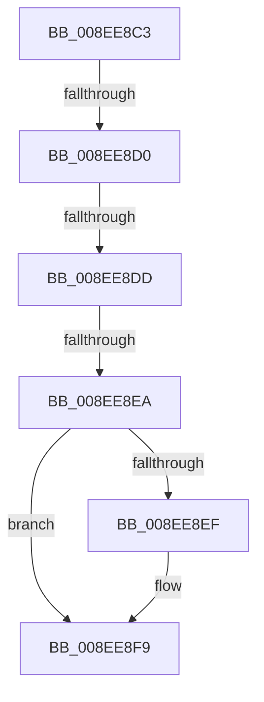

# sub_008EE8C3

- RVA: `0x008EE8C3`–`0x008EE91A` (길이 `87` bytes)
- VA: `0x00000001408EE8C3`
- 실행 섹션: `PAGE`
- PDB 이름 있음: `아니요`; PDB Function 태그: `아니요`
- unwind 정보 RVA: `0x00086F44`
- 디코드: `23`개 명령, `87/87` bytes 표시
- 미해석 바이트: `0` (있으면 어셈블리에 `.byte`로 보존)

> 이 문서는 커널 이미지의 기계어와 PDB 기호를 분석해 생성했습니다. 4번과 5번은 함수 원형과 자료형을 바이너리 사용 방식에서 추정한 C 해석이며 원본 소스 복구 결과는 아닙니다.

## 1. Dependencies

- 직접 호출 지점: **1**; 고유 호출 대상: **1**
- 직접 호출자로 확인된 함수: **0**
- RIP 상대 이미지 참조: **0**

### Outgoing calls
- `0x008EE8F4` → [ExFreePoolWithTag](../../poolcode/B8/ExFreePoolWithTag_function_00B82870.md) (function, `0x00B82870`)

### Direct callers
- 이 함수 시작 RVA로 연결되는 직접 call은 확인되지 않았습니다. 간접 호출은 완전히 역산할 수 없습니다.

### Static image references
- 디코드된 RIP-relative 메모리 참조가 없습니다.

## 2. Other-region calls and transfers

- 다른 실행 섹션으로 향하는 call: **1**
  - `0x008EE8F4` → [ExFreePoolWithTag](../../poolcode/B8/ExFreePoolWithTag_function_00B82870.md) (`PAGE` → `POOLCODE`)
- call이 아닌 외부 분기/꼬리 이동: **3**
  - `0x008EE8CA` → [sub_008EF0D3 + 0xA](Unknown_function_008EF0D3.md) (`tail-transfer`)
  - `0x008EE8D7` → [sub_008EF0D3 + 0x14](Unknown_function_008EF0D3.md) (`tail-transfer`)
  - `0x008EE8E4` → [sub_008EF0D3 + 0x1E](Unknown_function_008EF0D3.md) (`tail-transfer`)

## 3. Assembly (complete function range)

```asm
008EE8C3  48 8B 4D D7                     mov rcx, qword ptr [rbp - 0x29]
008EE8C7  48 85 C9                        test rcx, rcx
008EE8CA  0F 85 0D 08 00 00               jne 0x1408ef0dd
008EE8D0  48 8B 4D CF                     mov rcx, qword ptr [rbp - 0x31]
008EE8D4  48 85 C9                        test rcx, rcx
008EE8D7  0F 85 0A 08 00 00               jne 0x1408ef0e7
008EE8DD  48 8B 45 DF                     mov rax, qword ptr [rbp - 0x21]
008EE8E1  48 85 C0                        test rax, rax
008EE8E4  0F 85 07 08 00 00               jne 0x1408ef0f1
008EE8EA  4D 85 ED                        test r13, r13
008EE8ED  74 0A                           je 0x1408ee8f9
008EE8EF  33 D2                           xor edx, edx
008EE8F1  49 8B CD                        mov rcx, r13
008EE8F4  E8 77 3F 29 00                  call 0x140b82870
008EE8F9  4C 8B AC 24 98 00 00 00         mov r13, qword ptr [rsp + 0x98]
008EE901  41 8B C7                        mov eax, r15d
008EE904  4C 8B BC 24 90 00 00 00         mov r15, qword ptr [rsp + 0x90]
008EE90C  48 81 C4 A8 00 00 00            add rsp, 0xa8
008EE913  41 5E                           pop r14
008EE915  41 5C                           pop r12
008EE917  5F                              pop rdi
008EE918  5D                              pop rbp
008EE919  C3                              ret
```

## 4. C-style interpretation (structured pseudocode)

```c
__int64 __fastcall sub_008EE8C3(__int64 a1, int a2, __int64 a3, __int64 a4, __int64 a5, __int64 a6, __int64 a7, __int64 a8, __int64 a9, __int64 a10, __int64 a11, __int64 a12, __int64 a13, __int64 a14, __int64 a15, __int64 a16, __int64 a17, __int64 a18, __int64 a19)
{
    __int64 result;
    __int64 v_rsp;

    result = *(unsigned __int64 *)(v_rbp - 33);
    if (v_r13 != 0) {
        a2 = 0;
        a1 = v_r13;
        result = ExFreePoolWithTag(a1, a2, a3, a4);
    }
    v_rsp = (v_rsp) + (168);
    return (unsigned int)((unsigned int)(v_r15));
}
```

## 5. (Beta) C Style

```c
int64_t sub_008EE8C3(int64_t Arg1, int32_t Arg2, int64_t Arg3, int64_t Arg4, uint64_t Arg5, uint64_t Arg6, uint64_t Arg7, uint64_t Arg8, uint64_t Arg9, uint64_t Arg10, uint64_t Arg11, uint64_t Arg12, uint64_t Arg13, uint64_t Arg14, uint64_t Arg15, uint64_t Arg16, uint64_t Arg17, int64_t Arg18, int64_t Arg19)
{
    int64_t result;
    int64_t local_rsp;

    result = *(uint64_t *)(local_rbp - 0x21);
    if (local_r13 != 0) {
        Arg2 = 0;
        Arg1 = local_r13;
        result = ExFreePoolWithTag(Arg1, Arg2, Arg3, Arg4);
    }
    local_rsp = (local_rsp) + (168);
    return (uint32_t)((uint32_t)(local_r15));
}
```

## 6. Execution-region graph

[열기: 2D/3D 그래프와 함수 탐색 컨트롤 패널](../../../control-panel.html?section=page&rva=0x008EE8C3&view=graph)

- 2D 그래프는 위에서 아래로 흐르고, 3D 그래프는 빈 공간을 드래그해 회전합니다. Shift+드래그는 이동, 휠은 확대·축소, 함수 노드 선택은 대상 보고서 이동입니다.

### Static fallback


