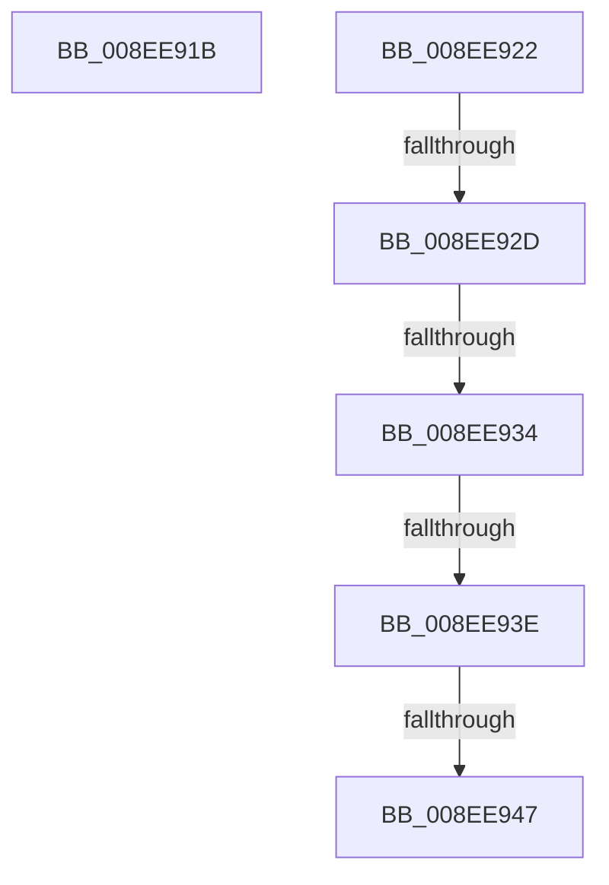

# sub_008EE91B

- RVA: `0x008EE91B`–`0x008EE952` (길이 `55` bytes)
- VA: `0x00000001408EE91B`
- 실행 섹션: `PAGE`
- PDB 이름 있음: `아니요`; PDB Function 태그: `아니요`
- unwind 정보 RVA: `0x00086F70`
- 디코드: `13`개 명령, `55/55` bytes 표시
- 미해석 바이트: `0` (있으면 어셈블리에 `.byte`로 보존)

> 이 문서는 커널 이미지의 기계어와 PDB 기호를 분석해 생성했습니다. 4번과 5번은 함수 원형과 자료형을 바이너리 사용 방식에서 추정한 C 해석이며 원본 소스 복구 결과는 아닙니다.

## 1. Dependencies

- 직접 호출 지점: **0**; 고유 호출 대상: **0**
- 직접 호출자로 확인된 함수: **0**
- RIP 상대 이미지 참조: **0**

### Outgoing calls
- 직접 디코드된 call 명령이 없습니다.

### Direct callers
- 이 함수 시작 RVA로 연결되는 직접 call은 확인되지 않았습니다. 간접 호출은 완전히 역산할 수 없습니다.

### Static image references
- 디코드된 RIP-relative 메모리 참조가 없습니다.

## 2. Other-region calls and transfers

- 다른 실행 섹션으로 향하는 call: **0**
- call이 아닌 외부 분기/꼬리 이동: **6**
  - `0x008EE91D` → [sub_008EE74B + 0x129](Unknown_function_008EE74B.md) (`tail-transfer`)
  - `0x008EE927` → [sub_008EE966 + 0xE2](Unknown_function_008EE966.md) (`tail-transfer`)
  - `0x008EE932` → [sub_008EE966](Unknown_function_008EE966.md) (`tail-transfer`)
  - `0x008EE93C` → [sub_008EE966 + 0x8](Unknown_function_008EE966.md) (`tail-transfer`)
  - `0x008EE941` → [sub_008EE966 + 0xED](Unknown_function_008EE966.md) (`tail-transfer`)
  - `0x008EE94D` → [sub_008EE74B + 0x15B](Unknown_function_008EE74B.md) (`tail-transfer`)

## 3. Assembly (complete function range)

```asm
008EE91B  33 C9                           xor ecx, ecx
008EE91D  E9 52 FF FF FF                  jmp 0x1408ee874
008EE922  3D 7C 01 00 C0                  cmp eax, 0xc000017c
008EE927  0F 84 1B 01 00 00               je 0x1408eea48
008EE92D  3D 34 00 00 C0                  cmp eax, 0xc0000034
008EE932  75 32                           jne 0x1408ee966
008EE934  80 7D 6F 00                     cmp byte ptr [rbp + 0x6f], 0
008EE938  40 0F B6 FE                     movzx edi, sil
008EE93C  75 30                           jne 0x1408ee96e
008EE93E  83 FF 10                        cmp edi, 0x10
008EE941  0F 84 0C 01 00 00               je 0x1408eea53
008EE947  41 BF 34 00 00 C0               mov r15d, 0xc0000034
008EE94D  E9 54 FF FF FF                  jmp 0x1408ee8a6
```

## 4. C-style interpretation (structured pseudocode)

```c
void __fastcall sub_008EE91B(int a1)
{
    a1 = 0;
}
```

## 5. (Beta) C Style

```c
void sub_008EE91B(int32_t Arg1)
{
    Arg1 = 0;
}
```

## 6. Execution-region graph

[열기: 2D/3D 그래프와 함수 탐색 컨트롤 패널](../../../control-panel.html?section=page&rva=0x008EE91B&view=graph)

- 2D 그래프는 위에서 아래로 흐르고, 3D 그래프는 빈 공간을 드래그해 회전합니다. Shift+드래그는 이동, 휠은 확대·축소, 함수 노드 선택은 대상 보고서 이동입니다.

### Static fallback


