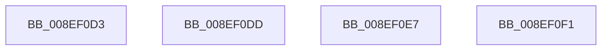

# sub_008EF0D3

- RVA: `0x008EF0D3`–`0x008EF100` (길이 `45` bytes)
- VA: `0x00000001408EF0D3`
- 실행 섹션: `PAGE`
- PDB 이름 있음: `아니요`; PDB Function 태그: `아니요`
- unwind 정보 RVA: `0x00086FC4`
- 디코드: `10`개 명령, `45/45` bytes 표시
- 미해석 바이트: `0` (있으면 어셈블리에 `.byte`로 보존)

> 이 문서는 커널 이미지의 기계어와 PDB 기호를 분석해 생성했습니다. 4번과 5번은 함수 원형과 자료형을 바이너리 사용 방식에서 추정한 C 해석이며 원본 소스 복구 결과는 아닙니다.

## 1. Dependencies

- 직접 호출 지점: **4**; 고유 호출 대상: **2**
- 직접 호출자로 확인된 함수: **0**
- RIP 상대 이미지 참조: **0**

### Outgoing calls
- `0x008EF0D3` → [ZwClose](../../text/6A/ZwClose_function_006AD2B0.md) (function, `0x006AD2B0`)
- `0x008EF0DD` → [ZwClose](../../text/6A/ZwClose_function_006AD2B0.md) (function, `0x006AD2B0`)
- `0x008EF0E7` → [ZwClose](../../text/6A/ZwClose_function_006AD2B0.md) (function, `0x006AD2B0`)
- `0x008EF0F6` → [ExFreePoolWithTag](../../poolcode/B8/ExFreePoolWithTag_function_00B82870.md) (function, `0x00B82870`)

### Direct callers
- 이 함수 시작 RVA로 연결되는 직접 call은 확인되지 않았습니다. 간접 호출은 완전히 역산할 수 없습니다.

### Static image references
- 디코드된 RIP-relative 메모리 참조가 없습니다.

## 2. Other-region calls and transfers

- 다른 실행 섹션으로 향하는 call: **4**
  - `0x008EF0D3` → [ZwClose](../../text/6A/ZwClose_function_006AD2B0.md) (`PAGE` → `.text`)
  - `0x008EF0DD` → [ZwClose](../../text/6A/ZwClose_function_006AD2B0.md) (`PAGE` → `.text`)
  - `0x008EF0E7` → [ZwClose](../../text/6A/ZwClose_function_006AD2B0.md) (`PAGE` → `.text`)
  - `0x008EF0F6` → [ExFreePoolWithTag](../../poolcode/B8/ExFreePoolWithTag_function_00B82870.md) (`PAGE` → `POOLCODE`)
- call이 아닌 외부 분기/꼬리 이동: **4**
  - `0x008EF0D8` → [sub_008EE8C3](Unknown_function_008EE8C3.md) (`tail-transfer`)
  - `0x008EF0E2` → [sub_008EE8C3 + 0xD](Unknown_function_008EE8C3.md) (`tail-transfer`)
  - `0x008EF0EC` → [sub_008EE8C3 + 0x1A](Unknown_function_008EE8C3.md) (`tail-transfer`)
  - `0x008EF0FB` → [sub_008EE8C3 + 0x27](Unknown_function_008EE8C3.md) (`tail-transfer`)

## 3. Assembly (complete function range)

```asm
008EF0D3  E8 D8 E1 DB FF                  call 0x1406ad2b0
008EF0D8  E9 E6 F7 FF FF                  jmp 0x1408ee8c3
008EF0DD  E8 CE E1 DB FF                  call 0x1406ad2b0
008EF0E2  E9 E9 F7 FF FF                  jmp 0x1408ee8d0
008EF0E7  E8 C4 E1 DB FF                  call 0x1406ad2b0
008EF0EC  E9 EC F7 FF FF                  jmp 0x1408ee8dd
008EF0F1  33 D2                           xor edx, edx
008EF0F3  48 8B C8                        mov rcx, rax
008EF0F6  E8 75 37 29 00                  call 0x140b82870
008EF0FB  E9 EA F7 FF FF                  jmp 0x1408ee8ea
```

## 4. C-style interpretation (structured pseudocode)

```c
__int64 __fastcall sub_008EF0D3(__int64 a1, int a2)
{
    __int64 result;

    result = ZwClose(a1, a2, a3, a4);
}
```

## 5. (Beta) C Style

```c
int64_t sub_008EF0D3(int64_t Arg1, int32_t Arg2)
{
    int64_t result;

    result = ZwClose(Arg1, Arg2, a3, a4);
}
```

## 6. Execution-region graph

[열기: 2D/3D 그래프와 함수 탐색 컨트롤 패널](../../../control-panel.html?section=page&rva=0x008EF0D3&view=graph)

- 2D 그래프는 위에서 아래로 흐르고, 3D 그래프는 빈 공간을 드래그해 회전합니다. Shift+드래그는 이동, 휠은 확대·축소, 함수 노드 선택은 대상 보고서 이동입니다.

### Static fallback


