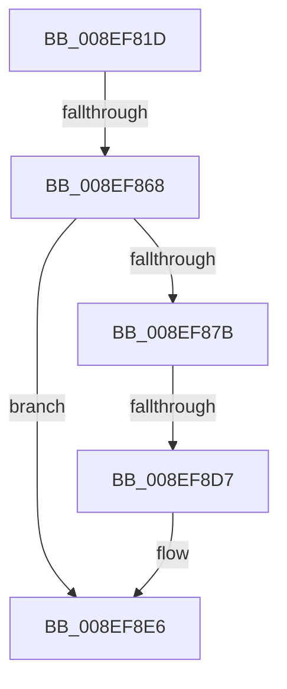

# sub_008EF81D

- RVA: `0x008EF81D`–`0x008EF911` (길이 `244` bytes)
- VA: `0x00000001408EF81D`
- 실행 섹션: `PAGE`
- PDB 이름 있음: `아니요`; PDB Function 태그: `아니요`
- unwind 정보 RVA: `0x0008703C`
- 디코드: `54`개 명령, `244/244` bytes 표시
- 미해석 바이트: `0` (있으면 어셈블리에 `.byte`로 보존)

> 이 문서는 커널 이미지의 기계어와 PDB 기호를 분석해 생성했습니다. 4번과 5번은 함수 원형과 자료형을 바이너리 사용 방식에서 추정한 C 해석이며 원본 소스 복구 결과는 아닙니다.

## 1. Dependencies

- 직접 호출 지점: **2**; 고유 호출 대상: **2**
- 직접 호출자로 확인된 함수: **0**
- RIP 상대 이미지 참조: **0**

### Outgoing calls
- `0x008EF870` → [RtlInitUnicodeStringEx](../../text/46/RtlInitUnicodeStringEx_function_00463960.md) (function, `0x00463960`)
- `0x008EF8DF` → [ZwOpenKeyEx](../../text/6A/ZwOpenKeyEx_function_006AF650.md) (function, `0x006AF650`)

### Direct callers
- 이 함수 시작 RVA로 연결되는 직접 call은 확인되지 않았습니다. 간접 호출은 완전히 역산할 수 없습니다.

### Static image references
- 디코드된 RIP-relative 메모리 참조가 없습니다.

## 2. Other-region calls and transfers

- 다른 실행 섹션으로 향하는 call: **2**
  - `0x008EF870` → [RtlInitUnicodeStringEx](../../text/46/RtlInitUnicodeStringEx_function_00463960.md) (`PAGE` → `.text`)
  - `0x008EF8DF` → [ZwOpenKeyEx](../../text/6A/ZwOpenKeyEx_function_006AF650.md) (`PAGE` → `.text`)
- call이 아닌 외부 분기/꼬리 이동: **3**
  - `0x008EF862` → [sub_008EF91D + 0x6F](Unknown_function_008EF91D.md) (`tail-transfer`)
  - `0x008EF8D5` → [sub_008EF91D](Unknown_function_008EF91D.md) (`tail-transfer`)
  - `0x008EF90B` → [sub_008EF9A8](Unknown_function_008EF9A8.md) (`tail-transfer`)

## 3. Assembly (complete function range)

```asm
008EF81D  49 89 6B 10                     mov qword ptr [r11 + 0x10], rbp
008EF821  0F 57 C0                        xorps xmm0, xmm0
008EF824  49 89 73 18                     mov qword ptr [r11 + 0x18], rsi
008EF828  49 89 7B F0                     mov qword ptr [r11 - 0x10], rdi
008EF82C  41 8B F0                        mov esi, r8d
008EF82F  0F 11 44 24 40                  movups xmmword ptr [rsp + 0x40], xmm0
008EF834  49 89 43 08                     mov qword ptr [r11 + 8], rax
008EF838  48 8B EA                        mov rbp, rdx
008EF83B  0F 11 44 24 50                  movups xmmword ptr [rsp + 0x50], xmm0
008EF840  49 89 43 D8                     mov qword ptr [r11 - 0x28], rax
008EF844  48 8B F9                        mov rdi, rcx
008EF847  89 44 24 68                     mov dword ptr [rsp + 0x68], eax
008EF84B  48 8D 81 00 00 00 80            lea rax, [rcx - 0x80000000]
008EF852  4D 89 73 E8                     mov qword ptr [r11 - 0x18], r14
008EF856  45 8B F1                        mov r14d, r9d
008EF859  0F 11 44 24 30                  movups xmmword ptr [rsp + 0x30], xmm0
008EF85E  48 83 F8 07                     cmp rax, 7
008EF862  0F 86 24 01 00 00               jbe 0x1408ef98c
008EF868  48 8B D5                        mov rdx, rbp
008EF86B  48 8D 4C 24 30                  lea rcx, [rsp + 0x30]
008EF870  E8 EB 40 B7 FF                  call 0x140463960
008EF875  8B D8                           mov ebx, eax
008EF877  85 C0                           test eax, eax
008EF879  78 6B                           js 0x1408ef8e6
008EF87B  48 8B 84 24 90 00 00 00         mov rax, qword ptr [rsp + 0x90]
008EF883  4C 8D 44 24 40                  lea r8, [rsp + 0x40]
008EF888  48 85 C0                        test rax, rax
008EF88B  C7 44 24 40 30 00 00 00         mov dword ptr [rsp + 0x40], 0x30
008EF893  BA 40 02 00 00                  mov edx, 0x240
008EF898  0F 57 C0                        xorps xmm0, xmm0
008EF89B  48 0F 45 F8                     cmovne rdi, rax
008EF89F  44 8B CE                        mov r9d, esi
008EF8A2  0F BA E6 03                     bt esi, 3
008EF8A6  48 89 7C 24 48                  mov qword ptr [rsp + 0x48], rdi
008EF8AB  48 8B BC 24 B8 00 00 00         mov rdi, qword ptr [rsp + 0xb8]
008EF8B3  B8 40 03 00 00                  mov eax, 0x340
008EF8B8  0F 43 C2                        cmovae eax, edx
008EF8BB  41 8B D6                        mov edx, r14d
008EF8BE  89 44 24 58                     mov dword ptr [rsp + 0x58], eax
008EF8C2  48 8D 44 24 30                  lea rax, [rsp + 0x30]
008EF8C7  48 89 44 24 50                  mov qword ptr [rsp + 0x50], rax
008EF8CC  F3 0F 7F 44 24 60               movdqu xmmword ptr [rsp + 0x60], xmm0
008EF8D2  48 85 FF                        test rdi, rdi
008EF8D5  75 46                           jne 0x1408ef91d
008EF8D7  48 8B 8C 24 B0 00 00 00         mov rcx, qword ptr [rsp + 0xb0]
008EF8DF  E8 6C FD DB FF                  call 0x1406af650
008EF8E4  8B D8                           mov ebx, eax
008EF8E6  48 8B 8C 24 90 00 00 00         mov rcx, qword ptr [rsp + 0x90]
008EF8EE  4C 8B 74 24 70                  mov r14, qword ptr [rsp + 0x70]
008EF8F3  48 8B 7C 24 78                  mov rdi, qword ptr [rsp + 0x78]
008EF8F8  48 8B B4 24 A0 00 00 00         mov rsi, qword ptr [rsp + 0xa0]
008EF900  48 8B AC 24 98 00 00 00         mov rbp, qword ptr [rsp + 0x98]
008EF908  48 85 C9                        test rcx, rcx
008EF90B  0F 85 97 00 00 00               jne 0x1408ef9a8
```

## 4. C-style interpretation (structured pseudocode)

```c
__int64 __fastcall sub_008EF81D(__int64 a1, __int64 a2, int a3, int a4, __int64 a5, __int64 a6, __int64 a7, __int64 a8, __int64 a9, __int64 a10, __int64 a11, __int64 a12, __int64 a13, __int64 a14, __int64 a15, __int64 a16, __int64 a17, __int64 a18, __int64 a19, __int64 a20, __int64 a21, __int64 a22, __int64 a23)
{
    __int64 result;
    unsigned int v_stack_p40;
    unsigned __int64 v_stack_p48;
    unsigned __int64 v_stack_p50;
    unsigned int v_stack_p58;
    unsigned __int64 v_stack_p60;
    unsigned int v_stack_p68;

    *(unsigned __int64 *)(v_r11 + 16) = v_rbp;
    *(unsigned __int64 *)(v_r11 + 24) = v_rsi;
    *(unsigned __int64 *)(v_r11 - 16) = v_rdi;
    a8 = v_xmm0;
    *(unsigned __int64 *)(v_r11 + 8) = result;
    a10 = v_xmm0;
    *(unsigned __int64 *)(v_r11 - 40) = result;
    v_stack_p68 = (unsigned int)(result);
    *(unsigned __int64 *)(v_r11 - 24) = v_r14;
    a6 = v_xmm0;
    result = RtlInitUnicodeStringEx(a6, a2, a3, a4);
    if (sign_flag) goto loc_008EF8E6;
    v_stack_p40 = 48;
    if (a18 != 0) { a1 = a18; }
    v_stack_p48 = a1;
    result = 832;
    if (condition_is_above_or_equal) { result = 576; }
    v_stack_p58 = (unsigned int)(result);
    v_stack_p50 = a6;
    v_stack_p60 = v_xmm0;
    result = ZwOpenKeyEx(a22, (unsigned int)((unsigned int)((unsigned int)(a4))), a8, (unsigned int)((unsigned int)((unsigned int)(a3))));
loc_008EF8E6:
}
```

## 5. (Beta) C Style

```c
int64_t sub_008EF81D(void *Arg1, int64_t Arg2, int32_t Arg3, int32_t Arg4, uint64_t Arg5, int64_t Arg6, uint64_t Arg7, int64_t Arg8, uint64_t Arg9, int64_t Arg10, uint64_t Arg11, uint64_t Arg12, uint64_t Arg13, int64_t Arg14, int64_t Arg15, uint64_t Arg16, uint64_t Arg17, int64_t Arg18, int64_t Arg19, int64_t Arg20, uint64_t Arg21, int64_t Arg22, int64_t Arg23)
{
    uint8_t *arg1 = (uint8_t *)Arg1;

    int64_t result;
    uint32_t v_stack_p40;
    uint64_t v_stack_p48;
    uint64_t v_stack_p50;
    uint32_t v_stack_p58;
    uint64_t v_stack_p60;
    uint32_t v_stack_p68;

    *(uint64_t *)(local_r11 + 0x10) = local_rbp;
    *(uint64_t *)(local_r11 + 0x18) = local_rsi;
    *(uint64_t *)(local_r11 - 0x10) = local_rdi;
    Arg8 = v_xmm0;
    *(uint64_t *)(local_r11 + 0x8) = result;
    Arg10 = v_xmm0;
    *(uint64_t *)(local_r11 - 0x28) = result;
    v_stack_p68 = (uint32_t)(result);
    *(uint64_t *)(local_r11 - 0x18) = local_r14;
    Arg6 = v_xmm0;
    result = RtlInitUnicodeStringEx(Arg6, Arg2, Arg3, Arg4);
    if (sign_flag) goto loc_008EF8E6;
    v_stack_p40 = 48;
    if (Arg18 != 0) { Arg1 = Arg18; }
    v_stack_p48 = Arg1;
    result = 832;
    if (condition_is_above_or_equal) { result = 576; }
    v_stack_p58 = (uint32_t)(result);
    v_stack_p50 = Arg6;
    v_stack_p60 = v_xmm0;
    result = ZwOpenKeyEx(Arg22, (uint32_t)((uint32_t)((uint32_t)(Arg4))), Arg8, (uint32_t)((uint32_t)((uint32_t)(Arg3))));
loc_008EF8E6:
}
```

### 관측된 메모리 오프셋

구조체 형식이 확인되지 않은 접근은 인자 기준의 오프셋으로만 기록했습니다.

| 기준 인자 | 오프셋 표현 | 폭 (bit) | 접근 |
|---|---:|---:|---|
| `Arg1` | `- 0x80000000` | `64` | `R` |

## 6. Execution-region graph

[열기: 2D/3D 그래프와 함수 탐색 컨트롤 패널](../../../control-panel.html?section=page&rva=0x008EF81D&view=graph)

- 2D 그래프는 위에서 아래로 흐르고, 3D 그래프는 빈 공간을 드래그해 회전합니다. Shift+드래그는 이동, 휠은 확대·축소, 함수 노드 선택은 대상 보고서 이동입니다.

### Static fallback


