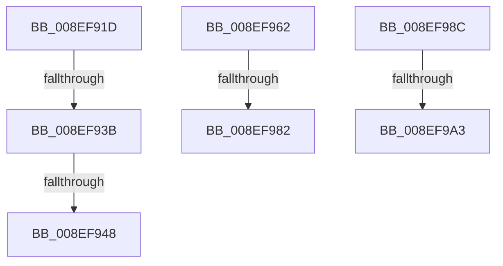

# sub_008EF91D

- RVA: `0x008EF91D`–`0x008EF9A8` (길이 `139` bytes)
- VA: `0x00000001408EF91D`
- 실행 섹션: `PAGE`
- PDB 이름 있음: `아니요`; PDB Function 태그: `아니요`
- unwind 정보 RVA: `0x00087070`
- 디코드: `29`개 명령, `139/139` bytes 표시
- 미해석 바이트: `0` (있으면 어셈블리에 `.byte`로 보존)

> 이 문서는 커널 이미지의 기계어와 PDB 기호를 분석해 생성했습니다. 4번과 5번은 함수 원형과 자료형을 바이너리 사용 방식에서 추정한 C 해석이며 원본 소스 복구 결과는 아닙니다.

## 1. Dependencies

- 직접 호출 지점: **3**; 고유 호출 대상: **3**
- 직접 호출자로 확인된 함수: **0**
- RIP 상대 이미지 참조: **4**

### Outgoing calls
- `0x008EF92D` → [NtOpenKeyTransactedEx_Stub](../70/NtOpenKeyTransactedEx_Stub_function_00702FB0.md) (function, `0x00702FB0`)
- `0x008EF970` → [guard_dispatch_icall](../../text/6B/guard_dispatch_icall_function_006BAAD0.md) (function, `0x006BAAD0`)
- `0x008EF994` → [RegRtlOpenPredefinedKey](../83/RegRtlOpenPredefinedKey_function_00832A14.md) (function, `0x00832A14`)

### Direct callers
- 이 함수 시작 RVA로 연결되는 직접 call은 확인되지 않았습니다. 간접 호출은 완전히 역산할 수 없습니다.

### Static image references
- `0x008EF93B` → RVA `0x00EEFFE1` (`.data`; read)
- `0x008EF948` → RVA `0x006AF670` (`ZwOpenKeyTransacted`; read)
- `0x008EF94F` → RVA `0x00EEFFE1` (`.data`; write)
- `0x008EF956` → RVA `0x00EEFFD8` (`.data`; write)

## 2. Other-region calls and transfers

- 다른 실행 섹션으로 향하는 call: **1**
  - `0x008EF970` → [guard_dispatch_icall](../../text/6B/guard_dispatch_icall_function_006BAAD0.md) (`PAGE` → `.text`)
- call이 아닌 외부 분기/꼬리 이동: **7**
  - `0x008EF939` → [sub_008EF81D + 0xC9](Unknown_function_008EF81D.md) (`tail-transfer`)
  - `0x008EF942` → [sub_00B1E10A](../B1/Unknown_function_00B1E10A.md) (`tail-transfer`)
  - `0x008EF95D` → [sub_00B1E10A + 0x7](../B1/Unknown_function_00B1E10A.md) (`tail-transfer`)
  - `0x008EF97C` → [sub_008EF81D + 0xC9](Unknown_function_008EF81D.md) (`tail-transfer`)
  - `0x008EF987` → [sub_008EF81D + 0xC9](Unknown_function_008EF81D.md) (`tail-transfer`)
  - `0x008EF99D` → [sub_008EF81D + 0xC9](Unknown_function_008EF81D.md) (`tail-transfer`)
  - `0x008EF9A3` → [sub_008EF81D + 0x4B](Unknown_function_008EF81D.md) (`tail-transfer`)

## 3. Assembly (complete function range)

```asm
008EF91D  48 8B B4 24 B0 00 00 00         mov rsi, qword ptr [rsp + 0xb0]
008EF925  48 8B CE                        mov rcx, rsi
008EF928  48 89 7C 24 20                  mov qword ptr [rsp + 0x20], rdi
008EF92D  E8 7E 36 E1 FF                  call 0x140702fb0
008EF932  8B D8                           mov ebx, eax
008EF934  3D 7A 00 00 C0                  cmp eax, 0xc000007a
008EF939  75 AB                           jne 0x1408ef8e6
008EF93B  80 3D 9F 06 60 00 00            cmp byte ptr [rip + 0x60069f], 0
008EF942  0F 85 C2 E7 22 00               jne 0x140b1e10a
008EF948  48 8D 05 21 FD DB FF            lea rax, [rip - 0x2402df]
008EF94F  C6 05 8B 06 60 00 01            mov byte ptr [rip + 0x60068b], 1
008EF956  48 89 05 7B 06 60 00            mov qword ptr [rip + 0x60067b], rax
008EF95D  E9 AF E7 22 00                  jmp 0x140b1e111
008EF962  4C 8B CF                        mov r9, rdi
008EF965  4C 8D 44 24 40                  lea r8, [rsp + 0x40]
008EF96A  41 8B D6                        mov edx, r14d
008EF96D  48 8B CE                        mov rcx, rsi
008EF970  E8 5B B1 DC FF                  call 0x1406baad0
008EF975  8B D8                           mov ebx, eax
008EF977  3D 7A 00 00 C0                  cmp eax, 0xc000007a
008EF97C  0F 85 64 FF FF FF               jne 0x1408ef8e6
008EF982  BB 04 00 19 C0                  mov ebx, 0xc0190004
008EF987  E9 5A FF FF FF                  jmp 0x1408ef8e6
008EF98C  48 8D 94 24 90 00 00 00         lea rdx, [rsp + 0x90]
008EF994  E8 7B 30 F4 FF                  call 0x140832a14
008EF999  8B D8                           mov ebx, eax
008EF99B  85 C0                           test eax, eax
008EF99D  0F 88 43 FF FF FF               js 0x1408ef8e6
008EF9A3  E9 C0 FE FF FF                  jmp 0x1408ef868
```

## 4. C-style interpretation (structured pseudocode)

```c
__int64 __fastcall sub_008EF91D(__int64 a1, __int64 a2, __int64 a3, __int64 a4, __int64 a5, __int64 a6, __int64 a7, __int64 a8, __int64 a9, __int64 a10, __int64 a11, __int64 a12, __int64 a13, __int64 a14, __int64 a15, __int64 a16, __int64 a17, __int64 a18, __int64 a19, __int64 a20, __int64 a21, __int64 a22)
{
    __int64 result;
    unsigned __int64 v_stack_p20;
    unsigned __int64 v_stack_p40;
    unsigned __int64 v_stack_p90;

    v_stack_p20 = v_rdi;
    result = NtOpenKeyTransactedEx_Stub(a22, a2, a3, a4);
    *(unsigned __int8 *)(v_rip + 6293131) = 1;
    *(unsigned __int64 *)(v_rip + 6293115) = v_rip - 2360031;
}
```

## 5. (Beta) C Style

```c
int64_t sub_008EF91D(int64_t Arg1, int64_t Arg2, int64_t Arg3, int64_t Arg4, uint64_t Arg5, uint64_t Arg6, uint64_t Arg7, uint64_t Arg8, uint64_t Arg9, uint64_t Arg10, uint64_t Arg11, uint64_t Arg12, uint64_t Arg13, uint64_t Arg14, uint64_t Arg15, uint64_t Arg16, uint64_t Arg17, uint64_t Arg18, uint64_t Arg19, uint64_t Arg20, uint64_t Arg21, int64_t Arg22)
{
    int64_t result;
    uint64_t v_stack_p20;
    uint64_t v_stack_p40;
    uint64_t v_stack_p90;

    v_stack_p20 = local_rdi;
    result = NtOpenKeyTransactedEx_Stub(Arg22, Arg2, Arg3, Arg4);
    *(uint8_t *)(v_rip + 0x60068B) = 1;
    *(uint64_t *)(v_rip + 0x60067B) = v_rip - 2360031;
}
```

## 6. Execution-region graph

[열기: 2D/3D 그래프와 함수 탐색 컨트롤 패널](../../../control-panel.html?section=page&rva=0x008EF91D&view=graph)

- 2D 그래프는 위에서 아래로 흐르고, 3D 그래프는 빈 공간을 드래그해 회전합니다. Shift+드래그는 이동, 휠은 확대·축소, 함수 노드 선택은 대상 보고서 이동입니다.

### Static fallback


