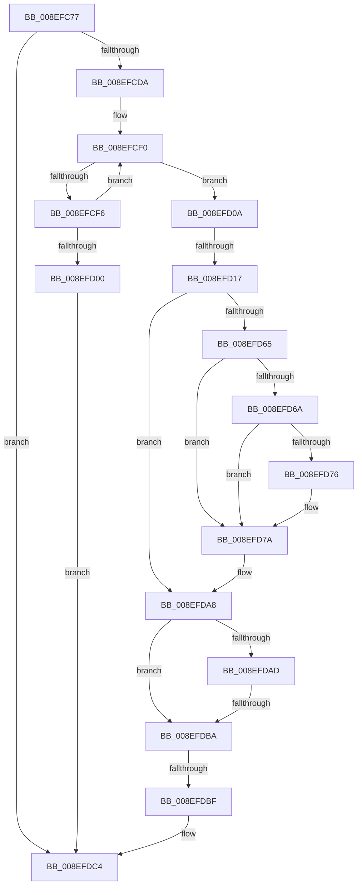

# sub_008EFC77

- RVA: `0x008EFC77`–`0x008EFDE5` (길이 `366` bytes)
- VA: `0x00000001408EFC77`
- 실행 섹션: `PAGE`
- PDB 이름 있음: `아니요`; PDB Function 태그: `아니요`
- unwind 정보 RVA: `0x00087174`
- 디코드: `83`개 명령, `366/366` bytes 표시
- 미해석 바이트: `0` (있으면 어셈블리에 `.byte`로 보존)

> 이 문서는 커널 이미지의 기계어와 PDB 기호를 분석해 생성했습니다. 4번과 5번은 함수 원형과 자료형을 바이너리 사용 방식에서 추정한 C 해석이며 원본 소스 복구 결과는 아닙니다.

## 1. Dependencies

- 직접 호출 지점: **3**; 고유 호출 대상: **2**
- 직접 호출자로 확인된 함수: **0**
- RIP 상대 이미지 참조: **3**

### Outgoing calls
- `0x008EFCCB` → [RtlStringCchPrintfExW](../../text/42/RtlStringCchPrintfExW_function_0042B390.md) (function, `0x0042B390`)
- `0x008EFD54` → [RtlStringCchPrintfExW](../../text/42/RtlStringCchPrintfExW_function_0042B390.md) (function, `0x0042B390`)
- `0x008EFD98` → [_RegRtlOpenKeyTransacted](_RegRtlOpenKeyTransacted_function_008EF810.md) (function, `0x008EF810`)

### Direct callers
- 이 함수 시작 RVA로 연결되는 직접 call은 확인되지 않았습니다. 간접 호출은 완전히 역산할 수 없습니다.

### Static image references
- `0x008EFCB7` → RVA `0x00B0D8D0` (` ?? ::NNGAKEGL::`string'`; read)
- `0x008EFD2E` → RVA `0x00AFCD40` (` ?? ::NNGAKEGL::`string'`; read)
- `0x008EFD40` → RVA `0x00AFD430` (` ?? ::NNGAKEGL::`string'`; read)

## 2. Other-region calls and transfers

- 다른 실행 섹션으로 향하는 call: **2**
  - `0x008EFCCB` → [RtlStringCchPrintfExW](../../text/42/RtlStringCchPrintfExW_function_0042B390.md) (`PAGE` → `.text`)
  - `0x008EFD54` → [RtlStringCchPrintfExW](../../text/42/RtlStringCchPrintfExW_function_0042B390.md) (`PAGE` → `.text`)
- call이 아닌 외부 분기/꼬리 이동: **4**
  - `0x008EFD11` → [sub_008EFE2C + 0xED](Unknown_function_008EFE2C.md) (`tail-transfer`)
  - `0x008EFDB4` → [sub_008EFE2C + 0x11B](Unknown_function_008EFE2C.md) (`tail-transfer`)
  - `0x008EFDBD` → [sub_008EFE2C](Unknown_function_008EFE2C.md) (`tail-transfer`)
  - `0x008EFDE3` → [sub_008EFDE5 + 0x5](Unknown_function_008EFDE5.md) (`tail-transfer`)

## 3. Assembly (complete function range)

```asm
008EFC77  48 89 9C 24 D8 01 00 00         mov qword ptr [rsp + 0x1d8], rbx
008EFC7F  41 0F B6 5F 09                  movzx ebx, byte ptr [r15 + 9]
008EFC84  41 8D 51 30                     lea edx, [r9 + 0x30]
008EFC88  89 5C 24 50                     mov dword ptr [rsp + 0x50], ebx
008EFC8C  89 7C 24 48                     mov dword ptr [rsp + 0x48], edi
008EFC90  48 89 B4 24 D0 01 00 00         mov qword ptr [rsp + 0x1d0], rsi
008EFC98  41 0F B7 77 06                  movzx esi, word ptr [r15 + 6]
008EFC9D  89 74 24 40                     mov dword ptr [rsp + 0x40], esi
008EFCA1  4C 89 B4 24 C8 01 00 00         mov qword ptr [rsp + 0x1c8], r14
008EFCA9  45 0F B7 77 04                  movzx r14d, word ptr [r15 + 4]
008EFCAE  44 89 74 24 38                  mov dword ptr [rsp + 0x38], r14d
008EFCB3  89 44 24 30                     mov dword ptr [rsp + 0x30], eax
008EFCB7  48 8D 05 12 DC 21 00            lea rax, [rip + 0x21dc12]
008EFCBE  48 89 44 24 28                  mov qword ptr [rsp + 0x28], rax
008EFCC3  C7 44 24 20 00 08 00 00         mov dword ptr [rsp + 0x20], 0x800
008EFCCB  E8 C0 B6 B3 FF                  call 0x14042b390
008EFCD0  8B F8                           mov edi, eax
008EFCD2  85 C0                           test eax, eax
008EFCD4  0F 88 EA 00 00 00               js 0x1408efdc4
008EFCDA  BB 00 02 00 00                  mov ebx, 0x200
008EFCDF  4C 89 65 90                     mov qword ptr [rbp - 0x70], r12
008EFCE3  8B CB                           mov ecx, ebx
008EFCE5  48 8D 45 C0                     lea rax, [rbp - 0x40]
008EFCE9  0F 1F 80 00 00 00 00            nop dword ptr [rax]
008EFCF0  66 44 39 20                     cmp word ptr [rax], r12w
008EFCF4  74 14                           je 0x1408efd0a
008EFCF6  48 83 C0 02                     add rax, 2
008EFCFA  48 83 E9 01                     sub rcx, 1
008EFCFE  75 F0                           jne 0x1408efcf0
008EFD00  BF 0D 00 00 C0                  mov edi, 0xc000000d
008EFD05  E9 BA 00 00 00                  jmp 0x1408efdc4
008EFD0A  48 2B D9                        sub rbx, rcx
008EFD0D  48 83 FB 30                     cmp rbx, 0x30
008EFD11  0F 83 02 02 00 00               jae 0x1408eff19
008EFD17  48 8D 7D 20                     lea rdi, [rbp + 0x20]
008EFD1B  BB 3B 00 00 00                  mov ebx, 0x3b
008EFD20  48 8D 45 C0                     lea rax, [rbp - 0x40]
008EFD24  8B D3                           mov edx, ebx
008EFD26  48 89 44 24 38                  mov qword ptr [rsp + 0x38], rax
008EFD2B  45 33 C9                        xor r9d, r9d
008EFD2E  48 8D 05 0B D0 20 00            lea rax, [rip + 0x20d00b]
008EFD35  45 33 C0                        xor r8d, r8d
008EFD38  48 89 44 24 30                  mov qword ptr [rsp + 0x30], rax
008EFD3D  48 8B CF                        mov rcx, rdi
008EFD40  48 8D 05 E9 D6 20 00            lea rax, [rip + 0x20d6e9]
008EFD47  48 89 44 24 28                  mov qword ptr [rsp + 0x28], rax
008EFD4C  C7 44 24 20 00 08 00 00         mov dword ptr [rsp + 0x20], 0x800
008EFD54  E8 37 B6 B3 FF                  call 0x14042b390
008EFD59  8B D8                           mov ebx, eax
008EFD5B  41 BE 34 00 00 C0               mov r14d, 0xc0000034
008EFD61  85 C0                           test eax, eax
008EFD63  78 43                           js 0x1408efda8
008EFD65  4D 85 ED                        test r13, r13
008EFD68  74 10                           je 0x1408efd7a
008EFD6A  49 8B 85 E0 00 00 00            mov rax, qword ptr [r13 + 0xe0]
008EFD71  48 85 C0                        test rax, rax
008EFD74  74 04                           je 0x1408efd7a
008EFD76  4C 8B 60 08                     mov r12, qword ptr [rax + 8]
008EFD7A  48 8B 4D A8                     mov rcx, qword ptr [rbp - 0x58]
008EFD7E  48 8D 45 90                     lea rax, [rbp - 0x70]
008EFD82  4C 89 64 24 28                  mov qword ptr [rsp + 0x28], r12
008EFD87  41 B9 01 00 00 00               mov r9d, 1
008EFD8D  45 33 C0                        xor r8d, r8d
008EFD90  48 89 44 24 20                  mov qword ptr [rsp + 0x20], rax
008EFD95  48 8B D7                        mov rdx, rdi
008EFD98  E8 73 FA FF FF                  call 0x1408ef810
008EFD9D  3D 7C 01 00 C0                  cmp eax, 0xc000017c
008EFDA2  8B D8                           mov ebx, eax
008EFDA4  41 0F 44 DE                     cmove ebx, r14d
008EFDA8  48 85 FF                        test rdi, rdi
008EFDAB  74 0D                           je 0x1408efdba
008EFDAD  48 8D 45 20                     lea rax, [rbp + 0x20]
008EFDB1  48 3B F8                        cmp rdi, rax
008EFDB4  0F 85 8D 01 00 00               jne 0x1408eff47
008EFDBA  41 3B DE                        cmp ebx, r14d
008EFDBD  75 6D                           jne 0x1408efe2c
008EFDBF  BF 25 02 00 C0                  mov edi, 0xc0000225
008EFDC4  48 8B 4D 90                     mov rcx, qword ptr [rbp - 0x70]
008EFDC8  4C 8B B4 24 C8 01 00 00         mov r14, qword ptr [rsp + 0x1c8]
008EFDD0  48 8B B4 24 D0 01 00 00         mov rsi, qword ptr [rsp + 0x1d0]
008EFDD8  48 8B 9C 24 D8 01 00 00         mov rbx, qword ptr [rsp + 0x1d8]
008EFDE0  48 85 C9                        test rcx, rcx
008EFDE3  74 05                           je 0x1408efdea
```

## 4. C-style interpretation (structured pseudocode)

```c
__int64 __fastcall sub_008EFC77(__int64 a1, __int64 a2, int a3, __int64 a4, __int64 a5, __int64 a6, __int64 a7, __int64 a8, __int64 a9, __int64 a10, __int64 a11, __int64 a12, __int64 a13, __int64 a14, __int64 a15, __int64 a16, __int64 a17, __int64 a18, __int64 a19, __int64 a20, __int64 a21, __int64 a22, __int64 a23, __int64 a24, __int64 a25, __int64 a26, __int64 a27, __int64 a28, __int64 a29, __int64 a30, __int64 a31, __int64 a32, __int64 a33, __int64 a34, __int64 a35, __int64 a36, __int64 a37, __int64 a38, __int64 a39, __int64 a40, __int64 a41, __int64 a42, __int64 a43, __int64 a44, __int64 a45, __int64 a46, __int64 a47, __int64 a48, __int64 a49, __int64 a50, __int64 a51, __int64 a52, __int64 a53, __int64 a54, __int64 a55, __int64 a56, __int64 a57, __int64 a58, __int64 a59)
{
    __int64 result;
    __int64 v_r12;
    __int64 v_rbx;
    unsigned __int64 v_stack_p1C8;
    unsigned __int64 v_stack_p1D0;
    unsigned __int64 v_stack_p1D8;
    unsigned int v_stack_p20;
    unsigned __int64 v_stack_p28;
    unsigned int v_stack_p30;
    unsigned int v_stack_p38;
    unsigned int v_stack_p40;
    unsigned int v_stack_p48;
    unsigned int v_stack_p50;

    v_stack_p1D8 = v_rbx;
    v_stack_p50 = (unsigned int)(*(unsigned __int8 *)(v_r15 + 9));
    v_stack_p48 = (unsigned int)(v_rdi);
    v_stack_p1D0 = v_rsi;
    v_stack_p40 = (unsigned int)(*(unsigned __int16 *)(v_r15 + 6));
    v_stack_p1C8 = v_r14;
    v_stack_p38 = (unsigned int)(*(unsigned __int16 *)(v_r15 + 4));
    v_stack_p30 = (unsigned int)(result);
    v_stack_p28 = v_rip + 2219026;
    v_stack_p20 = 0x800ULL;
    result = RtlStringCchPrintfExW(a1, a4 + 48, a3, a4);
    if (sign_flag) goto loc_008EFDC4;
    *(unsigned __int64 *)(v_rbp - 112) = v_r12;
loc_008EFCF0:
    if ((*(unsigned __int16 *)(v_rbp - 64)) == ((unsigned __int16)(v_r12))) goto loc_008EFD0A;
    result = (v_rbp - 64) + (2);
    a1 = (512) - (1);
    if (condition_is_not_equal) goto loc_008EFCF0;
    goto loc_008EFDC4;
loc_008EFD0A:
    v_rbx = (512) - (a1);
    v_stack_p38 = v_rbp - 64;
    a4 = 0;
    a3 = 0;
    v_stack_p30 = v_rip + 2150411;
    v_stack_p28 = v_rip + 2152169;
    v_stack_p20 = 0x800ULL;
    result = RtlStringCchPrintfExW(v_rbp + 32, 59, a3, a4);
    if (sign_flag) goto loc_008EFDA8;
    if (v_r13 == 0) goto loc_008EFD7A;
    if (*(unsigned __int64 *)(v_r13 + 224) != 0) {
        v_r12 = *(unsigned __int64 *)(*(unsigned __int64 *)(v_r13 + 224) + 8);
    }
    v_stack_p28 = v_r12;
    a3 = 0;
    v_stack_p20 = v_rbp - 112;
    result = _RegRtlOpenKeyTransacted(*(unsigned __int64 *)(v_rbp - 88), v_rbp + 32, a3, 1);
    v_rbx = (unsigned int)((unsigned int)(result));
    if (((unsigned int)(result)) == 0xC000017CULL) { v_rbx = (unsigned int)((unsigned int)(0xC0000034ULL)); }
loc_008EFDA8:
    if (v_rbp + 32 == 0) goto loc_008EFDBA;
loc_008EFDBA:
loc_008EFDC4:
}
```

## 5. (Beta) C Style

```c
int64_t sub_008EFC77(int64_t Arg1, int64_t Arg2, int32_t Arg3, void *Arg4, uint64_t Arg5, uint64_t Arg6, uint64_t Arg7, uint64_t Arg8, uint64_t Arg9, uint64_t Arg10, uint64_t Arg11, uint64_t Arg12, uint64_t Arg13, uint64_t Arg14, uint64_t Arg15, uint64_t Arg16, uint64_t Arg17, uint64_t Arg18, uint64_t Arg19, uint64_t Arg20, uint64_t Arg21, uint64_t Arg22, uint64_t Arg23, uint64_t Arg24, uint64_t Arg25, uint64_t Arg26, uint64_t Arg27, uint64_t Arg28, uint64_t Arg29, uint64_t Arg30, uint64_t Arg31, uint64_t Arg32, uint64_t Arg33, uint64_t Arg34, uint64_t Arg35, uint64_t Arg36, uint64_t Arg37, uint64_t Arg38, uint64_t Arg39, uint64_t Arg40, uint64_t Arg41, uint64_t Arg42, uint64_t Arg43, uint64_t Arg44, uint64_t Arg45, uint64_t Arg46, uint64_t Arg47, uint64_t Arg48, uint64_t Arg49, uint64_t Arg50, uint64_t Arg51, uint64_t Arg52, uint64_t Arg53, uint64_t Arg54, uint64_t Arg55, uint64_t Arg56, int64_t Arg57, int64_t Arg58, int64_t Arg59)
{
    uint8_t *arg4 = (uint8_t *)Arg4;

    int64_t result;
    int64_t local_r12;
    int64_t local_rbx;
    uint64_t v_stack_p1C8;
    uint64_t v_stack_p1D0;
    uint64_t v_stack_p1D8;
    uint32_t v_stack_p20;
    uint64_t v_stack_p28;
    uint32_t v_stack_p30;
    uint32_t v_stack_p38;
    uint32_t v_stack_p40;
    uint32_t v_stack_p48;
    uint32_t v_stack_p50;

    v_stack_p1D8 = local_rbx;
    v_stack_p50 = (uint32_t)(*(uint8_t *)(local_r15 + 0x9));
    v_stack_p48 = (uint32_t)(local_rdi);
    v_stack_p1D0 = local_rsi;
    v_stack_p40 = (uint32_t)(*(uint16_t *)(local_r15 + 0x6));
    v_stack_p1C8 = local_r14;
    v_stack_p38 = (uint32_t)(*(uint16_t *)(local_r15 + 0x4));
    v_stack_p30 = (uint32_t)(result);
    v_stack_p28 = v_rip + 2219026;
    v_stack_p20 = 0x800ULL;
    result = RtlStringCchPrintfExW(Arg1, Arg4 + 48, Arg3, Arg4);
    if (sign_flag) goto loc_008EFDC4;
    *(uint64_t *)(local_rbp - 0x70) = local_r12;
loc_008EFCF0:
    if ((*(uint16_t *)(local_rbp - 0x40)) == ((uint16_t)(local_r12))) goto loc_008EFD0A;
    result = (local_rbp - 64) + (2);
    Arg1 = (512) - (1);
    if (condition_is_not_equal) goto loc_008EFCF0;
    goto loc_008EFDC4;
loc_008EFD0A:
    local_rbx = (512) - (Arg1);
    v_stack_p38 = local_rbp - 64;
    Arg4 = 0;
    Arg3 = 0;
    v_stack_p30 = v_rip + 2150411;
    v_stack_p28 = v_rip + 2152169;
    v_stack_p20 = 0x800ULL;
    result = RtlStringCchPrintfExW(local_rbp + 32, 59, Arg3, Arg4);
    if (sign_flag) goto loc_008EFDA8;
    if (local_r13 == 0) goto loc_008EFD7A;
    if (*(uint64_t *)(local_r13 + 0xE0) != 0) {
        local_r12 = *(uint64_t *)(*(uint64_t *)(local_r13 + 0xE0) + 0x8);
    }
    v_stack_p28 = local_r12;
    Arg3 = 0;
    v_stack_p20 = local_rbp - 112;
    result = _RegRtlOpenKeyTransacted(*(uint64_t *)(local_rbp - 0x58), local_rbp + 32, Arg3, 1);
    local_rbx = (uint32_t)((uint32_t)(result));
    if (((uint32_t)(result)) == 0xC000017CULL) { local_rbx = (uint32_t)((uint32_t)(0xC0000034ULL)); }
loc_008EFDA8:
    if (local_rbp + 32 == 0) goto loc_008EFDBA;
loc_008EFDBA:
loc_008EFDC4:
}
```

### 관측된 메모리 오프셋

구조체 형식이 확인되지 않은 접근은 인자 기준의 오프셋으로만 기록했습니다.

| 기준 인자 | 오프셋 표현 | 폭 (bit) | 접근 |
|---|---:|---:|---|
| `Arg4` | `+ 0x30` | `32` | `R` |

## 6. Execution-region graph

[열기: 2D/3D 그래프와 함수 탐색 컨트롤 패널](../../../control-panel.html?section=page&rva=0x008EFC77&view=graph)

- 2D 그래프는 위에서 아래로 흐르고, 3D 그래프는 빈 공간을 드래그해 회전합니다. Shift+드래그는 이동, 휠은 확대·축소, 함수 노드 선택은 대상 보고서 이동입니다.

### Static fallback


