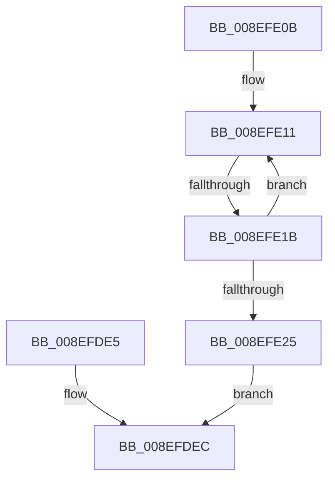

# sub_008EFDE5

- RVA: `0x008EFDE5`–`0x008EFE2C` (길이 `71` bytes)
- VA: `0x00000001408EFDE5`
- 실행 섹션: `PAGE`
- PDB 이름 있음: `아니요`; PDB Function 태그: `아니요`
- unwind 정보 RVA: `0x00087190`
- 디코드: `21`개 명령, `71/71` bytes 표시
- 미해석 바이트: `0` (있으면 어셈블리에 `.byte`로 보존)

> 이 문서는 커널 이미지의 기계어와 PDB 기호를 분석해 생성했습니다. 4번과 5번은 함수 원형과 자료형을 바이너리 사용 방식에서 추정한 C 해석이며 원본 소스 복구 결과는 아닙니다.

## 1. Dependencies

- 직접 호출 지점: **2**; 고유 호출 대상: **2**
- 직접 호출자로 확인된 함수: **0**
- RIP 상대 이미지 참조: **0**

### Outgoing calls
- `0x008EFDE5` → [ZwClose](../../text/6A/ZwClose_function_006AD2B0.md) (function, `0x006AD2B0`)
- `0x008EFDF6` → [_security_check_cookie](../../text/6A/_security_check_cookie_function_006AC640.md) (function, `0x006AC640`)

### Direct callers
- 이 함수 시작 RVA로 연결되는 직접 call은 확인되지 않았습니다. 간접 호출은 완전히 역산할 수 없습니다.

### Static image references
- 디코드된 RIP-relative 메모리 참조가 없습니다.

## 2. Other-region calls and transfers

- 다른 실행 섹션으로 향하는 call: **2**
  - `0x008EFDE5` → [ZwClose](../../text/6A/ZwClose_function_006AD2B0.md) (`PAGE` → `.text`)
  - `0x008EFDF6` → [_security_check_cookie](../../text/6A/_security_check_cookie_function_006AC640.md) (`PAGE` → `.text`)
- call이 아닌 외부 분기/꼬리 이동: **1**
  - `0x008EFE15` → [PnpGetGenericStoreProperty + 0x7D](PnpGetGenericStoreProperty_function_008EFBA0.md) (`tail-transfer`)

## 3. Assembly (complete function range)

```asm
008EFDE5  E8 C6 D4 DB FF                  call 0x1406ad2b0
008EFDEA  8B C7                           mov eax, edi
008EFDEC  48 8B 8D A0 00 00 00            mov rcx, qword ptr [rbp + 0xa0]
008EFDF3  48 33 CC                        xor rcx, rsp
008EFDF6  E8 45 C8 DB FF                  call 0x1406ac640
008EFDFB  48 81 C4 E0 01 00 00            add rsp, 0x1e0
008EFE02  41 5F                           pop r15
008EFE04  41 5D                           pop r13
008EFE06  41 5C                           pop r12
008EFE08  5F                              pop rdi
008EFE09  5D                              pop rbp
008EFE0A  C3                              ret
008EFE0B  CC                              int3
008EFE0C  B9 55 00 00 00                  mov ecx, 0x55
008EFE11  66 44 39 20                     cmp word ptr [rax], r12w
008EFE15  0F 84 02 FE FF FF               je 0x1408efc1d
008EFE1B  48 83 C0 02                     add rax, 2
008EFE1F  48 83 E9 01                     sub rcx, 1
008EFE23  75 EC                           jne 0x1408efe11
008EFE25  B8 0D 00 00 C0                  mov eax, 0xc000000d
008EFE2A  EB C0                           jmp 0x1408efdec
```

## 4. C-style interpretation (structured pseudocode)

```c
__int64 __fastcall sub_008EFDE5(void)
{
    __int64 result;
    __int64 v_rsp;

    result = ZwClose(a1, a2, a3, a4);
loc_008EFDEC:
    a1 = (*(unsigned __int64 *)(v_rbp + 160)) ^ (v_rsp);
    result = _security_check_cookie(a1, a2, a3, a4);
    v_rsp = (v_rsp) + (480);
    return result;
}
```

## 5. (Beta) C Style

```c
void sub_008EFDE5(void)
{
    int64_t result;
    int64_t local_rsp;

    result = ZwClose(a1, a2, a3, a4);
loc_008EFDEC:
    a1 = (*(uint64_t *)(local_rbp + 0xA0)) ^ (local_rsp);
    result = _security_check_cookie(a1, a2, a3, a4);
    local_rsp = (local_rsp) + (480);
    return result;
}
```

## 6. Execution-region graph

[열기: 2D/3D 그래프와 함수 탐색 컨트롤 패널](../../../control-panel.html?section=page&rva=0x008EFDE5&view=graph)

- 2D 그래프는 위에서 아래로 흐르고, 3D 그래프는 빈 공간을 드래그해 회전합니다. Shift+드래그는 이동, 휠은 확대·축소, 함수 노드 선택은 대상 보고서 이동입니다.

### Static fallback


