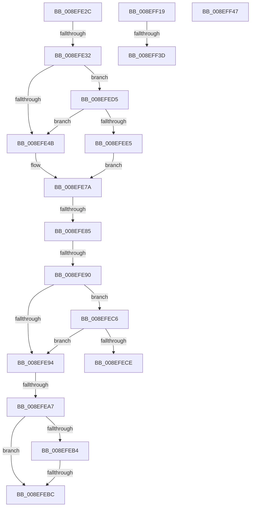

# sub_008EFE2C

- RVA: `0x008EFE2C`–`0x008EFF56` (길이 `298` bytes)
- VA: `0x00000001408EFE2C`
- 실행 섹션: `PAGE`
- PDB 이름 있음: `아니요`; PDB Function 태그: `아니요`
- unwind 정보 RVA: `0x000871A4`
- 디코드: `74`개 명령, `298/298` bytes 표시
- 미해석 바이트: `0` (있으면 어셈블리에 `.byte`로 보존)

> 이 문서는 커널 이미지의 기계어와 PDB 기호를 분석해 생성했습니다. 4번과 5번은 함수 원형과 자료형을 바이너리 사용 방식에서 추정한 C 해석이며 원본 소스 복구 결과는 아닙니다.

## 1. Dependencies

- 직접 호출 지점: **4**; 고유 호출 대상: **4**
- 직접 호출자로 확인된 함수: **0**
- RIP 상대 이미지 참조: **1**

### Outgoing calls
- `0x008EFE75` → [PnpRegQueryValueIndirect](PnpRegQueryValueIndirect_function_008EE210.md) (function, `0x008EE210`)
- `0x008EFF0F` → [guard_dispatch_icall](../../text/6B/guard_dispatch_icall_function_006BAAD0.md) (function, `0x006BAAD0`)
- `0x008EFF2C` → [ExAllocatePool2](../../poolcode/B8/ExAllocatePool2_function_00B820F0.md) (function, `0x00B820F0`)
- `0x008EFF4C` → [ExFreePoolWithTag](../../poolcode/B8/ExFreePoolWithTag_function_00B82870.md) (function, `0x00B82870`)

### Direct callers
- 이 함수 시작 RVA로 연결되는 직접 call은 확인되지 않았습니다. 간접 호출은 완전히 역산할 수 없습니다.

### Static image references
- `0x008EFED5` → RVA `0x008EE210` (`PnpRegQueryValueIndirect`; read)

## 2. Other-region calls and transfers

- 다른 실행 섹션으로 향하는 call: **3**
  - `0x008EFF0F` → [guard_dispatch_icall](../../text/6B/guard_dispatch_icall_function_006BAAD0.md) (`PAGE` → `.text`)
  - `0x008EFF2C` → [ExAllocatePool2](../../poolcode/B8/ExAllocatePool2_function_00B820F0.md) (`PAGE` → `POOLCODE`)
  - `0x008EFF4C` → [ExFreePoolWithTag](../../poolcode/B8/ExFreePoolWithTag_function_00B82870.md) (`PAGE` → `POOLCODE`)
- call이 아닌 외부 분기/꼬리 이동: **10**
  - `0x008EFE30` → [sub_008EFC77 + 0x14D](Unknown_function_008EFC77.md) (`tail-transfer`)
  - `0x008EFE7F` → [sub_008EFC77 + 0x148](Unknown_function_008EFC77.md) (`tail-transfer`)
  - `0x008EFE8A` → [sub_008EFC77 + 0x148](Unknown_function_008EFC77.md) (`tail-transfer`)
  - `0x008EFEA1` → [sub_008EFC77 + 0x14D](Unknown_function_008EFC77.md) (`tail-transfer`)
  - `0x008EFEB6` → [sub_008EFC77 + 0x14D](Unknown_function_008EFC77.md) (`tail-transfer`)
  - `0x008EFEC1` → [sub_008EFC77 + 0x14D](Unknown_function_008EFC77.md) (`tail-transfer`)
  - `0x008EFED0` → [sub_008EFC77 + 0x14D](Unknown_function_008EFC77.md) (`tail-transfer`)
  - `0x008EFF37` → [sub_008EFC77 + 0xA9](Unknown_function_008EFC77.md) (`tail-transfer`)
  - `0x008EFF42` → [sub_008EFC77 + 0x14D](Unknown_function_008EFC77.md) (`tail-transfer`)
  - `0x008EFF51` → [sub_008EFC77 + 0x143](Unknown_function_008EFC77.md) (`tail-transfer`)

## 3. Assembly (complete function range)

```asm
008EFE2C  8B FB                           mov edi, ebx
008EFE2E  85 DB                           test ebx, ebx
008EFE30  78 92                           js 0x1408efdc4
008EFE32  49 8B 85 08 02 00 00            mov rax, qword ptr [r13 + 0x208]
008EFE39  8B B5 30 01 00 00               mov esi, dword ptr [rbp + 0x130]
008EFE3F  89 75 84                        mov dword ptr [rbp - 0x7c], esi
008EFE42  48 85 C0                        test rax, rax
008EFE45  0F 85 8A 00 00 00               jne 0x1408efed5
008EFE4B  48 8B 4D 98                     mov rcx, qword ptr [rbp - 0x68]
008EFE4F  48 8D 45 80                     lea rax, [rbp - 0x80]
008EFE53  4C 8B 45 A0                     mov r8, qword ptr [rbp - 0x60]
008EFE57  4C 8D 4D 88                     lea r9, [rbp - 0x78]
008EFE5B  48 8B 55 90                     mov rdx, qword ptr [rbp - 0x70]
008EFE5F  48 89 44 24 30                  mov qword ptr [rsp + 0x30], rax
008EFE64  48 8D 45 84                     lea rax, [rbp - 0x7c]
008EFE68  48 89 44 24 28                  mov qword ptr [rsp + 0x28], rax
008EFE6D  48 89 4C 24 20                  mov qword ptr [rsp + 0x20], rcx
008EFE72  49 8B CD                        mov rcx, r13
008EFE75  E8 96 E3 FF FF                  call 0x1408ee210
008EFE7A  8B C8                           mov ecx, eax
008EFE7C  41 3B C6                        cmp eax, r14d
008EFE7F  0F 84 3A FF FF FF               je 0x1408efdbf
008EFE85  3D 7C 01 00 C0                  cmp eax, 0xc000017c
008EFE8A  0F 84 2F FF FF FF               je 0x1408efdbf
008EFE90  85 C0                           test eax, eax
008EFE92  75 32                           jne 0x1408efec6
008EFE94  0F B7 45 88                     movzx eax, word ptr [rbp - 0x78]
008EFE98  48 8B 55 B0                     mov rdx, qword ptr [rbp - 0x50]
008EFE9C  89 02                           mov dword ptr [rdx], eax
008EFE9E  83 F8 01                        cmp eax, 1
008EFEA1  0F 84 1D FF FF FF               je 0x1408efdc4
008EFEA7  48 8B 55 B8                     mov rdx, qword ptr [rbp - 0x48]
008EFEAB  8B 45 84                        mov eax, dword ptr [rbp - 0x7c]
008EFEAE  89 02                           mov dword ptr [rdx], eax
008EFEB0  85 C9                           test ecx, ecx
008EFEB2  75 08                           jne 0x1408efebc
008EFEB4  85 F6                           test esi, esi
008EFEB6  0F 85 08 FF FF FF               jne 0x1408efdc4
008EFEBC  BF 23 00 00 C0                  mov edi, 0xc0000023
008EFEC1  E9 FE FE FF FF                  jmp 0x1408efdc4
008EFEC6  81 F9 23 00 00 C0               cmp ecx, 0xc0000023
008EFECC  74 C6                           je 0x1408efe94
008EFECE  8B F9                           mov edi, ecx
008EFED0  E9 EF FE FF FF                  jmp 0x1408efdc4
008EFED5  48 8D 0D 34 E3 FF FF            lea rcx, [rip - 0x1ccc]
008EFEDC  48 3B C1                        cmp rax, rcx
008EFEDF  0F 84 66 FF FF FF               je 0x1408efe4b
008EFEE5  4C 8B 45 A0                     mov r8, qword ptr [rbp - 0x60]
008EFEE9  48 8D 4D 80                     lea rcx, [rbp - 0x80]
008EFEED  48 8B 55 90                     mov rdx, qword ptr [rbp - 0x70]
008EFEF1  4C 8D 4D 88                     lea r9, [rbp - 0x78]
008EFEF5  48 89 4C 24 30                  mov qword ptr [rsp + 0x30], rcx
008EFEFA  48 8D 4D 84                     lea rcx, [rbp - 0x7c]
008EFEFE  48 89 4C 24 28                  mov qword ptr [rsp + 0x28], rcx
008EFF03  48 8B 4D 98                     mov rcx, qword ptr [rbp - 0x68]
008EFF07  48 89 4C 24 20                  mov qword ptr [rsp + 0x20], rcx
008EFF0C  49 8B CD                        mov rcx, r13
008EFF0F  E8 BC AB DC FF                  call 0x1406baad0
008EFF14  E9 61 FF FF FF                  jmp 0x1408efe7a
008EFF19  83 C3 0C                        add ebx, 0xc
008EFF1C  B9 00 01 00 00                  mov ecx, 0x100
008EFF21  8B D3                           mov edx, ebx
008EFF23  41 B8 50 4E 50 52               mov r8d, 0x52504e50
008EFF29  48 03 D2                        add rdx, rdx
008EFF2C  E8 BF 21 29 00                  call 0x140b820f0
008EFF31  48 8B F8                        mov rdi, rax
008EFF34  48 85 C0                        test rax, rax
008EFF37  0F 85 E3 FD FF FF               jne 0x1408efd20
008EFF3D  BF 17 00 00 C0                  mov edi, 0xc0000017
008EFF42  E9 7D FE FF FF                  jmp 0x1408efdc4
008EFF47  33 D2                           xor edx, edx
008EFF49  48 8B CF                        mov rcx, rdi
008EFF4C  E8 1F 29 29 00                  call 0x140b82870
008EFF51  E9 64 FE FF FF                  jmp 0x1408efdba
```

## 4. C-style interpretation (structured pseudocode)

```c
__int64 __fastcall sub_008EFE2C(void)
{
    __int64 result;
    unsigned __int64 v_stack_p20;
    unsigned __int64 v_stack_p28;
    unsigned __int64 v_stack_p30;

    *(unsigned int *)(v_rbp - 124) = (unsigned int)((unsigned int)(*(unsigned int *)(v_rbp + 304)));
    if (*(unsigned __int64 *)(v_r13 + 520) != 0) goto loc_008EFED5;
loc_008EFE4B:
    v_stack_p30 = v_rbp - 128;
    v_stack_p28 = v_rbp - 124;
    v_stack_p20 = *(unsigned __int64 *)(v_rbp - 104);
    result = PnpRegQueryValueIndirect(v_r13, *(unsigned __int64 *)(v_rbp - 112), *(unsigned __int64 *)(v_rbp - 96), v_rbp - 120);
loc_008EFE7A:
    if ((unsigned int)(result) != 0) goto loc_008EFEC6;
loc_008EFE94:
    *(unsigned int *)(*(unsigned __int64 *)(v_rbp - 80)) = (unsigned int)(*(unsigned __int16 *)(v_rbp - 120));
    *(unsigned int *)(*(unsigned __int64 *)(v_rbp - 72)) = (unsigned int)((unsigned int)(*(unsigned int *)(v_rbp - 124)));
    if ((unsigned int)((unsigned int)((unsigned int)(result))) != 0) goto loc_008EFEBC;
loc_008EFEBC:
loc_008EFEC6:
    if (((unsigned int)((unsigned int)((unsigned int)(result)))) == 0xC0000023ULL) goto loc_008EFE94;
loc_008EFED5:
    if (((unsigned int)(*(unsigned int *)(v_rbp - 124))) == (v_rip - 7372)) goto loc_008EFE4B;
    v_stack_p30 = v_rbp - 128;
    v_stack_p28 = v_rbp - 124;
    v_stack_p20 = *(unsigned __int64 *)(v_rbp - 104);
    result = guard_dispatch_icall(v_r13, *(unsigned __int64 *)(v_rbp - 112), *(unsigned __int64 *)(v_rbp - 96), v_rbp - 120);
    goto loc_008EFE7A;
}
```

## 5. (Beta) C Style

```c
void sub_008EFE2C(void)
{
    int64_t result;
    uint64_t v_stack_p20;
    uint64_t v_stack_p28;
    uint64_t v_stack_p30;

    *(uint32_t *)(local_rbp - 0x7C) = (uint32_t)((uint32_t)(*(uint32_t *)(local_rbp + 0x130)));
    if (*(uint64_t *)(local_r13 + 0x208) != 0) goto loc_008EFED5;
loc_008EFE4B:
    v_stack_p30 = local_rbp - 128;
    v_stack_p28 = local_rbp - 124;
    v_stack_p20 = *(uint64_t *)(local_rbp - 0x68);
    result = PnpRegQueryValueIndirect(local_r13, *(uint64_t *)(local_rbp - 0x70), *(uint64_t *)(local_rbp - 0x60), local_rbp - 120);
loc_008EFE7A:
    if ((uint32_t)(result) != 0) goto loc_008EFEC6;
loc_008EFE94:
    *(uint32_t *)(*(uint64_t *)(local_rbp - 0x50)) = (uint32_t)(*(uint16_t *)(local_rbp - 0x78));
    *(uint32_t *)(*(uint64_t *)(local_rbp - 0x48)) = (uint32_t)((uint32_t)(*(uint32_t *)(local_rbp - 0x7C)));
    if ((uint32_t)((uint32_t)((uint32_t)(result))) != 0) goto loc_008EFEBC;
loc_008EFEBC:
loc_008EFEC6:
    if (((uint32_t)((uint32_t)((uint32_t)(result)))) == 0xC0000023ULL) goto loc_008EFE94;
loc_008EFED5:
    if (((uint32_t)(*(uint32_t *)(local_rbp - 0x7C))) == (v_rip - 7372)) goto loc_008EFE4B;
    v_stack_p30 = local_rbp - 128;
    v_stack_p28 = local_rbp - 124;
    v_stack_p20 = *(uint64_t *)(local_rbp - 0x68);
    result = guard_dispatch_icall(local_r13, *(uint64_t *)(local_rbp - 0x70), *(uint64_t *)(local_rbp - 0x60), local_rbp - 120);
    goto loc_008EFE7A;
}
```

## 6. Execution-region graph

[열기: 2D/3D 그래프와 함수 탐색 컨트롤 패널](../../../control-panel.html?section=page&rva=0x008EFE2C&view=graph)

- 2D 그래프는 위에서 아래로 흐르고, 3D 그래프는 빈 공간을 드래그해 회전합니다. Shift+드래그는 이동, 휠은 확대·축소, 함수 노드 선택은 대상 보고서 이동입니다.

### Static fallback


