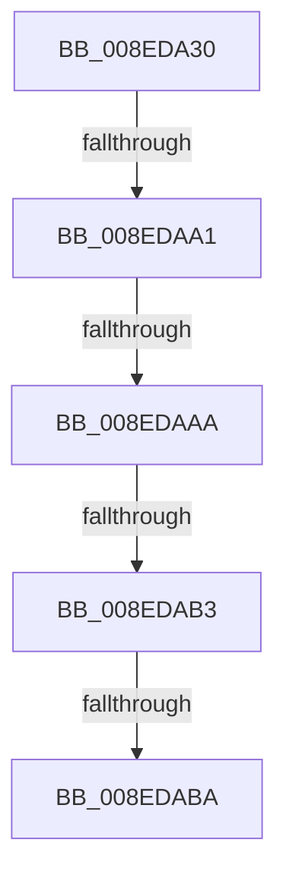

# _CmGetDeviceRegPropWorker

- RVA: `0x008EDA30`–`0x008EDAC3` (길이 `147` bytes)
- VA: `0x00000001408EDA30`
- 실행 섹션: `PAGE`
- PDB 이름 있음: `예`; PDB Function 태그: `예`
- unwind 정보 RVA: `0x00086E14`
- 디코드: `40`개 명령, `147/147` bytes 표시
- 미해석 바이트: `0` (있으면 어셈블리에 `.byte`로 보존)

> 이 문서는 커널 이미지의 기계어와 PDB 기호를 분석해 생성했습니다. 4번과 5번은 함수 원형과 자료형을 바이너리 사용 방식에서 추정한 C 해석이며 원본 소스 복구 결과는 아닙니다.

## 1. Dependencies

- 직접 호출 지점: **0**; 고유 호출 대상: **0**
- 직접 호출자로 확인된 함수: **1**
- RIP 상대 이미지 참조: **1**

### Outgoing calls
- 직접 디코드된 call 명령이 없습니다.

### Direct callers
- [CmGetDeviceRegProp](CmGetDeviceRegProp_function_008ED870.md) at `0x008ED982`

### Static image references
- `0x008EDA46` → RVA `0x00E0A740` (`.data`; read)

## 2. Other-region calls and transfers

- 다른 실행 섹션으로 향하는 call: **0**
- call이 아닌 외부 분기/꼬리 이동: **5**
  - `0x008EDA9B` → [sub_008EDF1B](Unknown_function_008EDF1B.md) (`tail-transfer`)
  - `0x008EDAA4` → [sub_008EDF1B](Unknown_function_008EDF1B.md) (`tail-transfer`)
  - `0x008EDAAD` → [sub_008EDF1B](Unknown_function_008EDF1B.md) (`tail-transfer`)
  - `0x008EDAB8` → [sub_008EDAC3](Unknown_function_008EDAC3.md) (`tail-transfer`)
  - `0x008EDABD` → [sub_008EDF1B](Unknown_function_008EDF1B.md) (`tail-transfer`)

## 3. Assembly (complete function range)

```asm
008EDA30  40 55                           push rbp
008EDA32  53                              push rbx
008EDA33  57                              push rdi
008EDA34  41 55                           push r13
008EDA36  41 56                           push r14
008EDA38  41 57                           push r15
008EDA3A  48 8D 6C 24 F8                  lea rbp, [rsp - 8]
008EDA3F  48 81 EC 08 01 00 00            sub rsp, 0x108
008EDA46  48 8B 05 F3 CC 51 00            mov rax, qword ptr [rip + 0x51ccf3]
008EDA4D  48 33 C4                        xor rax, rsp
008EDA50  48 89 45 F0                     mov qword ptr [rbp - 0x10], rax
008EDA54  0F B7 45 78                     movzx eax, word ptr [rbp + 0x78]
008EDA58  45 33 DB                        xor r11d, r11d
008EDA5B  4C 8B 7D 70                     mov r15, qword ptr [rbp + 0x70]
008EDA5F  4D 8B E8                        mov r13, r8
008EDA62  4C 8B 45 60                     mov r8, qword ptr [rbp + 0x60]
008EDA66  0F 57 C0                        xorps xmm0, xmm0
008EDA69  4C 89 44 24 70                  mov qword ptr [rsp + 0x70], r8
008EDA6E  4C 8B F1                        mov r14, rcx
008EDA71  48 8B 4D 68                     mov rcx, qword ptr [rbp + 0x68]
008EDA75  4C 8B D2                        mov r10, rdx
008EDA78  49 63 D9                        movsxd rbx, r9d
008EDA7B  41 8B FB                        mov edi, r11d
008EDA7E  48 89 55 80                     mov qword ptr [rbp - 0x80], rdx
008EDA82  4C 89 5C 24 78                  mov qword ptr [rsp + 0x78], r11
008EDA87  44 89 5C 24 68                  mov dword ptr [rsp + 0x68], r11d
008EDA8C  44 89 5C 24 64                  mov dword ptr [rsp + 0x64], r11d
008EDA91  44 89 5D 88                     mov dword ptr [rbp - 0x78], r11d
008EDA95  0F 11 45 90                     movups xmmword ptr [rbp - 0x70], xmm0
008EDA99  85 C0                           test eax, eax
008EDA9B  0F 85 7A 04 00 00               jne 0x1408edf1b
008EDAA1  4D 85 FF                        test r15, r15
008EDAA4  0F 84 71 04 00 00               je 0x1408edf1b
008EDAAA  4D 85 C0                        test r8, r8
008EDAAD  0F 84 68 04 00 00               je 0x1408edf1b
008EDAB3  41 8B 17                        mov edx, dword ptr [r15]
008EDAB6  85 D2                           test edx, edx
008EDAB8  74 09                           je 0x1408edac3
008EDABA  48 85 C9                        test rcx, rcx
008EDABD  0F 84 58 04 00 00               je 0x1408edf1b
```

## 4. C-style interpretation (structured pseudocode)

```c
__int64 __fastcall _CmGetDeviceRegPropWorker(__int64 a1, __int64 a2, __int64 a3, int a4, __int64 a5, __int64 a6, __int64 a7, unsigned __int16 a8)
{
    __int64 result;
    __int64 v_r11;
    __int64 v_rsp;
    unsigned __int64 v_stack_m38;
    unsigned __int64 v_stack_m48;
    unsigned __int64 v_stack_mA8;
    unsigned int v_stack_mB0;
    unsigned __int64 v_stack_mB8;
    unsigned __int64 v_stack_mC0;
    unsigned __int64 v_stack_mC8;
    unsigned int v_stack_mD0;
    unsigned int v_stack_mD4;

    v_rsp = (v_rsp) - (264);
    result = (*(unsigned __int64 *)(v_rip + 5360883)) ^ (v_rsp);
    v_stack_m48 = result;
    v_r11 = 0;
    v_stack_mC8 = a5;
    v_stack_mB8 = a2;
    v_stack_mC0 = 0;
    v_stack_mD0 = 0;
    v_stack_mD4 = 0;
    v_stack_mB0 = 0;
    v_stack_mA8 = v_xmm0;
}
```

## 5. (Beta) C Style

```c
int64_t _CmGetDeviceRegPropWorker(int64_t Arg1, int64_t Arg2, int64_t Arg3, int32_t Arg4, int64_t Arg5, int64_t Arg6, int64_t Arg7, uint16_t Arg8)
{
    int64_t result;
    int64_t local_r11;
    int64_t local_rsp;
    uint64_t v_stack_m38;
    uint64_t v_stack_m48;
    uint64_t v_stack_mA8;
    uint32_t v_stack_mB0;
    uint64_t v_stack_mB8;
    uint64_t v_stack_mC0;
    uint64_t v_stack_mC8;
    uint32_t v_stack_mD0;
    uint32_t v_stack_mD4;

    local_rsp = (local_rsp) - (264);
    result = (*(uint64_t *)(v_rip + 0x51CCF3)) ^ (local_rsp);
    v_stack_m48 = result;
    local_r11 = 0;
    v_stack_mC8 = Arg5;
    v_stack_mB8 = Arg2;
    v_stack_mC0 = 0;
    v_stack_mD0 = 0;
    v_stack_mD4 = 0;
    v_stack_mB0 = 0;
    v_stack_mA8 = v_xmm0;
}
```

## 6. Execution-region graph

[열기: 2D/3D 그래프와 함수 탐색 컨트롤 패널](../../../control-panel.html?section=page&rva=0x008EDA30&view=graph)

- 2D 그래프는 위에서 아래로 흐르고, 3D 그래프는 빈 공간을 드래그해 회전합니다. Shift+드래그는 이동, 휠은 확대·축소, 함수 노드 선택은 대상 보고서 이동입니다.

### Static fallback


