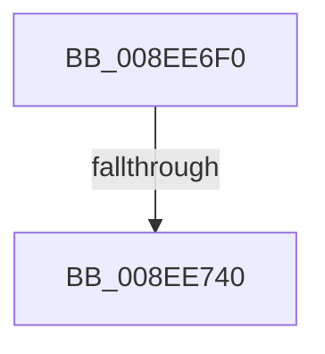

# _CmOpenDeviceRegKeyWorker

- RVA: `0x008EE6F0`–`0x008EE74B` (길이 `91` bytes)
- VA: `0x00000001408EE6F0`
- 실행 섹션: `PAGE`
- PDB 이름 있음: `예`; PDB Function 태그: `예`
- unwind 정보 RVA: `0x00086F14`
- 디코드: `26`개 명령, `91/91` bytes 표시
- 미해석 바이트: `0` (있으면 어셈블리에 `.byte`로 보존)

> 이 문서는 커널 이미지의 기계어와 PDB 기호를 분석해 생성했습니다. 4번과 5번은 함수 원형과 자료형을 바이너리 사용 방식에서 추정한 C 해석이며 원본 소스 복구 결과는 아닙니다.

## 1. Dependencies

- 직접 호출 지점: **0**; 고유 호출 대상: **0**
- 직접 호출자로 확인된 함수: **1**
- RIP 상대 이미지 참조: **0**

### Outgoing calls
- 직접 디코드된 call 명령이 없습니다.

### Direct callers
- [_CmOpenDeviceRegKey](_CmOpenDeviceRegKey_function_008EE540.md) at `0x008EE624`

### Static image references
- 디코드된 RIP-relative 메모리 참조가 없습니다.

## 2. Other-region calls and transfers

- 다른 실행 섹션으로 향하는 call: **0**
- call이 아닌 외부 분기/꼬리 이동: **2**
  - `0x008EE73A` → [sub_008EE952](Unknown_function_008EE952.md) (`tail-transfer`)
  - `0x008EE745` → [sub_008EE952](Unknown_function_008EE952.md) (`tail-transfer`)

## 3. Assembly (complete function range)

```asm
008EE6F0  4C 8B DC                        mov r11, rsp
008EE6F3  45 89 43 18                     mov dword ptr [r11 + 0x18], r8d
008EE6F7  49 89 53 10                     mov qword ptr [r11 + 0x10], rdx
008EE6FB  55                              push rbp
008EE6FC  57                              push rdi
008EE6FD  41 54                           push r12
008EE6FF  41 56                           push r14
008EE701  49 8D 6B C1                     lea rbp, [r11 - 0x3f]
008EE705  48 81 EC A8 00 00 00            sub rsp, 0xa8
008EE70C  4C 8B E1                        mov r12, rcx
008EE70F  0F 57 C0                        xorps xmm0, xmm0
008EE712  33 C9                           xor ecx, ecx
008EE714  45 8B F1                        mov r14d, r9d
008EE717  89 4D C7                        mov dword ptr [rbp - 0x39], ecx
008EE71A  41 8B C0                        mov eax, r8d
008EE71D  48 89 4D E7                     mov qword ptr [rbp - 0x19], rcx
008EE721  8B F9                           mov edi, ecx
008EE723  48 89 4D D7                     mov qword ptr [rbp - 0x29], rcx
008EE727  48 89 4D CF                     mov qword ptr [rbp - 0x31], rcx
008EE72B  48 89 4D EF                     mov qword ptr [rbp - 0x11], rcx
008EE72F  48 89 4D DF                     mov qword ptr [rbp - 0x21], rcx
008EE733  0F 11 45 F7                     movups xmmword ptr [rbp - 9], xmm0
008EE737  45 85 C0                        test r8d, r8d
008EE73A  0F 84 12 02 00 00               je 0x1408ee952
008EE740  A9 E8 FC FF FF                  test eax, 0xfffffce8
008EE745  0F 85 07 02 00 00               jne 0x1408ee952
```

## 4. C-style interpretation (structured pseudocode)

```c
__int64 __fastcall _CmOpenDeviceRegKeyWorker(__int64 a1, __int64 a2, int a3, int a4)
{
    __int64 v_rsp;

    *(unsigned int *)(v_rsp + 24) = a3;
    *(unsigned __int64 *)(v_rsp + 16) = a2;
    v_rsp = (v_rsp) - (168);
    a1 = 0;
    *(unsigned int *)(v_rsp - 63 - 57) = 0;
    *(unsigned __int64 *)(v_rsp - 63 - 25) = 0;
    *(unsigned __int64 *)(v_rsp - 63 - 41) = 0;
    *(unsigned __int64 *)(v_rsp - 63 - 49) = 0;
    *(unsigned __int64 *)(v_rsp - 63 - 17) = 0;
    *(unsigned __int64 *)(v_rsp - 63 - 33) = 0;
    *(unsigned __int64 *)(v_rsp - 63 - 9) = v_xmm0;
}
```

## 5. (Beta) C Style

```c
int64_t _CmOpenDeviceRegKeyWorker(int64_t Arg1, int64_t Arg2, int32_t Arg3, int32_t Arg4)
{
    int64_t local_rsp;

    *(uint32_t *)(local_rsp + 0x18) = Arg3;
    *(uint64_t *)(local_rsp + 0x10) = Arg2;
    local_rsp = (local_rsp) - (168);
    Arg1 = 0;
    *(uint32_t *)(local_rsp - 0x3F - 0x39) = 0;
    *(uint64_t *)(local_rsp - 0x3F - 0x19) = 0;
    *(uint64_t *)(local_rsp - 0x3F - 0x29) = 0;
    *(uint64_t *)(local_rsp - 0x3F - 0x31) = 0;
    *(uint64_t *)(local_rsp - 0x3F - 0x11) = 0;
    *(uint64_t *)(local_rsp - 0x3F - 0x21) = 0;
    *(uint64_t *)(local_rsp - 0x3F - 0x9) = v_xmm0;
}
```

## 6. Execution-region graph

[열기: 2D/3D 그래프와 함수 탐색 컨트롤 패널](../../../control-panel.html?section=page&rva=0x008EE6F0&view=graph)

- 2D 그래프는 위에서 아래로 흐르고, 3D 그래프는 빈 공간을 드래그해 회전합니다. Shift+드래그는 이동, 휠은 확대·축소, 함수 노드 선택은 대상 보고서 이동입니다.

### Static fallback


