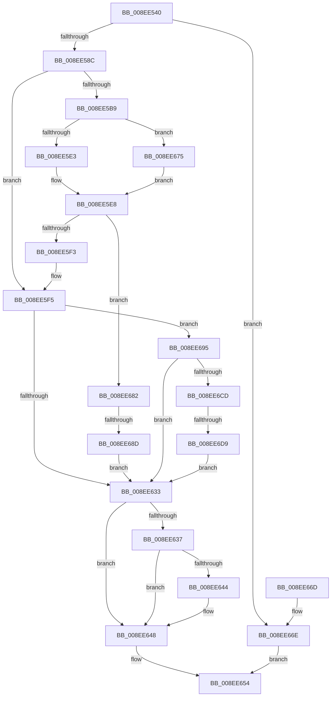

# _CmOpenDeviceRegKey

- RVA: `0x008EE540`–`0x008EE6E0` (길이 `416` bytes)
- VA: `0x00000001408EE540`
- 실행 섹션: `PAGE`
- PDB 이름 있음: `예`; PDB Function 태그: `예`
- unwind 정보 RVA: `0x00086EE8`
- 디코드: `106`개 명령, `416/416` bytes 표시
- 미해석 바이트: `0` (있으면 어셈블리에 `.byte`로 보존)

> 이 문서는 커널 이미지의 기계어와 PDB 기호를 분석해 생성했습니다. 4번과 5번은 함수 원형과 자료형을 바이너리 사용 방식에서 추정한 C 해석이며 원본 소스 복구 결과는 아닙니다.

## 1. Dependencies

- 직접 호출 지점: **6**; 고유 호출 대상: **5**
- 직접 호출자로 확인된 함수: **45**
- RIP 상대 이미지 참조: **1**

### Outgoing calls
- `0x008EE57B` → [ExAllocatePool2](../../poolcode/B8/ExAllocatePool2_function_00B820F0.md) (function, `0x00B820F0`)
- `0x008EE5E3` → [PiPnpRtlCmActionCallback](PiPnpRtlCmActionCallback_function_008EF110.md) (function, `0x008EF110`)
- `0x008EE624` → [_CmOpenDeviceRegKeyWorker](_CmOpenDeviceRegKeyWorker_function_008EE6F0.md) (function, `0x008EE6F0`)
- `0x008EE64D` → [ExFreePoolWithTag](../../poolcode/B8/ExFreePoolWithTag_function_00B82870.md) (function, `0x00B82870`)
- `0x008EE678` → [guard_dispatch_icall](../../text/6B/guard_dispatch_icall_function_006BAAD0.md) (function, `0x006BAAD0`)
- `0x008EE6B7` → [guard_dispatch_icall](../../text/6B/guard_dispatch_icall_function_006BAAD0.md) (function, `0x006BAAD0`)

### Direct callers
- [IoReportDetectedDevice](../72/IoReportDetectedDevice_function_00725CD0.md) at `0x00726370`
- [IoReportDetectedDevice](../72/IoReportDetectedDevice_function_00725CD0.md) at `0x00726557`
- [IopIsReportedAlready](../72/IopIsReportedAlready_function_00726C6C.md) at `0x00726D97`
- [IopIsReportedAlready](../72/IopIsReportedAlready_function_00726C6C.md) at `0x00726E3C`
- [IopIsReportedAlready](../72/IopIsReportedAlready_function_00726C6C.md) at `0x00726EB0`
- [PipApplyFunctionToServiceInstances](../72/PipApplyFunctionToServiceInstances_function_0072BF40.md) at `0x0072C0DC`
- [PiUEventBroadcastPortsChangedEvent](../72/PiUEventBroadcastPortsChangedEvent_function_0072DDA8.md) at `0x0072DE15`
- [PiDevCfgInitDriverDatabaseCallback](../73/PiDevCfgInitDriverDatabaseCallback_function_00733958.md) at `0x00733AA7`
- [PiDevCfgProcessDeviceCallback](../73/PiDevCfgProcessDeviceCallback_function_00734080.md) at `0x0073410F`
- [PiInitializeDevice](../73/PiInitializeDevice_function_0073EC5C.md) at `0x0073ED47`
- [CmDeleteDeviceMappedPropertyFromDriverKeyRegValue](../82/CmDeleteDeviceMappedPropertyFromDriverKeyRegValue_function_0082F944.md) at `0x0082F9D3`
- [CmDeleteDeviceMappedPropertyFromInstanceKeyRegValue](../82/CmDeleteDeviceMappedPropertyFromInstanceKeyRegValue_function_0082FA68.md) at `0x0082FB08`
- [CmSetDeviceMappedPropertyFromInstanceKeyRegValue](../83/CmSetDeviceMappedPropertyFromInstanceKeyRegValue_function_00830F40.md) at `0x00830FFF`
- [sub_008E1E1A](Unknown_function_008E1E1A.md) at `0x008E1E56`
- [sub_008EDAC3](Unknown_function_008EDAC3.md) at `0x008EDB32`
- [sub_008EE966](Unknown_function_008EE966.md) at `0x008EE9A8`
- [PnpDeviceObjectToDeviceInstance](../8F/PnpDeviceObjectToDeviceInstance_function_008FD630.md) at `0x008FD67E`
- [_CmSetDeviceRegPropWorker](../8F/_CmSetDeviceRegPropWorker_function_008FD804.md) at `0x008FDADC`
- [PiQueryAndAllocateBootResources](../8F/PiQueryAndAllocateBootResources_function_008FDB10.md) at `0x008FDBC1`
- [PiQueryResourceRequirements](../8F/PiQueryResourceRequirements_function_008FE61C.md) at `0x008FE6CB`
- [CmCreateDeviceWorker](../8F/CmCreateDeviceWorker_function_008FFC3C.md) at `0x008FFC93`
- [PiCMOpenDeviceKey](../96/PiCMOpenDeviceKey_function_00961C00.md) at `0x00961CDC`
- [PiCMOpenDeviceKey](../96/PiCMOpenDeviceKey_function_00961C00.md) at `0x00961DE9`
- [PiDevCfgEnumDeviceKeys](../96/PiDevCfgEnumDeviceKeys_function_00964EE8.md) at `0x00965023`
- [PiDevCfgResetDeviceDriverSettings](../96/PiDevCfgResetDeviceDriverSettings_function_00966168.md) at `0x0096634B`
- [PnpCheckDeviceIdsChanged](../97/PnpCheckDeviceIdsChanged_function_00972938.md) at `0x00972B3C`
- [PiDevCfgInitDeviceContext](../97/PiDevCfgInitDeviceContext_function_00977518.md) at `0x0097759F`
- [IoOpenDeviceRegistryKey](../99/IoOpenDeviceRegistryKey_function_00999250.md) at `0x0099930C`
- [_CmGetDeviceMappedPropertyFromComposite](../9D/_CmGetDeviceMappedPropertyFromComposite_function_009D1684.md) at `0x009D2207`
- [sub_009D2B5A](../9D/Unknown_function_009D2B5A.md) at `0x009D2C41`
- [_CmGetDeviceMappedPropertyFromInstanceKeyRegValue](../9D/_CmGetDeviceMappedPropertyFromInstanceKeyRegValue_function_009D2F44.md) at `0x009D30E3`
- [_CmGetDeviceCompoundFilters](../9D/_CmGetDeviceCompoundFilters_function_009D31C0.md) at `0x009D322C`
- [PpForEachDeviceInstanceDriver](../A0/PpForEachDeviceInstanceDriver_function_00A07D2C.md) at `0x00A07E4D`
- [IopReleaseDeviceResources](../A0/IopReleaseDeviceResources_function_00A0867C.md) at `0x00A08789`
- [_CmDeleteDeviceWorker](../A0/_CmDeleteDeviceWorker_function_00A08F48.md) at `0x00A08FD4`
- [_CmSetDeviceMappedPropertyFromDriverKeyRegValue](../A0/_CmSetDeviceMappedPropertyFromDriverKeyRegValue_function_00A0B488.md) at `0x00A0B53A`
- [PipCallDriverAddDevice](../A2/PipCallDriverAddDevice_function_00A272E0.md) at `0x00A273C5`
- [PipMakeGloballyUniqueId](../A6/PipMakeGloballyUniqueId_function_00A6F428.md) at `0x00A6F4DE`
- [PnpGetDeviceResourcesFromRegistry](../A7/PnpGetDeviceResourcesFromRegistry_function_00A74344.md) at `0x00A743C4`
- [PnpGetDeviceResourcesFromRegistry](../A7/PnpGetDeviceResourcesFromRegistry_function_00A74344.md) at `0x00A74452`
- [PnpGetDeviceResourcesFromRegistry](../A7/PnpGetDeviceResourcesFromRegistry_function_00A74344.md) at `0x00A744C1`
- [PnpIsDeviceInstanceEnabled](../A7/PnpIsDeviceInstanceEnabled_function_00A75A3C.md) at `0x00A75C3D`
- [PnpGetDeviceInstanceCsConfigFlags](../A7/PnpGetDeviceInstanceCsConfigFlags_function_00A75D5C.md) at `0x00A75E90`
- [IopGetRootDevices](../A7/IopGetRootDevices_function_00A7A4BC.md) at `0x00A7A607`
- [_CmDeleteDeviceRegKeyWorker](../A9/_CmDeleteDeviceRegKeyWorker_function_00A9200C.md) at `0x00A921E9`
- [IopWriteAllocatedResourcesToRegistry](../AA/IopWriteAllocatedResourcesToRegistry_function_00AA54E4.md) at `0x00AA5557`
- [PiDevCfgResolveVariableKeyHandle](../AB/PiDevCfgResolveVariableKeyHandle_function_00AB2A24.md) at `0x00AB2B43`
- [PiCMCreateDevice](../AC/PiCMCreateDevice_function_00ACB824.md) at `0x00ACBA3D`
- [PnpGetDeviceInstanceRegistryValue](../AD/PnpGetDeviceInstanceRegistryValue_function_00AD5A90.md) at `0x00AD5B2B`
- [sub_00B1FB42](../B1/Unknown_function_00B1FB42.md) at `0x00B1FBE9`
- [sub_00B40726](../B4/Unknown_function_00B40726.md) at `0x00B40756`

### Static image references
- `0x008EE5C4` → RVA `0x008EF110` (`PiPnpRtlCmActionCallback`; read)

## 2. Other-region calls and transfers

- 다른 실행 섹션으로 향하는 call: **4**
  - `0x008EE57B` → [ExAllocatePool2](../../poolcode/B8/ExAllocatePool2_function_00B820F0.md) (`PAGE` → `POOLCODE`)
  - `0x008EE64D` → [ExFreePoolWithTag](../../poolcode/B8/ExFreePoolWithTag_function_00B82870.md) (`PAGE` → `POOLCODE`)
  - `0x008EE678` → [guard_dispatch_icall](../../text/6B/guard_dispatch_icall_function_006BAAD0.md) (`PAGE` → `.text`)
  - `0x008EE6B7` → [guard_dispatch_icall](../../text/6B/guard_dispatch_icall_function_006BAAD0.md) (`PAGE` → `.text`)
- call이 아닌 외부 분기/꼬리 이동: **2**
  - `0x008EE687` → [sub_00B1DB2A](../B1/Unknown_function_00B1DB2A.md) (`tail-transfer`)
  - `0x008EE6D3` → [sub_00B1DB2A + 0x12](../B1/Unknown_function_00B1DB2A.md) (`tail-transfer`)

## 3. Assembly (complete function range)

```asm
008EE540  48 89 5C 24 08                  mov qword ptr [rsp + 8], rbx
008EE545  48 89 6C 24 10                  mov qword ptr [rsp + 0x10], rbp
008EE54A  48 89 74 24 18                  mov qword ptr [rsp + 0x18], rsi
008EE54F  57                              push rdi
008EE550  41 56                           push r14
008EE552  41 57                           push r15
008EE554  48 83 EC 40                     sub rsp, 0x40
008EE558  48 8B B1 F8 01 00 00            mov rsi, qword ptr [rcx + 0x1f8]
008EE55F  45 8B F0                        mov r14d, r8d
008EE562  4C 8B FA                        mov r15, rdx
008EE565  48 8B E9                        mov rbp, rcx
008EE568  BA 58 00 00 00                  mov edx, 0x58
008EE56D  B9 00 01 00 00                  mov ecx, 0x100
008EE572  41 B8 50 4E 50 52               mov r8d, 0x52504e50
008EE578  41 8B F9                        mov edi, r9d
008EE57B  E8 70 3B 29 00                  call 0x140b820f0
008EE580  48 8B D8                        mov rbx, rax
008EE583  48 85 C0                        test rax, rax
008EE586  0F 84 E2 00 00 00               je 0x1408ee66e
008EE58C  44 89 70 10                     mov dword ptr [rax + 0x10], r14d
008EE590  89 78 14                        mov dword ptr [rax + 0x14], edi
008EE593  8B 84 24 80 00 00 00            mov eax, dword ptr [rsp + 0x80]
008EE59A  89 43 18                        mov dword ptr [rbx + 0x18], eax
008EE59D  0F B6 84 24 88 00 00 00         movzx eax, byte ptr [rsp + 0x88]
008EE5A5  88 43 1C                        mov byte ptr [rbx + 0x1c], al
008EE5A8  48 8B 84 24 90 00 00 00         mov rax, qword ptr [rsp + 0x90]
008EE5B0  48 89 43 20                     mov qword ptr [rbx + 0x20], rax
008EE5B4  48 85 F6                        test rsi, rsi
008EE5B7  74 3C                           je 0x1408ee5f5
008EE5B9  41 B9 0B 00 00 00               mov r9d, 0xb
008EE5BF  48 89 5C 24 28                  mov qword ptr [rsp + 0x28], rbx
008EE5C4  48 8D 05 45 0B 00 00            lea rax, [rip + 0xb45]
008EE5CB  49 8B D7                        mov rdx, r15
008EE5CE  48 8B CD                        mov rcx, rbp
008EE5D1  45 8D 41 F6                     lea r8d, [r9 - 0xa]
008EE5D5  44 89 44 24 20                  mov dword ptr [rsp + 0x20], r8d
008EE5DA  48 3B F0                        cmp rsi, rax
008EE5DD  0F 85 92 00 00 00               jne 0x1408ee675
008EE5E3  E8 28 0B 00 00                  call 0x1408ef110
008EE5E8  3D 02 00 00 C0                  cmp eax, 0xc0000002
008EE5ED  0F 85 8F 00 00 00               jne 0x1408ee682
008EE5F3  33 F6                           xor esi, esi
008EE5F5  48 8B 43 20                     mov rax, qword ptr [rbx + 0x20]
008EE5F9  4C 8D 73 28                     lea r14, [rbx + 0x28]
008EE5FD  44 8B 4B 14                     mov r9d, dword ptr [rbx + 0x14]
008EE601  49 8B D7                        mov rdx, r15
008EE604  44 8B 43 10                     mov r8d, dword ptr [rbx + 0x10]
008EE608  48 8B CD                        mov rcx, rbp
008EE60B  4C 89 74 24 38                  mov qword ptr [rsp + 0x38], r14
008EE610  48 89 44 24 30                  mov qword ptr [rsp + 0x30], rax
008EE615  0F B6 43 1C                     movzx eax, byte ptr [rbx + 0x1c]
008EE619  88 44 24 28                     mov byte ptr [rsp + 0x28], al
008EE61D  8B 43 18                        mov eax, dword ptr [rbx + 0x18]
008EE620  89 44 24 20                     mov dword ptr [rsp + 0x20], eax
008EE624  E8 C7 00 00 00                  call 0x1408ee6f0
008EE629  8B F8                           mov edi, eax
008EE62B  49 8B C6                        mov rax, r14
008EE62E  48 85 F6                        test rsi, rsi
008EE631  75 62                           jne 0x1408ee695
008EE633  85 FF                           test edi, edi
008EE635  78 11                           js 0x1408ee648
008EE637  48 8B 8C 24 98 00 00 00         mov rcx, qword ptr [rsp + 0x98]
008EE63F  48 85 C9                        test rcx, rcx
008EE642  74 04                           je 0x1408ee648
008EE644  8B 00                           mov eax, dword ptr [rax]
008EE646  89 01                           mov dword ptr [rcx], eax
008EE648  33 D2                           xor edx, edx
008EE64A  48 8B CB                        mov rcx, rbx
008EE64D  E8 1E 42 29 00                  call 0x140b82870
008EE652  8B C7                           mov eax, edi
008EE654  48 8B 5C 24 60                  mov rbx, qword ptr [rsp + 0x60]
008EE659  48 8B 6C 24 68                  mov rbp, qword ptr [rsp + 0x68]
008EE65E  48 8B 74 24 70                  mov rsi, qword ptr [rsp + 0x70]
008EE663  48 83 C4 40                     add rsp, 0x40
008EE667  41 5F                           pop r15
008EE669  41 5E                           pop r14
008EE66B  5F                              pop rdi
008EE66C  C3                              ret
008EE66D  CC                              int3
008EE66E  B8 17 00 00 C0                  mov eax, 0xc0000017
008EE673  EB DF                           jmp 0x1408ee654
008EE675  48 8B C6                        mov rax, rsi
008EE678  E8 53 C4 DC FF                  call 0x1406baad0
008EE67D  E9 66 FF FF FF                  jmp 0x1408ee5e8
008EE682  3D 20 01 00 C0                  cmp eax, 0xc0000120
008EE687  0F 85 9D F4 22 00               jne 0x140b1db2a
008EE68D  8B 3B                           mov edi, dword ptr [rbx]
008EE68F  48 8D 43 28                     lea rax, [rbx + 0x28]
008EE693  EB 9E                           jmp 0x1408ee633
008EE695  41 B9 0B 00 00 00               mov r9d, 0xb
008EE69B  48 89 5C 24 28                  mov qword ptr [rsp + 0x28], rbx
008EE6A0  49 8B D7                        mov rdx, r15
008EE6A3  89 3B                           mov dword ptr [rbx], edi
008EE6A5  48 8B CD                        mov rcx, rbp
008EE6A8  C7 44 24 20 02 00 00 00         mov dword ptr [rsp + 0x20], 2
008EE6B0  48 8B C6                        mov rax, rsi
008EE6B3  45 8D 41 F6                     lea r8d, [r9 - 0xa]
008EE6B7  E8 14 C4 DC FF                  call 0x1406baad0
008EE6BC  8B C8                           mov ecx, eax
008EE6BE  49 8B C6                        mov rax, r14
008EE6C1  81 F9 02 00 00 C0               cmp ecx, 0xc0000002
008EE6C7  0F 84 66 FF FF FF               je 0x1408ee633
008EE6CD  81 F9 20 01 00 C0               cmp ecx, 0xc0000120
008EE6D3  0F 85 63 F4 22 00               jne 0x140b1db3c
008EE6D9  8B 3B                           mov edi, dword ptr [rbx]
008EE6DB  E9 53 FF FF FF                  jmp 0x1408ee633
```

## 4. C-style interpretation (structured pseudocode)

```c
__int64 __fastcall _CmOpenDeviceRegKey(__int64 a1, __int64 a2, int a3, int a4, unsigned int a5, unsigned __int8 a6, __int64 a7, __int64 a8)
{
    __int64 result;
    __int64 v_rsi;
    __int64 v_rsp;
    unsigned __int64 v_stack_m20;
    unsigned __int64 v_stack_m28;
    unsigned __int64 v_stack_m30;
    unsigned int v_stack_m38;
    unsigned __int64 v_stack_p10;
    unsigned __int64 v_stack_p18;
    unsigned int v_stack_p20;
    unsigned __int64 v_stack_p28;
    unsigned __int64 v_stack_p8;

    v_stack_p8 = v_rbx;
    v_stack_p10 = v_rbp;
    v_stack_p18 = v_rsi;
    v_rsp = (v_rsp) - (64);
    result = ExAllocatePool2(256, 88, (unsigned int)(0x52504E50ULL), a4);
    if (result == 0) goto loc_008EE66E;
    *(unsigned int *)(result + 16) = (unsigned int)((unsigned int)(a3));
    *(unsigned int *)(result + 20) = (unsigned int)((unsigned int)(a4));
    *(unsigned int *)(result + 24) = (unsigned int)((unsigned int)(a5));
    *(unsigned __int8 *)(result + 28) = a6;
    *(unsigned __int64 *)(result + 32) = a7;
    if (*(unsigned __int64 *)(a1 + 504) == 0) goto loc_008EE5F5;
    v_stack_m30 = result;
    v_stack_m38 = (unsigned int)(11 - 10);
    if ((*(unsigned __int64 *)(a1 + 504)) != (v_rip + 2885)) goto loc_008EE675;
    result = PiPnpRtlCmActionCallback(a1, a2, 11 - 10, 11);
loc_008EE5E8:
    if (((unsigned int)(result)) != 0xC0000002ULL) goto loc_008EE682;
    v_rsi = 0;
loc_008EE5F5:
    v_stack_m20 = result + 40;
    v_stack_m28 = *(unsigned __int64 *)(result + 32);
    v_stack_m30 = (unsigned __int8)(*(unsigned __int8 *)(result + 28));
    v_stack_m38 = (unsigned int)((unsigned int)(*(unsigned int *)(result + 24)));
    result = _CmOpenDeviceRegKeyWorker(a1, a2, (unsigned int)(*(unsigned int *)(result + 16)), (unsigned int)(*(unsigned int *)(result + 20)));
    if (0 != 0) goto loc_008EE695;
loc_008EE633:
    if (sign_flag) goto loc_008EE648;
    result = result + 40;
    if (a8 != 0) {
        result = *(unsigned int *)(result + 40);
        *(unsigned int *)(a8) = (unsigned int)(result);
    }
    a2 = 0;
    result = ExFreePoolWithTag(result, a2, (unsigned int)(*(unsigned int *)(result + 16)), (unsigned int)(*(unsigned int *)(result + 20)));
loc_008EE654:
    v_rsp = (v_rsp) + (64);
    return (unsigned int)((unsigned int)((unsigned int)((unsigned int)(result))));
loc_008EE66E:
    goto loc_008EE654;
loc_008EE675:
    result = guard_dispatch_icall(result, a2, (unsigned int)(*(unsigned int *)(result + 16)), (unsigned int)(*(unsigned int *)(result + 20)));
    goto loc_008EE5E8;
loc_008EE682:
    goto loc_008EE633;
loc_008EE695:
    v_stack_p28 = v_stack_p8;
    *(unsigned int *)(v_stack_p8) = (unsigned int)((unsigned int)(*(unsigned int *)(v_stack_p8)));
    v_stack_p20 = 2;
    result = guard_dispatch_icall(v_stack_p10, 0, 11 - 10, 11);
    if (((unsigned int)((unsigned int)((unsigned int)(result)))) == 0xC0000002ULL) goto loc_008EE633;
    goto loc_008EE633;
}
```

## 5. (Beta) C Style

```c
int64_t _CmOpenDeviceRegKey(void *Arg1, int64_t Arg2, int32_t Arg3, int32_t Arg4, uint32_t Arg5, uint8_t Arg6, int64_t Arg7, int64_t Arg8)
{
    uint8_t *arg1 = (uint8_t *)Arg1;

    int64_t result;
    int64_t local_rsi;
    int64_t local_rsp;
    uint64_t v_stack_m20;
    uint64_t v_stack_m28;
    uint64_t v_stack_m30;
    uint32_t v_stack_m38;
    uint64_t v_stack_p10;
    uint64_t v_stack_p18;
    uint32_t v_stack_p20;
    uint64_t v_stack_p28;
    uint64_t v_stack_p8;

    v_stack_p8 = local_rbx;
    v_stack_p10 = local_rbp;
    v_stack_p18 = local_rsi;
    local_rsp = (local_rsp) - (64);
    result = ExAllocatePool2(256, 88, (uint32_t)(0x52504E50ULL), Arg4);
    if (result == 0) goto loc_008EE66E;
    *(uint32_t *)(result + 0x10) = (uint32_t)((uint32_t)(Arg3));
    *(uint32_t *)(result + 0x14) = (uint32_t)((uint32_t)(Arg4));
    *(uint32_t *)(result + 0x18) = (uint32_t)((uint32_t)(Arg5));
    *(uint8_t *)(result + 0x1C) = Arg6;
    *(uint64_t *)(result + 0x20) = Arg7;
    if (*(uint64_t *)(arg1 + 0x1F8) == 0) goto loc_008EE5F5;
    v_stack_m30 = result;
    v_stack_m38 = (uint32_t)(11 - 10);
    if ((*(uint64_t *)(arg1 + 0x1F8)) != (v_rip + 2885)) goto loc_008EE675;
    result = PiPnpRtlCmActionCallback(Arg1, Arg2, 11 - 10, 11);
loc_008EE5E8:
    if (((uint32_t)(result)) != 0xC0000002ULL) goto loc_008EE682;
    local_rsi = 0;
loc_008EE5F5:
    v_stack_m20 = result + 40;
    v_stack_m28 = *(uint64_t *)(result + 0x20);
    v_stack_m30 = (uint8_t)(*(uint8_t *)(result + 0x1C));
    v_stack_m38 = (uint32_t)((uint32_t)(*(uint32_t *)(result + 0x18)));
    result = _CmOpenDeviceRegKeyWorker(Arg1, Arg2, (uint32_t)(*(uint32_t *)(result + 0x10)), (uint32_t)(*(uint32_t *)(result + 0x14)));
    if (0 != 0) goto loc_008EE695;
loc_008EE633:
    if (sign_flag) goto loc_008EE648;
    result = result + 40;
    if (Arg8 != 0) {
        result = *(uint32_t *)(result + 0x28);
        *(uint32_t *)(Arg8) = (uint32_t)(result);
    }
    Arg2 = 0;
    result = ExFreePoolWithTag(result, Arg2, (uint32_t)(*(uint32_t *)(result + 0x10)), (uint32_t)(*(uint32_t *)(result + 0x14)));
loc_008EE654:
    local_rsp = (local_rsp) + (64);
    return (uint32_t)((uint32_t)((uint32_t)((uint32_t)(result))));
loc_008EE66E:
    goto loc_008EE654;
loc_008EE675:
    result = guard_dispatch_icall(result, Arg2, (uint32_t)(*(uint32_t *)(result + 0x10)), (uint32_t)(*(uint32_t *)(result + 0x14)));
    goto loc_008EE5E8;
loc_008EE682:
    goto loc_008EE633;
loc_008EE695:
    v_stack_p28 = v_stack_p8;
    *(uint32_t *)(v_stack_p8) = (uint32_t)((uint32_t)(*(uint32_t *)(v_stack_p8)));
    v_stack_p20 = 2;
    result = guard_dispatch_icall(v_stack_p10, 0, 11 - 10, 11);
    if (((uint32_t)((uint32_t)((uint32_t)(result)))) == 0xC0000002ULL) goto loc_008EE633;
    goto loc_008EE633;
}
```

### 관측된 메모리 오프셋

구조체 형식이 확인되지 않은 접근은 인자 기준의 오프셋으로만 기록했습니다.

| 기준 인자 | 오프셋 표현 | 폭 (bit) | 접근 |
|---|---:|---:|---|
| `Arg1` | `+ 0x1F8` | `64` | `R` |

## 6. Execution-region graph

[열기: 2D/3D 그래프와 함수 탐색 컨트롤 패널](../../../control-panel.html?section=page&rva=0x008EE540&view=graph)

- 2D 그래프는 위에서 아래로 흐르고, 3D 그래프는 빈 공간을 드래그해 회전합니다. Shift+드래그는 이동, 휠은 확대·축소, 함수 노드 선택은 대상 보고서 이동입니다.

### Static fallback


