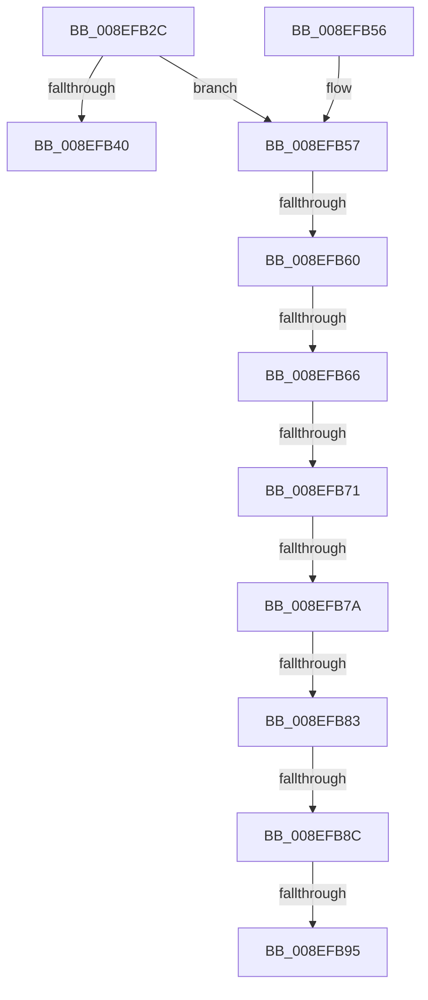

# _PnpCtxGetCachedContextBaseKey

- RVA: `0x008EFB2C`–`0x008EFB9A` (길이 `110` bytes)
- VA: `0x00000001408EFB2C`
- 실행 섹션: `PAGE`
- PDB 이름 있음: `예`; PDB Function 태그: `예`
- unwind 정보 RVA: `0x0008713C`
- 디코드: `29`개 명령, `110/110` bytes 표시
- 미해석 바이트: `0` (있으면 어셈블리에 `.byte`로 보존)

> 이 문서는 커널 이미지의 기계어와 PDB 기호를 분석해 생성했습니다. 4번과 5번은 함수 원형과 자료형을 바이너리 사용 방식에서 추정한 C 해석이며 원본 소스 복구 결과는 아닙니다.

## 1. Dependencies

- 직접 호출 지점: **1**; 고유 호출 대상: **1**
- 직접 호출자로 확인된 함수: **39**
- RIP 상대 이미지 참조: **0**

### Outgoing calls
- `0x008EFB4C` → [_PnpCtxGetCachedNodeBaseKey](_PnpCtxGetCachedNodeBaseKey_function_008EF9C0.md) (function, `0x008EF9C0`)

### Direct callers
- [PipUpdateDeviceProducts](../../text/5A/PipUpdateDeviceProducts_function_005A46C0.md) at `0x005A4745`
- [PipHardwareConfigClearStartOverrides](../72/PipHardwareConfigClearStartOverrides_function_007234A4.md) at `0x0072350A`
- [PnpCheckDriverDependencies](../72/PnpCheckDriverDependencies_function_0072C3C4.md) at `0x0072C416`
- [PiDevCfgOpenDeviceMigrationKey](../73/PiDevCfgOpenDeviceMigrationKey_function_00733EE4.md) at `0x00733F22`
- [PnprGetPluginDriverImagePath](../73/PnprGetPluginDriverImagePath_function_007398E8.md) at `0x0073993A`
- [CmDeleteCommonClassRegKeyWorker](../82/CmDeleteCommonClassRegKeyWorker_function_008298F8.md) at `0x00829AA6`
- [CmDeleteCommonClassRegKeyWorker](../82/CmDeleteCommonClassRegKeyWorker_function_008298F8.md) at `0x00829B2E`
- [CmDeleteDeviceInterfaceRegKeyWorker](../82/CmDeleteDeviceInterfaceRegKeyWorker_function_00829E1C.md) at `0x00829FC3`
- [CmDeleteDeviceContainerRegKeyWorker](../82/CmDeleteDeviceContainerRegKeyWorker_function_0082B15C.md) at `0x0082B2CE`
- [CmGetDevicesInBaseContainerList](../82/CmGetDevicesInBaseContainerList_function_0082BA6C.md) at `0x0082BAC0`
- [CmGetMatchingDeviceContainerList](../82/CmGetMatchingDeviceContainerList_function_0082BCC4.md) at `0x0082BD91`
- [CmRemoveDeviceFromContainerWorker](../82/CmRemoveDeviceFromContainerWorker_function_0082C080.md) at `0x0082C0D1`
- [CmGetMatchingCommonClassListWorker](../82/CmGetMatchingCommonClassListWorker_function_0082D28C.md) at `0x0082D2F9`
- [CmGetMatchingCommonClassListWorker](../82/CmGetMatchingCommonClassListWorker_function_0082D28C.md) at `0x0082D38B`
- [CmGetMatchingDeviceListForSubkey](../82/CmGetMatchingDeviceListForSubkey_function_0082D5A0.md) at `0x0082D5FB`
- [CmDeleteDevicePanelRegKeyWorker](../82/CmDeleteDevicePanelRegKeyWorker_function_0082E554.md) at `0x0082E6BD`
- [CmGetMatchingDevicePanelListWorker](../82/CmGetMatchingDevicePanelListWorker_function_0082F090.md) at `0x0082F0E2`
- [CmRemovePanelDeviceWorker](../82/CmRemovePanelDeviceWorker_function_0082F470.md) at `0x0082F4B7`
- [CmSetInstallerClassMappedProperty](../83/CmSetInstallerClassMappedProperty_function_008310E8.md) at `0x00831284`
- [CmSetInstallerClassMappedProperty](../83/CmSetInstallerClassMappedProperty_function_008310E8.md) at `0x008312D9`
- [NtDisableLastKnownGood](../83/NtDisableLastKnownGood_function_0083C560.md) at `0x0083C5CF`
- [NtEnableLastKnownGood](../83/NtEnableLastKnownGood_function_0083C680.md) at `0x0083C723`
- [_CmOpenCommonClassRegKeyWorker](../8F/_CmOpenCommonClassRegKeyWorker_function_008F0A1C.md) at `0x008F0F36`
- [CmOpenDeviceContainerRegKeyWorker](../8F/CmOpenDeviceContainerRegKeyWorker_function_008F4904.md) at `0x008F4A53`
- [DrvDbLoadDatabaseNode](../93/DrvDbLoadDatabaseNode_function_00931668.md) at `0x009317C7`
- [DrvDbLoadDatabaseNode](../93/DrvDbLoadDatabaseNode_function_00931668.md) at `0x00931802`
- [PnpCtxOpenContextBaseKey](../96/PnpCtxOpenContextBaseKey_function_00962A0C.md) at `0x00962A36`
- [CmGetMatchingFilteredDeviceInterfaceListWorker](../A0/CmGetMatchingFilteredDeviceInterfaceListWorker_function_00A097EC.md) at `0x00A09876`
- [_CmDeleteDeviceRegKeyWorker](../A9/_CmDeleteDeviceRegKeyWorker_function_00A9200C.md) at `0x00A921AD`
- [_CmOpenDevicePanelRegKeyWorker](../A9/_CmOpenDevicePanelRegKeyWorker_function_00A98434.md) at `0x00A98571`
- [PiDevCfgConfigureDeviceLocation](../AA/PiDevCfgConfigureDeviceLocation_function_00AA88C0.md) at `0x00AA895C`
- [PiCMDeleteDeviceKey](../AD/PiCMDeleteDeviceKey_function_00AD6780.md) at `0x00AD687B`
- [PipHardwareConfigOpenKey](../AD/PipHardwareConfigOpenKey_function_00AD8848.md) at `0x00AD8884`
- [sub_00B2BF4C](../B2/Unknown_function_00B2BF4C.md) at `0x00B2BF57`
- [sub_00B2BF4C](../B2/Unknown_function_00B2BF4C.md) at `0x00B2BF72`
- [sub_00B3FE90](../B3/Unknown_function_00B3FE90.md) at `0x00B3FF30`
- [IopInitializePlugPlayServices](../../init/C2/IopInitializePlugPlayServices_function_00C2F298.md) at `0x00C2F63D`
- [PipHardwareConfigInit](../../init/C3/PipHardwareConfigInit_function_00C30D24.md) at `0x00C30E10`
- [PipMigratePnpState](../../init/C3/PipMigratePnpState_function_00C317D4.md) at `0x00C319A7`
- [PnpOpenCCSPnpRegKey](../../init/C3/PnpOpenCCSPnpRegKey_function_00C33658.md) at `0x00C33681`
- [PipCommitPendingOsExtensionResource](../../init/C3/PipCommitPendingOsExtensionResource_function_00C35960.md) at `0x00C359AD`
- [PipCommitPendingService](../../init/C3/PipCommitPendingService_function_00C35B70.md) at `0x00C35BCD`
- [PipCommitPendingService](../../init/C3/PipCommitPendingService_function_00C35B70.md) at `0x00C35CDF`
- [PipProcessPendingOsExtensionResources](../../init/C3/PipProcessPendingOsExtensionResources_function_00C36164.md) at `0x00C36187`
- [PipProcessPendingServices](../../init/C3/PipProcessPendingServices_function_00C3620C.md) at `0x00C3622F`

### Static image references
- 디코드된 RIP-relative 메모리 참조가 없습니다.

## 2. Other-region calls and transfers

- 다른 실행 섹션으로 향하는 call: **0**
- call이 아닌 외부 분기/꼬리 이동: **8**
  - `0x008EFB5A` → [sub_00B1E3FC](../B1/Unknown_function_00B1E3FC.md) (`tail-transfer`)
  - `0x008EFB60` → [sub_00B1E3FC + 0x1B](../B1/Unknown_function_00B1E3FC.md) (`tail-transfer`)
  - `0x008EFB6B` → [sub_00B1E3FC + 0x2B](../B1/Unknown_function_00B1E3FC.md) (`tail-transfer`)
  - `0x008EFB74` → [sub_00B1E3FC + 0x1B](../B1/Unknown_function_00B1E3FC.md) (`tail-transfer`)
  - `0x008EFB7D` → [sub_00B1E3FC + 0x2B](../B1/Unknown_function_00B1E3FC.md) (`tail-transfer`)
  - `0x008EFB86` → [sub_00B1E3FC + 0x2B](../B1/Unknown_function_00B1E3FC.md) (`tail-transfer`)
  - `0x008EFB8F` → [sub_00B1E3FC + 0x16](../B1/Unknown_function_00B1E3FC.md) (`tail-transfer`)
  - `0x008EFB95` → [sub_00B1E3FC + 0x2B](../B1/Unknown_function_00B1E3FC.md) (`tail-transfer`)

## 3. Assembly (complete function range)

```asm
008EFB2C  48 83 EC 28                     sub rsp, 0x28
008EFB30  4C 63 CA                        movsxd r9, edx
008EFB33  4C 8B D1                        mov r10, rcx
008EFB36  4A 8B 44 C9 60                  mov rax, qword ptr [rcx + r9*8 + 0x60]
008EFB3B  48 85 C0                        test rax, rax
008EFB3E  74 17                           je 0x1408efb57
008EFB40  4D 8B C8                        mov r9, r8
008EFB43  49 8B CA                        mov rcx, r10
008EFB46  44 8B C2                        mov r8d, edx
008EFB49  48 8B D0                        mov rdx, rax
008EFB4C  E8 6F FE FF FF                  call 0x1408ef9c0
008EFB51  48 83 C4 28                     add rsp, 0x28
008EFB55  C3                              ret
008EFB56  CC                              int3
008EFB57  83 FA 0A                        cmp edx, 0xa
008EFB5A  0F 8F 9C E8 22 00               jg 0x140b1e3fc
008EFB60  0F 84 B1 E8 22 00               je 0x140b1e417
008EFB66  8B CA                           mov ecx, edx
008EFB68  83 E9 04                        sub ecx, 4
008EFB6B  0F 84 B6 E8 22 00               je 0x140b1e427
008EFB71  83 E9 01                        sub ecx, 1
008EFB74  0F 84 9D E8 22 00               je 0x140b1e417
008EFB7A  83 E9 01                        sub ecx, 1
008EFB7D  0F 84 A4 E8 22 00               je 0x140b1e427
008EFB83  83 E9 01                        sub ecx, 1
008EFB86  0F 84 9B E8 22 00               je 0x140b1e427
008EFB8C  83 E9 01                        sub ecx, 1
008EFB8F  0F 85 7D E8 22 00               jne 0x140b1e412
008EFB95  E9 8D E8 22 00                  jmp 0x140b1e427
```

## 4. C-style interpretation (structured pseudocode)

```c
__int64 __fastcall _PnpCtxGetCachedContextBaseKey(__int64 a1, int a2, __int64 a3)
{
    __int64 result;
    __int64 v_rsp;

    v_rsp = (v_rsp) - (40);
    if (*(unsigned __int64 *)(a1 + (int)(a2) * 8 + 96) == 0) goto loc_008EFB57;
    result = _PnpCtxGetCachedNodeBaseKey(a1, *(unsigned __int64 *)(a1 + (int)(a2) * 8 + 96), (unsigned int)(a2), a3);
    v_rsp = (v_rsp) + (40);
    return result;
loc_008EFB57:
    a1 = (unsigned int)(((unsigned int)((unsigned int)(*(unsigned __int64 *)(a1 + (int)(a2) * 8 + 96)))) - (4));
    a1 = (unsigned int)((a1) - (1));
    a1 = (unsigned int)((a1) - (1));
    a1 = (unsigned int)((a1) - (1));
    a1 = (unsigned int)((a1) - (1));
}
```

## 5. (Beta) C Style

```c
int64_t _PnpCtxGetCachedContextBaseKey(void *Arg1, int32_t Arg2, int64_t Arg3)
{
    uint8_t *arg1 = (uint8_t *)Arg1;

    int64_t result;
    int64_t local_rsp;

    local_rsp = (local_rsp) - (40);
    if (*(uint64_t *)(arg1 + (int32_t)(Arg2) * 8 + 0x60) == 0) goto loc_008EFB57;
    result = _PnpCtxGetCachedNodeBaseKey(Arg1, *(uint64_t *)(arg1 + (int32_t)(Arg2) * 8 + 0x60), (uint32_t)(Arg2), Arg3);
    local_rsp = (local_rsp) + (40);
    return result;
loc_008EFB57:
    Arg1 = (uint32_t)(((uint32_t)((uint32_t)(*(uint64_t *)(arg1 + (int32_t)(Arg2) * 8 + 0x60)))) - (4));
    Arg1 = (uint32_t)((Arg1) - (1));
    Arg1 = (uint32_t)((Arg1) - (1));
    Arg1 = (uint32_t)((Arg1) - (1));
    Arg1 = (uint32_t)((Arg1) - (1));
}
```

### 관측된 메모리 오프셋

구조체 형식이 확인되지 않은 접근은 인자 기준의 오프셋으로만 기록했습니다.

| 기준 인자 | 오프셋 표현 | 폭 (bit) | 접근 |
|---|---:|---:|---|
| `Arg1` | `+ 0x60 + r9*8` | `64` | `R` |

## 6. Execution-region graph

[열기: 2D/3D 그래프와 함수 탐색 컨트롤 패널](../../../control-panel.html?section=page&rva=0x008EFB2C&view=graph)

- 2D 그래프는 위에서 아래로 흐르고, 3D 그래프는 빈 공간을 드래그해 회전합니다. Shift+드래그는 이동, 휠은 확대·축소, 함수 노드 선택은 대상 보고서 이동입니다.

### Static fallback


