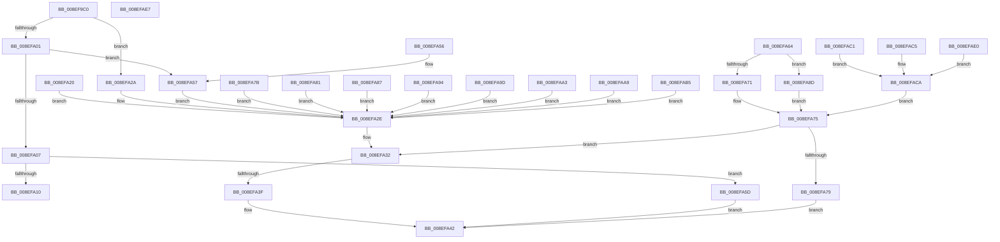

# _PnpCtxGetCachedNodeBaseKey

- RVA: `0x008EF9C0`–`0x008EFB24` (길이 `356` bytes)
- VA: `0x00000001408EF9C0`
- 실행 섹션: `PAGE`
- PDB 이름 있음: `예`; PDB Function 태그: `예`
- unwind 정보 RVA: `0x000870C0`
- 디코드: `121`개 명령, `356/356` bytes 표시
- 미해석 바이트: `1` (있으면 어셈블리에 `.byte`로 보존)

> 이 문서는 커널 이미지의 기계어와 PDB 기호를 분석해 생성했습니다. 4번과 5번은 함수 원형과 자료형을 바이너리 사용 방식에서 추정한 C 해석이며 원본 소스 복구 결과는 아닙니다.

## 1. Dependencies

- 직접 호출 지점: **1**; 고유 호출 대상: **1**
- 직접 호출자로 확인된 함수: **10**
- RIP 상대 이미지 참조: **1**

### Outgoing calls
- `0x008EFAD2` → [SysCtxGetCachedContextBaseKey](../A3/SysCtxGetCachedContextBaseKey_function_00A376A0.md) (function, `0x00A376A0`)

### Direct callers
- [PnpCtxOpenContextNodeBaseKey](../82/PnpCtxOpenContextNodeBaseKey_function_00828F14.md) at `0x00828F55`
- [sub_008EE74B](Unknown_function_008EE74B.md) at `0x008EE843`
- [_PnpCtxGetCachedContextBaseKey](_PnpCtxGetCachedContextBaseKey_function_008EFB2C.md) at `0x008EFB4C`
- [_CmOpenCommonClassRegKeyWorker](../8F/_CmOpenCommonClassRegKeyWorker_function_008F0A1C.md) at `0x008F0CFB`
- [_CmOpenDeviceInterfaceRegKeyWorker](../8F/_CmOpenDeviceInterfaceRegKeyWorker_function_008F2B48.md) at `0x008F2D70`
- [_CmGetDeviceContainerIdFromBase](../8F/_CmGetDeviceContainerIdFromBase_function_008FD2B4.md) at `0x008FD334`
- [PiDevCfgInitMigrationContext](../96/PiDevCfgInitMigrationContext_function_009642E0.md) at `0x00964347`
- [PiCMEnumerateSubKeys](../99/PiCMEnumerateSubKeys_function_009926E8.md) at `0x009927C5`
- [PipOpenServiceEnumKeys](../99/PipOpenServiceEnumKeys_function_00998E94.md) at `0x00998EF0`
- [PipOpenServiceEnumKeys](../99/PipOpenServiceEnumKeys_function_00998E94.md) at `0x0099905C`
- [CmGetInstallerClassMappedPropertyFromCoInstallers](../9D/CmGetInstallerClassMappedPropertyFromCoInstallers_function_009D44BC.md) at `0x009D4539`

### Static image references
- `0x008EF9E7` → RVA `0x00000000` (`image boundary/outside`; read)

## 2. Other-region calls and transfers

- 다른 실행 섹션으로 향하는 call: **0**
- call이 아닌 외부 분기/꼬리 이동: **1**
  - `0x008EFA39` → [sub_00B1E120](../B1/Unknown_function_00B1E120.md) (`tail-transfer`)

## 3. Assembly (complete function range)

```asm
008EF9C0  48 89 5C 24 18                  mov qword ptr [rsp + 0x18], rbx
008EF9C5  55                              push rbp
008EF9C6  56                              push rsi
008EF9C7  57                              push rdi
008EF9C8  41 55                           push r13
008EF9CA  41 56                           push r14
008EF9CC  48 8B EC                        mov rbp, rsp
008EF9CF  48 83 EC 60                     sub rsp, 0x60
008EF9D3  45 33 ED                        xor r13d, r13d
008EF9D6  45 8B D0                        mov r10d, r8d
008EF9D9  4C 89 6D F0                     mov qword ptr [rbp - 0x10], r13
008EF9DD  49 8B D9                        mov rbx, r9
008EF9E0  4C 89 6D F8                     mov qword ptr [rbp - 8], r13
008EF9E4  48 8B FA                        mov rdi, rdx
008EF9E7  4C 8D 05 12 06 71 FF            lea r8, [rip - 0x8ef9ee]
008EF9EE  4C 8B D9                        mov r11, rcx
008EF9F1  41 8D 75 01                     lea esi, [r13 + 1]
008EF9F5  41 8B C5                        mov eax, r13d
008EF9F8  45 8B F5                        mov r14d, r13d
008EF9FB  41 83 FA 05                     cmp r10d, 5
008EF9FF  74 29                           je 0x1408efa2a
008EFA01  41 83 FA 09                     cmp r10d, 9
008EFA05  74 50                           je 0x1408efa57
008EFA07  41 8D 4A FF                     lea ecx, [r10 - 1]
008EFA0B  83 F9 0E                        cmp ecx, 0xe
008EFA0E  77 4D                           ja 0x1408efa5d
008EFA10  48 63 C9                        movsxd rcx, ecx
008EFA13  41 8B 94 88 E8 FA 8E 00         mov edx, dword ptr [r8 + rcx*4 + 0x8efae8]
008EFA1B  49 03 D0                        add rdx, r8
008EFA1E  FF E2                           jmp rdx
008EFA20  CC                              int3
008EFA21  CC                              int3
008EFA22  CC                              int3
008EFA23  CC                              int3
008EFA24  48 8B 4F 58                     mov rcx, qword ptr [rdi + 0x58]
008EFA28  EB 04                           jmp 0x1408efa2e
008EFA2A  48 8B 4A 40                     mov rcx, qword ptr [rdx + 0x40]
008EFA2E  48 89 4D F0                     mov qword ptr [rbp - 0x10], rcx
008EFA32  48 8B 4D F0                     mov rcx, qword ptr [rbp - 0x10]
008EFA36  48 85 C9                        test rcx, rcx
008EFA39  0F 84 E1 E6 22 00               je 0x140b1e120
008EFA3F  48 89 0B                        mov qword ptr [rbx], rcx
008EFA42  48 8B 9C 24 A0 00 00 00         mov rbx, qword ptr [rsp + 0xa0]
008EFA4A  48 83 C4 60                     add rsp, 0x60
008EFA4E  41 5E                           pop r14
008EFA50  41 5D                           pop r13
008EFA52  5F                              pop rdi
008EFA53  5E                              pop rsi
008EFA54  5D                              pop rbp
008EFA55  C3                              ret
008EFA56  CC                              int3
008EFA57  48 8B 4A 60                     mov rcx, qword ptr [rdx + 0x60]
008EFA5B  EB D1                           jmp 0x1408efa2e
008EFA5D  B8 0D 00 00 C0                  mov eax, 0xc000000d
008EFA62  EB DE                           jmp 0x1408efa42
008EFA64  48 8B 4F 38                     mov rcx, qword ptr [rdi + 0x38]
008EFA68  48 8B 51 30                     mov rdx, qword ptr [rcx + 0x30]
008EFA6C  48 85 D2                        test rdx, rdx
008EFA6F  74 1C                           je 0x1408efa8d
008EFA71  48 89 55 F0                     mov qword ptr [rbp - 0x10], rdx
008EFA75  85 C0                           test eax, eax
008EFA77  79 B9                           jns 0x1408efa32
008EFA79  EB C7                           jmp 0x1408efa42
008EFA7B  48 8B 4F 50                     mov rcx, qword ptr [rdi + 0x50]
008EFA7F  EB AD                           jmp 0x1408efa2e
008EFA81  48 8B 4F 48                     mov rcx, qword ptr [rdi + 0x48]
008EFA85  EB A7                           jmp 0x1408efa2e
008EFA87  48 8B 4F 68                     mov rcx, qword ptr [rdi + 0x68]
008EFA8B  EB A1                           jmp 0x1408efa2e
008EFA8D  B8 34 00 00 C0                  mov eax, 0xc0000034
008EFA92  EB E1                           jmp 0x1408efa75
008EFA94  48 8B 8F 88 00 00 00            mov rcx, qword ptr [rdi + 0x88]
008EFA9B  EB 91                           jmp 0x1408efa2e
008EFA9D  48 8B 4F 70                     mov rcx, qword ptr [rdi + 0x70]
008EFAA1  EB 8B                           jmp 0x1408efa2e
008EFAA3  48 8B 4F 78                     mov rcx, qword ptr [rdi + 0x78]
008EFAA7  EB 85                           jmp 0x1408efa2e
008EFAA9  48 8B 8F 80 00 00 00            mov rcx, qword ptr [rdi + 0x80]
008EFAB0  E9 79 FF FF FF                  jmp 0x1408efa2e
008EFAB5  48 8B 8F 90 00 00 00            mov rcx, qword ptr [rdi + 0x90]
008EFABC  E9 6D FF FF FF                  jmp 0x1408efa2e
008EFAC1  8B D6                           mov edx, esi
008EFAC3  EB 05                           jmp 0x1408efaca
008EFAC5  BA 03 00 00 00                  mov edx, 3
008EFACA  48 8B 4F 38                     mov rcx, qword ptr [rdi + 0x38]
008EFACE  4C 8D 45 F0                     lea r8, [rbp - 0x10]
008EFAD2  E8 C9 7B 14 00                  call 0x140a376a0
008EFAD7  4C 8D 05 22 05 71 FF            lea r8, [rip - 0x8efade]
008EFADE  EB 95                           jmp 0x1408efa75
008EFAE0  BA 02 00 00 00                  mov edx, 2
008EFAE5  EB E3                           jmp 0x1408efaca
008EFAE7  90                              nop
008EFAE8  C1 FA 8E                        sar edx, 0x8e
008EFAEB  00 E0                           add al, ah
008EFAED  FA                              cli
008EFAEE  8E 00                           mov es, word ptr [rax]
008EFAF0  C5                              .byte 0xc5
008EFAF1  FA                              cli
008EFAF2  8E 00                           mov es, word ptr [rax]
008EFAF4  64 FA                           cli
008EFAF6  8E 00                           mov es, word ptr [rax]
008EFAF8  5D                              pop rbp
008EFAF9  FA                              cli
008EFAFA  8E 00                           mov es, word ptr [rax]
008EFAFC  81 FA 8E 00 7B FA               cmp edx, 0xfa7b008e
008EFB02  8E 00                           mov es, word ptr [rax]
008EFB04  24 FA                           and al, 0xfa
008EFB06  8E 00                           mov es, word ptr [rax]
008EFB08  5D                              pop rbp
008EFB09  FA                              cli
008EFB0A  8E 00                           mov es, word ptr [rax]
008EFB0C  87 FA                           xchg edx, edi
008EFB0E  8E 00                           mov es, word ptr [rax]
008EFB10  9D                              popfq
008EFB11  FA                              cli
008EFB12  8E 00                           mov es, word ptr [rax]
008EFB14  A3 FA 8E 00 A9 FA 8E 00 94      movabs dword ptr [0x94008efaa9008efa], eax
008EFB1D  FA                              cli
008EFB1E  8E 00                           mov es, word ptr [rax]
008EFB20  B5 FA                           mov ch, 0xfa
008EFB22  8E 00                           mov es, word ptr [rax]
```

## 4. C-style interpretation (structured pseudocode)

```c
__int64 __fastcall _PnpCtxGetCachedNodeBaseKey(__int64 a1, __int64 a2, int a3, __int64 a4)
{
    __int64 v_r13;
    __int64 v_rsp;
    unsigned __int64 v_stack_m30;
    unsigned __int64 v_stack_m38;
    unsigned __int64 v_stack_p18;

    v_stack_p18 = v_rbx;
    v_rsp = (v_rsp) - (96);
    v_r13 = 0;
    v_stack_m38 = 0;
    v_stack_m30 = 0;
    if (((unsigned int)((unsigned int)(a3))) == 5) goto loc_008EFA2A;
    if (((unsigned int)((unsigned int)(a3))) == 9) goto loc_008EFA57;
    if (((unsigned int)((unsigned int)(a3) - 1)) > 14) goto loc_008EFA5D;
    a2 = ((unsigned int)(*(unsigned int *)(v_rip - 9370094 + (int)((unsigned int)((unsigned int)(a3) - 1)) * 4 + 9370344))) + (v_rip - 9370094);
loc_008EFA2A:
loc_008EFA2E:
    v_stack_m38 = *(unsigned __int64 *)(a2 + 64);
loc_008EFA32:
    *(unsigned __int64 *)(a4) = v_stack_m38;
loc_008EFA42:
    v_rsp = (v_rsp) + (96);
    return 0;
loc_008EFA57:
    goto loc_008EFA2E;
loc_008EFA5D:
    goto loc_008EFA42;
}
```

## 5. (Beta) C Style

```c
int64_t _PnpCtxGetCachedNodeBaseKey(int64_t Arg1, void *Arg2, int32_t Arg3, void *Arg4)
{
    uint8_t *arg2 = (uint8_t *)Arg2;
    uint8_t *arg4 = (uint8_t *)Arg4;

    int64_t local_r13;
    int64_t local_rsp;
    uint64_t v_stack_m30;
    uint64_t v_stack_m38;
    uint64_t v_stack_p18;

    v_stack_p18 = local_rbx;
    local_rsp = (local_rsp) - (96);
    local_r13 = 0;
    v_stack_m38 = 0;
    v_stack_m30 = 0;
    if (((uint32_t)((uint32_t)(Arg3))) == 5) goto loc_008EFA2A;
    if (((uint32_t)((uint32_t)(Arg3))) == 9) goto loc_008EFA57;
    if (((uint32_t)((uint32_t)(Arg3) - 1)) > 14) goto loc_008EFA5D;
    Arg2 = ((uint32_t)(*(uint32_t *)(v_rip - 0x8EF9EE + (int32_t)((uint32_t)((uint32_t)(Arg3) - 0x1)) * 4 + 0x8EFAE8))) + (v_rip - 9370094);
loc_008EFA2A:
loc_008EFA2E:
    v_stack_m38 = *(uint64_t *)(arg2 + 0x40);
loc_008EFA32:
    *(uint64_t *)(arg4) = v_stack_m38;
loc_008EFA42:
    local_rsp = (local_rsp) + (96);
    return 0;
loc_008EFA57:
    goto loc_008EFA2E;
loc_008EFA5D:
    goto loc_008EFA42;
}
```

### 관측된 메모리 오프셋

구조체 형식이 확인되지 않은 접근은 인자 기준의 오프셋으로만 기록했습니다.

| 기준 인자 | 오프셋 표현 | 폭 (bit) | 접근 |
|---|---:|---:|---|
| `Arg2` | `+ 0x40` | `64` | `R` |
| `Arg2` | `+ 0x60` | `64` | `R` |
| `Arg4` | `+ 0x0` | `64` | `W` |

## 6. Execution-region graph

[열기: 2D/3D 그래프와 함수 탐색 컨트롤 패널](../../../control-panel.html?section=page&rva=0x008EF9C0&view=graph)

- 2D 그래프는 위에서 아래로 흐르고, 3D 그래프는 빈 공간을 드래그해 회전합니다. Shift+드래그는 이동, 휠은 확대·축소, 함수 노드 선택은 대상 보고서 이동입니다.

### Static fallback


