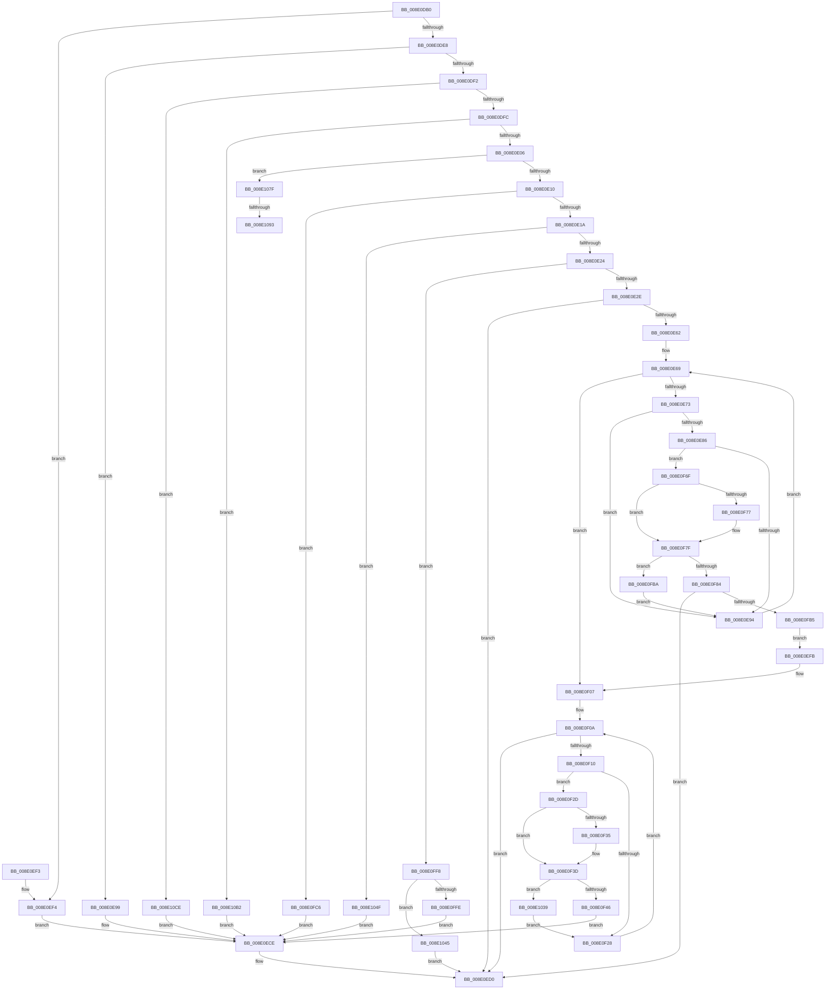

# _PnpDispatchDeviceInterface

- RVA: `0x008E0DB0`–`0x008E1101` (길이 `849` bytes)
- VA: `0x00000001408E0DB0`
- 실행 섹션: `PAGE`
- PDB 이름 있음: `예`; PDB Function 태그: `예`
- unwind 정보 RVA: `0x00085DD8`
- 디코드: `204`개 명령, `849/849` bytes 표시
- 미해석 바이트: `0` (있으면 어셈블리에 `.byte`로 보존)

> 이 문서는 커널 이미지의 기계어와 PDB 기호를 분석해 생성했습니다. 4번과 5번은 함수 원형과 자료형을 바이너리 사용 방식에서 추정한 C 해석이며 원본 소스 복구 결과는 아닙니다.

## 1. Dependencies

- 직접 호출 지점: **10**; 고유 호출 대상: **10**
- 직접 호출자로 확인된 함수: **4**
- RIP 상대 이미지 참조: **2**

### Outgoing calls
- `0x008E0EC9` → [_CmOpenDeviceInterfaceRegKey](../8F/_CmOpenDeviceInterfaceRegKey_function_008F31F4.md) (function, `0x008F31F4`)
- `0x008E0ED0` → [PnpMapCmStatusToDispatchStatus](../../text/45/PnpMapCmStatusToDispatchStatus_function_0045461C.md) (function, `0x0045461C`)
- `0x008E0EF4` → [CmValidateDeviceInterfaceName](../8F/CmValidateDeviceInterfaceName_function_008F1A40.md) (function, `0x008F1A40`)
- `0x008E0F65` → [CmGetDeviceInterfaceMappedPropertyFromComposite](../8F/CmGetDeviceInterfaceMappedPropertyFromComposite_function_008F3D70.md) (function, `0x008F3D70`)
- `0x008E0FA3` → [CmGetDeviceInterfaceMappedPropertyFromRegValue](../8F/CmGetDeviceInterfaceMappedPropertyFromRegValue_function_008F40BC.md) (function, `0x008F40BC`)
- `0x008E0FEE` → [CmGetDeviceInterfaceMappedPropertyKeys](../8F/CmGetDeviceInterfaceMappedPropertyKeys_function_008F50AC.md) (function, `0x008F50AC`)
- `0x008E102F` → [CmSetDeviceInterfaceMappedProperty](../A7/CmSetDeviceInterfaceMappedProperty_function_00A7287C.md) (function, `0x00A7287C`)
- `0x008E1075` → [CmGetDeviceInterfaceMappedPropertyLocales](../83/CmGetDeviceInterfaceMappedPropertyLocales_function_00830060.md) (function, `0x00830060`)
- `0x008E10C4` → [CmDeleteDeviceInterface](../A0/CmDeleteDeviceInterface_function_00A09E98.md) (function, `0x00A09E98`)
- `0x008E10F7` → [CmCreateDeviceInterface](../90/CmCreateDeviceInterface_function_00901578.md) (function, `0x00901578`)

### Direct callers
- [PnpGetObjectProperty](PnpGetObjectProperty_function_008E1110.md) at `0x008E1488`
- [PnpOpenObjectRegKey](PnpOpenObjectRegKey_function_008E15E8.md) at `0x008E1708`
- [PnpGetObjectPropertyWorker](PnpGetObjectPropertyWorker_function_008E1810.md) at `0x008E1979`
- [PnpGetObjectProperty](PnpGetObjectProperty_function_008E2180.md) at `0x008E2438`

### Static image references
- `0x008E0E62` → RVA `0x00000000` (`image boundary/outside`; read)
- `0x008E1098` → RVA `0x008317F0` (`PnpCmMatchCallbackRoutine`; read)

## 2. Other-region calls and transfers

- 다른 실행 섹션으로 향하는 call: **1**
  - `0x008E0ED0` → [PnpMapCmStatusToDispatchStatus](../../text/45/PnpMapCmStatusToDispatchStatus_function_0045461C.md) (`PAGE` → `.text`)
- call이 아닌 외부 분기/꼬리 이동: **2**
  - `0x008E108D` → [sub_00B1D0AA](../B1/Unknown_function_00B1D0AA.md) (`tail-transfer`)
  - `0x008E10AD` → [sub_00B1D0AA](../B1/Unknown_function_00B1D0AA.md) (`tail-transfer`)

## 3. Assembly (complete function range)

```asm
008E0DB0  48 8B C4                        mov rax, rsp
008E0DB3  48 89 58 08                     mov qword ptr [rax + 8], rbx
008E0DB7  48 89 68 10                     mov qword ptr [rax + 0x10], rbp
008E0DBB  48 89 70 18                     mov qword ptr [rax + 0x18], rsi
008E0DBF  57                              push rdi
008E0DC0  41 54                           push r12
008E0DC2  41 55                           push r13
008E0DC4  41 56                           push r14
008E0DC6  41 57                           push r15
008E0DC8  48 83 EC 60                     sub rsp, 0x60
008E0DCC  33 DB                           xor ebx, ebx
008E0DCE  0F 57 C0                        xorps xmm0, xmm0
008E0DD1  48 8B FA                        mov rdi, rdx
008E0DD4  48 8B F1                        mov rsi, rcx
008E0DD7  44 8B C3                        mov r8d, ebx
008E0DDA  0F 11 40 C0                     movups xmmword ptr [rax - 0x40], xmm0
008E0DDE  41 83 E9 01                     sub r9d, 1
008E0DE2  0F 84 0C 01 00 00               je 0x1408e0ef4
008E0DE8  41 83 E9 01                     sub r9d, 1
008E0DEC  0F 84 A7 00 00 00               je 0x1408e0e99
008E0DF2  41 83 E9 01                     sub r9d, 1
008E0DF6  0F 84 D2 02 00 00               je 0x1408e10ce
008E0DFC  41 83 E9 01                     sub r9d, 1
008E0E00  0F 84 AC 02 00 00               je 0x1408e10b2
008E0E06  41 83 E9 01                     sub r9d, 1
008E0E0A  0F 84 6F 02 00 00               je 0x1408e107f
008E0E10  41 83 E9 01                     sub r9d, 1
008E0E14  0F 84 AC 01 00 00               je 0x1408e0fc6
008E0E1A  41 83 E9 01                     sub r9d, 1
008E0E1E  0F 84 2B 02 00 00               je 0x1408e104f
008E0E24  41 83 E9 01                     sub r9d, 1
008E0E28  0F 85 CA 01 00 00               jne 0x1408e0ff8
008E0E2E  48 8B 8C 24 B0 00 00 00         mov rcx, qword ptr [rsp + 0xb0]
008E0E36  48 8B 41 08                     mov rax, qword ptr [rcx + 8]
008E0E3A  4C 8B 11                        mov r10, qword ptr [rcx]
008E0E3D  4C 8B 79 30                     mov r15, qword ptr [rcx + 0x30]
008E0E41  8B 69 28                        mov ebp, dword ptr [rcx + 0x28]
008E0E44  4C 8B 61 20                     mov r12, qword ptr [rcx + 0x20]
008E0E48  4C 8B 69 18                     mov r13, qword ptr [rcx + 0x18]
008E0E4C  4C 8B 71 10                     mov r14, qword ptr [rcx + 0x10]
008E0E50  B9 16 00 00 C0                  mov ecx, 0xc0000016
008E0E55  41 89 1F                        mov dword ptr [r15], ebx
008E0E58  4C 89 54 24 40                  mov qword ptr [rsp + 0x40], r10
008E0E5D  48 85 C0                        test rax, rax
008E0E60  75 6E                           jne 0x1408e0ed0
008E0E62  48 8D 15 97 F1 71 FF            lea rdx, [rip - 0x8e0e69]
008E0E69  41 83 F8 03                     cmp r8d, 3
008E0E6D  0F 83 94 00 00 00               jae 0x1408e0f07
008E0E73  41 8B C0                        mov eax, r8d
008E0E76  48 03 C0                        add rax, rax
008E0E79  4C 8B 8C C2 E0 B1 B4 00         mov r9, qword ptr [rdx + rax*8 + 0xb4b1e0]
008E0E81  4D 85 C9                        test r9, r9
008E0E84  74 0E                           je 0x1408e0e94
008E0E86  41 8B 41 10                     mov eax, dword ptr [r9 + 0x10]
008E0E8A  41 39 46 10                     cmp dword ptr [r14 + 0x10], eax
008E0E8E  0F 84 DB 00 00 00               je 0x1408e0f6f
008E0E94  41 FF C0                        inc r8d
008E0E97  EB D0                           jmp 0x1408e0e69
008E0E99  48 8B 8C 24 B0 00 00 00         mov rcx, qword ptr [rsp + 0xb0]
008E0EA1  41 B8 30 00 00 00               mov r8d, 0x30
008E0EA7  48 8D 41 10                     lea rax, [rcx + 0x10]
008E0EAB  48 89 44 24 38                  mov qword ptr [rsp + 0x38], rax
008E0EB0  48 8B 41 08                     mov rax, qword ptr [rcx + 8]
008E0EB4  48 89 44 24 30                  mov qword ptr [rsp + 0x30], rax
008E0EB9  8A 41 04                        mov al, byte ptr [rcx + 4]
008E0EBC  88 44 24 28                     mov byte ptr [rsp + 0x28], al
008E0EC0  8B 01                           mov eax, dword ptr [rcx]
008E0EC2  48 8B CE                        mov rcx, rsi
008E0EC5  89 44 24 20                     mov dword ptr [rsp + 0x20], eax
008E0EC9  E8 26 23 01 00                  call 0x1408f31f4
008E0ECE  8B C8                           mov ecx, eax
008E0ED0  E8 47 37 B7 FF                  call 0x14045461c
008E0ED5  4C 8D 5C 24 60                  lea r11, [rsp + 0x60]
008E0EDA  49 8B 5B 30                     mov rbx, qword ptr [r11 + 0x30]
008E0EDE  49 8B 6B 38                     mov rbp, qword ptr [r11 + 0x38]
008E0EE2  49 8B 73 40                     mov rsi, qword ptr [r11 + 0x40]
008E0EE6  49 8B E3                        mov rsp, r11
008E0EE9  41 5F                           pop r15
008E0EEB  41 5E                           pop r14
008E0EED  41 5D                           pop r13
008E0EEF  41 5C                           pop r12
008E0EF1  5F                              pop rdi
008E0EF2  C3                              ret
008E0EF3  CC                              int3
008E0EF4  E8 47 0B 01 00                  call 0x1408f1a40
008E0EF9  EB D3                           jmp 0x1408e0ece
008E0EFB  4C 8B 54 24 40                  mov r10, qword ptr [rsp + 0x40]
008E0F00  48 8D 15 F9 F0 71 FF            lea rdx, [rip - 0x8e0f07]
008E0F07  44 8B C3                        mov r8d, ebx
008E0F0A  41 83 F8 04                     cmp r8d, 4
008E0F0E  73 C0                           jae 0x1408e0ed0
008E0F10  41 8B C0                        mov eax, r8d
008E0F13  48 03 C0                        add rax, rax
008E0F16  4C 8B 8C C2 00 BA B4 00         mov r9, qword ptr [rdx + rax*8 + 0xb4ba00]
008E0F1E  41 8B 41 10                     mov eax, dword ptr [r9 + 0x10]
008E0F22  41 39 46 10                     cmp dword ptr [r14 + 0x10], eax
008E0F26  74 05                           je 0x1408e0f2d
008E0F28  41 FF C0                        inc r8d
008E0F2B  EB DD                           jmp 0x1408e0f0a
008E0F2D  49 8B 16                        mov rdx, qword ptr [r14]
008E0F30  49 2B 11                        sub rdx, qword ptr [r9]
008E0F33  75 08                           jne 0x1408e0f3d
008E0F35  49 8B 56 08                     mov rdx, qword ptr [r14 + 8]
008E0F39  49 2B 51 08                     sub rdx, qword ptr [r9 + 8]
008E0F3D  48 85 D2                        test rdx, rdx
008E0F40  0F 85 F3 00 00 00               jne 0x1408e1039
008E0F46  4C 89 7C 24 38                  mov qword ptr [rsp + 0x38], r15
008E0F4B  4D 8B CE                        mov r9, r14
008E0F4E  89 6C 24 30                     mov dword ptr [rsp + 0x30], ebp
008E0F52  4D 8B C2                        mov r8, r10
008E0F55  4C 89 64 24 28                  mov qword ptr [rsp + 0x28], r12
008E0F5A  48 8B D7                        mov rdx, rdi
008E0F5D  48 8B CE                        mov rcx, rsi
008E0F60  4C 89 6C 24 20                  mov qword ptr [rsp + 0x20], r13
008E0F65  E8 06 2E 01 00                  call 0x1408f3d70
008E0F6A  E9 5F FF FF FF                  jmp 0x1408e0ece
008E0F6F  49 8B 16                        mov rdx, qword ptr [r14]
008E0F72  49 2B 11                        sub rdx, qword ptr [r9]
008E0F75  75 08                           jne 0x1408e0f7f
008E0F77  49 8B 56 08                     mov rdx, qword ptr [r14 + 8]
008E0F7B  49 2B 51 08                     sub rdx, qword ptr [r9 + 8]
008E0F7F  48 85 D2                        test rdx, rdx
008E0F82  75 36                           jne 0x1408e0fba
008E0F84  4C 89 7C 24 38                  mov qword ptr [rsp + 0x38], r15
008E0F89  4D 8B CE                        mov r9, r14
008E0F8C  89 6C 24 30                     mov dword ptr [rsp + 0x30], ebp
008E0F90  4D 8B C2                        mov r8, r10
008E0F93  4C 89 64 24 28                  mov qword ptr [rsp + 0x28], r12
008E0F98  48 8B D7                        mov rdx, rdi
008E0F9B  48 8B CE                        mov rcx, rsi
008E0F9E  4C 89 6C 24 20                  mov qword ptr [rsp + 0x20], r13
008E0FA3  E8 14 31 01 00                  call 0x1408f40bc
008E0FA8  8B C8                           mov ecx, eax
008E0FAA  3D 16 00 00 C0                  cmp eax, 0xc0000016
008E0FAF  0F 85 1B FF FF FF               jne 0x1408e0ed0
008E0FB5  E9 41 FF FF FF                  jmp 0x1408e0efb
008E0FBA  48 8D 15 3F F0 71 FF            lea rdx, [rip - 0x8e0fc1]
008E0FC1  E9 CE FE FF FF                  jmp 0x1408e0e94
008E0FC6  4C 8B 84 24 B0 00 00 00         mov r8, qword ptr [rsp + 0xb0]
008E0FCE  45 33 C9                        xor r9d, r9d
008E0FD1  49 8B 40 28                     mov rax, qword ptr [r8 + 0x28]
008E0FD5  48 89 44 24 30                  mov qword ptr [rsp + 0x30], rax
008E0FDA  41 8B 40 20                     mov eax, dword ptr [r8 + 0x20]
008E0FDE  89 44 24 28                     mov dword ptr [rsp + 0x28], eax
008E0FE2  49 8B 40 18                     mov rax, qword ptr [r8 + 0x18]
008E0FE6  4D 8B 00                        mov r8, qword ptr [r8]
008E0FE9  48 89 44 24 20                  mov qword ptr [rsp + 0x20], rax
008E0FEE  E8 B9 40 01 00                  call 0x1408f50ac
008E0FF3  E9 D6 FE FF FF                  jmp 0x1408e0ece
008E0FF8  41 83 F9 01                     cmp r9d, 1
008E0FFC  75 47                           jne 0x1408e1045
008E0FFE  4C 8B 84 24 B0 00 00 00         mov r8, qword ptr [rsp + 0xb0]
008E1006  41 8B 40 28                     mov eax, dword ptr [r8 + 0x28]
008E100A  4D 8B 48 08                     mov r9, qword ptr [r8 + 8]
008E100E  89 44 24 38                     mov dword ptr [rsp + 0x38], eax
008E1012  49 8B 40 20                     mov rax, qword ptr [r8 + 0x20]
008E1016  48 89 44 24 30                  mov qword ptr [rsp + 0x30], rax
008E101B  41 8B 40 18                     mov eax, dword ptr [r8 + 0x18]
008E101F  89 44 24 28                     mov dword ptr [rsp + 0x28], eax
008E1023  49 8B 40 10                     mov rax, qword ptr [r8 + 0x10]
008E1027  4D 8B 00                        mov r8, qword ptr [r8]
008E102A  48 89 44 24 20                  mov qword ptr [rsp + 0x20], rax
008E102F  E8 48 18 19 00                  call 0x140a7287c
008E1034  E9 95 FE FF FF                  jmp 0x1408e0ece
008E1039  48 8D 15 C0 EF 71 FF            lea rdx, [rip - 0x8e1040]
008E1040  E9 E3 FE FF FF                  jmp 0x1408e0f28
008E1045  B9 0D 00 00 C0                  mov ecx, 0xc000000d
008E104A  E9 81 FE FF FF                  jmp 0x1408e0ed0
008E104F  4C 8B 8C 24 B0 00 00 00         mov r9, qword ptr [rsp + 0xb0]
008E1057  49 8B 41 20                     mov rax, qword ptr [r9 + 0x20]
008E105B  48 89 44 24 30                  mov qword ptr [rsp + 0x30], rax
008E1060  41 8B 41 18                     mov eax, dword ptr [r9 + 0x18]
008E1064  89 44 24 28                     mov dword ptr [rsp + 0x28], eax
008E1068  49 8B 41 10                     mov rax, qword ptr [r9 + 0x10]
008E106C  4D 8B 49 08                     mov r9, qword ptr [r9 + 8]
008E1070  48 89 44 24 20                  mov qword ptr [rsp + 0x20], rax
008E1075  E8 E6 EF F4 FF                  call 0x140830060
008E107A  E9 4F FE FF FF                  jmp 0x1408e0ece
008E107F  4C 8B 8C 24 B0 00 00 00         mov r9, qword ptr [rsp + 0xb0]
008E1087  49 8B 01                        mov rax, qword ptr [r9]
008E108A  48 85 C0                        test rax, rax
008E108D  0F 84 17 C0 23 00               je 0x140b1d0aa
008E1093  48 89 44 24 48                  mov qword ptr [rsp + 0x48], rax
008E1098  48 8D 1D 51 07 F5 FF            lea rbx, [rip - 0xaf8af]
008E109F  49 8B 41 08                     mov rax, qword ptr [r9 + 8]
008E10A3  4C 8D 44 24 48                  lea r8, [rsp + 0x48]
008E10A8  48 89 44 24 50                  mov qword ptr [rsp + 0x50], rax
008E10AD  E9 F8 BF 23 00                  jmp 0x140b1d0aa
008E10B2  48 8B 84 24 B0 00 00 00         mov rax, qword ptr [rsp + 0xb0]
008E10BA  44 8B 00                        mov r8d, dword ptr [rax]
008E10BD  41 81 E0 00 00 FF FF            and r8d, 0xffff0000
008E10C4  E8 CF 8D 12 00                  call 0x140a09e98
008E10C9  E9 00 FE FF FF                  jmp 0x1408e0ece
008E10CE  4C 8B 84 24 B0 00 00 00         mov r8, qword ptr [rsp + 0xb0]
008E10D6  41 8B 48 14                     mov ecx, dword ptr [r8 + 0x14]
008E10DA  49 8D 40 10                     lea rax, [r8 + 0x10]
008E10DE  81 E1 00 00 FF FF               and ecx, 0xffff0000
008E10E4  4D 8D 48 08                     lea r9, [r8 + 8]
008E10E8  45 8B 00                        mov r8d, dword ptr [r8]
008E10EB  89 4C 24 28                     mov dword ptr [rsp + 0x28], ecx
008E10EF  48 8B CE                        mov rcx, rsi
008E10F2  48 89 44 24 20                  mov qword ptr [rsp + 0x20], rax
008E10F7  E8 7C 04 02 00                  call 0x140901578
008E10FC  E9 CD FD FF FF                  jmp 0x1408e0ece
```

## 4. C-style interpretation (structured pseudocode)

```c
__int64 __fastcall _PnpDispatchDeviceInterface(__int64 a1, __int64 a2, __int64 a3, int a4, __int64 a5)
{
    __int64 result;
    __int64 v_rbx;
    __int64 v_rsp;
    unsigned __int64 v_stack_m10;
    unsigned __int64 v_stack_m18;
    unsigned __int64 v_stack_m20;
    unsigned __int64 v_stack_m28;
    unsigned int v_stack_m30;
    unsigned __int64 v_stack_m38;
    unsigned __int64 v_stack_m40;
    unsigned __int64 v_stack_m48;
    unsigned __int64 v_stack_m50;
    unsigned __int64 v_stack_m58;
    unsigned __int8 v_stack_m60;
    unsigned int v_stack_m68;

    *(unsigned __int64 *)(v_rsp + 8) = v_rbx;
    *(unsigned __int64 *)(v_rsp + 16) = v_rbp;
    *(unsigned __int64 *)(v_rsp + 24) = v_rsi;
    v_rsp = (v_rsp) - (96);
    v_rbx = 0;
    *(unsigned __int64 *)(v_rsp - 64) = v_xmm0;
    a4 = (unsigned int)((a4) - (1));
    if (condition_is_equal) goto loc_008E0EF4;
    a4 = (unsigned int)((a4) - (1));
    if (condition_is_equal) goto loc_008E0E99;
    a4 = (unsigned int)((a4) - (1));
    if (condition_is_equal) goto loc_008E10CE;
    a4 = (unsigned int)((a4) - (1));
    if (condition_is_equal) goto loc_008E10B2;
    a4 = (unsigned int)((a4) - (1));
    if (condition_is_equal) goto loc_008E107F;
    a4 = (unsigned int)((a4) - (1));
    if (condition_is_equal) goto loc_008E0FC6;
    a4 = (unsigned int)((a4) - (1));
    if (condition_is_equal) goto loc_008E104F;
    a4 = (unsigned int)((a4) - (1));
    if (condition_is_not_equal) goto loc_008E0FF8;
    *(unsigned int *)(*(unsigned __int64 *)(a5 + 48)) = 0;
    v_stack_m48 = *(unsigned __int64 *)(a5);
    if (*(unsigned __int64 *)(a5 + 8) != 0) goto loc_008E0ED0;
loc_008E0E69:
    if (0 >= 3) goto loc_008E0F07;
    result = (0) + (0);
    if (*(unsigned __int64 *)(v_rip - 9309801 + result * 8 + 11842016) == 0) goto loc_008E0E94;
    if ((*(unsigned int *)(*(unsigned __int64 *)(a5 + 16) + 16)) == ((unsigned int)((unsigned int)(*(unsigned int *)(*(unsigned __int64 *)(v_rip - 9309801 + result * 8 + 11842016) + 16))))) goto loc_008E0F6F;
loc_008E0E94:
    a3 = (unsigned int)((0) + 1);
    goto loc_008E0E69;
loc_008E0E99:
    v_stack_m50 = a5 + 16;
    v_stack_m58 = *(unsigned __int64 *)(a5 + 8);
    v_stack_m60 = (unsigned __int8)(*(unsigned __int8 *)(a5 + 4));
    v_stack_m68 = (unsigned int)((unsigned int)(*(unsigned int *)(a5)));
    result = _CmOpenDeviceInterfaceRegKey(a1, v_rip - 9309801, 48, *(unsigned __int64 *)(v_rip - 9309801 + result * 8 + 11842016));
loc_008E0ECE:
loc_008E0ED0:
    result = PnpMapCmStatusToDispatchStatus((unsigned int)((unsigned int)(result)), v_rip - 9309801, 48, *(unsigned __int64 *)(v_rip - 9309801 + result * 8 + 11842016));
    return result;
loc_008E0EF4:
    result = CmValidateDeviceInterfaceName((unsigned int)((unsigned int)(result)), v_rip - 9309801, 48, *(unsigned __int64 *)(v_rip - 9309801 + result * 8 + 11842016));
    goto loc_008E0ECE;
loc_008E0EFB:
loc_008E0F07:
loc_008E0F0A:
    if (((unsigned int)((unsigned int)((unsigned int)(*(unsigned __int64 *)(v_stack_m28 + 48))))) >= 4) goto loc_008E0ED0;
    result = ((unsigned int)((unsigned int)((unsigned int)((unsigned int)(*(unsigned __int64 *)(v_stack_m28 + 48)))))) + ((unsigned int)((unsigned int)((unsigned int)((unsigned int)(*(unsigned __int64 *)(v_stack_m28 + 48))))));
    if ((*(unsigned int *)(*(unsigned __int64 *)(a5 + 16) + 16)) == ((unsigned int)((unsigned int)(*(unsigned int *)(*(unsigned __int64 *)(v_rip - 9309959 + result * 8 + 11844096) + 16))))) goto loc_008E0F2D;
loc_008E0F28:
    a3 = (unsigned int)(((unsigned int)((unsigned int)(*(unsigned __int64 *)(v_stack_m28 + 48)))) + 1);
    goto loc_008E0F0A;
loc_008E0F2D:
    a2 = (*(unsigned __int64 *)(*(unsigned __int64 *)(a5 + 16))) - (*(unsigned __int64 *)(*(unsigned __int64 *)(v_rip - 9309959 + result * 8 + 11844096)));
    if (!(condition_is_not_equal)) {
        a2 = *(unsigned __int64 *)(*(unsigned __int64 *)(a5 + 16) + 8);
        a2 = (a2) - (*(unsigned __int64 *)(*(unsigned __int64 *)(v_rip - 9309959 + result * 8 + 11844096) + 8));
    }
    if (a2 != 0) goto loc_008E1039;
    v_stack_m28 = *(unsigned __int64 *)(a5 + 48);
    v_stack_m30 = (unsigned int)(*(unsigned __int64 *)(v_stack_m28 + 56));
    v_stack_m38 = *(unsigned __int64 *)(a5 + 32);
    v_stack_m40 = *(unsigned __int64 *)(a5 + 24);
    result = CmGetDeviceInterfaceMappedPropertyFromComposite(*(unsigned __int64 *)(v_stack_m28 + 64), a2, v_stack_m20, *(unsigned __int64 *)(a5 + 16));
    goto loc_008E0ECE;
loc_008E0F6F:
    a2 = (*(unsigned __int64 *)(*(unsigned __int64 *)(a5 + 16))) - (*(unsigned __int64 *)(*(unsigned __int64 *)(a5 + 16)));
    if (!(condition_is_not_equal)) {
        a2 = *(unsigned __int64 *)(*(unsigned __int64 *)(a5 + 16) + 8);
        a2 = (a2) - (*(unsigned __int64 *)(*(unsigned __int64 *)(a5 + 16) + 8));
    }
    if (a2 != 0) goto loc_008E0FBA;
    v_stack_m28 = *(unsigned __int64 *)(a5 + 48);
    v_stack_m30 = (unsigned int)(*(unsigned __int64 *)(v_stack_m28 + 56));
    v_stack_m38 = *(unsigned __int64 *)(a5 + 32);
    v_stack_m40 = *(unsigned __int64 *)(a5 + 24);
    result = CmGetDeviceInterfaceMappedPropertyFromRegValue(*(unsigned __int64 *)(v_stack_m28 + 64), a2, v_stack_m20, *(unsigned __int64 *)(a5 + 16));
    if (((unsigned int)(result)) != 0xC0000016ULL) goto loc_008E0ED0;
    goto loc_008E0EFB;
loc_008E0FBA:
    goto loc_008E0E94;
loc_008E0FC6:
    a4 = 0;
    v_stack_m30 = *(unsigned __int64 *)(a5 + 40);
    v_stack_m38 = (unsigned int)((unsigned int)(*(unsigned int *)(a5 + 32)));
    v_stack_m40 = *(unsigned __int64 *)(a5 + 24);
    result = CmGetDeviceInterfaceMappedPropertyKeys((unsigned int)((unsigned int)(result)), v_rip - 9310145, *(unsigned __int64 *)(a5), a4);
    goto loc_008E0ECE;
loc_008E0FF8:
    if (0 != 1) goto loc_008E1045;
    v_stack_m28 = (unsigned int)((unsigned int)(*(unsigned int *)(a5 + 40)));
    v_stack_m30 = *(unsigned __int64 *)(a5 + 32);
    v_stack_m38 = (unsigned int)((unsigned int)(*(unsigned int *)(a5 + 24)));
    v_stack_m40 = *(unsigned __int64 *)(a5 + 16);
    result = CmSetDeviceInterfaceMappedProperty((unsigned int)((unsigned int)(result)), v_rip - 9310145, *(unsigned __int64 *)(a5), *(unsigned __int64 *)(a5 + 8));
    goto loc_008E0ECE;
loc_008E1039:
    goto loc_008E0F28;
loc_008E1045:
    goto loc_008E0ED0;
loc_008E104F:
    v_stack_m30 = *(unsigned __int64 *)(a5 + 32);
    v_stack_m38 = (unsigned int)((unsigned int)(*(unsigned int *)(a5 + 24)));
    v_stack_m40 = *(unsigned __int64 *)(a5 + 16);
    result = CmGetDeviceInterfaceMappedPropertyLocales((unsigned int)(0xC000000DULL), v_rip - 9310272, *(unsigned __int64 *)(a5), *(unsigned __int64 *)(a5 + 8));
    goto loc_008E0ECE;
loc_008E107F:
    v_stack_m18 = *(unsigned __int64 *)(a5);
    v_stack_m10 = *(unsigned __int64 *)(a5 + 8);
loc_008E10B2:
    a3 = (unsigned int)(((unsigned int)(*(unsigned int *)(a5))) & (0xFFFF0000ULL));
    result = CmDeleteDeviceInterface((unsigned int)(0xC000000DULL), v_rip - 9310272, a3, a5);
    goto loc_008E0ECE;
loc_008E10CE:
    a1 = (unsigned int)(((unsigned int)(*(unsigned int *)(a5 + 20))) & (0xFFFF0000ULL));
    v_stack_m38 = (unsigned int)(a1);
    v_stack_m40 = a5 + 16;
    result = CmCreateDeviceInterface(*(unsigned __int64 *)(v_stack_m28 + 64), v_rip - 9310272, (unsigned int)(*(unsigned int *)(a5)), a5 + 8);
    goto loc_008E0ECE;
}
```

## 5. (Beta) C Style

```c
int64_t _PnpDispatchDeviceInterface(int64_t Arg1, int64_t Arg2, int64_t Arg3, int32_t Arg4, void *Arg5)
{
    uint8_t *arg5 = (uint8_t *)Arg5;

    int64_t result;
    int64_t local_rbx;
    int64_t local_rsp;
    uint64_t v_stack_m10;
    uint64_t v_stack_m18;
    uint64_t v_stack_m20;
    uint64_t v_stack_m28;
    uint32_t v_stack_m30;
    uint64_t v_stack_m38;
    uint64_t v_stack_m40;
    uint64_t v_stack_m48;
    uint64_t v_stack_m50;
    uint64_t v_stack_m58;
    uint8_t v_stack_m60;
    uint32_t v_stack_m68;

    *(uint64_t *)(local_rsp + 0x8) = local_rbx;
    *(uint64_t *)(local_rsp + 0x10) = local_rbp;
    *(uint64_t *)(local_rsp + 0x18) = local_rsi;
    local_rsp = (local_rsp) - (96);
    local_rbx = 0;
    *(uint64_t *)(local_rsp - 0x40) = v_xmm0;
    Arg4 = (uint32_t)((Arg4) - (1));
    if (condition_is_equal) goto loc_008E0EF4;
    Arg4 = (uint32_t)((Arg4) - (1));
    if (condition_is_equal) goto loc_008E0E99;
    Arg4 = (uint32_t)((Arg4) - (1));
    if (condition_is_equal) goto loc_008E10CE;
    Arg4 = (uint32_t)((Arg4) - (1));
    if (condition_is_equal) goto loc_008E10B2;
    Arg4 = (uint32_t)((Arg4) - (1));
    if (condition_is_equal) goto loc_008E107F;
    Arg4 = (uint32_t)((Arg4) - (1));
    if (condition_is_equal) goto loc_008E0FC6;
    Arg4 = (uint32_t)((Arg4) - (1));
    if (condition_is_equal) goto loc_008E104F;
    Arg4 = (uint32_t)((Arg4) - (1));
    if (condition_is_not_equal) goto loc_008E0FF8;
    *(uint32_t *)(*(uint64_t *)(arg5 + 0x30)) = 0;
    v_stack_m48 = *(uint64_t *)(arg5);
    if (*(uint64_t *)(arg5 + 0x8) != 0) goto loc_008E0ED0;
loc_008E0E69:
    if (0 >= 3) goto loc_008E0F07;
    result = (0) + (0);
    if (*(uint64_t *)(v_rip - 0x8E0E69 + result * 8 + 0xB4B1E0) == 0) goto loc_008E0E94;
    if ((*(uint32_t *)(*(uint64_t *)(arg5 + 0x10) + 0x10)) == ((uint32_t)((uint32_t)(*(uint32_t *)(*(uint64_t *)(v_rip - 0x8E0E69 + result * 8 + 0xB4B1E0) + 0x10))))) goto loc_008E0F6F;
loc_008E0E94:
    Arg3 = (uint32_t)((0) + 1);
    goto loc_008E0E69;
loc_008E0E99:
    v_stack_m50 = Arg5 + 16;
    v_stack_m58 = *(uint64_t *)(arg5 + 0x8);
    v_stack_m60 = (uint8_t)(*(uint8_t *)(arg5 + 0x4));
    v_stack_m68 = (uint32_t)((uint32_t)(*(uint32_t *)(arg5)));
    result = _CmOpenDeviceInterfaceRegKey(Arg1, v_rip - 9309801, 48, *(uint64_t *)(v_rip - 0x8E0E69 + result * 8 + 0xB4B1E0));
loc_008E0ECE:
loc_008E0ED0:
    result = PnpMapCmStatusToDispatchStatus((uint32_t)((uint32_t)(result)), v_rip - 9309801, 48, *(uint64_t *)(v_rip - 0x8E0E69 + result * 8 + 0xB4B1E0));
    return result;
loc_008E0EF4:
    result = CmValidateDeviceInterfaceName((uint32_t)((uint32_t)(result)), v_rip - 9309801, 48, *(uint64_t *)(v_rip - 0x8E0E69 + result * 8 + 0xB4B1E0));
    goto loc_008E0ECE;
loc_008E0EFB:
loc_008E0F07:
loc_008E0F0A:
    if (((uint32_t)((uint32_t)((uint32_t)(*(uint64_t *)(v_stack_m28 + 0x30))))) >= 4) goto loc_008E0ED0;
    result = ((uint32_t)((uint32_t)((uint32_t)((uint32_t)(*(uint64_t *)(v_stack_m28 + 0x30)))))) + ((uint32_t)((uint32_t)((uint32_t)((uint32_t)(*(uint64_t *)(v_stack_m28 + 0x30))))));
    if ((*(uint32_t *)(*(uint64_t *)(arg5 + 0x10) + 0x10)) == ((uint32_t)((uint32_t)(*(uint32_t *)(*(uint64_t *)(v_rip - 0x8E0F07 + result * 8 + 0xB4BA00) + 0x10))))) goto loc_008E0F2D;
loc_008E0F28:
    Arg3 = (uint32_t)(((uint32_t)((uint32_t)(*(uint64_t *)(v_stack_m28 + 0x30)))) + 1);
    goto loc_008E0F0A;
loc_008E0F2D:
    Arg2 = (*(uint64_t *)(*(uint64_t *)(arg5 + 0x10))) - (*(uint64_t *)(*(uint64_t *)(v_rip - 0x8E0F07 + result * 8 + 0xB4BA00)));
    if (!(condition_is_not_equal)) {
        Arg2 = *(uint64_t *)(*(uint64_t *)(arg5 + 0x10) + 0x8);
        Arg2 = (Arg2) - (*(uint64_t *)(*(uint64_t *)(v_rip - 0x8E0F07 + result * 8 + 0xB4BA00) + 0x8));
    }
    if (Arg2 != 0) goto loc_008E1039;
    v_stack_m28 = *(uint64_t *)(arg5 + 0x30);
    v_stack_m30 = (uint32_t)(*(uint64_t *)(v_stack_m28 + 0x38));
    v_stack_m38 = *(uint64_t *)(arg5 + 0x20);
    v_stack_m40 = *(uint64_t *)(arg5 + 0x18);
    result = CmGetDeviceInterfaceMappedPropertyFromComposite(*(uint64_t *)(v_stack_m28 + 0x40), Arg2, v_stack_m20, *(uint64_t *)(arg5 + 0x10));
    goto loc_008E0ECE;
loc_008E0F6F:
    Arg2 = (*(uint64_t *)(*(uint64_t *)(arg5 + 0x10))) - (*(uint64_t *)(*(uint64_t *)(arg5 + 0x10)));
    if (!(condition_is_not_equal)) {
        Arg2 = *(uint64_t *)(*(uint64_t *)(arg5 + 0x10) + 0x8);
        Arg2 = (Arg2) - (*(uint64_t *)(*(uint64_t *)(arg5 + 0x10) + 0x8));
    }
    if (Arg2 != 0) goto loc_008E0FBA;
    v_stack_m28 = *(uint64_t *)(arg5 + 0x30);
    v_stack_m30 = (uint32_t)(*(uint64_t *)(v_stack_m28 + 0x38));
    v_stack_m38 = *(uint64_t *)(arg5 + 0x20);
    v_stack_m40 = *(uint64_t *)(arg5 + 0x18);
    result = CmGetDeviceInterfaceMappedPropertyFromRegValue(*(uint64_t *)(v_stack_m28 + 0x40), Arg2, v_stack_m20, *(uint64_t *)(arg5 + 0x10));
    if (((uint32_t)(result)) != 0xC0000016ULL) goto loc_008E0ED0;
    goto loc_008E0EFB;
loc_008E0FBA:
    goto loc_008E0E94;
loc_008E0FC6:
    Arg4 = 0;
    v_stack_m30 = *(uint64_t *)(arg5 + 0x28);
    v_stack_m38 = (uint32_t)((uint32_t)(*(uint32_t *)(arg5 + 0x20)));
    v_stack_m40 = *(uint64_t *)(arg5 + 0x18);
    result = CmGetDeviceInterfaceMappedPropertyKeys((uint32_t)((uint32_t)(result)), v_rip - 9310145, *(uint64_t *)(arg5), Arg4);
    goto loc_008E0ECE;
loc_008E0FF8:
    if (0 != 1) goto loc_008E1045;
    v_stack_m28 = (uint32_t)((uint32_t)(*(uint32_t *)(arg5 + 0x28)));
    v_stack_m30 = *(uint64_t *)(arg5 + 0x20);
    v_stack_m38 = (uint32_t)((uint32_t)(*(uint32_t *)(arg5 + 0x18)));
    v_stack_m40 = *(uint64_t *)(arg5 + 0x10);
    result = CmSetDeviceInterfaceMappedProperty((uint32_t)((uint32_t)(result)), v_rip - 9310145, *(uint64_t *)(arg5), *(uint64_t *)(arg5 + 0x8));
    goto loc_008E0ECE;
loc_008E1039:
    goto loc_008E0F28;
loc_008E1045:
    goto loc_008E0ED0;
loc_008E104F:
    v_stack_m30 = *(uint64_t *)(arg5 + 0x20);
    v_stack_m38 = (uint32_t)((uint32_t)(*(uint32_t *)(arg5 + 0x18)));
    v_stack_m40 = *(uint64_t *)(arg5 + 0x10);
    result = CmGetDeviceInterfaceMappedPropertyLocales((uint32_t)(0xC000000DULL), v_rip - 9310272, *(uint64_t *)(arg5), *(uint64_t *)(arg5 + 0x8));
    goto loc_008E0ECE;
loc_008E107F:
    v_stack_m18 = *(uint64_t *)(arg5);
    v_stack_m10 = *(uint64_t *)(arg5 + 0x8);
loc_008E10B2:
    Arg3 = (uint32_t)(((uint32_t)(*(uint32_t *)(arg5))) & (0xFFFF0000ULL));
    result = CmDeleteDeviceInterface((uint32_t)(0xC000000DULL), v_rip - 9310272, Arg3, Arg5);
    goto loc_008E0ECE;
loc_008E10CE:
    Arg1 = (uint32_t)(((uint32_t)(*(uint32_t *)(arg5 + 0x14))) & (0xFFFF0000ULL));
    v_stack_m38 = (uint32_t)(Arg1);
    v_stack_m40 = Arg5 + 16;
    result = CmCreateDeviceInterface(*(uint64_t *)(v_stack_m28 + 0x40), v_rip - 9310272, (uint32_t)(*(uint32_t *)(arg5)), Arg5 + 8);
    goto loc_008E0ECE;
}
```

### 관측된 메모리 오프셋

구조체 형식이 확인되지 않은 접근은 인자 기준의 오프셋으로만 기록했습니다.

| 기준 인자 | 오프셋 표현 | 폭 (bit) | 접근 |
|---|---:|---:|---|
| `Arg5` | `+ 0x0` | `32` | `R` |
| `Arg5` | `+ 0x0` | `64` | `R` |
| `Arg5` | `+ 0x4` | `8` | `R` |
| `Arg5` | `+ 0x8` | `64` | `R` |
| `Arg5` | `+ 0x10` | `64` | `R` |
| `Arg5` | `+ 0x14` | `32` | `R` |
| `Arg5` | `+ 0x18` | `32` | `R` |
| `Arg5` | `+ 0x18` | `64` | `R` |
| `Arg5` | `+ 0x20` | `32` | `R` |
| `Arg5` | `+ 0x20` | `64` | `R` |
| `Arg5` | `+ 0x28` | `32` | `R` |
| `Arg5` | `+ 0x28` | `64` | `R` |
| `Arg5` | `+ 0x30` | `64` | `R` |

## 6. Execution-region graph

[열기: 2D/3D 그래프와 함수 탐색 컨트롤 패널](../../../control-panel.html?section=page&rva=0x008E0DB0&view=graph)

- 2D 그래프는 위에서 아래로 흐르고, 3D 그래프는 빈 공간을 드래그해 회전합니다. Shift+드래그는 이동, 휠은 확대·축소, 함수 노드 선택은 대상 보고서 이동입니다.

### Static fallback


