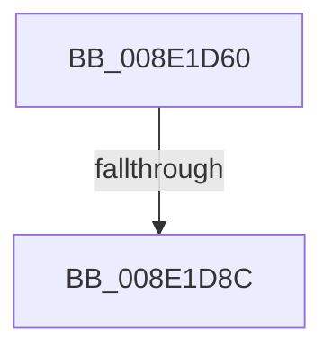

# _PnpDispatchDevice

- RVA: `0x008E1D60`–`0x008E1D9A` (길이 `58` bytes)
- VA: `0x00000001408E1D60`
- 실행 섹션: `PAGE`
- PDB 이름 있음: `예`; PDB Function 태그: `예`
- unwind 정보 RVA: `0x00085E74`
- 디코드: `16`개 명령, `58/58` bytes 표시
- 미해석 바이트: `0` (있으면 어셈블리에 `.byte`로 보존)

> 이 문서는 커널 이미지의 기계어와 PDB 기호를 분석해 생성했습니다. 4번과 5번은 함수 원형과 자료형을 바이너리 사용 방식에서 추정한 C 해석이며 원본 소스 복구 결과는 아닙니다.

## 1. Dependencies

- 직접 호출 지점: **0**; 고유 호출 대상: **0**
- 직접 호출자로 확인된 함수: **4**
- RIP 상대 이미지 참조: **0**

### Outgoing calls
- 직접 디코드된 call 명령이 없습니다.

### Direct callers
- [PnpGetObjectProperty](PnpGetObjectProperty_function_008E1110.md) at `0x008E13E0`
- [PnpOpenObjectRegKey](PnpOpenObjectRegKey_function_008E15E8.md) at `0x008E1718`
- [PnpGetObjectPropertyWorker](PnpGetObjectPropertyWorker_function_008E1810.md) at `0x008E191B`
- [PnpGetObjectProperty](PnpGetObjectProperty_function_008E2180.md) at `0x008E2394`

### Static image references
- 디코드된 RIP-relative 메모리 참조가 없습니다.

## 2. Other-region calls and transfers

- 다른 실행 섹션으로 향하는 call: **0**
- call이 아닌 외부 분기/꼬리 이동: **1**
  - `0x008E1D86` → [sub_008E1E1A](Unknown_function_008E1E1A.md) (`tail-transfer`)

## 3. Assembly (complete function range)

```asm
008E1D60  48 8B C4                        mov rax, rsp
008E1D63  53                              push rbx
008E1D64  56                              push rsi
008E1D65  41 54                           push r12
008E1D67  41 57                           push r15
008E1D69  48 81 EC 88 00 00 00            sub rsp, 0x88
008E1D70  33 DB                           xor ebx, ebx
008E1D72  0F 57 C0                        xorps xmm0, xmm0
008E1D75  4C 8B FA                        mov r15, rdx
008E1D78  4C 8B E1                        mov r12, rcx
008E1D7B  44 8B C3                        mov r8d, ebx
008E1D7E  0F 11 40 C0                     movups xmmword ptr [rax - 0x40], xmm0
008E1D82  41 83 F9 08                     cmp r9d, 8
008E1D86  0F 85 8E 00 00 00               jne 0x1408e1e1a
008E1D8C  48 8B 8C 24 D0 00 00 00         mov rcx, qword ptr [rsp + 0xd0]
008E1D94  41 BA 16 00 00 C0               mov r10d, 0xc0000016
```

## 4. C-style interpretation (structured pseudocode)

```c
__int64 __fastcall _PnpDispatchDevice(__int64 a1, __int64 a2, __int64 a3, int a4, __int64 a5)
{
    __int64 v_rbx;
    __int64 v_rsp;

    v_rsp = (v_rsp) - (136);
    v_rbx = 0;
    *(unsigned __int64 *)(v_rsp - 64) = v_xmm0;
    return v_rsp;
}
```

## 5. (Beta) C Style

```c
int64_t _PnpDispatchDevice(int64_t Arg1, int64_t Arg2, int64_t Arg3, int32_t Arg4, int64_t Arg5)
{
    int64_t local_rbx;
    int64_t local_rsp;

    local_rsp = (local_rsp) - (136);
    local_rbx = 0;
    *(uint64_t *)(local_rsp - 0x40) = v_xmm0;
    return local_rsp;
}
```

## 6. Execution-region graph

[열기: 2D/3D 그래프와 함수 탐색 컨트롤 패널](../../../control-panel.html?section=page&rva=0x008E1D60&view=graph)

- 2D 그래프는 위에서 아래로 흐르고, 3D 그래프는 빈 공간을 드래그해 회전합니다. Shift+드래그는 이동, 휠은 확대·축소, 함수 노드 선택은 대상 보고서 이동입니다.

### Static fallback


