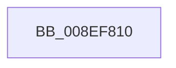

# _RegRtlOpenKeyTransacted

- RVA: `0x008EF810`–`0x008EF81D` (길이 `13` bytes)
- VA: `0x00000001408EF810`
- 실행 섹션: `PAGE`
- PDB 이름 있음: `예`; PDB Function 태그: `예`
- unwind 정보 RVA: `0x00087034`
- 디코드: `4`개 명령, `13/13` bytes 표시
- 미해석 바이트: `0` (있으면 어셈블리에 `.byte`로 보존)

> 이 문서는 커널 이미지의 기계어와 PDB 기호를 분석해 생성했습니다. 4번과 5번은 함수 원형과 자료형을 바이너리 사용 방식에서 추정한 C 해석이며 원본 소스 복구 결과는 아닙니다.

## 1. Dependencies

- 직접 호출 지점: **0**; 고유 호출 대상: **0**
- 직접 호출자로 확인된 함수: **32**
- RIP 상대 이미지 참조: **0**

### Outgoing calls
- 직접 디코드된 call 명령이 없습니다.

### Direct callers
- [SysCtxOpenControlSet](../83/SysCtxOpenControlSet_function_00831B00.md) at `0x00831B5F`
- [SysCtxOpenControlSet](../83/SysCtxOpenControlSet_function_00831B00.md) at `0x00831B96`
- [SysCtxOpenControlSet](../83/SysCtxOpenControlSet_function_00831B00.md) at `0x00831CA6`
- [SysCtxOpenMachine](../83/SysCtxOpenMachine_function_00831D24.md) at `0x00831F03`
- [SysCtxOpenMachine](../83/SysCtxOpenMachine_function_00831D24.md) at `0x00831F66`
- [RegRtlCopyTreeInternal](../83/RegRtlCopyTreeInternal_function_008324C0.md) at `0x00832586`
- [RegRtlOpenPredefinedKey](../83/RegRtlOpenPredefinedKey_function_00832A14.md) at `0x00832AAA`
- [PnpGetObjectPropertyWorker](PnpGetObjectPropertyWorker_function_008E1810.md) at `0x008E1B1C`
- [PnpGetObjectProperty](PnpGetObjectProperty_function_008E2180.md) at `0x008E25C9`
- [SysCtxRegOpenKey](SysCtxRegOpenKey_function_008ED810.md) at `0x008ED845`
- [sub_008EE74B](Unknown_function_008EE74B.md) at `0x008EE88F`
- [PnpCtxRegOpenKey](PnpCtxRegOpenKey_function_008EF7B8.md) at `0x008EF7FB`
- [sub_008EFC77](Unknown_function_008EFC77.md) at `0x008EFD98`
- [_CmOpenCommonClassRegKeyWorker](../8F/_CmOpenCommonClassRegKeyWorker_function_008F0A1C.md) at `0x008F0D50`
- [_CmOpenDeviceInterfaceRegKeyWorker](../8F/_CmOpenDeviceInterfaceRegKeyWorker_function_008F2B48.md) at `0x008F2DBA`
- [CmGetDeviceInterfaceMappedPropertyFromRegValue](../8F/CmGetDeviceInterfaceMappedPropertyFromRegValue_function_008F40BC.md) at `0x008F42CF`
- [PiCreateDriverSwDevices](../8F/PiCreateDriverSwDevices_function_008FCFA8.md) at `0x008FD025`
- [CmIsDeviceInContainer](../8F/CmIsDeviceInContainer_function_008FDC44.md) at `0x008FDCC9`
- [CmIsDeviceInContainer](../8F/CmIsDeviceInContainer_function_008FDC44.md) at `0x008FDD13`
- [CmIsDeviceInContainer](../8F/CmIsDeviceInContainer_function_008FDC44.md) at `0x008FDD55`
- [sub_0093107C](../93/Unknown_function_0093107C.md) at `0x009311FA`
- [sub_00931420](../93/Unknown_function_00931420.md) at `0x00931517`
- [sub_00931420](../93/Unknown_function_00931420.md) at `0x009315B7`
- [PiDrvDbLoadNode](../93/PiDrvDbLoadNode_function_00931AB0.md) at `0x00931B7C`
- [PiDevCfgClearDeviceMigrationNode](../96/PiDevCfgClearDeviceMigrationNode_function_00965780.md) at `0x00965820`
- [PiDevCfgClearDeviceMigrationNode](../96/PiDevCfgClearDeviceMigrationNode_function_00965780.md) at `0x0096597A`
- [_RegRtlDeletePathInternal](../96/_RegRtlDeletePathInternal_function_00965F04.md) at `0x00966022`
- [RegRtlDeleteKeyTransacted](../96/RegRtlDeleteKeyTransacted_function_00966108.md) at `0x0096612F`
- [PiDqOpenUserObjectRegKey](../99/PiDqOpenUserObjectRegKey_function_00990444.md) at `0x009905DC`
- [PnpGetGenericStorePropertyKeys](../99/PnpGetGenericStorePropertyKeys_function_00992378.md) at `0x00992519`
- [PnpGetGenericStorePropertyKeys](../99/PnpGetGenericStorePropertyKeys_function_00992378.md) at `0x009925C6`
- [_PnpOpenPropertiesKey](../99/_PnpOpenPropertiesKey_function_009938A0.md) at `0x009939A6`
- [_PnpOpenPropertiesKey](../99/_PnpOpenPropertiesKey_function_009938A0.md) at `0x00993A40`
- [_CmGetInterfaceClassMappedPropertyFromRegValue](../99/_CmGetInterfaceClassMappedPropertyFromRegValue_function_00993EB8.md) at `0x00993FCA`
- [RegRtlDeleteTreeInternal](../99/RegRtlDeleteTreeInternal_function_00994700.md) at `0x00994789`
- [PiDevCfgQueryDeviceMigrationNode](../9B/PiDevCfgQueryDeviceMigrationNode_function_009BD328.md) at `0x009BD3BA`
- [_CmGetDeviceCompoundFilters](../9D/_CmGetDeviceCompoundFilters_function_009D31C0.md) at `0x009D3280`
- [_CmGetInstallerClassCompoundFilters](../9D/_CmGetInstallerClassCompoundFilters_function_009D3C84.md) at `0x009D3D47`
- [DrvDbGetObjectSubKeyCallback](../A1/DrvDbGetObjectSubKeyCallback_function_00A11300.md) at `0x00A113FD`
- [PiDqDeleteUserObjectFromLoadedHives](../AB/PiDqDeleteUserObjectFromLoadedHives_function_00AB957C.md) at `0x00AB95FD`
- [PiDqDeleteUserObjectFromLoadedHives](../AB/PiDqDeleteUserObjectFromLoadedHives_function_00AB957C.md) at `0x00AB9652`
- [PiCreateDriverSwDeviceCallback](../AB/PiCreateDriverSwDeviceCallback_function_00ABB420.md) at `0x00ABB50C`

### Static image references
- 디코드된 RIP-relative 메모리 참조가 없습니다.

## 2. Other-region calls and transfers

- 다른 실행 섹션으로 향하는 call: **0**
- 별도 외부 분기/꼬리 이동을 확인하지 못했습니다.

## 3. Assembly (complete function range)

```asm
008EF810  4C 8B DC                        mov r11, rsp
008EF813  53                              push rbx
008EF814  48 81 EC 80 00 00 00            sub rsp, 0x80
008EF81B  33 C0                           xor eax, eax
```

## 4. C-style interpretation (structured pseudocode)

```c
__int64 __fastcall _RegRtlOpenKeyTransacted(void)
{
    __int64 result;
    __int64 v_rsp;

    v_rsp = (v_rsp) - (128);
    result = 0;
    return result;
}
```

## 5. (Beta) C Style

```c
void _RegRtlOpenKeyTransacted(void)
{
    int64_t result;
    int64_t local_rsp;

    local_rsp = (local_rsp) - (128);
    result = 0;
    return result;
}
```

## 6. Execution-region graph

[열기: 2D/3D 그래프와 함수 탐색 컨트롤 패널](../../../control-panel.html?section=page&rva=0x008EF810&view=graph)

- 2D 그래프는 위에서 아래로 흐르고, 3D 그래프는 빈 공간을 드래그해 회전합니다. Shift+드래그는 이동, 휠은 확대·축소, 함수 노드 선택은 대상 보고서 이동입니다.

### Static fallback


