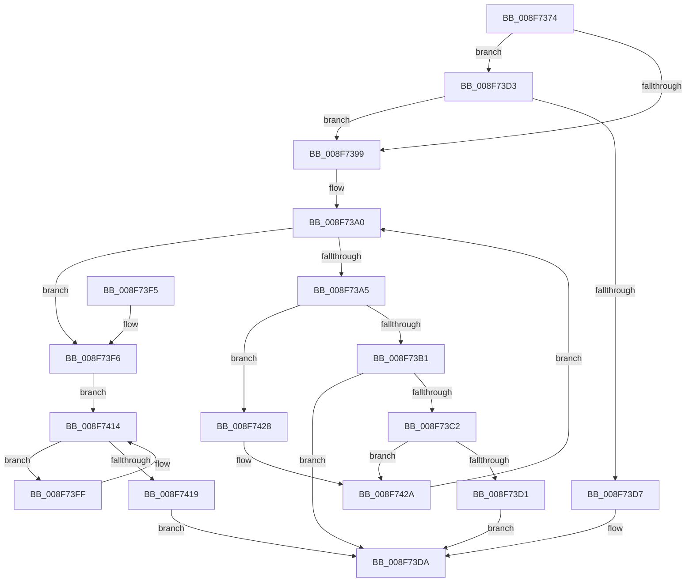

# AuthzBasepCompareLegacySecurityAttributesInformation

- RVA: `0x008F7374`–`0x008F7432` (길이 `190` bytes)
- VA: `0x00000001408F7374`
- 실행 섹션: `PAGE`
- PDB 이름 있음: `예`; PDB Function 태그: `아니요`
- unwind 정보 RVA: `0x00079B4C`
- 디코드: `65`개 명령, `190/190` bytes 표시
- 미해석 바이트: `0` (있으면 어셈블리에 `.byte`로 보존)

> 이 문서는 커널 이미지의 기계어와 PDB 기호를 분석해 생성했습니다. 4번과 5번은 함수 원형과 자료형을 바이너리 사용 방식에서 추정한 C 해석이며 원본 소스 복구 결과는 아닙니다.

## 1. Dependencies

- 직접 호출 지점: **4**; 고유 호출 대상: **3**
- 직접 호출자로 확인된 함수: **1**
- RIP 상대 이미지 참조: **0**

### Outgoing calls
- `0x008F73A8` → [AuthzBasepIsCompareRelevantAttribute](AuthzBasepIsCompareRelevantAttribute_function_008F6B54.md) (function, `0x008F6B54`)
- `0x008F73B8` → [AuthzBasepFindSecurityAttribute](../../text/3A/AuthzBasepFindSecurityAttribute_function_003A8980.md) (function, `0x003A8980`)
- `0x008F73C8` → [AuthzBasepCompareSecurityAttribute](../A6/AuthzBasepCompareSecurityAttribute_function_00A612A8.md) (function, `0x00A612A8`)
- `0x008F7402` → [AuthzBasepIsCompareRelevantAttribute](AuthzBasepIsCompareRelevantAttribute_function_008F6B54.md) (function, `0x008F6B54`)

### Direct callers
- [SeCompareTokens](SeCompareTokens_function_008F6F40.md) at `0x008F70BD`

### Static image references
- 디코드된 RIP-relative 메모리 참조가 없습니다.

## 2. Other-region calls and transfers

- 다른 실행 섹션으로 향하는 call: **1**
  - `0x008F73B8` → [AuthzBasepFindSecurityAttribute](../../text/3A/AuthzBasepFindSecurityAttribute_function_003A8980.md) (`PAGE` → `.text`)
- 별도 외부 분기/꼬리 이동을 확인하지 못했습니다.

## 3. Assembly (complete function range)

```asm
008F7374  48 89 5C 24 08                  mov qword ptr [rsp + 8], rbx
008F7379  48 89 6C 24 10                  mov qword ptr [rsp + 0x10], rbp
008F737E  48 89 74 24 18                  mov qword ptr [rsp + 0x18], rsi
008F7383  57                              push rdi
008F7384  41 56                           push r14
008F7386  41 57                           push r15
008F7388  48 83 EC 20                     sub rsp, 0x20
008F738C  8B 29                           mov ebp, dword ptr [rcx]
008F738E  33 DB                           xor ebx, ebx
008F7390  8B 3A                           mov edi, dword ptr [rdx]
008F7392  4C 8B F2                        mov r14, rdx
008F7395  85 ED                           test ebp, ebp
008F7397  74 3A                           je 0x1408f73d3
008F7399  4C 8D 79 08                     lea r15, [rcx + 8]
008F739D  49 8B 37                        mov rsi, qword ptr [r15]
008F73A0  49 3B F7                        cmp rsi, r15
008F73A3  74 51                           je 0x1408f73f6
008F73A5  48 8B CE                        mov rcx, rsi
008F73A8  E8 A7 F7 FF FF                  call 0x1408f6b54
008F73AD  84 C0                           test al, al
008F73AF  74 77                           je 0x1408f7428
008F73B1  48 8D 56 20                     lea rdx, [rsi + 0x20]
008F73B5  49 8B CE                        mov rcx, r14
008F73B8  E8 C3 15 AB FF                  call 0x1403a8980
008F73BD  48 85 C0                        test rax, rax
008F73C0  74 18                           je 0x1408f73da
008F73C2  48 8B D0                        mov rdx, rax
008F73C5  48 8B CE                        mov rcx, rsi
008F73C8  E8 DB 9E 16 00                  call 0x140a612a8
008F73CD  84 C0                           test al, al
008F73CF  75 59                           jne 0x1408f742a
008F73D1  EB 07                           jmp 0x1408f73da
008F73D3  85 FF                           test edi, edi
008F73D5  75 C2                           jne 0x1408f7399
008F73D7  8D 5F 01                        lea ebx, [rdi + 1]
008F73DA  48 8B 6C 24 48                  mov rbp, qword ptr [rsp + 0x48]
008F73DF  8A C3                           mov al, bl
008F73E1  48 8B 5C 24 40                  mov rbx, qword ptr [rsp + 0x40]
008F73E6  48 8B 74 24 50                  mov rsi, qword ptr [rsp + 0x50]
008F73EB  48 83 C4 20                     add rsp, 0x20
008F73EF  41 5F                           pop r15
008F73F1  41 5E                           pop r14
008F73F3  5F                              pop rdi
008F73F4  C3                              ret
008F73F5  CC                              int3
008F73F6  49 83 C6 08                     add r14, 8
008F73FA  49 8B 36                        mov rsi, qword ptr [r14]
008F73FD  EB 15                           jmp 0x1408f7414
008F73FF  48 8B CE                        mov rcx, rsi
008F7402  E8 4D F7 FF FF                  call 0x1408f6b54
008F7407  48 8B 36                        mov rsi, qword ptr [rsi]
008F740A  8D 4F FF                        lea ecx, [rdi - 1]
008F740D  84 C0                           test al, al
008F740F  0F 45 CF                        cmovne ecx, edi
008F7412  8B F9                           mov edi, ecx
008F7414  49 3B F6                        cmp rsi, r14
008F7417  75 E6                           jne 0x1408f73ff
008F7419  3B EF                           cmp ebp, edi
008F741B  0F B6 DB                        movzx ebx, bl
008F741E  B9 01 00 00 00                  mov ecx, 1
008F7423  0F 44 D9                        cmove ebx, ecx
008F7426  EB B2                           jmp 0x1408f73da
008F7428  FF CD                           dec ebp
008F742A  48 8B 36                        mov rsi, qword ptr [rsi]
008F742D  E9 6E FF FF FF                  jmp 0x1408f73a0
```

## 4. C-style interpretation (structured pseudocode)

```c
__int64 __fastcall AuthzBasepCompareLegacySecurityAttributesInformation(__int64 a1, __int64 a2)
{
    __int64 result;
    __int64 v_r14;
    __int64 v_rbp;
    __int64 v_rbx;
    __int64 v_rsp;
    unsigned __int64 v_stack_p10;
    unsigned __int64 v_stack_p18;
    unsigned __int64 v_stack_p8;

    v_stack_p8 = v_rbx;
    v_stack_p10 = v_rbp;
    v_stack_p18 = v_rsi;
    v_rsp = (v_rsp) - (32);
    v_rbx = 0;
    if ((unsigned int)((unsigned int)(*(unsigned int *)(a1))) == 0) goto loc_008F73D3;
loc_008F7399:
loc_008F73A0:
    if ((*(unsigned __int64 *)(a1 + 8)) == (a1 + 8)) goto loc_008F73F6;
    result = AuthzBasepIsCompareRelevantAttribute(*(unsigned __int64 *)(a1 + 8), a2, a3, a4);
    if ((unsigned __int8)(result) == 0) goto loc_008F7428;
    result = AuthzBasepFindSecurityAttribute(a2, *(unsigned __int64 *)(a1 + 8) + 32, a3, a4);
    if (result == 0) goto loc_008F73DA;
    result = AuthzBasepCompareSecurityAttribute(*(unsigned __int64 *)(a1 + 8), result, a3, a4);
    if ((unsigned __int8)(result) != 0) goto loc_008F742A;
    goto loc_008F73DA;
loc_008F73D3:
    if ((unsigned int)((unsigned int)(*(unsigned int *)(a2))) != 0) goto loc_008F7399;
loc_008F73DA:
    v_rsp = (v_rsp) + (32);
    return (unsigned __int8)((unsigned int)(*(unsigned int *)(a2)) + 1);
loc_008F73F6:
    v_r14 = (a2) + (8);
    goto loc_008F7414;
loc_008F73FF:
    result = AuthzBasepIsCompareRelevantAttribute(*(unsigned __int64 *)(v_r14), result, a3, a4);
    a1 = (unsigned int)(*(unsigned int *)(a2)) - 1;
    if ((unsigned __int8)(result) != 0) { a1 = (unsigned int)((unsigned int)(*(unsigned int *)(a2))); }
loc_008F7414:
    if ((*(unsigned __int64 *)(*(unsigned __int64 *)(v_r14))) != v_r14) goto loc_008F73FF;
    v_rbx = (unsigned __int8)(v_stack_p8);
    if (((unsigned int)(v_stack_p10)) == ((unsigned int)((unsigned int)((unsigned int)(a1))))) { v_rbx = 1; }
    goto loc_008F73DA;
loc_008F7428:
    v_rbp = (unsigned int)((v_stack_p10) - 1);
loc_008F742A:
    goto loc_008F73A0;
}
```

## 5. (Beta) C Style

```c
int64_t AuthzBasepCompareLegacySecurityAttributesInformation(void *Arg1, void *Arg2)
{
    uint8_t *arg1 = (uint8_t *)Arg1;
    uint8_t *arg2 = (uint8_t *)Arg2;

    int64_t result;
    int64_t local_r14;
    int64_t local_rbp;
    int64_t local_rbx;
    int64_t local_rsp;
    uint64_t v_stack_p10;
    uint64_t v_stack_p18;
    uint64_t v_stack_p8;

    v_stack_p8 = local_rbx;
    v_stack_p10 = local_rbp;
    v_stack_p18 = local_rsi;
    local_rsp = (local_rsp) - (32);
    local_rbx = 0;
    if ((uint32_t)((uint32_t)(*(uint32_t *)(arg1))) == 0) goto loc_008F73D3;
loc_008F7399:
loc_008F73A0:
    if ((*(uint64_t *)(arg1 + 0x8)) == (Arg1 + 8)) goto loc_008F73F6;
    result = AuthzBasepIsCompareRelevantAttribute(*(uint64_t *)(arg1 + 0x8), Arg2, a3, a4);
    if ((uint8_t)(result) == 0) goto loc_008F7428;
    result = AuthzBasepFindSecurityAttribute(Arg2, *(uint64_t *)(arg1 + 0x8) + 32, a3, a4);
    if (result == 0) goto loc_008F73DA;
    result = AuthzBasepCompareSecurityAttribute(*(uint64_t *)(arg1 + 0x8), result, a3, a4);
    if ((uint8_t)(result) != 0) goto loc_008F742A;
    goto loc_008F73DA;
loc_008F73D3:
    if ((uint32_t)((uint32_t)(*(uint32_t *)(arg2))) != 0) goto loc_008F7399;
loc_008F73DA:
    local_rsp = (local_rsp) + (32);
    return (uint8_t)((uint32_t)(*(uint32_t *)(arg2)) + 1);
loc_008F73F6:
    local_r14 = (Arg2) + (8);
    goto loc_008F7414;
loc_008F73FF:
    result = AuthzBasepIsCompareRelevantAttribute(*(uint64_t *)(local_r14), result, a3, a4);
    Arg1 = (uint32_t)(*(uint32_t *)(arg2)) - 1;
    if ((uint8_t)(result) != 0) { Arg1 = (uint32_t)((uint32_t)(*(uint32_t *)(arg2))); }
loc_008F7414:
    if ((*(uint64_t *)(*(uint64_t *)(local_r14))) != local_r14) goto loc_008F73FF;
    local_rbx = (uint8_t)(v_stack_p8);
    if (((uint32_t)(v_stack_p10)) == ((uint32_t)((uint32_t)((uint32_t)(Arg1))))) { local_rbx = 1; }
    goto loc_008F73DA;
loc_008F7428:
    local_rbp = (uint32_t)((v_stack_p10) - 1);
loc_008F742A:
    goto loc_008F73A0;
}
```

### 관측된 메모리 오프셋

구조체 형식이 확인되지 않은 접근은 인자 기준의 오프셋으로만 기록했습니다.

| 기준 인자 | 오프셋 표현 | 폭 (bit) | 접근 |
|---|---:|---:|---|
| `Arg1` | `+ 0x0` | `32` | `R` |
| `Arg1` | `+ 0x0` | `64` | `R` |
| `Arg1` | `+ 0x8` | `64` | `R` |
| `Arg2` | `+ 0x0` | `32` | `R` |
| `Arg2` | `+ 0x0` | `64` | `R` |

## 6. Execution-region graph

[열기: 2D/3D 그래프와 함수 탐색 컨트롤 패널](../../../control-panel.html?section=page&rva=0x008F7374&view=graph)

- 2D 그래프는 위에서 아래로 흐르고, 3D 그래프는 빈 공간을 드래그해 회전합니다. Shift+드래그는 이동, 휠은 확대·축소, 함수 노드 선택은 대상 보고서 이동입니다.

### Static fallback


