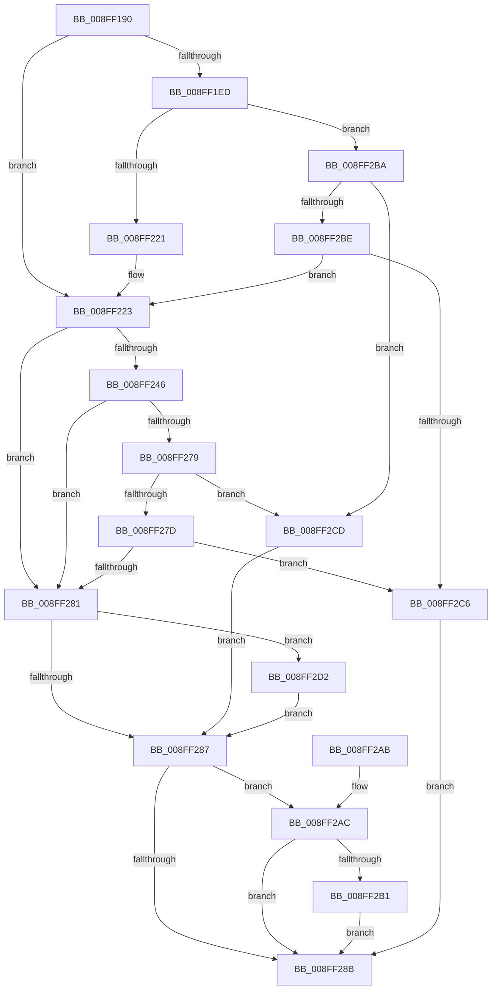

# CmAddDeviceToContainer

- RVA: `0x008FF190`–`0x008FF2E5` (길이 `341` bytes)
- VA: `0x00000001408FF190`
- 실행 섹션: `PAGE`
- PDB 이름 있음: `예`; PDB Function 태그: `아니요`
- unwind 정보 RVA: `0x00088314`
- 디코드: `101`개 명령, `341/341` bytes 표시
- 미해석 바이트: `0` (있으면 어셈블리에 `.byte`로 보존)

> 이 문서는 커널 이미지의 기계어와 PDB 기호를 분석해 생성했습니다. 4번과 5번은 함수 원형과 자료형을 바이너리 사용 방식에서 추정한 C 해석이며 원본 소스 복구 결과는 아닙니다.

## 1. Dependencies

- 직접 호출 지점: **6**; 고유 호출 대상: **5**
- 직접 호출자로 확인된 함수: **3**
- RIP 상대 이미지 참조: **1**

### Outgoing calls
- `0x008FF1CF` → [memset](../../text/6C/memset_function_006C6C40.md) (function, `0x006C6C40`)
- `0x008FF211` → [guard_dispatch_icall](../../text/6B/guard_dispatch_icall_function_006BAAD0.md) (function, `0x006BAAD0`)
- `0x008FF23A` → [_CmAddDeviceToContainerWorker](_CmAddDeviceToContainerWorker_function_008FF2EC.md) (function, `0x008FF2EC`)
- `0x008FF26D` → [guard_dispatch_icall](../../text/6B/guard_dispatch_icall_function_006BAAD0.md) (function, `0x006BAAD0`)
- `0x008FF294` → [_security_check_cookie](../../text/6A/_security_check_cookie_function_006AC640.md) (function, `0x006AC640`)
- `0x008FF2DE` → [PnpObjectRaiseDevicesChangeEvent](../AC/PnpObjectRaiseDevicesChangeEvent_function_00AC9888.md) (function, `0x00AC9888`)

### Direct callers
- [CmMoveBaseContainer](../82/CmMoveBaseContainer_function_0082BE5C.md) at `0x0082BEE1`
- [PiDcUpdateDeviceContainerMembership](PiDcUpdateDeviceContainerMembership_function_008FD0A8.md) at `0x008FD21B`
- [IopInitializePlugPlayServices](../../init/C2/IopInitializePlugPlayServices_function_00C2F298.md) at `0x00C2FDCE`

### Static image references
- `0x008FF1A7` → RVA `0x00E0A740` (`.data`; read)

## 2. Other-region calls and transfers

- 다른 실행 섹션으로 향하는 call: **4**
  - `0x008FF1CF` → [memset](../../text/6C/memset_function_006C6C40.md) (`PAGE` → `.text`)
  - `0x008FF211` → [guard_dispatch_icall](../../text/6B/guard_dispatch_icall_function_006BAAD0.md) (`PAGE` → `.text`)
  - `0x008FF26D` → [guard_dispatch_icall](../../text/6B/guard_dispatch_icall_function_006BAAD0.md) (`PAGE` → `.text`)
  - `0x008FF294` → [_security_check_cookie](../../text/6A/_security_check_cookie_function_006AC640.md) (`PAGE` → `.text`)
- 별도 외부 분기/꼬리 이동을 확인하지 못했습니다.

## 3. Assembly (complete function range)

```asm
008FF190  40 55                           push rbp
008FF192  53                              push rbx
008FF193  56                              push rsi
008FF194  57                              push rdi
008FF195  41 54                           push r12
008FF197  41 56                           push r14
008FF199  41 57                           push r15
008FF19B  48 8D 6C 24 E1                  lea rbp, [rsp - 0x1f]
008FF1A0  48 81 EC B0 00 00 00            sub rsp, 0xb0
008FF1A7  48 8B 05 92 B5 50 00            mov rax, qword ptr [rip + 0x50b592]
008FF1AE  48 33 C4                        xor rax, rsp
008FF1B1  48 89 45 0F                     mov qword ptr [rbp + 0xf], rax
008FF1B5  4C 8B 65 7F                     mov r12, qword ptr [rbp + 0x7f]
008FF1B9  4C 8B FA                        mov r15, rdx
008FF1BC  33 D2                           xor edx, edx
008FF1BE  49 8B D8                        mov rbx, r8
008FF1C1  4C 8B F1                        mov r14, rcx
008FF1C4  49 8B F9                        mov rdi, r9
008FF1C7  48 8D 4D AF                     lea rcx, [rbp - 0x51]
008FF1CB  44 8D 42 58                     lea r8d, [rdx + 0x58]
008FF1CF  E8 6C 7A DC FF                  call 0x1406c6c40
008FF1D4  49 8B B6 F8 01 00 00            mov rsi, qword ptr [r14 + 0x1f8]
008FF1DB  48 89 7D C7                     mov qword ptr [rbp - 0x39], rdi
008FF1DF  BF 20 01 00 C0                  mov edi, 0xc0000120
008FF1E4  48 89 5D BF                     mov qword ptr [rbp - 0x41], rbx
008FF1E8  48 85 F6                        test rsi, rsi
008FF1EB  74 36                           je 0x1408ff223
008FF1ED  41 B9 0D 00 00 00               mov r9d, 0xd
008FF1F3  48 8D 45 AF                     lea rax, [rbp - 0x51]
008FF1F7  48 89 44 24 28                  mov qword ptr [rsp + 0x28], rax
008FF1FC  49 8B D7                        mov rdx, r15
008FF1FF  49 8B CE                        mov rcx, r14
008FF202  C7 44 24 20 01 00 00 00         mov dword ptr [rsp + 0x20], 1
008FF20A  48 8B C6                        mov rax, rsi
008FF20D  45 8D 41 F8                     lea r8d, [r9 - 8]
008FF211  E8 BA B8 DB FF                  call 0x1406baad0
008FF216  3D 02 00 00 C0                  cmp eax, 0xc0000002
008FF21B  0F 85 99 00 00 00               jne 0x1408ff2ba
008FF221  33 F6                           xor esi, esi
008FF223  4C 8B 4D C7                     mov r9, qword ptr [rbp - 0x39]
008FF227  48 8D 45 CF                     lea rax, [rbp - 0x31]
008FF22B  4C 8B 45 BF                     mov r8, qword ptr [rbp - 0x41]
008FF22F  49 8B D7                        mov rdx, r15
008FF232  49 8B CE                        mov rcx, r14
008FF235  48 89 44 24 20                  mov qword ptr [rsp + 0x20], rax
008FF23A  E8 AD 00 00 00                  call 0x1408ff2ec
008FF23F  8B D8                           mov ebx, eax
008FF241  48 85 F6                        test rsi, rsi
008FF244  74 3B                           je 0x1408ff281
008FF246  89 45 AF                        mov dword ptr [rbp - 0x51], eax
008FF249  41 B9 0D 00 00 00               mov r9d, 0xd
008FF24F  48 8D 45 AF                     lea rax, [rbp - 0x51]
008FF253  49 8B D7                        mov rdx, r15
008FF256  48 89 44 24 28                  mov qword ptr [rsp + 0x28], rax
008FF25B  49 8B CE                        mov rcx, r14
008FF25E  48 8B C6                        mov rax, rsi
008FF261  C7 44 24 20 02 00 00 00         mov dword ptr [rsp + 0x20], 2
008FF269  45 8D 41 F8                     lea r8d, [r9 - 8]
008FF26D  E8 5E B8 DB FF                  call 0x1406baad0
008FF272  3D 02 00 00 C0                  cmp eax, 0xc0000002
008FF277  74 08                           je 0x1408ff281
008FF279  3B C7                           cmp eax, edi
008FF27B  74 50                           je 0x1408ff2cd
008FF27D  85 C0                           test eax, eax
008FF27F  75 45                           jne 0x1408ff2c6
008FF281  80 7D CF 00                     cmp byte ptr [rbp - 0x31], 0
008FF285  74 4B                           je 0x1408ff2d2
008FF287  85 DB                           test ebx, ebx
008FF289  79 21                           jns 0x1408ff2ac
008FF28B  8B C3                           mov eax, ebx
008FF28D  48 8B 4D 0F                     mov rcx, qword ptr [rbp + 0xf]
008FF291  48 33 CC                        xor rcx, rsp
008FF294  E8 A7 D3 DA FF                  call 0x1406ac640
008FF299  48 81 C4 B0 00 00 00            add rsp, 0xb0
008FF2A0  41 5F                           pop r15
008FF2A2  41 5E                           pop r14
008FF2A4  41 5C                           pop r12
008FF2A6  5F                              pop rdi
008FF2A7  5E                              pop rsi
008FF2A8  5B                              pop rbx
008FF2A9  5D                              pop rbp
008FF2AA  C3                              ret
008FF2AB  CC                              int3
008FF2AC  4D 85 E4                        test r12, r12
008FF2AF  74 DA                           je 0x1408ff28b
008FF2B1  8A 45 CF                        mov al, byte ptr [rbp - 0x31]
008FF2B4  41 88 04 24                     mov byte ptr [r12], al
008FF2B8  EB D1                           jmp 0x1408ff28b
008FF2BA  3B C7                           cmp eax, edi
008FF2BC  74 0F                           je 0x1408ff2cd
008FF2BE  85 C0                           test eax, eax
008FF2C0  0F 84 5D FF FF FF               je 0x1408ff223
008FF2C6  BB E5 00 00 C0                  mov ebx, 0xc00000e5
008FF2CB  EB BE                           jmp 0x1408ff28b
008FF2CD  8B 5D AF                        mov ebx, dword ptr [rbp - 0x51]
008FF2D0  EB B5                           jmp 0x1408ff287
008FF2D2  41 B8 05 00 00 00               mov r8d, 5
008FF2D8  49 8B D7                        mov rdx, r15
008FF2DB  49 8B CE                        mov rcx, r14
008FF2DE  E8 A5 A5 1C 00                  call 0x140ac9888
008FF2E3  EB A2                           jmp 0x1408ff287
```

## 4. C-style interpretation (structured pseudocode)

```c
__int64 __fastcall CmAddDeviceToContainer(__int64 a1, __int64 a2, __int64 a3, __int64 a4, __int64 a5)
{
    __int64 result;
    __int64 v_rsi;
    __int64 v_rsp;
    unsigned __int64 v_stack_m48;
    unsigned __int64 v_stack_m57;
    unsigned __int64 v_stack_m88;
    unsigned __int64 v_stack_m90;
    unsigned __int64 v_stack_m98;
    unsigned __int64 v_stack_mA8;
    unsigned __int64 v_stack_mC0;
    unsigned int v_stack_mC8;

    v_rsp = (v_rsp) - (176);
    result = (*(unsigned __int64 *)(v_rip + 5289362)) ^ (v_rsp);
    v_stack_m48 = result;
    a2 = 0;
    result = memset(v_stack_mA8, a2, a2 + 88, a4);
    v_stack_m90 = a4;
    v_stack_m98 = a3;
    if (*(unsigned __int64 *)(a1 + 504) == 0) goto loc_008FF223;
    v_stack_mC0 = v_stack_mA8;
    v_stack_mC8 = 1;
    result = guard_dispatch_icall(a1, 0, 13 - 8, 13);
    if (((unsigned int)(result)) != 0xC0000002ULL) goto loc_008FF2BA;
    v_rsi = 0;
loc_008FF223:
    v_stack_mC8 = v_stack_m88;
    result = _CmAddDeviceToContainerWorker(a1, 0, v_stack_m98, v_stack_m90);
    if (0 == 0) goto loc_008FF281;
    v_stack_mA8 = (unsigned int)(result);
    v_stack_mC0 = v_stack_mA8;
    v_stack_mC8 = 2;
    result = guard_dispatch_icall(a1, 0, 13 - 8, 13);
    if (((unsigned int)(result)) == 0xC0000002ULL) goto loc_008FF281;
    if (((unsigned int)(result)) == ((unsigned int)((unsigned int)(0xC0000120ULL)))) goto loc_008FF2CD;
    if ((unsigned int)(result) != 0) goto loc_008FF2C6;
loc_008FF281:
    if (v_stack_m88 == 0) goto loc_008FF2D2;
loc_008FF287:
    if (!sign_flag) goto loc_008FF2AC;
loc_008FF28B:
    a1 = (v_stack_m48) ^ (v_rsp);
    result = _security_check_cookie(a1, 0, 13 - 8, 13);
    v_rsp = (v_rsp) + (176);
    return result;
loc_008FF2AC:
    if (a5 == 0) goto loc_008FF28B;
    *(unsigned __int8 *)(a5) = (unsigned __int8)(v_stack_m88);
    goto loc_008FF28B;
loc_008FF2BA:
    if (((unsigned int)(v_stack_m88)) == ((unsigned int)((unsigned int)(0xC0000120ULL)))) goto loc_008FF2CD;
    if ((unsigned int)(v_stack_m88) == 0) goto loc_008FF223;
loc_008FF2C6:
    goto loc_008FF28B;
loc_008FF2CD:
    goto loc_008FF287;
loc_008FF2D2:
    result = PnpObjectRaiseDevicesChangeEvent(a1, 0, 5, 13);
    goto loc_008FF287;
}
```

## 5. (Beta) C Style

```c
int64_t CmAddDeviceToContainer(void *Arg1, int64_t Arg2, int64_t Arg3, int64_t Arg4, int64_t Arg5)
{
    uint8_t *arg1 = (uint8_t *)Arg1;

    int64_t result;
    int64_t local_rsi;
    int64_t local_rsp;
    uint64_t v_stack_m48;
    uint64_t v_stack_m57;
    uint64_t v_stack_m88;
    uint64_t v_stack_m90;
    uint64_t v_stack_m98;
    uint64_t v_stack_mA8;
    uint64_t v_stack_mC0;
    uint32_t v_stack_mC8;

    local_rsp = (local_rsp) - (176);
    result = (*(uint64_t *)(v_rip + 0x50B592)) ^ (local_rsp);
    v_stack_m48 = result;
    Arg2 = 0;
    result = memset(v_stack_mA8, Arg2, Arg2 + 88, Arg4);
    v_stack_m90 = Arg4;
    v_stack_m98 = Arg3;
    if (*(uint64_t *)(arg1 + 0x1F8) == 0) goto loc_008FF223;
    v_stack_mC0 = v_stack_mA8;
    v_stack_mC8 = 1;
    result = guard_dispatch_icall(Arg1, 0, 13 - 8, 13);
    if (((uint32_t)(result)) != 0xC0000002ULL) goto loc_008FF2BA;
    local_rsi = 0;
loc_008FF223:
    v_stack_mC8 = v_stack_m88;
    result = _CmAddDeviceToContainerWorker(Arg1, 0, v_stack_m98, v_stack_m90);
    if (0 == 0) goto loc_008FF281;
    v_stack_mA8 = (uint32_t)(result);
    v_stack_mC0 = v_stack_mA8;
    v_stack_mC8 = 2;
    result = guard_dispatch_icall(Arg1, 0, 13 - 8, 13);
    if (((uint32_t)(result)) == 0xC0000002ULL) goto loc_008FF281;
    if (((uint32_t)(result)) == ((uint32_t)((uint32_t)(0xC0000120ULL)))) goto loc_008FF2CD;
    if ((uint32_t)(result) != 0) goto loc_008FF2C6;
loc_008FF281:
    if (v_stack_m88 == 0) goto loc_008FF2D2;
loc_008FF287:
    if (!sign_flag) goto loc_008FF2AC;
loc_008FF28B:
    Arg1 = (v_stack_m48) ^ (local_rsp);
    result = _security_check_cookie(Arg1, 0, 13 - 8, 13);
    local_rsp = (local_rsp) + (176);
    return result;
loc_008FF2AC:
    if (Arg5 == 0) goto loc_008FF28B;
    *(uint8_t *)(Arg5) = (uint8_t)(v_stack_m88);
    goto loc_008FF28B;
loc_008FF2BA:
    if (((uint32_t)(v_stack_m88)) == ((uint32_t)((uint32_t)(0xC0000120ULL)))) goto loc_008FF2CD;
    if ((uint32_t)(v_stack_m88) == 0) goto loc_008FF223;
loc_008FF2C6:
    goto loc_008FF28B;
loc_008FF2CD:
    goto loc_008FF287;
loc_008FF2D2:
    result = PnpObjectRaiseDevicesChangeEvent(Arg1, 0, 5, 13);
    goto loc_008FF287;
}
```

### 관측된 메모리 오프셋

구조체 형식이 확인되지 않은 접근은 인자 기준의 오프셋으로만 기록했습니다.

| 기준 인자 | 오프셋 표현 | 폭 (bit) | 접근 |
|---|---:|---:|---|
| `Arg1` | `+ 0x1F8` | `64` | `R` |

## 6. Execution-region graph

[열기: 2D/3D 그래프와 함수 탐색 컨트롤 패널](../../../control-panel.html?section=page&rva=0x008FF190&view=graph)

- 2D 그래프는 위에서 아래로 흐르고, 3D 그래프는 빈 공간을 드래그해 회전합니다. Shift+드래그는 이동, 휠은 확대·축소, 함수 노드 선택은 대상 보고서 이동입니다.

### Static fallback


