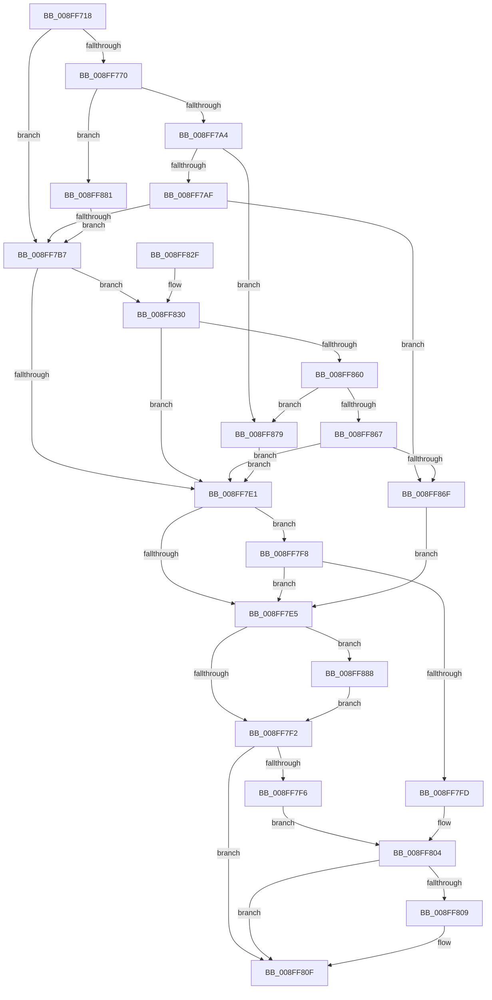

# CmCreateDeviceContainer

- RVA: `0x008FF718`–`0x008FF892` (길이 `378` bytes)
- VA: `0x00000001408FF718`
- 실행 섹션: `PAGE`
- PDB 이름 있음: `예`; PDB Function 태그: `아니요`
- unwind 정보 RVA: `0x0008836C`
- 디코드: `106`개 명령, `378/378` bytes 표시
- 미해석 바이트: `0` (있으면 어셈블리에 `.byte`로 보존)

> 이 문서는 커널 이미지의 기계어와 PDB 기호를 분석해 생성했습니다. 4번과 5번은 함수 원형과 자료형을 바이너리 사용 방식에서 추정한 C 해석이며 원본 소스 복구 결과는 아닙니다.

## 1. Dependencies

- 직접 호출 지점: **6**; 고유 호출 대상: **5**
- 직접 호출자로 확인된 함수: **1**
- RIP 상대 이미지 참조: **1**

### Outgoing calls
- `0x008FF754` → [memset](../../text/6C/memset_function_006C6C40.md) (function, `0x006C6C40`)
- `0x008FF794` → [guard_dispatch_icall](../../text/6B/guard_dispatch_icall_function_006BAAD0.md) (function, `0x006BAAD0`)
- `0x008FF7D5` → [_CmCreateDeviceContainerWorker](_CmCreateDeviceContainerWorker_function_008FF898.md) (function, `0x008FF898`)
- `0x008FF818` → [_security_check_cookie](../../text/6A/_security_check_cookie_function_006AC640.md) (function, `0x006AC640`)
- `0x008FF854` → [guard_dispatch_icall](../../text/6B/guard_dispatch_icall_function_006BAAD0.md) (function, `0x006BAAD0`)
- `0x008FF888` → [ZwClose](../../text/6A/ZwClose_function_006AD2B0.md) (function, `0x006AD2B0`)

### Direct callers
- [_CmAddDeviceToContainerWorker](_CmAddDeviceToContainerWorker_function_008FF2EC.md) at `0x008FF34C`

### Static image references
- `0x008FF72F` → RVA `0x00E0A740` (`.data`; read)

## 2. Other-region calls and transfers

- 다른 실행 섹션으로 향하는 call: **5**
  - `0x008FF754` → [memset](../../text/6C/memset_function_006C6C40.md) (`PAGE` → `.text`)
  - `0x008FF794` → [guard_dispatch_icall](../../text/6B/guard_dispatch_icall_function_006BAAD0.md) (`PAGE` → `.text`)
  - `0x008FF818` → [_security_check_cookie](../../text/6A/_security_check_cookie_function_006AC640.md) (`PAGE` → `.text`)
  - `0x008FF854` → [guard_dispatch_icall](../../text/6B/guard_dispatch_icall_function_006BAAD0.md) (`PAGE` → `.text`)
  - `0x008FF888` → [ZwClose](../../text/6A/ZwClose_function_006AD2B0.md) (`PAGE` → `.text`)
- 별도 외부 분기/꼬리 이동을 확인하지 못했습니다.

## 3. Assembly (complete function range)

```asm
008FF718  40 55                           push rbp
008FF71A  53                              push rbx
008FF71B  56                              push rsi
008FF71C  57                              push rdi
008FF71D  41 54                           push r12
008FF71F  41 56                           push r14
008FF721  41 57                           push r15
008FF723  48 8D 6C 24 E9                  lea rbp, [rsp - 0x17]
008FF728  48 81 EC B0 00 00 00            sub rsp, 0xb0
008FF72F  48 8B 05 0A B0 50 00            mov rax, qword ptr [rip + 0x50b00a]
008FF736  48 33 C4                        xor rax, rsp
008FF739  48 89 45 07                     mov qword ptr [rbp + 7], rax
008FF73D  4C 8B 75 77                     mov r14, qword ptr [rbp + 0x77]
008FF741  4C 8B E2                        mov r12, rdx
008FF744  33 D2                           xor edx, edx
008FF746  4C 8B F9                        mov r15, rcx
008FF749  48 8D 4D A7                     lea rcx, [rbp - 0x59]
008FF74D  49 8B F1                        mov rsi, r9
008FF750  44 8D 42 58                     lea r8d, [rdx + 0x58]
008FF754  E8 E7 74 DC FF                  call 0x1406c6c40
008FF759  49 8B BF F8 01 00 00            mov rdi, qword ptr [r15 + 0x1f8]
008FF760  83 65 CB 00                     and dword ptr [rbp - 0x35], 0
008FF764  C7 45 B7 04 00 00 00            mov dword ptr [rbp - 0x49], 4
008FF76B  48 85 FF                        test rdi, rdi
008FF76E  74 47                           je 0x1408ff7b7
008FF770  41 B9 02 00 00 00               mov r9d, 2
008FF776  48 8D 45 A7                     lea rax, [rbp - 0x59]
008FF77A  48 89 44 24 28                  mov qword ptr [rsp + 0x28], rax
008FF77F  49 8B D4                        mov rdx, r12
008FF782  49 8B CF                        mov rcx, r15
008FF785  C7 44 24 20 01 00 00 00         mov dword ptr [rsp + 0x20], 1
008FF78D  48 8B C7                        mov rax, rdi
008FF790  45 8D 41 03                     lea r8d, [r9 + 3]
008FF794  E8 37 B3 DB FF                  call 0x1406baad0
008FF799  3D 02 00 00 C0                  cmp eax, 0xc0000002
008FF79E  0F 84 DD 00 00 00               je 0x1408ff881
008FF7A4  3D 20 01 00 C0                  cmp eax, 0xc0000120
008FF7A9  0F 84 CA 00 00 00               je 0x1408ff879
008FF7AF  85 C0                           test eax, eax
008FF7B1  0F 85 B8 00 00 00               jne 0x1408ff86f
008FF7B7  8B 45 CB                        mov eax, dword ptr [rbp - 0x35]
008FF7BA  4C 8D 4D BF                     lea r9, [rbp - 0x41]
008FF7BE  44 8B 45 B7                     mov r8d, dword ptr [rbp - 0x49]
008FF7C2  49 8B D4                        mov rdx, r12
008FF7C5  89 44 24 28                     mov dword ptr [rsp + 0x28], eax
008FF7C9  49 8B CF                        mov rcx, r15
008FF7CC  48 8D 45 C7                     lea rax, [rbp - 0x39]
008FF7D0  48 89 44 24 20                  mov qword ptr [rsp + 0x20], rax
008FF7D5  E8 BE 00 00 00                  call 0x1408ff898
008FF7DA  8B D8                           mov ebx, eax
008FF7DC  48 85 FF                        test rdi, rdi
008FF7DF  75 4F                           jne 0x1408ff830
008FF7E1  85 DB                           test ebx, ebx
008FF7E3  79 13                           jns 0x1408ff7f8
008FF7E5  48 8B 4D BF                     mov rcx, qword ptr [rbp - 0x41]
008FF7E9  48 85 C9                        test rcx, rcx
008FF7EC  0F 85 96 00 00 00               jne 0x1408ff888
008FF7F2  85 DB                           test ebx, ebx
008FF7F4  78 19                           js 0x1408ff80f
008FF7F6  EB 0C                           jmp 0x1408ff804
008FF7F8  48 85 F6                        test rsi, rsi
008FF7FB  74 E8                           je 0x1408ff7e5
008FF7FD  48 8B 45 BF                     mov rax, qword ptr [rbp - 0x41]
008FF801  48 89 06                        mov qword ptr [rsi], rax
008FF804  4D 85 F6                        test r14, r14
008FF807  74 06                           je 0x1408ff80f
008FF809  8A 45 C7                        mov al, byte ptr [rbp - 0x39]
008FF80C  41 88 06                        mov byte ptr [r14], al
008FF80F  8B C3                           mov eax, ebx
008FF811  48 8B 4D 07                     mov rcx, qword ptr [rbp + 7]
008FF815  48 33 CC                        xor rcx, rsp
008FF818  E8 23 CE DA FF                  call 0x1406ac640
008FF81D  48 81 C4 B0 00 00 00            add rsp, 0xb0
008FF824  41 5F                           pop r15
008FF826  41 5E                           pop r14
008FF828  41 5C                           pop r12
008FF82A  5F                              pop rdi
008FF82B  5E                              pop rsi
008FF82C  5B                              pop rbx
008FF82D  5D                              pop rbp
008FF82E  C3                              ret
008FF82F  CC                              int3
008FF830  41 B9 02 00 00 00               mov r9d, 2
008FF836  89 45 A7                        mov dword ptr [rbp - 0x59], eax
008FF839  48 8D 45 A7                     lea rax, [rbp - 0x59]
008FF83D  49 8B D4                        mov rdx, r12
008FF840  48 89 44 24 28                  mov qword ptr [rsp + 0x28], rax
008FF845  49 8B CF                        mov rcx, r15
008FF848  48 8B C7                        mov rax, rdi
008FF84B  44 89 4C 24 20                  mov dword ptr [rsp + 0x20], r9d
008FF850  45 8D 41 03                     lea r8d, [r9 + 3]
008FF854  E8 77 B2 DB FF                  call 0x1406baad0
008FF859  3D 02 00 00 C0                  cmp eax, 0xc0000002
008FF85E  74 81                           je 0x1408ff7e1
008FF860  3D 20 01 00 C0                  cmp eax, 0xc0000120
008FF865  74 12                           je 0x1408ff879
008FF867  85 C0                           test eax, eax
008FF869  0F 84 72 FF FF FF               je 0x1408ff7e1
008FF86F  BB E5 00 00 C0                  mov ebx, 0xc00000e5
008FF874  E9 6C FF FF FF                  jmp 0x1408ff7e5
008FF879  8B 5D A7                        mov ebx, dword ptr [rbp - 0x59]
008FF87C  E9 60 FF FF FF                  jmp 0x1408ff7e1
008FF881  33 FF                           xor edi, edi
008FF883  E9 2F FF FF FF                  jmp 0x1408ff7b7
008FF888  E8 23 DA DA FF                  call 0x1406ad2b0
008FF88D  E9 60 FF FF FF                  jmp 0x1408ff7f2
```

## 4. C-style interpretation (structured pseudocode)

```c
__int64 __fastcall CmCreateDeviceContainer(__int64 a1, __int64 a2, __int64 a3, __int64 a4, __int64 a5)
{
    __int64 result;
    __int64 v_rdi;
    __int64 v_rsp;
    unsigned __int64 v_stack_m48;
    unsigned __int64 v_stack_m4F;
    unsigned int v_stack_m84;
    unsigned __int64 v_stack_m88;
    unsigned __int64 v_stack_m90;
    unsigned int v_stack_m98;
    unsigned __int64 v_stack_mA8;
    unsigned __int64 v_stack_mC0;
    unsigned int v_stack_mC8;
    unsigned int v_stack_p20;
    unsigned __int64 v_stack_p28;

    v_rsp = (v_rsp) - (176);
    result = (*(unsigned __int64 *)(v_rip + 5287946)) ^ (v_rsp);
    v_stack_m48 = result;
    a2 = 0;
    result = memset(v_stack_mA8, a2, a2 + 88, a4);
    v_stack_m98 = 4;
    if (*(unsigned __int64 *)(a1 + 504) == 0) goto loc_008FF7B7;
    v_stack_mC0 = v_stack_mA8;
    v_stack_mC8 = 1;
    result = guard_dispatch_icall(a1, 0, 2 + 3, 2);
    if (((unsigned int)(result)) == 0xC0000002ULL) goto loc_008FF881;
    if (((unsigned int)(result)) == 0xC0000120ULL) goto loc_008FF879;
    if ((unsigned int)(result) != 0) goto loc_008FF86F;
loc_008FF7B7:
    v_stack_mC0 = (unsigned int)((unsigned int)(v_stack_m84));
    v_stack_mC8 = v_stack_m88;
    result = _CmCreateDeviceContainerWorker(a1, 0, (unsigned int)(v_stack_m98), v_stack_m90);
    if (*(unsigned __int64 *)(a1 + 504) != 0) goto loc_008FF830;
loc_008FF7E1:
    if (!sign_flag) goto loc_008FF7F8;
loc_008FF7E5:
    if (v_stack_m90 != 0) goto loc_008FF888;
loc_008FF7F2:
    if (sign_flag) goto loc_008FF80F;
    goto loc_008FF804;
loc_008FF7F8:
    if (a4 == 0) goto loc_008FF7E5;
    *(unsigned __int64 *)(a4) = v_stack_m90;
loc_008FF804:
    result = v_stack_m90;
    if (a5 != 0) {
        result = v_stack_m88;
        *(unsigned __int8 *)(a5) = (unsigned __int8)(result);
    }
    a1 = (v_stack_m48) ^ (v_rsp);
    result = _security_check_cookie(a1, 0, (unsigned int)(v_stack_m98), v_stack_m90);
    v_rsp = (v_rsp) + (176);
    return result;
loc_008FF830:
    v_stack_mA8 = (unsigned int)(result);
    v_stack_p28 = v_stack_mA8;
    v_stack_p20 = 2;
    result = guard_dispatch_icall(a1, 0, 2 + 3, 2);
    if (((unsigned int)(result)) == 0xC0000002ULL) goto loc_008FF7E1;
    if (((unsigned int)(result)) == 0xC0000120ULL) goto loc_008FF879;
    if ((unsigned int)(result) == 0) goto loc_008FF7E1;
loc_008FF86F:
    goto loc_008FF7E5;
loc_008FF879:
    goto loc_008FF7E1;
loc_008FF881:
    v_rdi = 0;
    goto loc_008FF7B7;
loc_008FF888:
    result = ZwClose(a1, 0, 2 + 3, 2);
    goto loc_008FF7F2;
}
```

## 5. (Beta) C Style

```c
int64_t CmCreateDeviceContainer(void *Arg1, int64_t Arg2, int64_t Arg3, int64_t Arg4, int64_t Arg5)
{
    uint8_t *arg1 = (uint8_t *)Arg1;

    int64_t result;
    int64_t local_rdi;
    int64_t local_rsp;
    uint64_t v_stack_m48;
    uint64_t v_stack_m4F;
    uint32_t v_stack_m84;
    uint64_t v_stack_m88;
    uint64_t v_stack_m90;
    uint32_t v_stack_m98;
    uint64_t v_stack_mA8;
    uint64_t v_stack_mC0;
    uint32_t v_stack_mC8;
    uint32_t v_stack_p20;
    uint64_t v_stack_p28;

    local_rsp = (local_rsp) - (176);
    result = (*(uint64_t *)(v_rip + 0x50B00A)) ^ (local_rsp);
    v_stack_m48 = result;
    Arg2 = 0;
    result = memset(v_stack_mA8, Arg2, Arg2 + 88, Arg4);
    v_stack_m98 = 4;
    if (*(uint64_t *)(arg1 + 0x1F8) == 0) goto loc_008FF7B7;
    v_stack_mC0 = v_stack_mA8;
    v_stack_mC8 = 1;
    result = guard_dispatch_icall(Arg1, 0, 2 + 3, 2);
    if (((uint32_t)(result)) == 0xC0000002ULL) goto loc_008FF881;
    if (((uint32_t)(result)) == 0xC0000120ULL) goto loc_008FF879;
    if ((uint32_t)(result) != 0) goto loc_008FF86F;
loc_008FF7B7:
    v_stack_mC0 = (uint32_t)((uint32_t)(v_stack_m84));
    v_stack_mC8 = v_stack_m88;
    result = _CmCreateDeviceContainerWorker(Arg1, 0, (uint32_t)(v_stack_m98), v_stack_m90);
    if (*(uint64_t *)(arg1 + 0x1F8) != 0) goto loc_008FF830;
loc_008FF7E1:
    if (!sign_flag) goto loc_008FF7F8;
loc_008FF7E5:
    if (v_stack_m90 != 0) goto loc_008FF888;
loc_008FF7F2:
    if (sign_flag) goto loc_008FF80F;
    goto loc_008FF804;
loc_008FF7F8:
    if (Arg4 == 0) goto loc_008FF7E5;
    *(uint64_t *)(Arg4) = v_stack_m90;
loc_008FF804:
    result = v_stack_m90;
    if (Arg5 != 0) {
        result = v_stack_m88;
        *(uint8_t *)(Arg5) = (uint8_t)(result);
    }
    Arg1 = (v_stack_m48) ^ (local_rsp);
    result = _security_check_cookie(Arg1, 0, (uint32_t)(v_stack_m98), v_stack_m90);
    local_rsp = (local_rsp) + (176);
    return result;
loc_008FF830:
    v_stack_mA8 = (uint32_t)(result);
    v_stack_p28 = v_stack_mA8;
    v_stack_p20 = 2;
    result = guard_dispatch_icall(Arg1, 0, 2 + 3, 2);
    if (((uint32_t)(result)) == 0xC0000002ULL) goto loc_008FF7E1;
    if (((uint32_t)(result)) == 0xC0000120ULL) goto loc_008FF879;
    if ((uint32_t)(result) == 0) goto loc_008FF7E1;
loc_008FF86F:
    goto loc_008FF7E5;
loc_008FF879:
    goto loc_008FF7E1;
loc_008FF881:
    local_rdi = 0;
    goto loc_008FF7B7;
loc_008FF888:
    result = ZwClose(Arg1, 0, 2 + 3, 2);
    goto loc_008FF7F2;
}
```

### 관측된 메모리 오프셋

구조체 형식이 확인되지 않은 접근은 인자 기준의 오프셋으로만 기록했습니다.

| 기준 인자 | 오프셋 표현 | 폭 (bit) | 접근 |
|---|---:|---:|---|
| `Arg1` | `+ 0x1F8` | `64` | `R` |

## 6. Execution-region graph

[열기: 2D/3D 그래프와 함수 탐색 컨트롤 패널](../../../control-panel.html?section=page&rva=0x008FF718&view=graph)

- 2D 그래프는 위에서 아래로 흐르고, 3D 그래프는 빈 공간을 드래그해 회전합니다. Shift+드래그는 이동, 휠은 확대·축소, 함수 노드 선택은 대상 보고서 이동입니다.

### Static fallback


