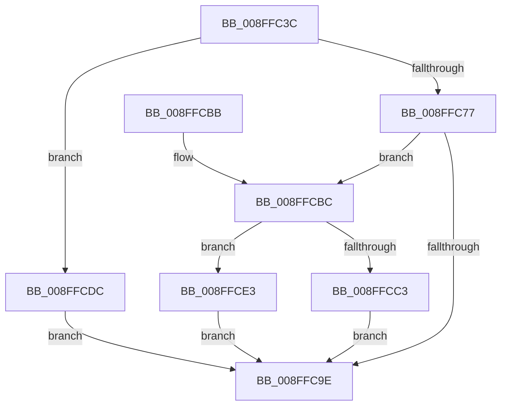

# CmCreateDeviceWorker

- RVA: `0x008FFC3C`–`0x008FFCE8` (길이 `172` bytes)
- VA: `0x00000001408FFC3C`
- 실행 섹션: `PAGE`
- PDB 이름 있음: `예`; PDB Function 태그: `아니요`
- unwind 정보 RVA: `0x0008840C`
- 디코드: `48`개 명령, `172/172` bytes 표시
- 미해석 바이트: `0` (있으면 어셈블리에 `.byte`로 보존)

> 이 문서는 커널 이미지의 기계어와 PDB 기호를 분석해 생성했습니다. 4번과 5번은 함수 원형과 자료형을 바이너리 사용 방식에서 추정한 C 해석이며 원본 소스 복구 결과는 아닙니다.

## 1. Dependencies

- 직접 호출 지점: **2**; 고유 호출 대상: **2**
- 직접 호출자로 확인된 함수: **1**
- RIP 상대 이미지 참조: **0**

### Outgoing calls
- `0x008FFC93` → [_CmOpenDeviceRegKey](../8E/_CmOpenDeviceRegKey_function_008EE540.md) (function, `0x008EE540`)
- `0x008FFCD5` → [CmRaiseCreateEvent](CmRaiseCreateEvent_function_008FF944.md) (function, `0x008FF944`)

### Direct callers
- [CmCreateDevice](CmCreateDevice_function_008FFABC.md) at `0x008FFB7A`

### Static image references
- 디코드된 RIP-relative 메모리 참조가 없습니다.

## 2. Other-region calls and transfers

- 다른 실행 섹션으로 향하는 call: **0**
- 별도 외부 분기/꼬리 이동을 확인하지 못했습니다.

## 3. Assembly (complete function range)

```asm
008FFC3C  4C 8B DC                        mov r11, rsp
008FFC3F  49 89 5B 08                     mov qword ptr [r11 + 8], rbx
008FFC43  49 89 6B 10                     mov qword ptr [r11 + 0x10], rbp
008FFC47  49 89 73 18                     mov qword ptr [r11 + 0x18], rsi
008FFC4B  49 89 7B 20                     mov qword ptr [r11 + 0x20], rdi
008FFC4F  41 56                           push r14
008FFC51  48 83 EC 50                     sub rsp, 0x50
008FFC55  83 64 24 40 00                  and dword ptr [rsp + 0x40], 0
008FFC5A  49 8B F1                        mov rsi, r9
008FFC5D  0F B7 84 24 88 00 00 00         movzx eax, word ptr [rsp + 0x88]
008FFC65  48 8B EA                        mov rbp, rdx
008FFC68  48 8B BC 24 80 00 00 00         mov rdi, qword ptr [rsp + 0x80]
008FFC70  4C 8B F1                        mov r14, rcx
008FFC73  85 C0                           test eax, eax
008FFC75  75 65                           jne 0x1408ffcdc
008FFC77  49 8D 43 E8                     lea rax, [r11 - 0x18]
008FFC7B  49 89 43 E0                     mov qword ptr [r11 - 0x20], rax
008FFC7F  4D 89 4B D8                     mov qword ptr [r11 - 0x28], r9
008FFC83  45 33 C9                        xor r9d, r9d
008FFC86  C6 44 24 28 01                  mov byte ptr [rsp + 0x28], 1
008FFC8B  45 89 43 C8                     mov dword ptr [r11 - 0x38], r8d
008FFC8F  45 8D 41 10                     lea r8d, [r9 + 0x10]
008FFC93  E8 A8 E8 FE FF                  call 0x1408ee540
008FFC98  8B D8                           mov ebx, eax
008FFC9A  85 C0                           test eax, eax
008FFC9C  79 1E                           jns 0x1408ffcbc
008FFC9E  48 8B 6C 24 68                  mov rbp, qword ptr [rsp + 0x68]
008FFCA3  8B C3                           mov eax, ebx
008FFCA5  48 8B 5C 24 60                  mov rbx, qword ptr [rsp + 0x60]
008FFCAA  48 8B 74 24 70                  mov rsi, qword ptr [rsp + 0x70]
008FFCAF  48 8B 7C 24 78                  mov rdi, qword ptr [rsp + 0x78]
008FFCB4  48 83 C4 50                     add rsp, 0x50
008FFCB8  41 5E                           pop r14
008FFCBA  C3                              ret
008FFCBB  CC                              int3
008FFCBC  83 7C 24 40 01                  cmp dword ptr [rsp + 0x40], 1
008FFCC1  75 20                           jne 0x1408ffce3
008FFCC3  C6 07 01                        mov byte ptr [rdi], 1
008FFCC6  41 B8 01 00 00 00               mov r8d, 1
008FFCCC  4C 8B 0E                        mov r9, qword ptr [rsi]
008FFCCF  48 8B D5                        mov rdx, rbp
008FFCD2  49 8B CE                        mov rcx, r14
008FFCD5  E8 6A FC FF FF                  call 0x1408ff944
008FFCDA  EB C2                           jmp 0x1408ffc9e
008FFCDC  BB 0D 00 00 C0                  mov ebx, 0xc000000d
008FFCE1  EB BB                           jmp 0x1408ffc9e
008FFCE3  C6 07 00                        mov byte ptr [rdi], 0
008FFCE6  EB B6                           jmp 0x1408ffc9e
```

## 4. C-style interpretation (structured pseudocode)

```c
__int64 __fastcall CmCreateDeviceWorker(__int64 a1, __int64 a2, int a3, __int64 a4, __int64 a5, unsigned __int16 a6)
{
    __int64 result;
    __int64 v_rsp;
    unsigned int v_stack_m18;
    unsigned __int8 v_stack_m30;
    unsigned __int64 v_stack_p10;
    unsigned __int64 v_stack_p18;
    unsigned __int64 v_stack_p20;
    unsigned int v_stack_p40;
    unsigned __int64 v_stack_p8;

    *(unsigned __int64 *)(v_rsp + 8) = v_rbx;
    *(unsigned __int64 *)(v_rsp + 16) = v_rbp;
    *(unsigned __int64 *)(v_rsp + 24) = v_rsi;
    *(unsigned __int64 *)(v_rsp + 32) = v_rdi;
    v_rsp = (v_rsp) - (80);
    if (a6 != 0) goto loc_008FFCDC;
    *(unsigned __int64 *)(v_rsp - 32) = v_rsp - 24;
    *(unsigned __int64 *)(v_rsp - 40) = a4;
    a4 = 0;
    v_stack_m30 = 1;
    *(unsigned int *)(v_rsp - 56) = a3;
    result = _CmOpenDeviceRegKey(a1, a2, a4 + 16, a4);
    if (!sign_flag) goto loc_008FFCBC;
loc_008FFC9E:
    v_rsp = (v_rsp) + (80);
    return (unsigned int)((unsigned int)((unsigned int)((unsigned int)(result))));
loc_008FFCBC:
    if (v_stack_p40 != 1) goto loc_008FFCE3;
    *(unsigned __int8 *)(v_stack_p20) = 1;
    result = CmRaiseCreateEvent(a1, v_stack_p10, 1, *(unsigned __int64 *)(v_stack_p18));
    goto loc_008FFC9E;
loc_008FFCDC:
    goto loc_008FFC9E;
loc_008FFCE3:
    *(unsigned __int8 *)(v_stack_p20) = 0;
    goto loc_008FFC9E;
}
```

## 5. (Beta) C Style

```c
int64_t CmCreateDeviceWorker(int64_t Arg1, int64_t Arg2, int32_t Arg3, void *Arg4, void *Arg5, uint16_t Arg6)
{
    uint8_t *arg4 = (uint8_t *)Arg4;
    uint8_t *arg5 = (uint8_t *)Arg5;

    int64_t result;
    int64_t local_rsp;
    uint32_t v_stack_m18;
    uint8_t v_stack_m30;
    uint64_t v_stack_p10;
    uint64_t v_stack_p18;
    uint64_t v_stack_p20;
    uint32_t v_stack_p40;
    uint64_t v_stack_p8;

    *(uint64_t *)(local_rsp + 0x8) = local_rbx;
    *(uint64_t *)(local_rsp + 0x10) = local_rbp;
    *(uint64_t *)(local_rsp + 0x18) = local_rsi;
    *(uint64_t *)(local_rsp + 0x20) = local_rdi;
    local_rsp = (local_rsp) - (80);
    if (Arg6 != 0) goto loc_008FFCDC;
    *(uint64_t *)(local_rsp - 0x20) = local_rsp - 24;
    *(void **)(local_rsp - 0x28) = Arg4;
    Arg4 = 0;
    v_stack_m30 = 1;
    *(uint32_t *)(local_rsp - 0x38) = Arg3;
    result = _CmOpenDeviceRegKey(Arg1, Arg2, Arg4 + 16, Arg4);
    if (!sign_flag) goto loc_008FFCBC;
loc_008FFC9E:
    local_rsp = (local_rsp) + (80);
    return (uint32_t)((uint32_t)((uint32_t)((uint32_t)(result))));
loc_008FFCBC:
    if (v_stack_p40 != 1) goto loc_008FFCE3;
    *(uint8_t *)(v_stack_p20) = 1;
    result = CmRaiseCreateEvent(Arg1, v_stack_p10, 1, *(uint64_t *)(v_stack_p18));
    goto loc_008FFC9E;
loc_008FFCDC:
    goto loc_008FFC9E;
loc_008FFCE3:
    *(uint8_t *)(v_stack_p20) = 0;
    goto loc_008FFC9E;
}
```

### 관측된 메모리 오프셋

구조체 형식이 확인되지 않은 접근은 인자 기준의 오프셋으로만 기록했습니다.

| 기준 인자 | 오프셋 표현 | 폭 (bit) | 접근 |
|---|---:|---:|---|
| `Arg4` | `+ 0x0` | `64` | `R` |
| `Arg5` | `+ 0x0` | `8` | `W` |

## 6. Execution-region graph

[열기: 2D/3D 그래프와 함수 탐색 컨트롤 패널](../../../control-panel.html?section=page&rva=0x008FFC3C&view=graph)

- 2D 그래프는 위에서 아래로 흐르고, 3D 그래프는 빈 공간을 드래그해 회전합니다. Shift+드래그는 이동, 휠은 확대·축소, 함수 노드 선택은 대상 보고서 이동입니다.

### Static fallback


