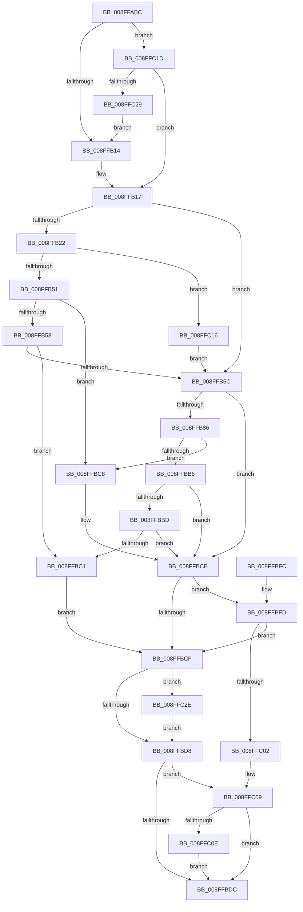

# CmCreateDevice

- RVA: `0x008FFABC`–`0x008FFC35` (길이 `377` bytes)
- VA: `0x00000001408FFABC`
- 실행 섹션: `PAGE`
- PDB 이름 있음: `예`; PDB Function 태그: `아니요`
- unwind 정보 RVA: `0x000883E8`
- 디코드: `114`개 명령, `377/377` bytes 표시
- 미해석 바이트: `0` (있으면 어셈블리에 `.byte`로 보존)

> 이 문서는 커널 이미지의 기계어와 PDB 기호를 분석해 생성했습니다. 4번과 5번은 함수 원형과 자료형을 바이너리 사용 방식에서 추정한 C 해석이며 원본 소스 복구 결과는 아닙니다.

## 1. Dependencies

- 직접 호출 지점: **6**; 고유 호출 대상: **5**
- 직접 호출자로 확인된 함수: **8**
- RIP 상대 이미지 참조: **1**

### Outgoing calls
- `0x008FFAFB` → [memset](../../text/6C/memset_function_006C6C40.md) (function, `0x006C6C40`)
- `0x008FFB41` → [guard_dispatch_icall](../../text/6B/guard_dispatch_icall_function_006BAAD0.md) (function, `0x006BAAD0`)
- `0x008FFB7A` → [CmCreateDeviceWorker](CmCreateDeviceWorker_function_008FFC3C.md) (function, `0x008FFC3C`)
- `0x008FFBAA` → [guard_dispatch_icall](../../text/6B/guard_dispatch_icall_function_006BAAD0.md) (function, `0x006BAAD0`)
- `0x008FFBE5` → [_security_check_cookie](../../text/6A/_security_check_cookie_function_006AC640.md) (function, `0x006AC640`)
- `0x008FFC2E` → [ZwClose](../../text/6A/ZwClose_function_006AD2B0.md) (function, `0x006AD2B0`)

### Direct callers
- [IoReportDetectedDevice](../72/IoReportDetectedDevice_function_00725CD0.md) at `0x00725F8C`
- [IoReportRootDevice](../72/IoReportRootDevice_function_00726780.md) at `0x0072693A`
- [PiDevCfgInitDriverDatabaseCallback](../73/PiDevCfgInitDriverDatabaseCallback_function_00733958.md) at `0x00733AD6`
- [PiCMGenerateDeviceInstance](../73/PiCMGenerateDeviceInstance_function_0073B69C.md) at `0x0073B8AF`
- [sub_008E200E](../8E/Unknown_function_008E200E.md) at `0x008E20DD`
- [PiCreateDeviceInstanceKey](PiCreateDeviceInstanceKey_function_008FFA0C.md) at `0x008FFA73`
- [PiCMCreateDevice](../AC/PiCMCreateDevice_function_00ACB824.md) at `0x00ACBAC6`
- [PiCMCreateDevice](../AC/PiCMCreateDevice_function_00ACB824.md) at `0x00ACBC19`
- [IopInitializePlugPlayServices](../../init/C2/IopInitializePlugPlayServices_function_00C2F298.md) at `0x00C2F989`

### Static image references
- `0x008FFAD3` → RVA `0x00E0A740` (`.data`; read)

## 2. Other-region calls and transfers

- 다른 실행 섹션으로 향하는 call: **5**
  - `0x008FFAFB` → [memset](../../text/6C/memset_function_006C6C40.md) (`PAGE` → `.text`)
  - `0x008FFB41` → [guard_dispatch_icall](../../text/6B/guard_dispatch_icall_function_006BAAD0.md) (`PAGE` → `.text`)
  - `0x008FFBAA` → [guard_dispatch_icall](../../text/6B/guard_dispatch_icall_function_006BAAD0.md) (`PAGE` → `.text`)
  - `0x008FFBE5` → [_security_check_cookie](../../text/6A/_security_check_cookie_function_006AC640.md) (`PAGE` → `.text`)
  - `0x008FFC2E` → [ZwClose](../../text/6A/ZwClose_function_006AD2B0.md) (`PAGE` → `.text`)
- 별도 외부 분기/꼬리 이동을 확인하지 못했습니다.

## 3. Assembly (complete function range)

```asm
008FFABC  40 55                           push rbp
008FFABE  53                              push rbx
008FFABF  56                              push rsi
008FFAC0  57                              push rdi
008FFAC1  41 54                           push r12
008FFAC3  41 56                           push r14
008FFAC5  41 57                           push r15
008FFAC7  48 8D 6C 24 E9                  lea rbp, [rsp - 0x17]
008FFACC  48 81 EC B0 00 00 00            sub rsp, 0xb0
008FFAD3  48 8B 05 66 AC 50 00            mov rax, qword ptr [rip + 0x50ac66]
008FFADA  48 33 C4                        xor rax, rsp
008FFADD  48 89 45 07                     mov qword ptr [rbp + 7], rax
008FFAE1  4C 8B 75 77                     mov r14, qword ptr [rbp + 0x77]
008FFAE5  4C 8B E2                        mov r12, rdx
008FFAE8  33 D2                           xor edx, edx
008FFAEA  41 8B D8                        mov ebx, r8d
008FFAED  4C 8B F9                        mov r15, rcx
008FFAF0  49 8B F9                        mov rdi, r9
008FFAF3  48 8D 4D A7                     lea rcx, [rbp - 0x59]
008FFAF7  44 8D 42 58                     lea r8d, [rdx + 0x58]
008FFAFB  E8 40 71 DC FF                  call 0x1406c6c40
008FFB00  49 8B B7 F8 01 00 00            mov rsi, qword ptr [r15 + 0x1f8]
008FFB07  B9 01 00 00 00                  mov ecx, 1
008FFB0C  85 DB                           test ebx, ebx
008FFB0E  0F 84 09 01 00 00               je 0x1408ffc1d
008FFB14  89 5D B7                        mov dword ptr [rbp - 0x49], ebx
008FFB17  8B 45 7F                        mov eax, dword ptr [rbp + 0x7f]
008FFB1A  89 45 CB                        mov dword ptr [rbp - 0x35], eax
008FFB1D  48 85 F6                        test rsi, rsi
008FFB20  74 3A                           je 0x1408ffb5c
008FFB22  48 8D 45 A7                     lea rax, [rbp - 0x59]
008FFB26  44 8B C1                        mov r8d, ecx
008FFB29  48 89 44 24 28                  mov qword ptr [rsp + 0x28], rax
008FFB2E  41 B9 02 00 00 00               mov r9d, 2
008FFB34  89 4C 24 20                     mov dword ptr [rsp + 0x20], ecx
008FFB38  49 8B D4                        mov rdx, r12
008FFB3B  49 8B CF                        mov rcx, r15
008FFB3E  48 8B C6                        mov rax, rsi
008FFB41  E8 8A AF DB FF                  call 0x1406baad0
008FFB46  3D 02 00 00 C0                  cmp eax, 0xc0000002
008FFB4B  0F 84 C5 00 00 00               je 0x1408ffc16
008FFB51  3D 20 01 00 C0                  cmp eax, 0xc0000120
008FFB56  74 70                           je 0x1408ffbc8
008FFB58  85 C0                           test eax, eax
008FFB5A  75 65                           jne 0x1408ffbc1
008FFB5C  8B 45 CB                        mov eax, dword ptr [rbp - 0x35]
008FFB5F  4C 8D 4D BF                     lea r9, [rbp - 0x41]
008FFB63  44 8B 45 B7                     mov r8d, dword ptr [rbp - 0x49]
008FFB67  49 8B D4                        mov rdx, r12
008FFB6A  89 44 24 28                     mov dword ptr [rsp + 0x28], eax
008FFB6E  49 8B CF                        mov rcx, r15
008FFB71  48 8D 45 C7                     lea rax, [rbp - 0x39]
008FFB75  48 89 44 24 20                  mov qword ptr [rsp + 0x20], rax
008FFB7A  E8 BD 00 00 00                  call 0x1408ffc3c
008FFB7F  8B D8                           mov ebx, eax
008FFB81  48 85 F6                        test rsi, rsi
008FFB84  74 45                           je 0x1408ffbcb
008FFB86  41 B9 02 00 00 00               mov r9d, 2
008FFB8C  89 45 A7                        mov dword ptr [rbp - 0x59], eax
008FFB8F  48 8D 45 A7                     lea rax, [rbp - 0x59]
008FFB93  49 8B D4                        mov rdx, r12
008FFB96  48 89 44 24 28                  mov qword ptr [rsp + 0x28], rax
008FFB9B  49 8B CF                        mov rcx, r15
008FFB9E  48 8B C6                        mov rax, rsi
008FFBA1  44 89 4C 24 20                  mov dword ptr [rsp + 0x20], r9d
008FFBA6  45 8D 41 FF                     lea r8d, [r9 - 1]
008FFBAA  E8 21 AF DB FF                  call 0x1406baad0
008FFBAF  3D 20 01 00 C0                  cmp eax, 0xc0000120
008FFBB4  74 12                           je 0x1408ffbc8
008FFBB6  3D 02 00 00 C0                  cmp eax, 0xc0000002
008FFBBB  74 0E                           je 0x1408ffbcb
008FFBBD  85 C0                           test eax, eax
008FFBBF  74 0A                           je 0x1408ffbcb
008FFBC1  BB E5 00 00 C0                  mov ebx, 0xc00000e5
008FFBC6  EB 07                           jmp 0x1408ffbcf
008FFBC8  8B 5D A7                        mov ebx, dword ptr [rbp - 0x59]
008FFBCB  85 DB                           test ebx, ebx
008FFBCD  79 2E                           jns 0x1408ffbfd
008FFBCF  48 8B 4D BF                     mov rcx, qword ptr [rbp - 0x41]
008FFBD3  48 85 C9                        test rcx, rcx
008FFBD6  75 56                           jne 0x1408ffc2e
008FFBD8  85 DB                           test ebx, ebx
008FFBDA  79 2D                           jns 0x1408ffc09
008FFBDC  8B C3                           mov eax, ebx
008FFBDE  48 8B 4D 07                     mov rcx, qword ptr [rbp + 7]
008FFBE2  48 33 CC                        xor rcx, rsp
008FFBE5  E8 56 CA DA FF                  call 0x1406ac640
008FFBEA  48 81 C4 B0 00 00 00            add rsp, 0xb0
008FFBF1  41 5F                           pop r15
008FFBF3  41 5E                           pop r14
008FFBF5  41 5C                           pop r12
008FFBF7  5F                              pop rdi
008FFBF8  5E                              pop rsi
008FFBF9  5B                              pop rbx
008FFBFA  5D                              pop rbp
008FFBFB  C3                              ret
008FFBFC  CC                              int3
008FFBFD  48 85 FF                        test rdi, rdi
008FFC00  74 CD                           je 0x1408ffbcf
008FFC02  48 8B 45 BF                     mov rax, qword ptr [rbp - 0x41]
008FFC06  48 89 07                        mov qword ptr [rdi], rax
008FFC09  4D 85 F6                        test r14, r14
008FFC0C  74 CE                           je 0x1408ffbdc
008FFC0E  8A 45 C7                        mov al, byte ptr [rbp - 0x39]
008FFC11  41 88 06                        mov byte ptr [r14], al
008FFC14  EB C6                           jmp 0x1408ffbdc
008FFC16  33 F6                           xor esi, esi
008FFC18  E9 3F FF FF FF                  jmp 0x1408ffb5c
008FFC1D  89 4D B7                        mov dword ptr [rbp - 0x49], ecx
008FFC20  48 85 FF                        test rdi, rdi
008FFC23  0F 84 EE FE FF FF               je 0x1408ffb17
008FFC29  E9 E6 FE FF FF                  jmp 0x1408ffb14
008FFC2E  E8 7D D6 DA FF                  call 0x1406ad2b0
008FFC33  EB A3                           jmp 0x1408ffbd8
```

## 4. C-style interpretation (structured pseudocode)

```c
__int64 __fastcall CmCreateDevice(__int64 a1, __int64 a2, int a3, __int64 a4, __int64 a5, unsigned int a6)
{
    __int64 result;
    __int64 v_rsi;
    __int64 v_rsp;
    unsigned __int64 v_stack_m48;
    unsigned __int64 v_stack_m4F;
    unsigned int v_stack_m84;
    unsigned __int64 v_stack_m88;
    unsigned __int64 v_stack_m90;
    unsigned int v_stack_m98;
    unsigned __int64 v_stack_mA8;
    unsigned __int64 v_stack_mC0;
    unsigned int v_stack_mC8;

    v_rsp = (v_rsp) - (176);
    result = (*(unsigned __int64 *)(v_rip + 5287014)) ^ (v_rsp);
    v_stack_m48 = result;
    a2 = 0;
    result = memset(v_stack_mA8, a2, a2 + 88, a4);
    if ((unsigned int)((unsigned int)(a3)) == 0) goto loc_008FFC1D;
loc_008FFB14:
    v_stack_m98 = (unsigned int)((unsigned int)(a3));
loc_008FFB17:
    v_stack_m84 = (unsigned int)((unsigned int)(a6));
    if (*(unsigned __int64 *)(a1 + 504) == 0) goto loc_008FFB5C;
    v_stack_mC0 = v_stack_mA8;
    v_stack_mC8 = 1;
    result = guard_dispatch_icall(a1, 0, 1, 2);
    if (((unsigned int)(result)) == 0xC0000002ULL) goto loc_008FFC16;
    if (((unsigned int)(result)) == 0xC0000120ULL) goto loc_008FFBC8;
    if ((unsigned int)(result) != 0) goto loc_008FFBC1;
loc_008FFB5C:
    v_stack_mC0 = (unsigned int)((unsigned int)(v_stack_m84));
    v_stack_mC8 = v_stack_m88;
    result = CmCreateDeviceWorker(a1, 0, (unsigned int)(v_stack_m98), v_stack_m90);
    if (*(unsigned __int64 *)(a1 + 504) == 0) goto loc_008FFBCB;
    v_stack_mA8 = (unsigned int)(result);
    v_stack_mC0 = v_stack_mA8;
    v_stack_mC8 = 2;
    result = guard_dispatch_icall(a1, 0, 2 - 1, 2);
    if (((unsigned int)(result)) == 0xC0000120ULL) goto loc_008FFBC8;
    if (((unsigned int)(result)) == 0xC0000002ULL) goto loc_008FFBCB;
    if ((unsigned int)(result) == 0) goto loc_008FFBCB;
loc_008FFBC1:
    goto loc_008FFBCF;
loc_008FFBC8:
loc_008FFBCB:
    if (!sign_flag) goto loc_008FFBFD;
loc_008FFBCF:
    if (v_stack_m90 != 0) goto loc_008FFC2E;
loc_008FFBD8:
    if (!sign_flag) goto loc_008FFC09;
loc_008FFBDC:
    a1 = (v_stack_m48) ^ (v_rsp);
    result = _security_check_cookie(a1, 0, 2 - 1, 2);
    v_rsp = (v_rsp) + (176);
    return result;
loc_008FFBFD:
    if (a4 == 0) goto loc_008FFBCF;
    *(unsigned __int64 *)(a4) = v_stack_m90;
loc_008FFC09:
    if (a5 == 0) goto loc_008FFBDC;
    *(unsigned __int8 *)(a5) = (unsigned __int8)(v_stack_m88);
    goto loc_008FFBDC;
loc_008FFC16:
    v_rsi = 0;
    goto loc_008FFB5C;
loc_008FFC1D:
    v_stack_m98 = (unsigned int)(a1);
    if (a4 == 0) goto loc_008FFB17;
    goto loc_008FFB14;
loc_008FFC2E:
    result = ZwClose(a1, 0, 2 - 1, 2);
    goto loc_008FFBD8;
}
```

## 5. (Beta) C Style

```c
int64_t CmCreateDevice(void *Arg1, int64_t Arg2, int32_t Arg3, int64_t Arg4, int64_t Arg5, uint32_t Arg6)
{
    uint8_t *arg1 = (uint8_t *)Arg1;

    int64_t result;
    int64_t local_rsi;
    int64_t local_rsp;
    uint64_t v_stack_m48;
    uint64_t v_stack_m4F;
    uint32_t v_stack_m84;
    uint64_t v_stack_m88;
    uint64_t v_stack_m90;
    uint32_t v_stack_m98;
    uint64_t v_stack_mA8;
    uint64_t v_stack_mC0;
    uint32_t v_stack_mC8;

    local_rsp = (local_rsp) - (176);
    result = (*(uint64_t *)(v_rip + 0x50AC66)) ^ (local_rsp);
    v_stack_m48 = result;
    Arg2 = 0;
    result = memset(v_stack_mA8, Arg2, Arg2 + 88, Arg4);
    if ((uint32_t)((uint32_t)(Arg3)) == 0) goto loc_008FFC1D;
loc_008FFB14:
    v_stack_m98 = (uint32_t)((uint32_t)(Arg3));
loc_008FFB17:
    v_stack_m84 = (uint32_t)((uint32_t)(Arg6));
    if (*(uint64_t *)(arg1 + 0x1F8) == 0) goto loc_008FFB5C;
    v_stack_mC0 = v_stack_mA8;
    v_stack_mC8 = 1;
    result = guard_dispatch_icall(Arg1, 0, 1, 2);
    if (((uint32_t)(result)) == 0xC0000002ULL) goto loc_008FFC16;
    if (((uint32_t)(result)) == 0xC0000120ULL) goto loc_008FFBC8;
    if ((uint32_t)(result) != 0) goto loc_008FFBC1;
loc_008FFB5C:
    v_stack_mC0 = (uint32_t)((uint32_t)(v_stack_m84));
    v_stack_mC8 = v_stack_m88;
    result = CmCreateDeviceWorker(Arg1, 0, (uint32_t)(v_stack_m98), v_stack_m90);
    if (*(uint64_t *)(arg1 + 0x1F8) == 0) goto loc_008FFBCB;
    v_stack_mA8 = (uint32_t)(result);
    v_stack_mC0 = v_stack_mA8;
    v_stack_mC8 = 2;
    result = guard_dispatch_icall(Arg1, 0, 2 - 1, 2);
    if (((uint32_t)(result)) == 0xC0000120ULL) goto loc_008FFBC8;
    if (((uint32_t)(result)) == 0xC0000002ULL) goto loc_008FFBCB;
    if ((uint32_t)(result) == 0) goto loc_008FFBCB;
loc_008FFBC1:
    goto loc_008FFBCF;
loc_008FFBC8:
loc_008FFBCB:
    if (!sign_flag) goto loc_008FFBFD;
loc_008FFBCF:
    if (v_stack_m90 != 0) goto loc_008FFC2E;
loc_008FFBD8:
    if (!sign_flag) goto loc_008FFC09;
loc_008FFBDC:
    Arg1 = (v_stack_m48) ^ (local_rsp);
    result = _security_check_cookie(Arg1, 0, 2 - 1, 2);
    local_rsp = (local_rsp) + (176);
    return result;
loc_008FFBFD:
    if (Arg4 == 0) goto loc_008FFBCF;
    *(uint64_t *)(Arg4) = v_stack_m90;
loc_008FFC09:
    if (Arg5 == 0) goto loc_008FFBDC;
    *(uint8_t *)(Arg5) = (uint8_t)(v_stack_m88);
    goto loc_008FFBDC;
loc_008FFC16:
    local_rsi = 0;
    goto loc_008FFB5C;
loc_008FFC1D:
    v_stack_m98 = (uint32_t)(Arg1);
    if (Arg4 == 0) goto loc_008FFB17;
    goto loc_008FFB14;
loc_008FFC2E:
    result = ZwClose(Arg1, 0, 2 - 1, 2);
    goto loc_008FFBD8;
}
```

### 관측된 메모리 오프셋

구조체 형식이 확인되지 않은 접근은 인자 기준의 오프셋으로만 기록했습니다.

| 기준 인자 | 오프셋 표현 | 폭 (bit) | 접근 |
|---|---:|---:|---|
| `Arg1` | `+ 0x1F8` | `64` | `R` |

## 6. Execution-region graph

[열기: 2D/3D 그래프와 함수 탐색 컨트롤 패널](../../../control-panel.html?section=page&rva=0x008FFABC&view=graph)

- 2D 그래프는 위에서 아래로 흐르고, 3D 그래프는 빈 공간을 드래그해 회전합니다. Shift+드래그는 이동, 휠은 확대·축소, 함수 노드 선택은 대상 보고서 이동입니다.

### Static fallback


