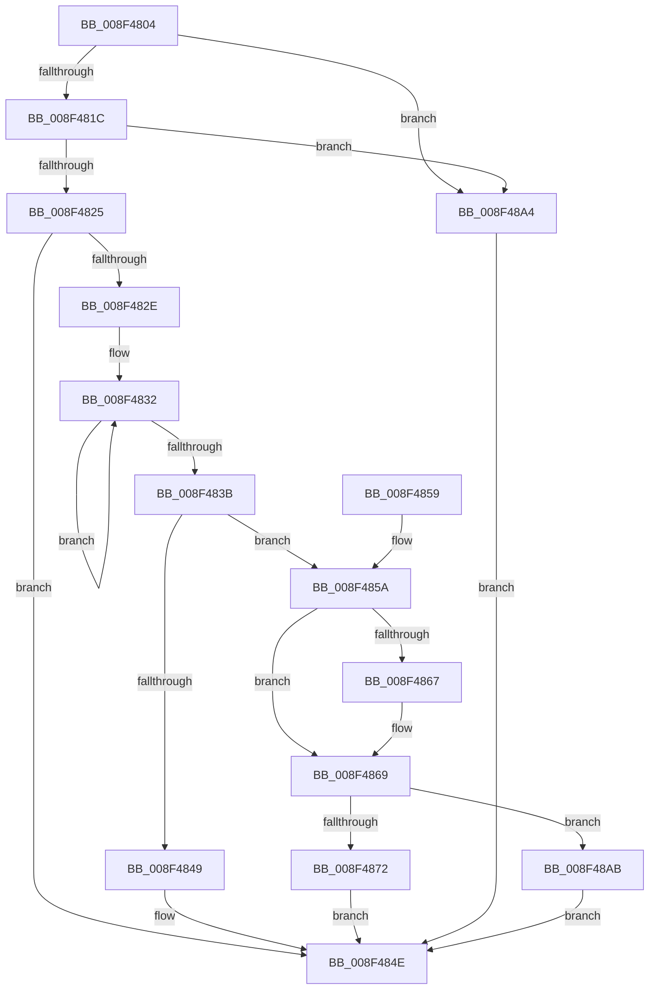

# CmGetDeviceContainerRegKeyPath

- RVA: `0x008F4804`–`0x008F48B2` (길이 `174` bytes)
- VA: `0x00000001408F4804`
- 실행 섹션: `PAGE`
- PDB 이름 있음: `예`; PDB Function 태그: `아니요`
- unwind 정보 RVA: `0x00087710`
- 디코드: `46`개 명령, `174/174` bytes 표시
- 미해석 바이트: `0` (있으면 어셈블리에 `.byte`로 보존)

> 이 문서는 커널 이미지의 기계어와 PDB 기호를 분석해 생성했습니다. 4번과 5번은 함수 원형과 자료형을 바이너리 사용 방식에서 추정한 C 해석이며 원본 소스 복구 결과는 아닙니다.

## 1. Dependencies

- 직접 호출 지점: **2**; 고유 호출 대상: **2**
- 직접 호출자로 확인된 함수: **3**
- RIP 상대 이미지 참조: **1**

### Outgoing calls
- `0x008F4825` → [CmValidateDeviceContainerName](CmValidateDeviceContainerName_function_008F48B8.md) (function, `0x008F48B8`)
- `0x008F489D` → [RtlStringCchPrintfExW](../../text/42/RtlStringCchPrintfExW_function_0042B390.md) (function, `0x0042B390`)

### Direct callers
- [CmDeleteDeviceContainerRegKeyWorker](../82/CmDeleteDeviceContainerRegKeyWorker_function_0082B15C.md) at `0x0082B1F7`
- [CmOpenDeviceContainerRegKeyWorker](CmOpenDeviceContainerRegKeyWorker_function_008F4904.md) at `0x008F499F`
- [PiDqGetRelativeObjectRegPath](../99/PiDqGetRelativeObjectRegPath_function_00990B6C.md) at `0x00990C45`

### Static image references
- `0x008F4879` → RVA `0x00B0D720` (` ?? ::NNGAKEGL::`string'`; read)

## 2. Other-region calls and transfers

- 다른 실행 섹션으로 향하는 call: **1**
  - `0x008F489D` → [RtlStringCchPrintfExW](../../text/42/RtlStringCchPrintfExW_function_0042B390.md) (`PAGE` → `.text`)
- 별도 외부 분기/꼬리 이동을 확인하지 못했습니다.

## 3. Assembly (complete function range)

```asm
008F4804  48 89 5C 24 08                  mov qword ptr [rsp + 8], rbx
008F4809  57                              push rdi
008F480A  48 83 EC 40                     sub rsp, 0x40
008F480E  33 FF                           xor edi, edi
008F4810  48 8B DA                        mov rbx, rdx
008F4813  45 85 C0                        test r8d, r8d
008F4816  0F 84 88 00 00 00               je 0x1408f48a4
008F481C  41 F7 C0 AF FE FF FF            test r8d, 0xfffffeaf
008F4823  75 7F                           jne 0x1408f48a4
008F4825  E8 8E 00 00 00                  call 0x1408f48b8
008F482A  85 C0                           test eax, eax
008F482C  78 20                           js 0x1408f484e
008F482E  48 83 C8 FF                     or rax, 0xffffffffffffffff
008F4832  48 FF C0                        inc rax
008F4835  66 39 3C 43                     cmp word ptr [rbx + rax*2], di
008F4839  75 F7                           jne 0x1408f4832
008F483B  48 83 C0 33                     add rax, 0x33
008F483F  B9 FF FF FF FF                  mov ecx, 0xffffffff
008F4844  48 3B C1                        cmp rax, rcx
008F4847  76 11                           jbe 0x1408f485a
008F4849  B8 95 00 00 C0                  mov eax, 0xc0000095
008F484E  48 8B 5C 24 50                  mov rbx, qword ptr [rsp + 0x50]
008F4853  48 83 C4 40                     add rsp, 0x40
008F4857  5F                              pop rdi
008F4858  C3                              ret
008F4859  CC                              int3
008F485A  48 8B 8C 24 88 00 00 00         mov rcx, qword ptr [rsp + 0x88]
008F4862  48 85 C9                        test rcx, rcx
008F4865  74 02                           je 0x1408f4869
008F4867  89 01                           mov dword ptr [rcx], eax
008F4869  3B 84 24 80 00 00 00            cmp eax, dword ptr [rsp + 0x80]
008F4870  77 39                           ja 0x1408f48ab
008F4872  8B 94 24 80 00 00 00            mov edx, dword ptr [rsp + 0x80]
008F4879  48 8D 05 A0 8E 21 00            lea rax, [rip + 0x218ea0]
008F4880  48 8B 4C 24 78                  mov rcx, qword ptr [rsp + 0x78]
008F4885  45 33 C9                        xor r9d, r9d
008F4888  48 89 5C 24 30                  mov qword ptr [rsp + 0x30], rbx
008F488D  45 33 C0                        xor r8d, r8d
008F4890  48 89 44 24 28                  mov qword ptr [rsp + 0x28], rax
008F4895  C7 44 24 20 00 08 00 00         mov dword ptr [rsp + 0x20], 0x800
008F489D  E8 EE 6A B3 FF                  call 0x14042b390
008F48A2  EB AA                           jmp 0x1408f484e
008F48A4  B8 0D 00 00 C0                  mov eax, 0xc000000d
008F48A9  EB A3                           jmp 0x1408f484e
008F48AB  B8 23 00 00 C0                  mov eax, 0xc0000023
008F48B0  EB 9C                           jmp 0x1408f484e
```

## 4. C-style interpretation (structured pseudocode)

```c
__int64 __fastcall CmGetDeviceContainerRegKeyPath(__int64 a1, __int64 a2, int a3, int a4, __int64 a5, __int64 a6, unsigned int a7, __int64 a8)
{
    __int64 result;
    __int64 v_rdi;
    __int64 v_rsp;
    unsigned int v_stack_p20;
    unsigned __int64 v_stack_p28;
    unsigned __int64 v_stack_p30;
    unsigned __int64 v_stack_p8;

    v_stack_p8 = v_rbx;
    v_rsp = (v_rsp) - (64);
    v_rdi = 0;
    if (a3 == 0) goto loc_008F48A4;
    if (((a3) & (0xFFFFFEAFULL)) != 0) goto loc_008F48A4;
    result = CmValidateDeviceContainerName(a1, a2, a3, a4);
    if (sign_flag) goto loc_008F484E;
    result = (result) | (-1);
loc_008F4832:
    result = (result) + 1;
    if ((*(unsigned __int16 *)(a2 + result * 2)) != 0) goto loc_008F4832;
    result = (result) + (51);
    if (result <= ((unsigned int)(0xFFFFFFFFULL))) goto loc_008F485A;
loc_008F484E:
    v_rsp = (v_rsp) + (64);
    return (unsigned int)(0xC0000095ULL);
loc_008F485A:
    if (a8 != 0) {
        *(unsigned int *)(a8) = (unsigned int)((unsigned int)(0xC0000095ULL));
    }
    if (((unsigned int)((unsigned int)(0xC0000095ULL))) > a7) goto loc_008F48AB;
    a4 = 0;
    v_stack_p30 = v_stack_p8;
    a3 = 0;
    v_stack_p28 = v_rip + 2199200;
    v_stack_p20 = 0x800ULL;
    result = RtlStringCchPrintfExW(a6, (unsigned int)(a7), a3, a4);
    goto loc_008F484E;
loc_008F48A4:
    goto loc_008F484E;
loc_008F48AB:
    goto loc_008F484E;
}
```

## 5. (Beta) C Style

```c
int64_t CmGetDeviceContainerRegKeyPath(int64_t Arg1, void *Arg2, int32_t Arg3, int32_t Arg4, uint64_t Arg5, int64_t Arg6, uint32_t Arg7, int64_t Arg8)
{
    uint8_t *arg2 = (uint8_t *)Arg2;

    int64_t result;
    int64_t local_rdi;
    int64_t local_rsp;
    uint32_t v_stack_p20;
    uint64_t v_stack_p28;
    uint64_t v_stack_p30;
    uint64_t v_stack_p8;

    v_stack_p8 = local_rbx;
    local_rsp = (local_rsp) - (64);
    local_rdi = 0;
    if (Arg3 == 0) goto loc_008F48A4;
    if (((Arg3) & (0xFFFFFEAFULL)) != 0) goto loc_008F48A4;
    result = CmValidateDeviceContainerName(Arg1, Arg2, Arg3, Arg4);
    if (sign_flag) goto loc_008F484E;
    result = (result) | (-1);
loc_008F4832:
    result = (result) + 1;
    if ((*(uint16_t *)(arg2 + result * 2)) != 0) goto loc_008F4832;
    result = (result) + (51);
    if (result <= ((uint32_t)(0xFFFFFFFFULL))) goto loc_008F485A;
loc_008F484E:
    local_rsp = (local_rsp) + (64);
    return (uint32_t)(0xC0000095ULL);
loc_008F485A:
    if (Arg8 != 0) {
        *(uint32_t *)(Arg8) = (uint32_t)((uint32_t)(0xC0000095ULL));
    }
    if (((uint32_t)((uint32_t)(0xC0000095ULL))) > Arg7) goto loc_008F48AB;
    Arg4 = 0;
    v_stack_p30 = v_stack_p8;
    Arg3 = 0;
    v_stack_p28 = v_rip + 2199200;
    v_stack_p20 = 0x800ULL;
    result = RtlStringCchPrintfExW(Arg6, (uint32_t)(Arg7), Arg3, Arg4);
    goto loc_008F484E;
loc_008F48A4:
    goto loc_008F484E;
loc_008F48AB:
    goto loc_008F484E;
}
```

### 관측된 메모리 오프셋

구조체 형식이 확인되지 않은 접근은 인자 기준의 오프셋으로만 기록했습니다.

| 기준 인자 | 오프셋 표현 | 폭 (bit) | 접근 |
|---|---:|---:|---|
| `Arg2` | `+ 0x0 + rax*2` | `16` | `R` |

## 6. Execution-region graph

[열기: 2D/3D 그래프와 함수 탐색 컨트롤 패널](../../../control-panel.html?section=page&rva=0x008F4804&view=graph)

- 2D 그래프는 위에서 아래로 흐르고, 3D 그래프는 빈 공간을 드래그해 회전합니다. Shift+드래그는 이동, 휠은 확대·축소, 함수 노드 선택은 대상 보고서 이동입니다.

### Static fallback


