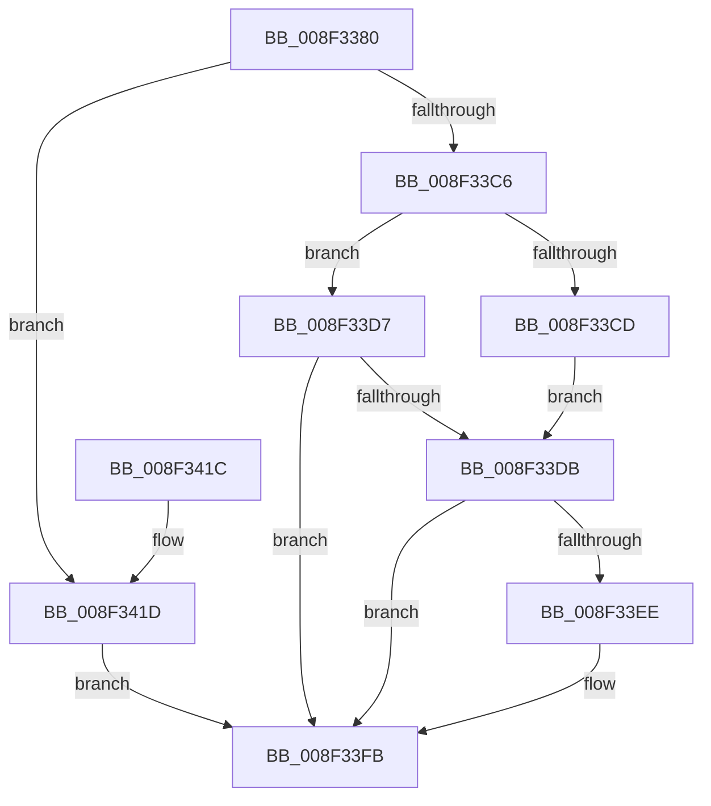

# CmGetDeviceInterfaceClassGuid

- RVA: `0x008F3380`–`0x008F3424` (길이 `164` bytes)
- VA: `0x00000001408F3380`
- 실행 섹션: `PAGE`
- PDB 이름 있음: `예`; PDB Function 태그: `아니요`
- unwind 정보 RVA: `0x000875E4`
- 디코드: `41`개 명령, `164/164` bytes 표시
- 미해석 바이트: `0` (있으면 어셈블리에 `.byte`로 보존)

> 이 문서는 커널 이미지의 기계어와 PDB 기호를 분석해 생성했습니다. 4번과 5번은 함수 원형과 자료형을 바이너리 사용 방식에서 추정한 C 해석이며 원본 소스 복구 결과는 아닙니다.

## 1. Dependencies

- 직접 호출 지점: **4**; 고유 호출 대상: **4**
- 직접 호출자로 확인된 함수: **3**
- RIP 상대 이미지 참조: **1**

### Outgoing calls
- `0x008F33BD` → [CmGetDeviceInterfaceSubkeyPath](CmGetDeviceInterfaceSubkeyPath_function_008F1010.md) (function, `0x008F1010`)
- `0x008F33E5` → [RtlInitUnicodeStringEx](../../text/46/RtlInitUnicodeStringEx_function_00463960.md) (function, `0x00463960`)
- `0x008F33F6` → [RtlGUIDFromString](RtlGUIDFromString_function_008F1EF0.md) (function, `0x008F1EF0`)
- `0x008F3406` → [_security_check_cookie](../../text/6A/_security_check_cookie_function_006AC640.md) (function, `0x006AC640`)

### Direct callers
- [CmGetDeviceInterfaceMappedPropertyFromComposite](CmGetDeviceInterfaceMappedPropertyFromComposite_function_008F3D70.md) at `0x008F3E2E`
- [IopProcessSetInterfaceState](../95/IopProcessSetInterfaceState_function_00950964.md) at `0x00950AA0`
- [sub_00B1C3F8](../B1/Unknown_function_00B1C3F8.md) at `0x00B1C400`

### Static image references
- `0x008F338D` → RVA `0x00E0A740` (`.data`; read)

## 2. Other-region calls and transfers

- 다른 실행 섹션으로 향하는 call: **2**
  - `0x008F33E5` → [RtlInitUnicodeStringEx](../../text/46/RtlInitUnicodeStringEx_function_00463960.md) (`PAGE` → `.text`)
  - `0x008F3406` → [_security_check_cookie](../../text/6A/_security_check_cookie_function_006AC640.md) (`PAGE` → `.text`)
- 별도 외부 분기/꼬리 이동을 확인하지 못했습니다.

## 3. Assembly (complete function range)

```asm
008F3380  48 89 5C 24 08                  mov qword ptr [rsp + 8], rbx
008F3385  57                              push rdi
008F3386  48 81 EC B0 00 00 00            sub rsp, 0xb0
008F338D  48 8B 05 AC 73 51 00            mov rax, qword ptr [rip + 0x5173ac]
008F3394  48 33 C4                        xor rax, rsp
008F3397  48 89 84 24 A0 00 00 00         mov qword ptr [rsp + 0xa0], rax
008F339F  33 FF                           xor edi, edi
008F33A1  4C 8D 4C 24 50                  lea r9, [rsp + 0x50]
008F33A6  49 8B D8                        mov rbx, r8
008F33A9  89 7C 24 28                     mov dword ptr [rsp + 0x28], edi
008F33AD  0F 57 C0                        xorps xmm0, xmm0
008F33B0  48 89 7C 24 20                  mov qword ptr [rsp + 0x20], rdi
008F33B5  41 B0 01                        mov r8b, 1
008F33B8  0F 11 44 24 40                  movups xmmword ptr [rsp + 0x40], xmm0
008F33BD  E8 4E DC FF FF                  call 0x1408f1010
008F33C2  85 C0                           test eax, eax
008F33C4  74 57                           je 0x1408f341d
008F33C6  3D 23 00 00 C0                  cmp eax, 0xc0000023
008F33CB  75 0A                           jne 0x1408f33d7
008F33CD  66 89 BC 24 9C 00 00 00         mov word ptr [rsp + 0x9c], di
008F33D5  EB 04                           jmp 0x1408f33db
008F33D7  85 C0                           test eax, eax
008F33D9  78 20                           js 0x1408f33fb
008F33DB  48 8D 54 24 50                  lea rdx, [rsp + 0x50]
008F33E0  48 8D 4C 24 40                  lea rcx, [rsp + 0x40]
008F33E5  E8 76 05 B7 FF                  call 0x140463960
008F33EA  85 C0                           test eax, eax
008F33EC  78 0D                           js 0x1408f33fb
008F33EE  48 8B D3                        mov rdx, rbx
008F33F1  48 8D 4C 24 40                  lea rcx, [rsp + 0x40]
008F33F6  E8 F5 EA FF FF                  call 0x1408f1ef0
008F33FB  48 8B 8C 24 A0 00 00 00         mov rcx, qword ptr [rsp + 0xa0]
008F3403  48 33 CC                        xor rcx, rsp
008F3406  E8 35 92 DB FF                  call 0x1406ac640
008F340B  48 8B 9C 24 C0 00 00 00         mov rbx, qword ptr [rsp + 0xc0]
008F3413  48 81 C4 B0 00 00 00            add rsp, 0xb0
008F341A  5F                              pop rdi
008F341B  C3                              ret
008F341C  CC                              int3
008F341D  B8 E5 00 00 C0                  mov eax, 0xc00000e5
008F3422  EB D7                           jmp 0x1408f33fb
```

## 4. C-style interpretation (structured pseudocode)

```c
__int64 __fastcall CmGetDeviceInterfaceClassGuid(__int64 a1, __int64 a2, __int64 a3)
{
    __int64 result;
    __int64 v_rdi;
    __int64 v_rsp;
    unsigned __int64 v_stack_m18;
    unsigned __int16 v_stack_m1C;
    unsigned __int64 v_stack_m68;
    unsigned __int64 v_stack_m78;
    unsigned int v_stack_m90;
    unsigned __int64 v_stack_m98;
    unsigned __int64 v_stack_p8;

    v_stack_p8 = v_rbx;
    v_rsp = (v_rsp) - (176);
    result = (*(unsigned __int64 *)(v_rip + 5338028)) ^ (v_rsp);
    v_stack_m18 = result;
    v_rdi = 0;
    v_stack_m90 = 0;
    v_stack_m98 = 0;
    v_stack_m78 = v_xmm0;
    result = CmGetDeviceInterfaceSubkeyPath(a1, a2, 1, v_stack_m68);
    if ((unsigned int)(result) == 0) goto loc_008F341D;
    if (((unsigned int)(result)) != 0xC0000023ULL) goto loc_008F33D7;
    v_stack_m1C = 0;
    goto loc_008F33DB;
loc_008F33D7:
    if (sign_flag) goto loc_008F33FB;
loc_008F33DB:
    result = RtlInitUnicodeStringEx(v_stack_m78, v_stack_m68, 1, v_stack_m68);
    if (!(sign_flag)) {
        a2 = a3;
        a1 = v_stack_m78;
        result = RtlGUIDFromString(a1, a2, 1, v_stack_m68);
    }
    a1 = (v_stack_m18) ^ (v_rsp);
    result = _security_check_cookie(a1, a2, 1, v_stack_m68);
    v_rsp = (v_rsp) + (176);
    return result;
loc_008F341D:
    goto loc_008F33FB;
}
```

## 5. (Beta) C Style

```c
int64_t CmGetDeviceInterfaceClassGuid(int64_t Arg1, int64_t Arg2, int64_t Arg3)
{
    int64_t result;
    int64_t local_rdi;
    int64_t local_rsp;
    uint64_t v_stack_m18;
    uint16_t v_stack_m1C;
    uint64_t v_stack_m68;
    uint64_t v_stack_m78;
    uint32_t v_stack_m90;
    uint64_t v_stack_m98;
    uint64_t v_stack_p8;

    v_stack_p8 = local_rbx;
    local_rsp = (local_rsp) - (176);
    result = (*(uint64_t *)(v_rip + 0x5173AC)) ^ (local_rsp);
    v_stack_m18 = result;
    local_rdi = 0;
    v_stack_m90 = 0;
    v_stack_m98 = 0;
    v_stack_m78 = v_xmm0;
    result = CmGetDeviceInterfaceSubkeyPath(Arg1, Arg2, 1, v_stack_m68);
    if ((uint32_t)(result) == 0) goto loc_008F341D;
    if (((uint32_t)(result)) != 0xC0000023ULL) goto loc_008F33D7;
    v_stack_m1C = 0;
    goto loc_008F33DB;
loc_008F33D7:
    if (sign_flag) goto loc_008F33FB;
loc_008F33DB:
    result = RtlInitUnicodeStringEx(v_stack_m78, v_stack_m68, 1, v_stack_m68);
    if (!(sign_flag)) {
        Arg2 = Arg3;
        Arg1 = v_stack_m78;
        result = RtlGUIDFromString(Arg1, Arg2, 1, v_stack_m68);
    }
    Arg1 = (v_stack_m18) ^ (local_rsp);
    result = _security_check_cookie(Arg1, Arg2, 1, v_stack_m68);
    local_rsp = (local_rsp) + (176);
    return result;
loc_008F341D:
    goto loc_008F33FB;
}
```

## 6. Execution-region graph

[열기: 2D/3D 그래프와 함수 탐색 컨트롤 패널](../../../control-panel.html?section=page&rva=0x008F3380&view=graph)

- 2D 그래프는 위에서 아래로 흐르고, 3D 그래프는 빈 공간을 드래그해 회전합니다. Shift+드래그는 이동, 휠은 확대·축소, 함수 노드 선택은 대상 보고서 이동입니다.

### Static fallback


