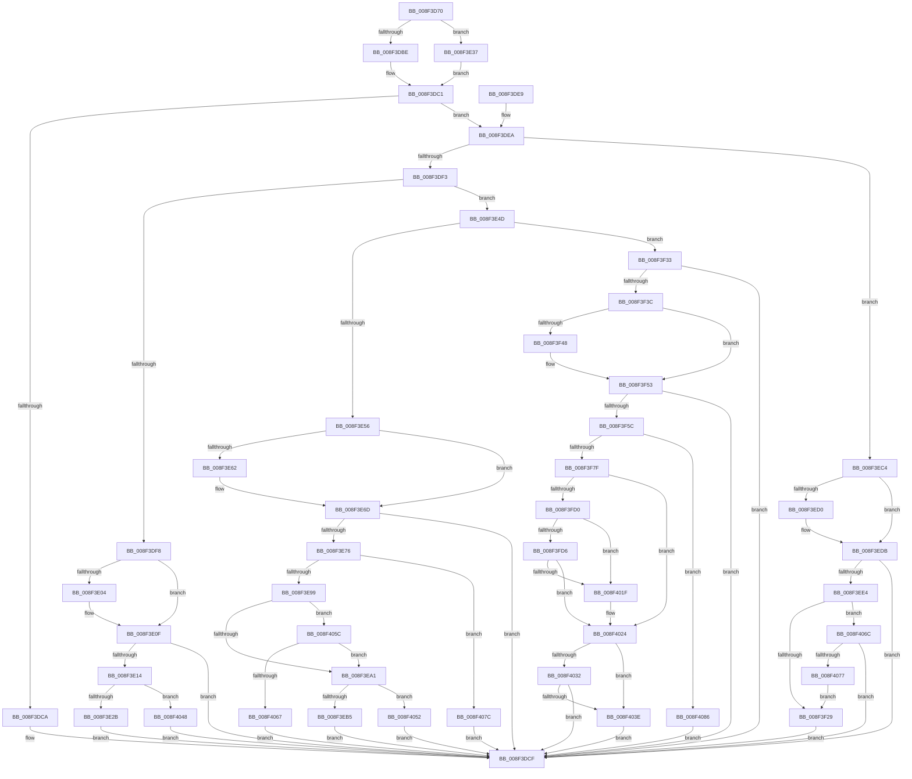

# CmGetDeviceInterfaceMappedPropertyFromComposite

- RVA: `0x008F3D70`–`0x008F4090` (길이 `800` bytes)
- VA: `0x00000001408F3D70`
- 실행 섹션: `PAGE`
- PDB 이름 있음: `예`; PDB Function 태그: `아니요`
- unwind 정보 RVA: `0x000876B0`
- 디코드: `201`개 명령, `800/800` bytes 표시
- 미해석 바이트: `0` (있으면 어셈블리에 `.byte`로 보존)

> 이 문서는 커널 이미지의 기계어와 PDB 기호를 분석해 생성했습니다. 4번과 5번은 함수 원형과 자료형을 바이너리 사용 방식에서 추정한 C 해석이며 원본 소스 복구 결과는 아닙니다.

## 1. Dependencies

- 직접 호출 지점: **7**; 고유 호출 대상: **5**
- 직접 호출자로 확인된 함수: **2**
- RIP 상대 이미지 참조: **10**

### Outgoing calls
- `0x008F3E2E` → [CmGetDeviceInterfaceClassGuid](CmGetDeviceInterfaceClassGuid_function_008F3380.md) (function, `0x008F3380`)
- `0x008F3E87` → [CmGetDeviceInterfaceReferenceString](CmGetDeviceInterfaceReferenceString_function_008F5AF8.md) (function, `0x008F5AF8`)
- `0x008F3F1A` → [PnpGetObjectProperty](../8E/PnpGetObjectProperty_function_008E2180.md) (function, `0x008E2180`)
- `0x008F3F6E` → [ExAllocatePool2](../../poolcode/B8/ExAllocatePool2_function_00B820F0.md) (function, `0x00B820F0`)
- `0x008F3FC5` → [PnpGetObjectProperty](../8E/PnpGetObjectProperty_function_008E2180.md) (function, `0x008E2180`)
- `0x008F4011` → [PnpGetObjectProperty](../8E/PnpGetObjectProperty_function_008E2180.md) (function, `0x008E2180`)
- `0x008F4029` → [ExFreePoolWithTag](../../poolcode/B8/ExFreePoolWithTag_function_00B82870.md) (function, `0x00B82870`)

### Direct callers
- [_PnpDispatchDeviceInterface](../8E/_PnpDispatchDeviceInterface_function_008E0DB0.md) at `0x008E0F65`
- [CmGetDeviceInterfaceMappedPropertyKeys](CmGetDeviceInterfaceMappedPropertyKeys_function_008F50AC.md) at `0x008F5212`

### Static image references
- `0x008F3DFB` → RVA `0x000114B8` (`.rdata`; read)
- `0x008F3E08` → RVA `0x000114C0` (`.rdata`; read)
- `0x008F3E59` → RVA `0x00011510` (`.rdata`; read)
- `0x008F3E66` → RVA `0x00011518` (`.rdata`; read)
- `0x008F3EC7` → RVA `0x00014080` (`.rdata`; read)
- `0x008F3ED4` → RVA `0x00014088` (`.rdata`; read)
- `0x008F3EF9` → RVA `0x000114F8` (`.rdata`; read)
- `0x008F3F3F` → RVA `0x00011568` (`.rdata`; read)
- `0x008F3F4C` → RVA `0x00011570` (`.rdata`; read)
- `0x008F3FB3` → RVA `0x00011490` (`.rdata`; read)

## 2. Other-region calls and transfers

- 다른 실행 섹션으로 향하는 call: **2**
  - `0x008F3F6E` → [ExAllocatePool2](../../poolcode/B8/ExAllocatePool2_function_00B820F0.md) (`PAGE` → `POOLCODE`)
  - `0x008F4029` → [ExFreePoolWithTag](../../poolcode/B8/ExFreePoolWithTag_function_00B82870.md) (`PAGE` → `POOLCODE`)
- 별도 외부 분기/꼬리 이동을 확인하지 못했습니다.

## 3. Assembly (complete function range)

```asm
008F3D70  48 89 5C 24 10                  mov qword ptr [rsp + 0x10], rbx
008F3D75  4C 89 44 24 18                  mov qword ptr [rsp + 0x18], r8
008F3D7A  48 89 4C 24 08                  mov qword ptr [rsp + 8], rcx
008F3D7F  55                              push rbp
008F3D80  56                              push rsi
008F3D81  57                              push rdi
008F3D82  41 54                           push r12
008F3D84  41 55                           push r13
008F3D86  41 56                           push r14
008F3D88  41 57                           push r15
008F3D8A  48 8B EC                        mov rbp, rsp
008F3D8D  48 83 EC 70                     sub rsp, 0x70
008F3D91  4C 8B 65 60                     mov r12, qword ptr [rbp + 0x60]
008F3D95  45 33 FF                        xor r15d, r15d
008F3D98  48 8B 75 78                     mov rsi, qword ptr [rbp + 0x78]
008F3D9C  4C 8B EA                        mov r13, rdx
008F3D9F  4C 8B 75 68                     mov r14, qword ptr [rbp + 0x68]
008F3DA3  41 8B DF                        mov ebx, r15d
008F3DA6  44 89 7D 58                     mov dword ptr [rbp + 0x58], r15d
008F3DAA  45 89 3C 24                     mov dword ptr [r12], r15d
008F3DAE  44 89 3E                        mov dword ptr [rsi], r15d
008F3DB1  44 89 7D F0                     mov dword ptr [rbp - 0x10], r15d
008F3DB5  44 89 7D F4                     mov dword ptr [rbp - 0xc], r15d
008F3DB9  4D 85 F6                        test r14, r14
008F3DBC  75 79                           jne 0x1408f3e37
008F3DBE  41 8B FF                        mov edi, r15d
008F3DC1  41 8B 41 10                     mov eax, dword ptr [r9 + 0x10]
008F3DC5  83 F8 02                        cmp eax, 2
008F3DC8  73 20                           jae 0x1408f3dea
008F3DCA  BB 30 02 00 C0                  mov ebx, 0xc0000230
008F3DCF  8B C3                           mov eax, ebx
008F3DD1  48 8B 9C 24 B8 00 00 00         mov rbx, qword ptr [rsp + 0xb8]
008F3DD9  48 83 C4 70                     add rsp, 0x70
008F3DDD  41 5F                           pop r15
008F3DDF  41 5E                           pop r14
008F3DE1  41 5D                           pop r13
008F3DE3  41 5C                           pop r12
008F3DE5  5F                              pop rdi
008F3DE6  5E                              pop rsi
008F3DE7  5D                              pop rbp
008F3DE8  C3                              ret
008F3DE9  CC                              int3
008F3DEA  83 F8 0A                        cmp eax, 0xa
008F3DED  0F 84 D1 00 00 00               je 0x1408f3ec4
008F3DF3  83 F8 04                        cmp eax, 4
008F3DF6  75 55                           jne 0x1408f3e4d
008F3DF8  49 8B 01                        mov rax, qword ptr [r9]
008F3DFB  48 2B 05 B6 D6 71 FF            sub rax, qword ptr [rip - 0x8e294a]
008F3E02  75 0B                           jne 0x1408f3e0f
008F3E04  49 8B 41 08                     mov rax, qword ptr [r9 + 8]
008F3E08  48 2B 05 B1 D6 71 FF            sub rax, qword ptr [rip - 0x8e294f]
008F3E0F  48 85 C0                        test rax, rax
008F3E12  75 BB                           jne 0x1408f3dcf
008F3E14  C7 06 10 00 00 00               mov dword ptr [rsi], 0x10
008F3E1A  41 C7 04 24 0D 00 00 00         mov dword ptr [r12], 0xd
008F3E22  83 FF 10                        cmp edi, 0x10
008F3E25  0F 82 1D 02 00 00               jb 0x1408f4048
008F3E2B  4D 8B C6                        mov r8, r14
008F3E2E  E8 4D F5 FF FF                  call 0x1408f3380
008F3E33  8B D8                           mov ebx, eax
008F3E35  EB 98                           jmp 0x1408f3dcf
008F3E37  8B 7D 70                        mov edi, dword ptr [rbp + 0x70]
008F3E3A  8B C7                           mov eax, edi
008F3E3C  F7 D8                           neg eax
008F3E3E  48 1B C9                        sbb rcx, rcx
008F3E41  4C 23 F1                        and r14, rcx
008F3E44  48 8B 4D 40                     mov rcx, qword ptr [rbp + 0x40]
008F3E48  E9 74 FF FF FF                  jmp 0x1408f3dc1
008F3E4D  83 F8 05                        cmp eax, 5
008F3E50  0F 85 DD 00 00 00               jne 0x1408f3f33
008F3E56  49 8B 01                        mov rax, qword ptr [r9]
008F3E59  48 2B 05 B0 D6 71 FF            sub rax, qword ptr [rip - 0x8e2950]
008F3E60  75 0B                           jne 0x1408f3e6d
008F3E62  49 8B 41 08                     mov rax, qword ptr [r9 + 8]
008F3E66  48 2B 05 AB D6 71 FF            sub rax, qword ptr [rip - 0x8e2955]
008F3E6D  48 85 C0                        test rax, rax
008F3E70  0F 85 59 FF FF FF               jne 0x1408f3dcf
008F3E76  48 8D 45 F0                     lea rax, [rbp - 0x10]
008F3E7A  D1 EF                           shr edi, 1
008F3E7C  44 8B CF                        mov r9d, edi
008F3E7F  48 89 44 24 20                  mov qword ptr [rsp + 0x20], rax
008F3E84  4D 8B C6                        mov r8, r14
008F3E87  E8 6C 1C 00 00                  call 0x1408f5af8
008F3E8C  8B D8                           mov ebx, eax
008F3E8E  3D 34 00 00 C0                  cmp eax, 0xc0000034
008F3E93  0F 84 E3 01 00 00               je 0x1408f407c
008F3E99  85 C0                           test eax, eax
008F3E9B  0F 85 BB 01 00 00               jne 0x1408f405c
008F3EA1  8B 45 F0                        mov eax, dword ptr [rbp - 0x10]
008F3EA4  B9 FF FF FF FF                  mov ecx, 0xffffffff
008F3EA9  48 03 C0                        add rax, rax
008F3EAC  48 3B C1                        cmp rax, rcx
008F3EAF  0F 87 9D 01 00 00               ja 0x1408f4052
008F3EB5  89 06                           mov dword ptr [rsi], eax
008F3EB7  41 C7 04 24 12 00 00 00         mov dword ptr [r12], 0x12
008F3EBF  E9 0B FF FF FF                  jmp 0x1408f3dcf
008F3EC4  49 8B 01                        mov rax, qword ptr [r9]
008F3EC7  48 2B 05 B2 01 72 FF            sub rax, qword ptr [rip - 0x8dfe4e]
008F3ECE  75 0B                           jne 0x1408f3edb
008F3ED0  49 8B 41 08                     mov rax, qword ptr [r9 + 8]
008F3ED4  48 2B 05 AD 01 72 FF            sub rax, qword ptr [rip - 0x8dfe53]
008F3EDB  48 85 C0                        test rax, rax
008F3EDE  0F 85 EB FE FF FF               jne 0x1408f3dcf
008F3EE4  44 89 7C 24 50                  mov dword ptr [rsp + 0x50], r15d
008F3EE9  48 8D 45 58                     lea rax, [rbp + 0x58]
008F3EED  48 89 44 24 48                  mov qword ptr [rsp + 0x48], rax
008F3EF2  4D 8B C8                        mov r9, r8
008F3EF5  89 7C 24 40                     mov dword ptr [rsp + 0x40], edi
008F3EF9  48 8D 05 F8 D5 71 FF            lea rax, [rip - 0x8e2a08]
008F3F00  4C 89 74 24 38                  mov qword ptr [rsp + 0x38], r14
008F3F05  41 B8 03 00 00 00               mov r8d, 3
008F3F0B  4C 89 64 24 30                  mov qword ptr [rsp + 0x30], r12
008F3F10  48 89 44 24 28                  mov qword ptr [rsp + 0x28], rax
008F3F15  4C 89 7C 24 20                  mov qword ptr [rsp + 0x20], r15
008F3F1A  E8 61 E2 FE FF                  call 0x1408e2180
008F3F1F  8B D8                           mov ebx, eax
008F3F21  85 C0                           test eax, eax
008F3F23  0F 85 43 01 00 00               jne 0x1408f406c
008F3F29  8B 4D 58                        mov ecx, dword ptr [rbp + 0x58]
008F3F2C  89 0E                           mov dword ptr [rsi], ecx
008F3F2E  E9 9C FE FF FF                  jmp 0x1408f3dcf
008F3F33  83 F8 02                        cmp eax, 2
008F3F36  0F 85 93 FE FF FF               jne 0x1408f3dcf
008F3F3C  49 8B 01                        mov rax, qword ptr [r9]
008F3F3F  48 2B 05 22 D6 71 FF            sub rax, qword ptr [rip - 0x8e29de]
008F3F46  75 0B                           jne 0x1408f3f53
008F3F48  49 8B 41 08                     mov rax, qword ptr [r9 + 8]
008F3F4C  48 2B 05 1D D6 71 FF            sub rax, qword ptr [rip - 0x8e29e3]
008F3F53  48 85 C0                        test rax, rax
008F3F56  0F 85 73 FE FF FF               jne 0x1408f3dcf
008F3F5C  BB 90 01 00 00                  mov ebx, 0x190
008F3F61  41 B8 50 4E 50 52               mov r8d, 0x52504e50
008F3F67  8B D3                           mov edx, ebx
008F3F69  B9 00 01 00 00                  mov ecx, 0x100
008F3F6E  E8 7D E1 28 00                  call 0x140b820f0
008F3F73  4C 8B F8                        mov r15, rax
008F3F76  48 85 C0                        test rax, rax
008F3F79  0F 84 07 01 00 00               je 0x1408f4086
008F3F7F  83 64 24 50 00                  and dword ptr [rsp + 0x50], 0
008F3F84  48 8D 45 58                     lea rax, [rbp + 0x58]
008F3F88  4C 8B 4D 50                     mov r9, qword ptr [rbp + 0x50]
008F3F8C  49 8B D5                        mov rdx, r13
008F3F8F  4C 8B 6D 40                     mov r13, qword ptr [rbp + 0x40]
008F3F93  41 B8 03 00 00 00               mov r8d, 3
008F3F99  48 89 44 24 48                  mov qword ptr [rsp + 0x48], rax
008F3F9E  49 8B CD                        mov rcx, r13
008F3FA1  89 5C 24 40                     mov dword ptr [rsp + 0x40], ebx
008F3FA5  48 8D 45 F4                     lea rax, [rbp - 0xc]
008F3FA9  4C 89 7C 24 38                  mov qword ptr [rsp + 0x38], r15
008F3FAE  48 89 44 24 30                  mov qword ptr [rsp + 0x30], rax
008F3FB3  48 8D 05 D6 D4 71 FF            lea rax, [rip - 0x8e2b2a]
008F3FBA  48 89 44 24 28                  mov qword ptr [rsp + 0x28], rax
008F3FBF  48 83 64 24 20 00               and qword ptr [rsp + 0x20], 0
008F3FC5  E8 B6 E1 FE FF                  call 0x1408e2180
008F3FCA  8B D8                           mov ebx, eax
008F3FCC  85 C0                           test eax, eax
008F3FCE  78 54                           js 0x1408f4024
008F3FD0  83 7D F4 12                     cmp dword ptr [rbp - 0xc], 0x12
008F3FD4  75 49                           jne 0x1408f401f
008F3FD6  83 64 24 50 00                  and dword ptr [rsp + 0x50], 0
008F3FDB  48 8D 45 58                     lea rax, [rbp + 0x58]
008F3FDF  48 89 44 24 48                  mov qword ptr [rsp + 0x48], rax
008F3FE4  45 33 C9                        xor r9d, r9d
008F3FE7  89 7C 24 40                     mov dword ptr [rsp + 0x40], edi
008F3FEB  48 8D 05 76 D5 71 FF            lea rax, [rip - 0x8e2a8a]
008F3FF2  4C 89 74 24 38                  mov qword ptr [rsp + 0x38], r14
008F3FF7  49 8B D7                        mov rdx, r15
008F3FFA  4C 89 64 24 30                  mov qword ptr [rsp + 0x30], r12
008F3FFF  49 8B CD                        mov rcx, r13
008F4002  48 89 44 24 28                  mov qword ptr [rsp + 0x28], rax
008F4007  45 8D 41 01                     lea r8d, [r9 + 1]
008F400B  48 83 64 24 20 00               and qword ptr [rsp + 0x20], 0
008F4011  E8 6A E1 FE FF                  call 0x1408e2180
008F4016  8B D8                           mov ebx, eax
008F4018  3D 34 00 00 C0                  cmp eax, 0xc0000034
008F401D  75 05                           jne 0x1408f4024
008F401F  BB 25 02 00 C0                  mov ebx, 0xc0000225
008F4024  33 D2                           xor edx, edx
008F4026  49 8B CF                        mov rcx, r15
008F4029  E8 42 E8 28 00                  call 0x140b82870
008F402E  85 DB                           test ebx, ebx
008F4030  74 0C                           je 0x1408f403e
008F4032  81 FB 23 00 00 C0               cmp ebx, 0xc0000023
008F4038  0F 85 91 FD FF FF               jne 0x1408f3dcf
008F403E  8B 45 58                        mov eax, dword ptr [rbp + 0x58]
008F4041  89 06                           mov dword ptr [rsi], eax
008F4043  E9 87 FD FF FF                  jmp 0x1408f3dcf
008F4048  BB 23 00 00 C0                  mov ebx, 0xc0000023
008F404D  E9 7D FD FF FF                  jmp 0x1408f3dcf
008F4052  BB E5 00 00 C0                  mov ebx, 0xc00000e5
008F4057  E9 73 FD FF FF                  jmp 0x1408f3dcf
008F405C  3D 23 00 00 C0                  cmp eax, 0xc0000023
008F4061  0F 84 3A FE FF FF               je 0x1408f3ea1
008F4067  E9 63 FD FF FF                  jmp 0x1408f3dcf
008F406C  3D 23 00 00 C0                  cmp eax, 0xc0000023
008F4071  0F 85 58 FD FF FF               jne 0x1408f3dcf
008F4077  E9 AD FE FF FF                  jmp 0x1408f3f29
008F407C  BB 25 02 00 C0                  mov ebx, 0xc0000225
008F4081  E9 49 FD FF FF                  jmp 0x1408f3dcf
008F4086  BB 17 00 00 C0                  mov ebx, 0xc0000017
008F408B  E9 3F FD FF FF                  jmp 0x1408f3dcf
```

## 4. C-style interpretation (structured pseudocode)

```c
__int64 __fastcall CmGetDeviceInterfaceMappedPropertyFromComposite(__int64 a1, __int64 a2, __int64 a3, __int64 a4, __int64 a5, __int64 a6, unsigned int a7, __int64 a8)
{
    __int64 result;
    __int64 v_r14;
    __int64 v_r15;
    __int64 v_rbx;
    __int64 v_rdi;
    __int64 v_rsp;
    unsigned int v_stack_m44;
    unsigned int v_stack_m48;
    unsigned __int64 v_stack_p10;
    unsigned __int64 v_stack_p18;
    unsigned int v_stack_p20;
    unsigned __int64 v_stack_p28;
    unsigned __int64 v_stack_p30;
    unsigned __int64 v_stack_p38;
    unsigned int v_stack_p40;
    unsigned __int64 v_stack_p48;
    unsigned int v_stack_p50;
    unsigned __int64 v_stack_p8;

    v_stack_p10 = v_rbx;
    v_stack_p18 = a3;
    v_stack_p8 = a1;
    v_rsp = (v_rsp) - (112);
    v_r15 = 0;
    v_stack_p20 = 0;
    *(unsigned int *)(a5) = 0;
    *(unsigned int *)(a8) = 0;
    v_stack_m48 = 0;
    v_stack_m44 = 0;
    if (a6 != 0) goto loc_008F3E37;
loc_008F3DC1:
    if (((unsigned int)((unsigned int)(*(unsigned int *)(a4 + 16)))) >= 2) goto loc_008F3DEA;
loc_008F3DCF:
    v_rsp = (v_rsp) + (112);
    return (unsigned int)((unsigned int)((unsigned int)(0xC0000230ULL)));
loc_008F3DEA:
    if (((unsigned int)((unsigned int)((unsigned int)((unsigned int)(0xC0000230ULL))))) == 10) goto loc_008F3EC4;
    if (((unsigned int)((unsigned int)((unsigned int)((unsigned int)(0xC0000230ULL))))) != 4) goto loc_008F3E4D;
    result = (*(unsigned __int64 *)(a4)) - (*(unsigned __int64 *)(v_rip - 9316682));
    if (!(condition_is_not_equal)) {
        result = *(unsigned __int64 *)(a4 + 8);
        result = (result) - (*(unsigned __int64 *)(v_rip - 9316687));
    }
    if (result != 0) goto loc_008F3DCF;
    *(unsigned int *)(a8) = 16;
    *(unsigned int *)(a5) = 13;
    if (0 < 16) goto loc_008F4048;
    result = CmGetDeviceInterfaceClassGuid(a1, a2, a6, a4);
    goto loc_008F3DCF;
loc_008F3E37:
    result = (unsigned int)(-((unsigned int)((unsigned int)((unsigned int)(a7)))));
    v_r14 = (a6) & (a1);
    goto loc_008F3DC1;
loc_008F3E4D:
    if (((unsigned int)(result)) != 5) goto loc_008F3F33;
    result = (*(unsigned __int64 *)(a4)) - (*(unsigned __int64 *)(v_rip - 9316688));
    if (!(condition_is_not_equal)) {
        result = *(unsigned __int64 *)(a4 + 8);
        result = (result) - (*(unsigned __int64 *)(v_rip - 9316693));
    }
    if (result != 0) goto loc_008F3DCF;
    v_rdi = (unsigned int)(((unsigned int)(a7)) >> (1));
    v_stack_p20 = v_stack_m48;
    result = CmGetDeviceInterfaceReferenceString(v_stack_p8, a2, v_r14, (unsigned int)((unsigned int)(v_rdi)));
    if (((unsigned int)(result)) == 0xC0000034ULL) goto loc_008F407C;
    if ((unsigned int)(result) != 0) goto loc_008F405C;
loc_008F3EA1:
    result = ((unsigned int)(v_stack_m48)) + ((unsigned int)(v_stack_m48));
    if (result > ((unsigned int)(0xFFFFFFFFULL))) goto loc_008F4052;
    *(unsigned int *)(a8) = (unsigned int)(result);
    *(unsigned int *)(a5) = 18;
    goto loc_008F3DCF;
loc_008F3EC4:
    result = (*(unsigned __int64 *)((unsigned int)((unsigned int)(v_rdi)))) - (*(unsigned __int64 *)(v_rip - 9305678));
    if (!(condition_is_not_equal)) {
        result = *(unsigned __int64 *)((unsigned int)((unsigned int)(v_rdi)) + 8);
        result = (result) - (*(unsigned __int64 *)(v_rip - 9305683));
    }
    if (result != 0) goto loc_008F3DCF;
    v_stack_p50 = 0;
    v_stack_p48 = v_stack_p20;
    v_stack_p40 = (unsigned int)(v_rdi);
    v_stack_p38 = v_r14;
    v_stack_p30 = a5;
    v_stack_p28 = v_rip - 9316872;
    v_stack_p20 = 0;
    result = PnpGetObjectProperty((unsigned int)(0xFFFFFFFFULL), a2, 3, v_r14);
    if ((unsigned int)(result) != 0) goto loc_008F406C;
loc_008F3F29:
    *(unsigned int *)(a8) = (unsigned int)((unsigned int)(v_stack_p20));
    goto loc_008F3DCF;
loc_008F3F33:
    if (((unsigned int)(result)) != 2) goto loc_008F3DCF;
    result = (*(unsigned __int64 *)(v_r14)) - (*(unsigned __int64 *)(v_rip - 9316830));
    if (!(condition_is_not_equal)) {
        result = *(unsigned __int64 *)(v_r14 + 8);
        result = (result) - (*(unsigned __int64 *)(v_rip - 9316835));
    }
    if (result != 0) goto loc_008F3DCF;
    result = ExAllocatePool2(256, 400, (unsigned int)(0x52504E50ULL), v_r14);
    if (result == 0) goto loc_008F4086;
    v_stack_p48 = v_stack_p20;
    v_stack_p40 = 400;
    v_stack_p38 = result;
    v_stack_p30 = v_stack_m44;
    v_stack_p28 = v_rip - 9317162;
    result = PnpGetObjectProperty(v_stack_p8, a2, 3, v_stack_p18);
    if (sign_flag) goto loc_008F4024;
    if (v_stack_m44 != 18) goto loc_008F401F;
    v_stack_p48 = v_stack_p20;
    a4 = 0;
    v_stack_p40 = (unsigned int)(v_rdi);
    v_stack_p38 = v_r14;
    v_stack_p30 = a5;
    v_stack_p28 = v_rip - 9317002;
    result = PnpGetObjectProperty(v_stack_p8, result, a4 + 1, a4);
    v_rbx = (unsigned int)((unsigned int)(result));
    if (((unsigned int)(result)) == 0xC0000034ULL) {
        v_rbx = 0xC0000225ULL;
    }
    a2 = 0;
    result = ExFreePoolWithTag(result, a2, a4 + 1, a4);
    if ((unsigned int)(v_rbx) == 0) goto loc_008F403E;
    if (((unsigned int)(v_rbx)) != 0xC0000023ULL) goto loc_008F3DCF;
loc_008F403E:
    *(unsigned int *)(a8) = (unsigned int)((unsigned int)(v_stack_p20));
    goto loc_008F3DCF;
loc_008F4048:
    goto loc_008F3DCF;
loc_008F4052:
    goto loc_008F3DCF;
loc_008F405C:
    if (((unsigned int)((unsigned int)(v_stack_p20))) == 0xC0000023ULL) goto loc_008F3EA1;
    goto loc_008F3DCF;
loc_008F406C:
    if (((unsigned int)((unsigned int)(v_stack_p20))) != 0xC0000023ULL) goto loc_008F3DCF;
    goto loc_008F3F29;
loc_008F407C:
    goto loc_008F3DCF;
loc_008F4086:
    goto loc_008F3DCF;
}
```

## 5. (Beta) C Style

```c
int64_t CmGetDeviceInterfaceMappedPropertyFromComposite(int64_t Arg1, int64_t Arg2, int64_t Arg3, void *Arg4, void *Arg5, int64_t Arg6, uint32_t Arg7, void *Arg8)
{
    uint8_t *arg4 = (uint8_t *)Arg4;
    uint8_t *arg5 = (uint8_t *)Arg5;
    uint8_t *arg8 = (uint8_t *)Arg8;

    int64_t result;
    int64_t local_r14;
    int64_t local_r15;
    int64_t local_rbx;
    int64_t local_rdi;
    int64_t local_rsp;
    uint32_t v_stack_m44;
    uint32_t v_stack_m48;
    uint64_t v_stack_p10;
    uint64_t v_stack_p18;
    uint32_t v_stack_p20;
    uint64_t v_stack_p28;
    uint64_t v_stack_p30;
    uint64_t v_stack_p38;
    uint32_t v_stack_p40;
    uint64_t v_stack_p48;
    uint32_t v_stack_p50;
    uint64_t v_stack_p8;

    v_stack_p10 = local_rbx;
    v_stack_p18 = Arg3;
    v_stack_p8 = Arg1;
    local_rsp = (local_rsp) - (112);
    local_r15 = 0;
    v_stack_p20 = 0;
    *(uint32_t *)(arg5) = 0;
    *(uint32_t *)(arg8) = 0;
    v_stack_m48 = 0;
    v_stack_m44 = 0;
    if (Arg6 != 0) goto loc_008F3E37;
loc_008F3DC1:
    if (((uint32_t)((uint32_t)(*(uint32_t *)(arg4 + 0x10)))) >= 2) goto loc_008F3DEA;
loc_008F3DCF:
    local_rsp = (local_rsp) + (112);
    return (uint32_t)((uint32_t)((uint32_t)(0xC0000230ULL)));
loc_008F3DEA:
    if (((uint32_t)((uint32_t)((uint32_t)((uint32_t)(0xC0000230ULL))))) == 10) goto loc_008F3EC4;
    if (((uint32_t)((uint32_t)((uint32_t)((uint32_t)(0xC0000230ULL))))) != 4) goto loc_008F3E4D;
    result = (*(uint64_t *)(arg4)) - (*(uint64_t *)(v_rip - 0x8E294A));
    if (!(condition_is_not_equal)) {
        result = *(uint64_t *)(arg4 + 0x8);
        result = (result) - (*(uint64_t *)(v_rip - 0x8E294F));
    }
    if (result != 0) goto loc_008F3DCF;
    *(uint32_t *)(arg8) = 16;
    *(uint32_t *)(arg5) = 13;
    if (0 < 16) goto loc_008F4048;
    result = CmGetDeviceInterfaceClassGuid(Arg1, Arg2, Arg6, Arg4);
    goto loc_008F3DCF;
loc_008F3E37:
    result = (uint32_t)(-((uint32_t)((uint32_t)((uint32_t)(Arg7)))));
    local_r14 = (Arg6) & (Arg1);
    goto loc_008F3DC1;
loc_008F3E4D:
    if (((uint32_t)(result)) != 5) goto loc_008F3F33;
    result = (*(uint64_t *)(arg4)) - (*(uint64_t *)(v_rip - 0x8E2950));
    if (!(condition_is_not_equal)) {
        result = *(uint64_t *)(arg4 + 0x8);
        result = (result) - (*(uint64_t *)(v_rip - 0x8E2955));
    }
    if (result != 0) goto loc_008F3DCF;
    local_rdi = (uint32_t)(((uint32_t)(Arg7)) >> (1));
    v_stack_p20 = v_stack_m48;
    result = CmGetDeviceInterfaceReferenceString(v_stack_p8, Arg2, local_r14, (uint32_t)((uint32_t)(local_rdi)));
    if (((uint32_t)(result)) == 0xC0000034ULL) goto loc_008F407C;
    if ((uint32_t)(result) != 0) goto loc_008F405C;
loc_008F3EA1:
    result = ((uint32_t)(v_stack_m48)) + ((uint32_t)(v_stack_m48));
    if (result > ((uint32_t)(0xFFFFFFFFULL))) goto loc_008F4052;
    *(uint32_t *)(arg8) = (uint32_t)(result);
    *(uint32_t *)(arg5) = 18;
    goto loc_008F3DCF;
loc_008F3EC4:
    result = (*(uint64_t *)((uint32_t)((uint32_t)(local_rdi)))) - (*(uint64_t *)(v_rip - 0x8DFE4E));
    if (!(condition_is_not_equal)) {
        result = *(uint64_t *)((uint32_t)((uint32_t)(local_rdi)) + 0x8);
        result = (result) - (*(uint64_t *)(v_rip - 0x8DFE53));
    }
    if (result != 0) goto loc_008F3DCF;
    v_stack_p50 = 0;
    v_stack_p48 = v_stack_p20;
    v_stack_p40 = (uint32_t)(local_rdi);
    v_stack_p38 = local_r14;
    v_stack_p30 = Arg5;
    v_stack_p28 = v_rip - 9316872;
    v_stack_p20 = 0;
    result = PnpGetObjectProperty((uint32_t)(0xFFFFFFFFULL), Arg2, 3, local_r14);
    if ((uint32_t)(result) != 0) goto loc_008F406C;
loc_008F3F29:
    *(uint32_t *)(arg8) = (uint32_t)((uint32_t)(v_stack_p20));
    goto loc_008F3DCF;
loc_008F3F33:
    if (((uint32_t)(result)) != 2) goto loc_008F3DCF;
    result = (*(uint64_t *)(local_r14)) - (*(uint64_t *)(v_rip - 0x8E29DE));
    if (!(condition_is_not_equal)) {
        result = *(uint64_t *)(local_r14 + 0x8);
        result = (result) - (*(uint64_t *)(v_rip - 0x8E29E3));
    }
    if (result != 0) goto loc_008F3DCF;
    result = ExAllocatePool2(256, 400, (uint32_t)(0x52504E50ULL), local_r14);
    if (result == 0) goto loc_008F4086;
    v_stack_p48 = v_stack_p20;
    v_stack_p40 = 400;
    v_stack_p38 = result;
    v_stack_p30 = v_stack_m44;
    v_stack_p28 = v_rip - 9317162;
    result = PnpGetObjectProperty(v_stack_p8, Arg2, 3, v_stack_p18);
    if (sign_flag) goto loc_008F4024;
    if (v_stack_m44 != 18) goto loc_008F401F;
    v_stack_p48 = v_stack_p20;
    Arg4 = 0;
    v_stack_p40 = (uint32_t)(local_rdi);
    v_stack_p38 = local_r14;
    v_stack_p30 = Arg5;
    v_stack_p28 = v_rip - 9317002;
    result = PnpGetObjectProperty(v_stack_p8, result, Arg4 + 1, Arg4);
    local_rbx = (uint32_t)((uint32_t)(result));
    if (((uint32_t)(result)) == 0xC0000034ULL) {
        local_rbx = 0xC0000225ULL;
    }
    Arg2 = 0;
    result = ExFreePoolWithTag(result, Arg2, Arg4 + 1, Arg4);
    if ((uint32_t)(local_rbx) == 0) goto loc_008F403E;
    if (((uint32_t)(local_rbx)) != 0xC0000023ULL) goto loc_008F3DCF;
loc_008F403E:
    *(uint32_t *)(arg8) = (uint32_t)((uint32_t)(v_stack_p20));
    goto loc_008F3DCF;
loc_008F4048:
    goto loc_008F3DCF;
loc_008F4052:
    goto loc_008F3DCF;
loc_008F405C:
    if (((uint32_t)((uint32_t)(v_stack_p20))) == 0xC0000023ULL) goto loc_008F3EA1;
    goto loc_008F3DCF;
loc_008F406C:
    if (((uint32_t)((uint32_t)(v_stack_p20))) != 0xC0000023ULL) goto loc_008F3DCF;
    goto loc_008F3F29;
loc_008F407C:
    goto loc_008F3DCF;
loc_008F4086:
    goto loc_008F3DCF;
}
```

### 관측된 메모리 오프셋

구조체 형식이 확인되지 않은 접근은 인자 기준의 오프셋으로만 기록했습니다.

| 기준 인자 | 오프셋 표현 | 폭 (bit) | 접근 |
|---|---:|---:|---|
| `Arg4` | `+ 0x0` | `64` | `R` |
| `Arg4` | `+ 0x8` | `64` | `R` |
| `Arg4` | `+ 0x10` | `32` | `R` |
| `Arg5` | `+ 0x0` | `32` | `W` |
| `Arg8` | `+ 0x0` | `32` | `W` |

## 6. Execution-region graph

[열기: 2D/3D 그래프와 함수 탐색 컨트롤 패널](../../../control-panel.html?section=page&rva=0x008F3D70&view=graph)

- 2D 그래프는 위에서 아래로 흐르고, 3D 그래프는 빈 공간을 드래그해 회전합니다. Shift+드래그는 이동, 휠은 확대·축소, 함수 노드 선택은 대상 보고서 이동입니다.

### Static fallback


