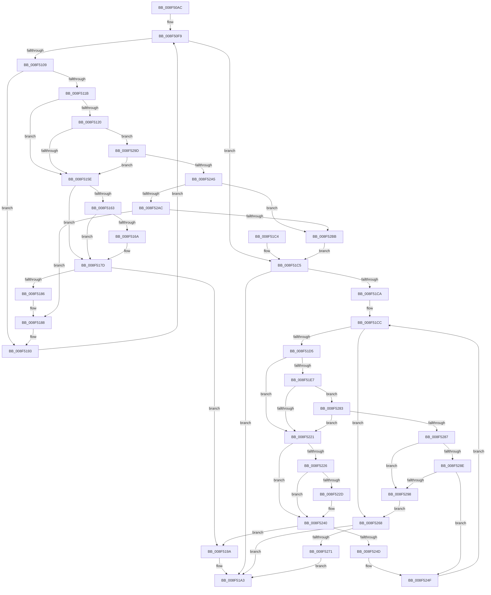

# CmGetDeviceInterfaceMappedPropertyKeys

- RVA: `0x008F50AC`–`0x008F52D2` (길이 `550` bytes)
- VA: `0x00000001408F50AC`
- 실행 섹션: `PAGE`
- PDB 이름 있음: `예`; PDB Function 태그: `아니요`
- unwind 정보 RVA: `0x00087790`
- 디코드: `147`개 명령, `550/550` bytes 표시
- 미해석 바이트: `0` (있으면 어셈블리에 `.byte`로 보존)

> 이 문서는 커널 이미지의 기계어와 PDB 기호를 분석해 생성했습니다. 4번과 5번은 함수 원형과 자료형을 바이너리 사용 방식에서 추정한 C 해석이며 원본 소스 복구 결과는 아닙니다.

## 1. Dependencies

- 직접 호출 지점: **2**; 고유 호출 대상: **2**
- 직접 호출자로 확인된 함수: **2**
- RIP 상대 이미지 참조: **1**

### Outgoing calls
- `0x008F514B` → [CmGetDeviceInterfaceMappedPropertyFromRegValue](CmGetDeviceInterfaceMappedPropertyFromRegValue_function_008F40BC.md) (function, `0x008F40BC`)
- `0x008F5212` → [CmGetDeviceInterfaceMappedPropertyFromComposite](CmGetDeviceInterfaceMappedPropertyFromComposite_function_008F3D70.md) (function, `0x008F3D70`)

### Direct callers
- [CmDeleteDeviceInterfaceWorker](../82/CmDeleteDeviceInterfaceWorker_function_0082A0B8.md) at `0x0082A1BC`
- [_PnpDispatchDeviceInterface](../8E/_PnpDispatchDeviceInterface_function_008E0DB0.md) at `0x008E0FEE`

### Static image references
- `0x008F50F9` → RVA `0x00000000` (`image boundary/outside`; read)

## 2. Other-region calls and transfers

- 다른 실행 섹션으로 향하는 call: **0**
- 별도 외부 분기/꼬리 이동을 확인하지 못했습니다.

## 3. Assembly (complete function range)

```asm
008F50AC  48 8B C4                        mov rax, rsp
008F50AF  48 89 58 10                     mov qword ptr [rax + 0x10], rbx
008F50B3  48 89 68 18                     mov qword ptr [rax + 0x18], rbp
008F50B7  48 89 70 20                     mov qword ptr [rax + 0x20], rsi
008F50BB  48 89 48 08                     mov qword ptr [rax + 8], rcx
008F50BF  57                              push rdi
008F50C0  41 54                           push r12
008F50C2  41 55                           push r13
008F50C4  41 56                           push r14
008F50C6  41 57                           push r15
008F50C8  48 83 EC 50                     sub rsp, 0x50
008F50CC  48 8B 9C 24 B0 00 00 00         mov rbx, qword ptr [rsp + 0xb0]
008F50D4  45 33 D2                        xor r10d, r10d
008F50D7  44 21 50 38                     and dword ptr [rax + 0x38], r10d
008F50DB  45 8A F9                        mov r15b, r9b
008F50DE  44 8B B4 24 A8 00 00 00         mov r14d, dword ptr [rsp + 0xa8]
008F50E6  4D 8B E0                        mov r12, r8
008F50E9  48 8B AC 24 A0 00 00 00         mov rbp, qword ptr [rsp + 0xa0]
008F50F1  4C 8B EA                        mov r13, rdx
008F50F4  44 21 13                        and dword ptr [rbx], r10d
008F50F7  33 FF                           xor edi, edi
008F50F9  48 8D 15 00 AF 70 FF            lea rdx, [rip - 0x8f5100]
008F5100  83 FF 03                        cmp edi, 3
008F5103  0F 83 BC 00 00 00               jae 0x1408f51c5
008F5109  8B C7                           mov eax, edi
008F510B  48 03 C0                        add rax, rax
008F510E  48 8B B4 C2 E0 B1 B4 00         mov rsi, qword ptr [rdx + rax*8 + 0xb4b1e0]
008F5116  48 85 F6                        test rsi, rsi
008F5119  74 78                           je 0x1408f5193
008F511B  45 84 FF                        test r15b, r15b
008F511E  75 3E                           jne 0x1408f515e
008F5120  48 8D 44 24 40                  lea rax, [rsp + 0x40]
008F5125  4C 8B CE                        mov r9, rsi
008F5128  48 89 44 24 38                  mov qword ptr [rsp + 0x38], rax
008F512D  4D 8B C4                        mov r8, r12
008F5130  83 64 24 30 00                  and dword ptr [rsp + 0x30], 0
008F5135  48 8D 84 24 B0 00 00 00         lea rax, [rsp + 0xb0]
008F513D  48 83 64 24 28 00               and qword ptr [rsp + 0x28], 0
008F5143  49 8B D5                        mov rdx, r13
008F5146  48 89 44 24 20                  mov qword ptr [rsp + 0x20], rax
008F514B  E8 6C EF FF FF                  call 0x1408f40bc
008F5150  44 8B D0                        mov r10d, eax
008F5153  3D 23 00 00 C0                  cmp eax, 0xc0000023
008F5158  0F 85 3F 01 00 00               jne 0x1408f529d
008F515E  48 85 ED                        test rbp, rbp
008F5161  74 1A                           je 0x1408f517d
008F5163  8B 03                           mov eax, dword ptr [rbx]
008F5165  41 3B C6                        cmp eax, r14d
008F5168  73 13                           jae 0x1408f517d
008F516A  0F 10 06                        movups xmm0, xmmword ptr [rsi]
008F516D  48 8D 0C 80                     lea rcx, [rax + rax*4]
008F5171  0F 11 44 8D 00                  movups xmmword ptr [rbp + rcx*4], xmm0
008F5176  8B 46 10                        mov eax, dword ptr [rsi + 0x10]
008F5179  89 44 8D 10                     mov dword ptr [rbp + rcx*4 + 0x10], eax
008F517D  8B 03                           mov eax, dword ptr [rbx]
008F517F  8D 48 01                        lea ecx, [rax + 1]
008F5182  3B C8                           cmp ecx, eax
008F5184  72 14                           jb 0x1408f519a
008F5186  89 0B                           mov dword ptr [rbx], ecx
008F5188  48 8B 8C 24 80 00 00 00         mov rcx, qword ptr [rsp + 0x80]
008F5190  45 33 D2                        xor r10d, r10d
008F5193  FF C7                           inc edi
008F5195  E9 5F FF FF FF                  jmp 0x1408f50f9
008F519A  83 23 00                        and dword ptr [rbx], 0
008F519D  41 BA 95 00 00 C0               mov r10d, 0xc0000095
008F51A3  4C 8D 5C 24 50                  lea r11, [rsp + 0x50]
008F51A8  41 8B C2                        mov eax, r10d
008F51AB  49 8B 5B 38                     mov rbx, qword ptr [r11 + 0x38]
008F51AF  49 8B 6B 40                     mov rbp, qword ptr [r11 + 0x40]
008F51B3  49 8B 73 48                     mov rsi, qword ptr [r11 + 0x48]
008F51B7  49 8B E3                        mov rsp, r11
008F51BA  41 5F                           pop r15
008F51BC  41 5E                           pop r14
008F51BE  41 5D                           pop r13
008F51C0  41 5C                           pop r12
008F51C2  5F                              pop rdi
008F51C3  C3                              ret
008F51C4  CC                              int3
008F51C5  45 85 D2                        test r10d, r10d
008F51C8  78 D9                           js 0x1408f51a3
008F51CA  33 FF                           xor edi, edi
008F51CC  83 FF 04                        cmp edi, 4
008F51CF  0F 83 93 00 00 00               jae 0x1408f5268
008F51D5  8B C7                           mov eax, edi
008F51D7  48 03 C0                        add rax, rax
008F51DA  48 8B B4 C2 00 BA B4 00         mov rsi, qword ptr [rdx + rax*8 + 0xb4ba00]
008F51E2  45 84 FF                        test r15b, r15b
008F51E5  75 3A                           jne 0x1408f5221
008F51E7  48 8D 44 24 40                  lea rax, [rsp + 0x40]
008F51EC  4C 8B CE                        mov r9, rsi
008F51EF  48 89 44 24 38                  mov qword ptr [rsp + 0x38], rax
008F51F4  4D 8B C4                        mov r8, r12
008F51F7  83 64 24 30 00                  and dword ptr [rsp + 0x30], 0
008F51FC  48 8D 84 24 B0 00 00 00         lea rax, [rsp + 0xb0]
008F5204  48 83 64 24 28 00               and qword ptr [rsp + 0x28], 0
008F520A  49 8B D5                        mov rdx, r13
008F520D  48 89 44 24 20                  mov qword ptr [rsp + 0x20], rax
008F5212  E8 59 EB FF FF                  call 0x1408f3d70
008F5217  44 8B D0                        mov r10d, eax
008F521A  3D 23 00 00 C0                  cmp eax, 0xc0000023
008F521F  75 62                           jne 0x1408f5283
008F5221  48 85 ED                        test rbp, rbp
008F5224  74 1A                           je 0x1408f5240
008F5226  8B 03                           mov eax, dword ptr [rbx]
008F5228  41 3B C6                        cmp eax, r14d
008F522B  73 13                           jae 0x1408f5240
008F522D  0F 10 06                        movups xmm0, xmmword ptr [rsi]
008F5230  48 8D 0C 80                     lea rcx, [rax + rax*4]
008F5234  0F 11 44 8D 00                  movups xmmword ptr [rbp + rcx*4], xmm0
008F5239  8B 46 10                        mov eax, dword ptr [rsi + 0x10]
008F523C  89 44 8D 10                     mov dword ptr [rbp + rcx*4 + 0x10], eax
008F5240  8B 03                           mov eax, dword ptr [rbx]
008F5242  8D 48 01                        lea ecx, [rax + 1]
008F5245  3B C8                           cmp ecx, eax
008F5247  0F 82 4D FF FF FF               jb 0x1408f519a
008F524D  89 0B                           mov dword ptr [rbx], ecx
008F524F  48 8B 8C 24 80 00 00 00         mov rcx, qword ptr [rsp + 0x80]
008F5257  48 8D 15 A2 AD 70 FF            lea rdx, [rip - 0x8f525e]
008F525E  45 33 D2                        xor r10d, r10d
008F5261  FF C7                           inc edi
008F5263  E9 64 FF FF FF                  jmp 0x1408f51cc
008F5268  45 85 D2                        test r10d, r10d
008F526B  0F 88 32 FF FF FF               js 0x1408f51a3
008F5271  44 3B 33                        cmp r14d, dword ptr [rbx]
008F5274  45 1B D2                        sbb r10d, r10d
008F5277  41 81 E2 23 00 00 C0            and r10d, 0xc0000023
008F527E  E9 20 FF FF FF                  jmp 0x1408f51a3
008F5283  85 C0                           test eax, eax
008F5285  74 9A                           je 0x1408f5221
008F5287  3D 0D 00 00 C0                  cmp eax, 0xc000000d
008F528C  74 0A                           je 0x1408f5298
008F528E  05 C7 FF FF 3F                  add eax, 0x3fffffc7
008F5293  83 F8 01                        cmp eax, 1
008F5296  77 B7                           ja 0x1408f524f
008F5298  83 23 00                        and dword ptr [rbx], 0
008F529B  EB CB                           jmp 0x1408f5268
008F529D  85 C0                           test eax, eax
008F529F  0F 84 B9 FE FF FF               je 0x1408f515e
008F52A5  3D 0D 00 00 C0                  cmp eax, 0xc000000d
008F52AA  74 0F                           je 0x1408f52bb
008F52AC  8D 88 C7 FF FF 3F               lea ecx, [rax + 0x3fffffc7]
008F52B2  83 F9 01                        cmp ecx, 1
008F52B5  0F 87 CD FE FF FF               ja 0x1408f5188
008F52BB  83 23 00                        and dword ptr [rbx], 0
008F52BE  48 8D 15 3B AD 70 FF            lea rdx, [rip - 0x8f52c5]
008F52C5  48 8B 8C 24 80 00 00 00         mov rcx, qword ptr [rsp + 0x80]
008F52CD  E9 F3 FE FF FF                  jmp 0x1408f51c5
```

## 4. C-style interpretation (structured pseudocode)

```c
__int64 __fastcall CmGetDeviceInterfaceMappedPropertyKeys(__int64 a1, __int64 a2, __int64 a3, unsigned __int8 a4, __int64 a5, unsigned int a6, __int64 a7)
{
    __int64 result;
    __int64 v_r10;
    __int64 v_rdi;
    __int64 v_rsp;
    unsigned __int64 v_stack_m10;
    unsigned __int64 v_stack_m18;
    unsigned int v_stack_m20;
    unsigned __int64 v_stack_m28;
    unsigned __int64 v_stack_m30;
    unsigned __int64 v_stack_m38;
    unsigned __int64 v_stack_m40;
    unsigned int v_stack_m48;
    unsigned __int64 v_stack_m50;
    unsigned __int64 v_stack_m58;
    unsigned __int64 v_stack_p30;
    unsigned __int64 v_stack_p8;

    *(unsigned __int64 *)(v_rsp + 16) = v_rbx;
    *(unsigned __int64 *)(v_rsp + 24) = v_rbp;
    *(unsigned __int64 *)(v_rsp + 32) = v_rsi;
    *(unsigned __int64 *)(v_rsp + 8) = a1;
    v_rsp = (v_rsp) - (80);
    v_r10 = 0;
    v_rdi = 0;
loc_008F50F9:
    if (0 >= 3) goto loc_008F51C5;
    result = (0) + (0);
    if (*(unsigned __int64 *)(v_rip - 9392384 + result * 8 + 11842016) == 0) goto loc_008F5193;
    if (a4 != 0) goto loc_008F515E;
    v_stack_m40 = v_stack_m38;
    v_stack_m58 = a7;
    result = CmGetDeviceInterfaceMappedPropertyFromRegValue(a1, a2, a3, *(unsigned __int64 *)(v_rip - 9392384 + result * 8 + 11842016));
    if (((unsigned int)(result)) != 0xC0000023ULL) goto loc_008F529D;
loc_008F515E:
    if (a5 == 0) goto loc_008F517D;
    result = (unsigned int)(*(unsigned int *)(a7));
    if (((unsigned int)((unsigned int)(*(unsigned int *)(a7)))) < ((unsigned int)((unsigned int)(a6)))) {
        a1 = (unsigned int)(*(unsigned int *)(a7)) + (unsigned int)(*(unsigned int *)(a7)) * 4;
        *(unsigned __int64 *)(a5 + a1 * 4) = v_xmm0;
        result = *(unsigned int *)(*(unsigned __int64 *)(v_rip - 9392384 + result * 8 + 11842016) + 16);
        *(unsigned int *)(a5 + a1 * 4 + 16) = (unsigned int)(result);
    }
    if (((unsigned int)((unsigned int)(*(unsigned int *)(a7)) + 1)) < ((unsigned int)((unsigned int)(*(unsigned int *)(a7))))) goto loc_008F519A;
    *(unsigned int *)(a7) = (unsigned int)((unsigned int)(*(unsigned int *)(a7)) + 1);
loc_008F5188:
    v_r10 = 0;
loc_008F5193:
    v_rdi = (unsigned int)((v_rdi) + 1);
    goto loc_008F50F9;
loc_008F519A:
loc_008F51A3:
    return (unsigned int)((unsigned int)((unsigned int)(0xC0000095ULL)));
loc_008F51C5:
    if (sign_flag) goto loc_008F51A3;
    v_rdi = 0;
loc_008F51CC:
    if (0 >= 4) goto loc_008F5268;
    result = (0) + (0);
    if (a4 != 0) goto loc_008F5221;
    v_stack_m18 = v_stack_m10;
    v_stack_m30 = a7;
    result = CmGetDeviceInterfaceMappedPropertyFromComposite(v_stack_p8, a2, a3, *(unsigned __int64 *)(a2 + result * 8 + 11844096));
    if (((unsigned int)(result)) != 0xC0000023ULL) goto loc_008F5283;
loc_008F5221:
    if (*(unsigned __int64 *)(v_stack_m28 + 64) == 0) goto loc_008F5240;
    result = (unsigned int)(*(unsigned int *)(*(unsigned __int64 *)(v_stack_m28 + 56)));
    if (((unsigned int)((unsigned int)(*(unsigned int *)(*(unsigned __int64 *)(v_stack_m28 + 56))))) < ((unsigned int)((unsigned int)(a6)))) {
        a1 = (unsigned int)(*(unsigned int *)(*(unsigned __int64 *)(v_stack_m28 + 56))) + (unsigned int)(*(unsigned int *)(*(unsigned __int64 *)(v_stack_m28 + 56))) * 4;
        *(unsigned __int64 *)(*(unsigned __int64 *)(v_stack_m28 + 64) + a1 * 4) = v_xmm0;
        result = *(unsigned int *)(*(unsigned __int64 *)(a2 + result * 8 + 11844096) + 16);
        *(unsigned int *)(*(unsigned __int64 *)(v_stack_m28 + 64) + a1 * 4 + 16) = (unsigned int)(result);
    }
    if (((unsigned int)((unsigned int)(*(unsigned int *)(*(unsigned __int64 *)(v_stack_m28 + 56))) + 1)) < ((unsigned int)((unsigned int)(*(unsigned int *)(*(unsigned __int64 *)(v_stack_m28 + 56)))))) goto loc_008F519A;
    *(unsigned int *)(*(unsigned __int64 *)(v_stack_m28 + 56)) = (unsigned int)((unsigned int)(*(unsigned int *)(*(unsigned __int64 *)(v_stack_m28 + 56))) + 1);
loc_008F524F:
    v_r10 = 0;
    v_rdi = (unsigned int)((v_rdi) + 1);
    goto loc_008F51CC;
loc_008F5268:
    if (sign_flag) goto loc_008F51A3;
    v_r10 = (unsigned int)((v_r10) & (0xC0000023ULL));
    goto loc_008F51A3;
loc_008F5283:
    if ((unsigned int)((unsigned int)(*(unsigned int *)(*(unsigned __int64 *)(v_stack_m28 + 56)))) == 0) goto loc_008F5221;
    if (((unsigned int)((unsigned int)(*(unsigned int *)(*(unsigned __int64 *)(v_stack_m28 + 56))))) == 0xC000000DULL) goto loc_008F5298;
    result = (unsigned int)(((unsigned int)(*(unsigned int *)(*(unsigned __int64 *)(v_stack_m28 + 56)))) + (0x3FFFFFC7ULL));
    if (((unsigned int)(result)) > 1) goto loc_008F524F;
loc_008F5298:
    goto loc_008F5268;
loc_008F529D:
    if ((unsigned int)(result) == 0) goto loc_008F515E;
    if (((unsigned int)(result)) == 0xC000000DULL) goto loc_008F52BB;
    if (((unsigned int)(result + 1073741767)) > 1) goto loc_008F5188;
loc_008F52BB:
    goto loc_008F51C5;
}
```

## 5. (Beta) C Style

```c
int64_t CmGetDeviceInterfaceMappedPropertyKeys(int64_t Arg1, int64_t Arg2, int64_t Arg3, uint8_t Arg4, int64_t Arg5, uint32_t Arg6, void *Arg7)
{
    uint8_t *arg7 = (uint8_t *)Arg7;

    int64_t result;
    int64_t local_r10;
    int64_t local_rdi;
    int64_t local_rsp;
    uint64_t v_stack_m10;
    uint64_t v_stack_m18;
    uint32_t v_stack_m20;
    uint64_t v_stack_m28;
    uint64_t v_stack_m30;
    uint64_t v_stack_m38;
    uint64_t v_stack_m40;
    uint32_t v_stack_m48;
    uint64_t v_stack_m50;
    uint64_t v_stack_m58;
    uint64_t v_stack_p30;
    uint64_t v_stack_p8;

    *(uint64_t *)(local_rsp + 0x10) = local_rbx;
    *(uint64_t *)(local_rsp + 0x18) = local_rbp;
    *(uint64_t *)(local_rsp + 0x20) = local_rsi;
    *(uint64_t *)(local_rsp + 0x8) = Arg1;
    local_rsp = (local_rsp) - (80);
    local_r10 = 0;
    local_rdi = 0;
loc_008F50F9:
    if (0 >= 3) goto loc_008F51C5;
    result = (0) + (0);
    if (*(uint64_t *)(v_rip - 0x8F5100 + result * 8 + 0xB4B1E0) == 0) goto loc_008F5193;
    if (Arg4 != 0) goto loc_008F515E;
    v_stack_m40 = v_stack_m38;
    v_stack_m58 = Arg7;
    result = CmGetDeviceInterfaceMappedPropertyFromRegValue(Arg1, Arg2, Arg3, *(uint64_t *)(v_rip - 0x8F5100 + result * 8 + 0xB4B1E0));
    if (((uint32_t)(result)) != 0xC0000023ULL) goto loc_008F529D;
loc_008F515E:
    if (Arg5 == 0) goto loc_008F517D;
    result = (uint32_t)(*(uint32_t *)(arg7));
    if (((uint32_t)((uint32_t)(*(uint32_t *)(arg7)))) < ((uint32_t)((uint32_t)(Arg6)))) {
        Arg1 = (uint32_t)(*(uint32_t *)(arg7)) + (uint32_t)(*(uint32_t *)(arg7)) * 4;
        *(uint64_t *)(Arg5 + Arg1 * 4) = v_xmm0;
        result = *(uint32_t *)(*(uint64_t *)(v_rip - 0x8F5100 + result * 8 + 0xB4B1E0) + 0x10);
        *(uint32_t *)(Arg5 + Arg1 * 4 + 0x10) = (uint32_t)(result);
    }
    if (((uint32_t)((uint32_t)(*(uint32_t *)(arg7)) + 1)) < ((uint32_t)((uint32_t)(*(uint32_t *)(arg7))))) goto loc_008F519A;
    *(uint32_t *)(arg7) = (uint32_t)((uint32_t)(*(uint32_t *)(arg7)) + 1);
loc_008F5188:
    local_r10 = 0;
loc_008F5193:
    local_rdi = (uint32_t)((local_rdi) + 1);
    goto loc_008F50F9;
loc_008F519A:
loc_008F51A3:
    return (uint32_t)((uint32_t)((uint32_t)(0xC0000095ULL)));
loc_008F51C5:
    if (sign_flag) goto loc_008F51A3;
    local_rdi = 0;
loc_008F51CC:
    if (0 >= 4) goto loc_008F5268;
    result = (0) + (0);
    if (Arg4 != 0) goto loc_008F5221;
    v_stack_m18 = v_stack_m10;
    v_stack_m30 = Arg7;
    result = CmGetDeviceInterfaceMappedPropertyFromComposite(v_stack_p8, Arg2, Arg3, *(uint64_t *)(Arg2 + result * 8 + 0xB4BA00));
    if (((uint32_t)(result)) != 0xC0000023ULL) goto loc_008F5283;
loc_008F5221:
    if (*(uint64_t *)(v_stack_m28 + 0x40) == 0) goto loc_008F5240;
    result = (uint32_t)(*(uint32_t *)(*(uint64_t *)(v_stack_m28 + 0x38)));
    if (((uint32_t)((uint32_t)(*(uint32_t *)(*(uint64_t *)(v_stack_m28 + 0x38))))) < ((uint32_t)((uint32_t)(Arg6)))) {
        Arg1 = (uint32_t)(*(uint32_t *)(*(uint64_t *)(v_stack_m28 + 0x38))) + (uint32_t)(*(uint32_t *)(*(uint64_t *)(v_stack_m28 + 0x38))) * 4;
        *(uint64_t *)(*(uint64_t *)(v_stack_m28 + 0x40) + Arg1 * 4) = v_xmm0;
        result = *(uint32_t *)(*(uint64_t *)(Arg2 + result * 8 + 0xB4BA00) + 0x10);
        *(uint32_t *)(*(uint64_t *)(v_stack_m28 + 0x40) + Arg1 * 4 + 0x10) = (uint32_t)(result);
    }
    if (((uint32_t)((uint32_t)(*(uint32_t *)(*(uint64_t *)(v_stack_m28 + 0x38))) + 1)) < ((uint32_t)((uint32_t)(*(uint32_t *)(*(uint64_t *)(v_stack_m28 + 0x38)))))) goto loc_008F519A;
    *(uint32_t *)(*(uint64_t *)(v_stack_m28 + 0x38)) = (uint32_t)((uint32_t)(*(uint32_t *)(*(uint64_t *)(v_stack_m28 + 0x38))) + 1);
loc_008F524F:
    local_r10 = 0;
    local_rdi = (uint32_t)((local_rdi) + 1);
    goto loc_008F51CC;
loc_008F5268:
    if (sign_flag) goto loc_008F51A3;
    local_r10 = (uint32_t)((local_r10) & (0xC0000023ULL));
    goto loc_008F51A3;
loc_008F5283:
    if ((uint32_t)((uint32_t)(*(uint32_t *)(*(uint64_t *)(v_stack_m28 + 0x38)))) == 0) goto loc_008F5221;
    if (((uint32_t)((uint32_t)(*(uint32_t *)(*(uint64_t *)(v_stack_m28 + 0x38))))) == 0xC000000DULL) goto loc_008F5298;
    result = (uint32_t)(((uint32_t)(*(uint32_t *)(*(uint64_t *)(v_stack_m28 + 0x38)))) + (0x3FFFFFC7ULL));
    if (((uint32_t)(result)) > 1) goto loc_008F524F;
loc_008F5298:
    goto loc_008F5268;
loc_008F529D:
    if ((uint32_t)(result) == 0) goto loc_008F515E;
    if (((uint32_t)(result)) == 0xC000000DULL) goto loc_008F52BB;
    if (((uint32_t)(result + 1073741767)) > 1) goto loc_008F5188;
loc_008F52BB:
    goto loc_008F51C5;
}
```

### 관측된 메모리 오프셋

구조체 형식이 확인되지 않은 접근은 인자 기준의 오프셋으로만 기록했습니다.

| 기준 인자 | 오프셋 표현 | 폭 (bit) | 접근 |
|---|---:|---:|---|
| `Arg7` | `+ 0x0` | `32` | `R` |
| `Arg7` | `+ 0x0` | `32` | `R/W` |
| `Arg7` | `+ 0x0` | `32` | `W` |

## 6. Execution-region graph

[열기: 2D/3D 그래프와 함수 탐색 컨트롤 패널](../../../control-panel.html?section=page&rva=0x008F50AC&view=graph)

- 2D 그래프는 위에서 아래로 흐르고, 3D 그래프는 빈 공간을 드래그해 회전합니다. Shift+드래그는 이동, 휠은 확대·축소, 함수 노드 선택은 대상 보고서 이동입니다.

### Static fallback


