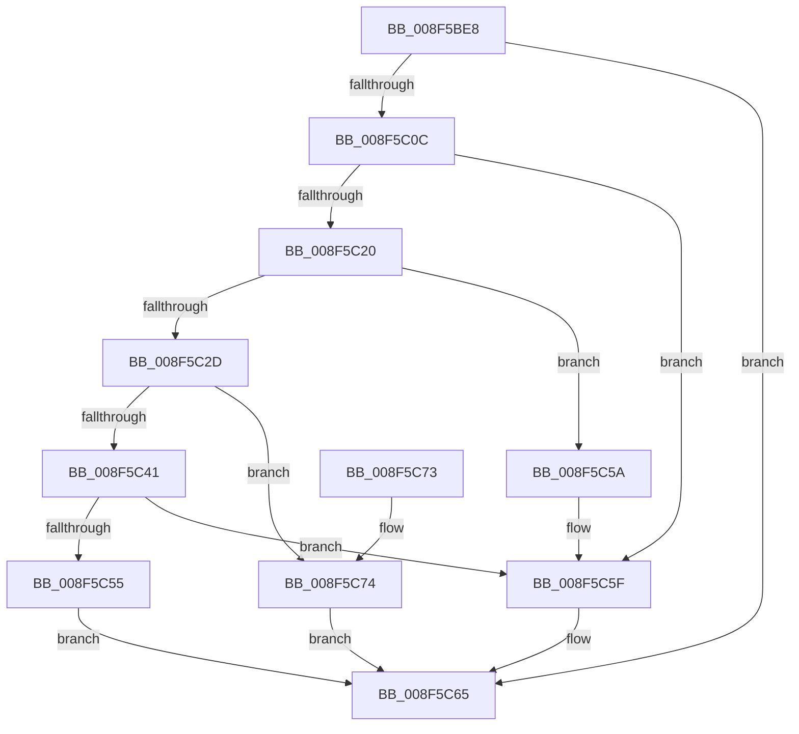

# CmGetDeviceInterfacePathFormat

- RVA: `0x008F5BE8`–`0x008F5C79` (길이 `145` bytes)
- VA: `0x00000001408F5BE8`
- 실행 섹션: `PAGE`
- PDB 이름 있음: `예`; PDB Function 태그: `아니요`
- unwind 정보 RVA: `0x00087858`
- 디코드: `42`개 명령, `145/145` bytes 표시
- 미해석 바이트: `0` (있으면 어셈블리에 `.byte`로 보존)

> 이 문서는 커널 이미지의 기계어와 PDB 기호를 분석해 생성했습니다. 4번과 5번은 함수 원형과 자료형을 바이너리 사용 방식에서 추정한 C 해석이며 원본 소스 복구 결과는 아닙니다.

## 1. Dependencies

- 직접 호출 지점: **5**; 고유 호출 대상: **3**
- 직접 호출자로 확인된 함수: **1**
- RIP 상대 이미지 참조: **2**

### Outgoing calls
- `0x008F5C00` → [CmValidateDeviceInterfaceName](CmValidateDeviceInterfaceName_function_008F1A40.md) (function, `0x008F1A40`)
- `0x008F5C14` → [RtlInitUnicodeStringEx](../../text/46/RtlInitUnicodeStringEx_function_00463960.md) (function, `0x00463960`)
- `0x008F5C20` → [PsGetCurrentServerSiloGlobals](../../text/2F/PsGetCurrentServerSiloGlobals_function_002FE1F0.md) (function, `0x002FE1F0`)
- `0x008F5C41` → [PsGetCurrentServerSiloGlobals](../../text/2F/PsGetCurrentServerSiloGlobals_function_002FE1F0.md) (function, `0x002FE1F0`)
- `0x008F5C5A` → [PsGetCurrentServerSiloGlobals](../../text/2F/PsGetCurrentServerSiloGlobals_function_002FE1F0.md) (function, `0x002FE1F0`)

### Direct callers
- [IoGetDeviceInterfaceAlias](IoGetDeviceInterfaceAlias_function_008F5570.md) at `0x008F57FF`

### Static image references
- `0x008F5C2D` → RVA `0x00001FA0` (`.rdata`; read)
- `0x008F5C46` → RVA `0x00001F90` (`.rdata`; read)

## 2. Other-region calls and transfers

- 다른 실행 섹션으로 향하는 call: **4**
  - `0x008F5C14` → [RtlInitUnicodeStringEx](../../text/46/RtlInitUnicodeStringEx_function_00463960.md) (`PAGE` → `.text`)
  - `0x008F5C20` → [PsGetCurrentServerSiloGlobals](../../text/2F/PsGetCurrentServerSiloGlobals_function_002FE1F0.md) (`PAGE` → `.text`)
  - `0x008F5C41` → [PsGetCurrentServerSiloGlobals](../../text/2F/PsGetCurrentServerSiloGlobals_function_002FE1F0.md) (`PAGE` → `.text`)
  - `0x008F5C5A` → [PsGetCurrentServerSiloGlobals](../../text/2F/PsGetCurrentServerSiloGlobals_function_002FE1F0.md) (`PAGE` → `.text`)
- 별도 외부 분기/꼬리 이동을 확인하지 못했습니다.

## 3. Assembly (complete function range)

```asm
008F5BE8  48 89 5C 24 08                  mov qword ptr [rsp + 8], rbx
008F5BED  57                              push rdi
008F5BEE  48 83 EC 30                     sub rsp, 0x30
008F5BF2  0F 57 C0                        xorps xmm0, xmm0
008F5BF5  49 8B D8                        mov rbx, r8
008F5BF8  0F 11 44 24 20                  movups xmmword ptr [rsp + 0x20], xmm0
008F5BFD  48 8B FA                        mov rdi, rdx
008F5C00  E8 3B BE FF FF                  call 0x1408f1a40
008F5C05  44 8B C8                        mov r9d, eax
008F5C08  85 C0                           test eax, eax
008F5C0A  78 59                           js 0x1408f5c65
008F5C0C  48 8B D7                        mov rdx, rdi
008F5C0F  48 8D 4C 24 20                  lea rcx, [rsp + 0x20]
008F5C14  E8 47 DD B6 FF                  call 0x140463960
008F5C19  44 8B C8                        mov r9d, eax
008F5C1C  85 C0                           test eax, eax
008F5C1E  78 3F                           js 0x1408f5c5f
008F5C20  E8 CB 85 A0 FF                  call 0x1402fe1f0
008F5C25  66 83 7C 24 20 08               cmp word ptr [rsp + 0x20], 8
008F5C2B  72 2D                           jb 0x1408f5c5a
008F5C2D  48 8B 0D 6C C3 70 FF            mov rcx, qword ptr [rip - 0x8f3c94]
008F5C34  4C 8B 44 24 28                  mov r8, qword ptr [rsp + 0x28]
008F5C39  48 8B 09                        mov rcx, qword ptr [rcx]
008F5C3C  49 3B 08                        cmp rcx, qword ptr [r8]
008F5C3F  74 33                           je 0x1408f5c74
008F5C41  E8 AA 85 A0 FF                  call 0x1402fe1f0
008F5C46  48 8B 15 43 C3 70 FF            mov rdx, qword ptr [rip - 0x8f3cbd]
008F5C4D  48 8B 0A                        mov rcx, qword ptr [rdx]
008F5C50  49 3B 08                        cmp rcx, qword ptr [r8]
008F5C53  75 0A                           jne 0x1408f5c5f
008F5C55  C6 03 00                        mov byte ptr [rbx], 0
008F5C58  EB 0B                           jmp 0x1408f5c65
008F5C5A  E8 91 85 A0 FF                  call 0x1402fe1f0
008F5C5F  41 B9 33 00 00 C0               mov r9d, 0xc0000033
008F5C65  48 8B 5C 24 40                  mov rbx, qword ptr [rsp + 0x40]
008F5C6A  41 8B C1                        mov eax, r9d
008F5C6D  48 83 C4 30                     add rsp, 0x30
008F5C71  5F                              pop rdi
008F5C72  C3                              ret
008F5C73  CC                              int3
008F5C74  C6 03 01                        mov byte ptr [rbx], 1
008F5C77  EB EC                           jmp 0x1408f5c65
```

## 4. C-style interpretation (structured pseudocode)

```c
__int64 __fastcall CmGetDeviceInterfacePathFormat(__int64 a1, __int64 a2, __int64 a3)
{
    __int64 result;
    __int64 v_rsp;
    unsigned __int64 v_stack_m10;
    unsigned __int64 v_stack_m18;
    unsigned __int64 v_stack_p8;

    v_stack_p8 = v_rbx;
    v_rsp = (v_rsp) - (48);
    v_stack_m18 = v_xmm0;
    result = CmValidateDeviceInterfaceName(a1, a2, a3, a4);
    if (sign_flag) goto loc_008F5C65;
    result = RtlInitUnicodeStringEx(v_stack_m18, a2, a3, (unsigned int)((unsigned int)(result)));
    if (sign_flag) goto loc_008F5C5F;
    result = PsGetCurrentServerSiloGlobals(v_stack_m18, a2, a3, (unsigned int)((unsigned int)(result)));
    if (v_stack_m18 < 8) goto loc_008F5C5A;
    if ((*(unsigned __int64 *)(*(unsigned __int64 *)(v_rip - 9387156))) == (*(unsigned __int64 *)(v_stack_m10))) goto loc_008F5C74;
    result = PsGetCurrentServerSiloGlobals(*(unsigned __int64 *)(*(unsigned __int64 *)(v_rip - 9387156)), a2, v_stack_m10, (unsigned int)((unsigned int)(result)));
    if ((*(unsigned __int64 *)(*(unsigned __int64 *)(v_rip - 9387197))) != (*(unsigned __int64 *)(v_stack_m10))) goto loc_008F5C5F;
    *(unsigned __int8 *)(a3) = 0;
    goto loc_008F5C65;
loc_008F5C5A:
    result = PsGetCurrentServerSiloGlobals(*(unsigned __int64 *)(*(unsigned __int64 *)(v_rip - 9387197)), *(unsigned __int64 *)(v_rip - 9387197), v_stack_m10, (unsigned int)((unsigned int)(result)));
loc_008F5C5F:
loc_008F5C65:
    v_rsp = (v_rsp) + (48);
    return (unsigned int)((unsigned int)((unsigned int)(0xC0000033ULL)));
loc_008F5C74:
    *(unsigned __int8 *)(v_stack_p8) = 1;
    goto loc_008F5C65;
}
```

## 5. (Beta) C Style

```c
int64_t CmGetDeviceInterfacePathFormat(int64_t Arg1, int64_t Arg2, void *Arg3)
{
    uint8_t *arg3 = (uint8_t *)Arg3;

    int64_t result;
    int64_t local_rsp;
    uint64_t v_stack_m10;
    uint64_t v_stack_m18;
    uint64_t v_stack_p8;

    v_stack_p8 = local_rbx;
    local_rsp = (local_rsp) - (48);
    v_stack_m18 = v_xmm0;
    result = CmValidateDeviceInterfaceName(Arg1, Arg2, Arg3, a4);
    if (sign_flag) goto loc_008F5C65;
    result = RtlInitUnicodeStringEx(v_stack_m18, Arg2, Arg3, (uint32_t)((uint32_t)(result)));
    if (sign_flag) goto loc_008F5C5F;
    result = PsGetCurrentServerSiloGlobals(v_stack_m18, Arg2, Arg3, (uint32_t)((uint32_t)(result)));
    if (v_stack_m18 < 8) goto loc_008F5C5A;
    if ((*(uint64_t *)(*(uint64_t *)(v_rip - 0x8F3C94))) == (*(uint64_t *)(v_stack_m10))) goto loc_008F5C74;
    result = PsGetCurrentServerSiloGlobals(*(uint64_t *)(*(uint64_t *)(v_rip - 0x8F3C94)), Arg2, v_stack_m10, (uint32_t)((uint32_t)(result)));
    if ((*(uint64_t *)(*(uint64_t *)(v_rip - 0x8F3CBD))) != (*(uint64_t *)(v_stack_m10))) goto loc_008F5C5F;
    *(uint8_t *)(arg3) = 0;
    goto loc_008F5C65;
loc_008F5C5A:
    result = PsGetCurrentServerSiloGlobals(*(uint64_t *)(*(uint64_t *)(v_rip - 0x8F3CBD)), *(uint64_t *)(v_rip - 0x8F3CBD), v_stack_m10, (uint32_t)((uint32_t)(result)));
loc_008F5C5F:
loc_008F5C65:
    local_rsp = (local_rsp) + (48);
    return (uint32_t)((uint32_t)((uint32_t)(0xC0000033ULL)));
loc_008F5C74:
    *(uint8_t *)(v_stack_p8) = 1;
    goto loc_008F5C65;
}
```

### 관측된 메모리 오프셋

구조체 형식이 확인되지 않은 접근은 인자 기준의 오프셋으로만 기록했습니다.

| 기준 인자 | 오프셋 표현 | 폭 (bit) | 접근 |
|---|---:|---:|---|
| `Arg3` | `+ 0x0` | `8` | `W` |

## 6. Execution-region graph

[열기: 2D/3D 그래프와 함수 탐색 컨트롤 패널](../../../control-panel.html?section=page&rva=0x008F5BE8&view=graph)

- 2D 그래프는 위에서 아래로 흐르고, 3D 그래프는 빈 공간을 드래그해 회전합니다. Shift+드래그는 이동, 휠은 확대·축소, 함수 노드 선택은 대상 보고서 이동입니다.

### Static fallback


