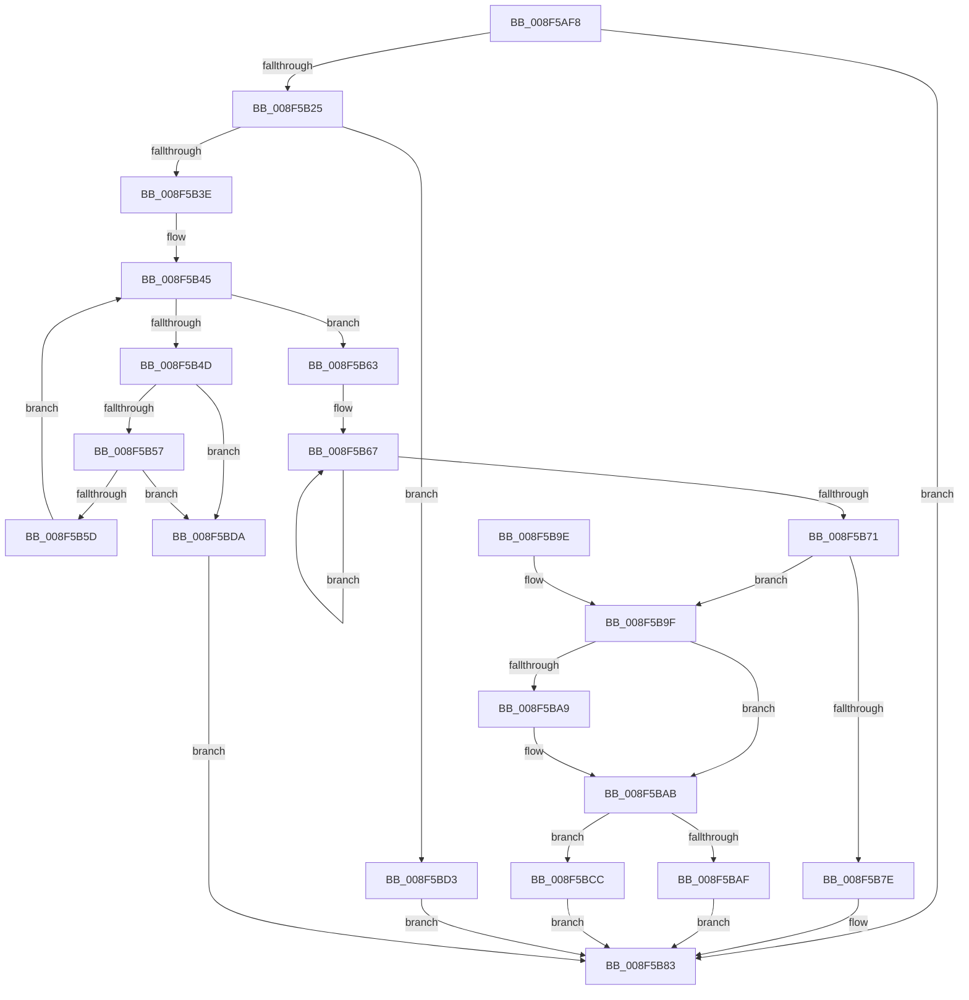

# CmGetDeviceInterfaceReferenceString

- RVA: `0x008F5AF8`–`0x008F5BE1` (길이 `233` bytes)
- VA: `0x00000001408F5AF8`
- 실행 섹션: `PAGE`
- PDB 이름 있음: `예`; PDB Function 태그: `아니요`
- unwind 정보 RVA: `0x0008783C`
- 디코드: `67`개 명령, `233/233` bytes 표시
- 미해석 바이트: `0` (있으면 어셈블리에 `.byte`로 보존)

> 이 문서는 커널 이미지의 기계어와 PDB 기호를 분석해 생성했습니다. 4번과 5번은 함수 원형과 자료형을 바이너리 사용 방식에서 추정한 C 해석이며 원본 소스 복구 결과는 아닙니다.

## 1. Dependencies

- 직접 호출 지점: **3**; 고유 호출 대상: **3**
- 직접 호출자로 확인된 함수: **3**
- RIP 상대 이미지 참조: **0**

### Outgoing calls
- `0x008F5B1A` → [CmValidateDeviceInterfaceName](CmValidateDeviceInterfaceName_function_008F1A40.md) (function, `0x008F1A40`)
- `0x008F5B30` → [wcschr](../../text/50/wcschr_function_00501A60.md) (function, `0x00501A60`)
- `0x008F5BC5` → [RtlStringCchCopyExW](../../text/41/RtlStringCchCopyExW_function_0041E1C0.md) (function, `0x0041E1C0`)

### Direct callers
- [CmGetDeviceInterfaceMappedPropertyFromComposite](CmGetDeviceInterfaceMappedPropertyFromComposite_function_008F3D70.md) at `0x008F3E87`
- [IoGetDeviceInterfaceAlias](IoGetDeviceInterfaceAlias_function_008F5570.md) at `0x008F57D1`
- [IoGetDeviceInterfaceAlias](IoGetDeviceInterfaceAlias_function_008F5570.md) at `0x008F59CB`
- [sub_00B1C3F8](../B1/Unknown_function_00B1C3F8.md) at `0x00B1C427`

### Static image references
- 디코드된 RIP-relative 메모리 참조가 없습니다.

## 2. Other-region calls and transfers

- 다른 실행 섹션으로 향하는 call: **2**
  - `0x008F5B30` → [wcschr](../../text/50/wcschr_function_00501A60.md) (`PAGE` → `.text`)
  - `0x008F5BC5` → [RtlStringCchCopyExW](../../text/41/RtlStringCchCopyExW_function_0041E1C0.md) (`PAGE` → `.text`)
- 별도 외부 분기/꼬리 이동을 확인하지 못했습니다.

## 3. Assembly (complete function range)

```asm
008F5AF8  48 8B C4                        mov rax, rsp
008F5AFB  48 89 58 08                     mov qword ptr [rax + 8], rbx
008F5AFF  48 89 68 10                     mov qword ptr [rax + 0x10], rbp
008F5B03  48 89 70 18                     mov qword ptr [rax + 0x18], rsi
008F5B07  48 89 78 20                     mov qword ptr [rax + 0x20], rdi
008F5B0B  41 56                           push r14
008F5B0D  48 83 EC 30                     sub rsp, 0x30
008F5B11  41 8B F9                        mov edi, r9d
008F5B14  49 8B F0                        mov rsi, r8
008F5B17  48 8B DA                        mov rbx, rdx
008F5B1A  E8 21 BF FF FF                  call 0x1408f1a40
008F5B1F  33 ED                           xor ebp, ebp
008F5B21  85 C0                           test eax, eax
008F5B23  78 5E                           js 0x1408f5b83
008F5B25  44 8D 75 5C                     lea r14d, [rbp + 0x5c]
008F5B29  41 8B D6                        mov edx, r14d
008F5B2C  48 8D 4B 08                     lea rcx, [rbx + 8]
008F5B30  E8 2B BF C0 FF                  call 0x140501a60
008F5B35  48 85 C0                        test rax, rax
008F5B38  0F 84 95 00 00 00               je 0x1408f5bd3
008F5B3E  4C 8D 40 02                     lea r8, [rax + 2]
008F5B42  49 8B C8                        mov rcx, r8
008F5B45  0F B7 01                        movzx eax, word ptr [rcx]
008F5B48  66 85 C0                        test ax, ax
008F5B4B  74 16                           je 0x1408f5b63
008F5B4D  66 41 3B C6                     cmp ax, r14w
008F5B51  0F 84 83 00 00 00               je 0x1408f5bda
008F5B57  66 83 F8 2F                     cmp ax, 0x2f
008F5B5B  74 7D                           je 0x1408f5bda
008F5B5D  48 83 C1 02                     add rcx, 2
008F5B61  EB E2                           jmp 0x1408f5b45
008F5B63  48 83 C8 FF                     or rax, 0xffffffffffffffff
008F5B67  48 FF C0                        inc rax
008F5B6A  66 41 39 2C 40                  cmp word ptr [r8 + rax*2], bp
008F5B6F  75 F6                           jne 0x1408f5b67
008F5B71  48 FF C0                        inc rax
008F5B74  B9 FF FF FF FF                  mov ecx, 0xffffffff
008F5B79  48 3B C1                        cmp rax, rcx
008F5B7C  76 21                           jbe 0x1408f5b9f
008F5B7E  B8 95 00 00 C0                  mov eax, 0xc0000095
008F5B83  48 8B 5C 24 40                  mov rbx, qword ptr [rsp + 0x40]
008F5B88  48 8B 6C 24 48                  mov rbp, qword ptr [rsp + 0x48]
008F5B8D  48 8B 74 24 50                  mov rsi, qword ptr [rsp + 0x50]
008F5B92  48 8B 7C 24 58                  mov rdi, qword ptr [rsp + 0x58]
008F5B97  48 83 C4 30                     add rsp, 0x30
008F5B9B  41 5E                           pop r14
008F5B9D  C3                              ret
008F5B9E  CC                              int3
008F5B9F  48 8B 4C 24 60                  mov rcx, qword ptr [rsp + 0x60]
008F5BA4  48 85 C9                        test rcx, rcx
008F5BA7  74 02                           je 0x1408f5bab
008F5BA9  89 01                           mov dword ptr [rcx], eax
008F5BAB  3B C7                           cmp eax, edi
008F5BAD  77 1D                           ja 0x1408f5bcc
008F5BAF  48 8B D7                        mov rdx, rdi
008F5BB2  C7 44 24 28 00 09 00 00         mov dword ptr [rsp + 0x28], 0x900
008F5BBA  45 33 C9                        xor r9d, r9d
008F5BBD  48 89 6C 24 20                  mov qword ptr [rsp + 0x20], rbp
008F5BC2  48 8B CE                        mov rcx, rsi
008F5BC5  E8 F6 85 B2 FF                  call 0x14041e1c0
008F5BCA  EB B7                           jmp 0x1408f5b83
008F5BCC  B8 23 00 00 C0                  mov eax, 0xc0000023
008F5BD1  EB B0                           jmp 0x1408f5b83
008F5BD3  B8 34 00 00 C0                  mov eax, 0xc0000034
008F5BD8  EB A9                           jmp 0x1408f5b83
008F5BDA  B8 39 00 00 C0                  mov eax, 0xc0000039
008F5BDF  EB A2                           jmp 0x1408f5b83
```

## 4. C-style interpretation (structured pseudocode)

```c
__int64 __fastcall CmGetDeviceInterfaceReferenceString(__int64 a1, __int64 a2, __int64 a3, int a4, __int64 a5)
{
    __int64 result;
    __int64 v_rbp;
    __int64 v_rsp;
    unsigned __int64 v_stack_p10;
    unsigned __int64 v_stack_p18;
    unsigned __int64 v_stack_p20;
    unsigned int v_stack_p28;
    unsigned __int64 v_stack_p8;

    *(unsigned __int64 *)(v_rsp + 8) = v_rbx;
    *(unsigned __int64 *)(v_rsp + 16) = v_rbp;
    *(unsigned __int64 *)(v_rsp + 24) = v_rsi;
    *(unsigned __int64 *)(v_rsp + 32) = v_rdi;
    v_rsp = (v_rsp) - (48);
    result = CmValidateDeviceInterfaceName(a1, a2, a3, a4);
    v_rbp = 0;
    if (sign_flag) goto loc_008F5B83;
    result = wcschr(a2 + 8, (unsigned int)((unsigned int)(v_rbp + 92)), a3, a4);
    if (result == 0) goto loc_008F5BD3;
loc_008F5B45:
    if ((unsigned __int16)(*(unsigned __int16 *)(result + 2)) == 0) goto loc_008F5B63;
    if (((unsigned __int16)(*(unsigned __int16 *)(result + 2))) == ((unsigned __int16)(v_rbp + 92))) goto loc_008F5BDA;
    if (((unsigned __int16)(*(unsigned __int16 *)(result + 2))) == 47) goto loc_008F5BDA;
    a1 = (result + 2) + (2);
    goto loc_008F5B45;
loc_008F5B63:
    result = (*(unsigned __int16 *)(result + 2)) | (-1);
loc_008F5B67:
    result = (result) + 1;
    if ((*(unsigned __int16 *)(result + 2 + result * 2)) != 0) goto loc_008F5B67;
    result = (result) + 1;
    if (result <= ((unsigned int)(0xFFFFFFFFULL))) goto loc_008F5B9F;
loc_008F5B83:
    v_rsp = (v_rsp) + (48);
    return (unsigned int)(0xC0000095ULL);
loc_008F5B9F:
    if (a5 != 0) {
        *(unsigned int *)(a5) = (unsigned int)((unsigned int)(0xC0000095ULL));
    }
    if (((unsigned int)((unsigned int)(0xC0000095ULL))) > ((unsigned int)(v_stack_p20))) goto loc_008F5BCC;
    v_stack_p28 = 0x900ULL;
    a4 = 0;
    v_stack_p20 = v_stack_p10;
    result = RtlStringCchCopyExW(v_stack_p18, v_stack_p20, result + 2, a4);
    goto loc_008F5B83;
loc_008F5BCC:
    goto loc_008F5B83;
loc_008F5BD3:
    goto loc_008F5B83;
loc_008F5BDA:
    goto loc_008F5B83;
}
```

## 5. (Beta) C Style

```c
int64_t CmGetDeviceInterfaceReferenceString(int64_t Arg1, void *Arg2, int64_t Arg3, int32_t Arg4, int64_t Arg5)
{
    uint8_t *arg2 = (uint8_t *)Arg2;

    int64_t result;
    int64_t local_rbp;
    int64_t local_rsp;
    uint64_t v_stack_p10;
    uint64_t v_stack_p18;
    uint64_t v_stack_p20;
    uint32_t v_stack_p28;
    uint64_t v_stack_p8;

    *(uint64_t *)(local_rsp + 0x8) = local_rbx;
    *(uint64_t *)(local_rsp + 0x10) = local_rbp;
    *(uint64_t *)(local_rsp + 0x18) = local_rsi;
    *(uint64_t *)(local_rsp + 0x20) = local_rdi;
    local_rsp = (local_rsp) - (48);
    result = CmValidateDeviceInterfaceName(Arg1, Arg2, Arg3, Arg4);
    local_rbp = 0;
    if (sign_flag) goto loc_008F5B83;
    result = wcschr(Arg2 + 8, (uint32_t)((uint32_t)(local_rbp + 92)), Arg3, Arg4);
    if (result == 0) goto loc_008F5BD3;
loc_008F5B45:
    if ((uint16_t)(*(uint16_t *)(result + 0x2)) == 0) goto loc_008F5B63;
    if (((uint16_t)(*(uint16_t *)(result + 0x2))) == ((uint16_t)(local_rbp + 92))) goto loc_008F5BDA;
    if (((uint16_t)(*(uint16_t *)(result + 0x2))) == 47) goto loc_008F5BDA;
    Arg1 = (result + 2) + (2);
    goto loc_008F5B45;
loc_008F5B63:
    result = (*(uint16_t *)(result + 0x2)) | (-1);
loc_008F5B67:
    result = (result) + 1;
    if ((*(uint16_t *)(result + 0x2 + result * 2)) != 0) goto loc_008F5B67;
    result = (result) + 1;
    if (result <= ((uint32_t)(0xFFFFFFFFULL))) goto loc_008F5B9F;
loc_008F5B83:
    local_rsp = (local_rsp) + (48);
    return (uint32_t)(0xC0000095ULL);
loc_008F5B9F:
    if (Arg5 != 0) {
        *(uint32_t *)(Arg5) = (uint32_t)((uint32_t)(0xC0000095ULL));
    }
    if (((uint32_t)((uint32_t)(0xC0000095ULL))) > ((uint32_t)(v_stack_p20))) goto loc_008F5BCC;
    v_stack_p28 = 0x900ULL;
    Arg4 = 0;
    v_stack_p20 = v_stack_p10;
    result = RtlStringCchCopyExW(v_stack_p18, v_stack_p20, result + 2, Arg4);
    goto loc_008F5B83;
loc_008F5BCC:
    goto loc_008F5B83;
loc_008F5BD3:
    goto loc_008F5B83;
loc_008F5BDA:
    goto loc_008F5B83;
}
```

### 관측된 메모리 오프셋

구조체 형식이 확인되지 않은 접근은 인자 기준의 오프셋으로만 기록했습니다.

| 기준 인자 | 오프셋 표현 | 폭 (bit) | 접근 |
|---|---:|---:|---|
| `Arg2` | `+ 0x8` | `64` | `R` |

## 6. Execution-region graph

[열기: 2D/3D 그래프와 함수 탐색 컨트롤 패널](../../../control-panel.html?section=page&rva=0x008F5AF8&view=graph)

- 2D 그래프는 위에서 아래로 흐르고, 3D 그래프는 빈 공간을 드래그해 회전합니다. Shift+드래그는 이동, 휠은 확대·축소, 함수 노드 선택은 대상 보고서 이동입니다.

### Static fallback


