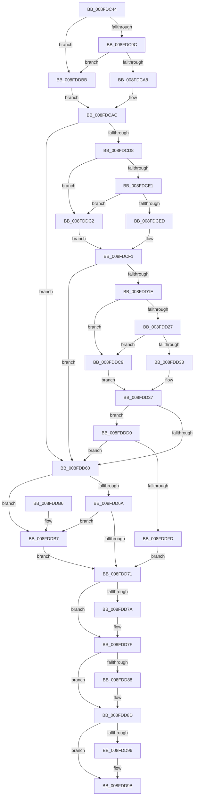

# CmIsDeviceInContainer

- RVA: `0x008FDC44`–`0x008FDE06` (길이 `450` bytes)
- VA: `0x00000001408FDC44`
- 실행 섹션: `PAGE`
- PDB 이름 있음: `예`; PDB Function 태그: `아니요`
- unwind 정보 RVA: `0x0008819C`
- 디코드: `123`개 명령, `450/450` bytes 표시
- 미해석 바이트: `0` (있으면 어셈블리에 `.byte`로 보존)

> 이 문서는 커널 이미지의 기계어와 PDB 기호를 분석해 생성했습니다. 4번과 5번은 함수 원형과 자료형을 바이너리 사용 방식에서 추정한 C 해석이며 원본 소스 복구 결과는 아닙니다.

## 1. Dependencies

- 직접 호출 지점: **7**; 고유 호출 대상: **3**
- 직접 호출자로 확인된 함수: **1**
- RIP 상대 이미지 참조: **1**

### Outgoing calls
- `0x008FDCC9` → [_RegRtlOpenKeyTransacted](../8E/_RegRtlOpenKeyTransacted_function_008EF810.md) (function, `0x008EF810`)
- `0x008FDD13` → [_RegRtlOpenKeyTransacted](../8E/_RegRtlOpenKeyTransacted_function_008EF810.md) (function, `0x008EF810`)
- `0x008FDD55` → [_RegRtlOpenKeyTransacted](../8E/_RegRtlOpenKeyTransacted_function_008EF810.md) (function, `0x008EF810`)
- `0x008FDD7A` → [ZwClose](../../text/6A/ZwClose_function_006AD2B0.md) (function, `0x006AD2B0`)
- `0x008FDD88` → [ZwClose](../../text/6A/ZwClose_function_006AD2B0.md) (function, `0x006AD2B0`)
- `0x008FDD96` → [ZwClose](../../text/6A/ZwClose_function_006AD2B0.md) (function, `0x006AD2B0`)
- `0x008FDDEE` → [PnpCtxRegQueryValue](../99/PnpCtxRegQueryValue_function_009940FC.md) (function, `0x009940FC`)

### Direct callers
- [_CmGetDeviceContainerIdFromBase](_CmGetDeviceContainerIdFromBase_function_008FD2B4.md) at `0x008FD363`
- [_CmGetDeviceContainerIdFromBase](_CmGetDeviceContainerIdFromBase_function_008FD2B4.md) at `0x008FD411`

### Static image references
- `0x008FDCFE` → RVA `0x00B0D7D0` (` ?? ::NNGAKEGL::`string'`; read)

## 2. Other-region calls and transfers

- 다른 실행 섹션으로 향하는 call: **3**
  - `0x008FDD7A` → [ZwClose](../../text/6A/ZwClose_function_006AD2B0.md) (`PAGE` → `.text`)
  - `0x008FDD88` → [ZwClose](../../text/6A/ZwClose_function_006AD2B0.md) (`PAGE` → `.text`)
  - `0x008FDD96` → [ZwClose](../../text/6A/ZwClose_function_006AD2B0.md) (`PAGE` → `.text`)
- 별도 외부 분기/꼬리 이동을 확인하지 못했습니다.

## 3. Assembly (complete function range)

```asm
008FDC44  48 89 5C 24 10                  mov qword ptr [rsp + 0x10], rbx
008FDC49  48 89 74 24 18                  mov qword ptr [rsp + 0x18], rsi
008FDC4E  55                              push rbp
008FDC4F  57                              push rdi
008FDC50  41 54                           push r12
008FDC52  41 56                           push r14
008FDC54  41 57                           push r15
008FDC56  48 8B EC                        mov rbp, rsp
008FDC59  48 83 EC 50                     sub rsp, 0x50
008FDC5D  4C 8B 7D 58                     mov r15, qword ptr [rbp + 0x58]
008FDC61  48 8D B9 E0 00 00 00            lea rdi, [rcx + 0xe0]
008FDC68  4C 8B 75 60                     mov r14, qword ptr [rbp + 0x60]
008FDC6C  4D 8B E1                        mov r12, r9
008FDC6F  48 83 65 F0 00                  and qword ptr [rbp - 0x10], 0
008FDC74  4D 8B D0                        mov r10, r8
008FDC77  48 83 65 E8 00                  and qword ptr [rbp - 0x18], 0
008FDC7C  4C 8B DA                        mov r11, rdx
008FDC7F  48 83 65 E0 00                  and qword ptr [rbp - 0x20], 0
008FDC84  48 8B F1                        mov rsi, rcx
008FDC87  83 65 30 00                     and dword ptr [rbp + 0x30], 0
008FDC8B  41 C6 07 00                     mov byte ptr [r15], 0
008FDC8F  41 C6 06 00                     mov byte ptr [r14], 0
008FDC93  48 85 C9                        test rcx, rcx
008FDC96  0F 84 1F 01 00 00               je 0x1408fddbb
008FDC9C  48 8B 07                        mov rax, qword ptr [rdi]
008FDC9F  48 85 C0                        test rax, rax
008FDCA2  0F 84 13 01 00 00               je 0x1408fddbb
008FDCA8  48 8B 40 08                     mov rax, qword ptr [rax + 8]
008FDCAC  48 89 44 24 28                  mov qword ptr [rsp + 0x28], rax
008FDCB1  41 B9 01 00 00 00               mov r9d, 1
008FDCB7  48 8D 45 F0                     lea rax, [rbp - 0x10]
008FDCBB  45 33 C0                        xor r8d, r8d
008FDCBE  49 8B D2                        mov rdx, r10
008FDCC1  48 89 44 24 20                  mov qword ptr [rsp + 0x20], rax
008FDCC6  49 8B CB                        mov rcx, r11
008FDCC9  E8 42 1B FF FF                  call 0x1408ef810
008FDCCE  8B D8                           mov ebx, eax
008FDCD0  85 C0                           test eax, eax
008FDCD2  0F 88 88 00 00 00               js 0x1408fdd60
008FDCD8  48 85 F6                        test rsi, rsi
008FDCDB  0F 84 E1 00 00 00               je 0x1408fddc2
008FDCE1  48 8B 07                        mov rax, qword ptr [rdi]
008FDCE4  48 85 C0                        test rax, rax
008FDCE7  0F 84 D5 00 00 00               je 0x1408fddc2
008FDCED  48 8B 48 08                     mov rcx, qword ptr [rax + 8]
008FDCF1  48 89 4C 24 28                  mov qword ptr [rsp + 0x28], rcx
008FDCF6  48 8D 45 E8                     lea rax, [rbp - 0x18]
008FDCFA  48 8B 4D F0                     mov rcx, qword ptr [rbp - 0x10]
008FDCFE  48 8D 15 CB FA 20 00            lea rdx, [rip + 0x20facb]
008FDD05  41 B9 01 00 00 00               mov r9d, 1
008FDD0B  48 89 44 24 20                  mov qword ptr [rsp + 0x20], rax
008FDD10  45 33 C0                        xor r8d, r8d
008FDD13  E8 F8 1A FF FF                  call 0x1408ef810
008FDD18  8B D8                           mov ebx, eax
008FDD1A  85 C0                           test eax, eax
008FDD1C  78 42                           js 0x1408fdd60
008FDD1E  48 85 F6                        test rsi, rsi
008FDD21  0F 84 A2 00 00 00               je 0x1408fddc9
008FDD27  48 8B 07                        mov rax, qword ptr [rdi]
008FDD2A  48 85 C0                        test rax, rax
008FDD2D  0F 84 96 00 00 00               je 0x1408fddc9
008FDD33  48 8B 48 08                     mov rcx, qword ptr [rax + 8]
008FDD37  48 89 4C 24 28                  mov qword ptr [rsp + 0x28], rcx
008FDD3C  48 8D 45 E0                     lea rax, [rbp - 0x20]
008FDD40  48 8B 4D E8                     mov rcx, qword ptr [rbp - 0x18]
008FDD44  41 B9 01 00 00 00               mov r9d, 1
008FDD4A  45 33 C0                        xor r8d, r8d
008FDD4D  48 89 44 24 20                  mov qword ptr [rsp + 0x20], rax
008FDD52  49 8B D4                        mov rdx, r12
008FDD55  E8 B6 1A FF FF                  call 0x1408ef810
008FDD5A  8B D8                           mov ebx, eax
008FDD5C  85 C0                           test eax, eax
008FDD5E  79 70                           jns 0x1408fddd0
008FDD60  8B C3                           mov eax, ebx
008FDD62  81 FB 34 00 00 C0               cmp ebx, 0xc0000034
008FDD68  74 4D                           je 0x1408fddb7
008FDD6A  3D 7C 01 00 C0                  cmp eax, 0xc000017c
008FDD6F  74 46                           je 0x1408fddb7
008FDD71  48 8B 4D E0                     mov rcx, qword ptr [rbp - 0x20]
008FDD75  48 85 C9                        test rcx, rcx
008FDD78  74 05                           je 0x1408fdd7f
008FDD7A  E8 31 F5 DA FF                  call 0x1406ad2b0
008FDD7F  48 8B 4D E8                     mov rcx, qword ptr [rbp - 0x18]
008FDD83  48 85 C9                        test rcx, rcx
008FDD86  74 05                           je 0x1408fdd8d
008FDD88  E8 23 F5 DA FF                  call 0x1406ad2b0
008FDD8D  48 8B 4D F0                     mov rcx, qword ptr [rbp - 0x10]
008FDD91  48 85 C9                        test rcx, rcx
008FDD94  74 05                           je 0x1408fdd9b
008FDD96  E8 15 F5 DA FF                  call 0x1406ad2b0
008FDD9B  4C 8D 5C 24 50                  lea r11, [rsp + 0x50]
008FDDA0  8B C3                           mov eax, ebx
008FDDA2  49 8B 5B 38                     mov rbx, qword ptr [r11 + 0x38]
008FDDA6  49 8B 73 40                     mov rsi, qword ptr [r11 + 0x40]
008FDDAA  49 8B E3                        mov rsp, r11
008FDDAD  41 5F                           pop r15
008FDDAF  41 5E                           pop r14
008FDDB1  41 5C                           pop r12
008FDDB3  5F                              pop rdi
008FDDB4  5D                              pop rbp
008FDDB5  C3                              ret
008FDDB6  CC                              int3
008FDDB7  33 DB                           xor ebx, ebx
008FDDB9  EB B6                           jmp 0x1408fdd71
008FDDBB  33 C0                           xor eax, eax
008FDDBD  E9 EA FE FF FF                  jmp 0x1408fdcac
008FDDC2  33 C9                           xor ecx, ecx
008FDDC4  E9 28 FF FF FF                  jmp 0x1408fdcf1
008FDDC9  33 C9                           xor ecx, ecx
008FDDCB  E9 67 FF FF FF                  jmp 0x1408fdd37
008FDDD0  4C 8B 45 50                     mov r8, qword ptr [rbp + 0x50]
008FDDD4  48 8D 45 30                     lea rax, [rbp + 0x30]
008FDDD8  48 8B 55 E0                     mov rdx, qword ptr [rbp - 0x20]
008FDDDC  45 33 C9                        xor r9d, r9d
008FDDDF  48 89 44 24 28                  mov qword ptr [rsp + 0x28], rax
008FDDE4  48 83 64 24 20 00               and qword ptr [rsp + 0x20], 0
008FDDEA  41 C6 07 01                     mov byte ptr [r15], 1
008FDDEE  E8 09 63 09 00                  call 0x1409940fc
008FDDF3  8B D8                           mov ebx, eax
008FDDF5  85 C0                           test eax, eax
008FDDF7  0F 88 63 FF FF FF               js 0x1408fdd60
008FDDFD  41 C6 06 01                     mov byte ptr [r14], 1
008FDE01  E9 6B FF FF FF                  jmp 0x1408fdd71
```

## 4. C-style interpretation (structured pseudocode)

```c
__int64 __fastcall CmIsDeviceInContainer(__int64 a1, __int64 a2, __int64 a3, __int64 a4, __int64 a5, __int64 a6, __int64 a7)
{
    __int64 result;
    __int64 v_rbx;
    __int64 v_rsp;
    unsigned __int64 v_stack_m28;
    unsigned __int64 v_stack_m30;
    unsigned __int64 v_stack_m38;
    unsigned __int64 v_stack_m40;
    unsigned __int64 v_stack_m48;
    unsigned __int64 v_stack_m50;
    unsigned __int64 v_stack_m58;
    unsigned __int64 v_stack_p10;
    unsigned __int64 v_stack_p18;
    unsigned int v_stack_p8;

    v_stack_p10 = v_rbx;
    v_stack_p18 = v_rsi;
    v_rsp = (v_rsp) - (80);
    *(unsigned __int8 *)(a6) = 0;
    *(unsigned __int8 *)(a7) = 0;
    if (a1 == 0) goto loc_008FDDBB;
    if (*(unsigned __int64 *)(a1 + 224) == 0) goto loc_008FDDBB;
loc_008FDCAC:
    v_stack_m50 = *(unsigned __int64 *)(*(unsigned __int64 *)(a1 + 224) + 8);
    a3 = 0;
    v_stack_m58 = v_stack_m38;
    result = _RegRtlOpenKeyTransacted(a2, 0, a3, 1);
    if (sign_flag) goto loc_008FDD60;
    if (a1 == 0) goto loc_008FDDC2;
    if (*(unsigned __int64 *)(a1 + 224) == 0) goto loc_008FDDC2;
loc_008FDCF1:
    v_stack_m50 = *(unsigned __int64 *)(*(unsigned __int64 *)(a1 + 224) + 8);
    v_stack_m58 = v_stack_m40;
    a3 = 0;
    result = _RegRtlOpenKeyTransacted(v_stack_m38, v_rip + 2161355, a3, 1);
    if (sign_flag) goto loc_008FDD60;
    if (a1 == 0) goto loc_008FDDC9;
    if (*(unsigned __int64 *)(a1 + 224) == 0) goto loc_008FDDC9;
loc_008FDD37:
    v_stack_m50 = *(unsigned __int64 *)(*(unsigned __int64 *)(a1 + 224) + 8);
    a3 = 0;
    v_stack_m58 = v_stack_m48;
    result = _RegRtlOpenKeyTransacted(v_stack_m40, a4, a3, 1);
    if (!sign_flag) goto loc_008FDDD0;
loc_008FDD60:
    if (((unsigned int)((unsigned int)((unsigned int)(result)))) == 0xC0000034ULL) goto loc_008FDDB7;
    if (((unsigned int)((unsigned int)((unsigned int)((unsigned int)((unsigned int)(result)))))) == 0xC000017CULL) goto loc_008FDDB7;
loc_008FDD71:
    result = (unsigned int)((unsigned int)((unsigned int)((unsigned int)(result))));
    if (v_stack_m48 != 0) {
        result = ZwClose(v_stack_m48, a4, a3, 1);
    }
    if (v_stack_m40 != 0) {
        result = ZwClose(v_stack_m40, a4, a3, 1);
    }
    if (v_stack_m38 != 0) {
        result = ZwClose(v_stack_m38, a4, a3, 1);
    }
    return (unsigned int)((unsigned int)((unsigned int)((unsigned int)(result))));
loc_008FDDB7:
    v_rbx = 0;
    goto loc_008FDD71;
loc_008FDDBB:
    result = 0;
    goto loc_008FDCAC;
loc_008FDDC2:
    a1 = 0;
    goto loc_008FDCF1;
loc_008FDDC9:
    a1 = 0;
    goto loc_008FDD37;
loc_008FDDD0:
    a4 = 0;
    v_stack_m28 = v_stack_p8;
    *(unsigned __int8 *)(a6) = 1;
    result = PnpCtxRegQueryValue(a1, v_stack_m48, a5, a4);
    if (sign_flag) goto loc_008FDD60;
    *(unsigned __int8 *)(a7) = 1;
    goto loc_008FDD71;
}
```

## 5. (Beta) C Style

```c
int64_t CmIsDeviceInContainer(void *Arg1, int64_t Arg2, int64_t Arg3, int64_t Arg4, int64_t Arg5, void *Arg6, void *Arg7)
{
    uint8_t *arg1 = (uint8_t *)Arg1;
    uint8_t *arg6 = (uint8_t *)Arg6;
    uint8_t *arg7 = (uint8_t *)Arg7;

    int64_t result;
    int64_t local_rbx;
    int64_t local_rsp;
    uint64_t v_stack_m28;
    uint64_t v_stack_m30;
    uint64_t v_stack_m38;
    uint64_t v_stack_m40;
    uint64_t v_stack_m48;
    uint64_t v_stack_m50;
    uint64_t v_stack_m58;
    uint64_t v_stack_p10;
    uint64_t v_stack_p18;
    uint32_t v_stack_p8;

    v_stack_p10 = local_rbx;
    v_stack_p18 = local_rsi;
    local_rsp = (local_rsp) - (80);
    *(uint8_t *)(arg6) = 0;
    *(uint8_t *)(arg7) = 0;
    if (Arg1 == NULL) goto loc_008FDDBB;
    if (*(uint64_t *)(arg1 + 0xE0) == 0) goto loc_008FDDBB;
loc_008FDCAC:
    v_stack_m50 = *(uint64_t *)(*(uint64_t *)(arg1 + 0xE0) + 0x8);
    Arg3 = 0;
    v_stack_m58 = v_stack_m38;
    result = _RegRtlOpenKeyTransacted(Arg2, 0, Arg3, 1);
    if (sign_flag) goto loc_008FDD60;
    if (Arg1 == NULL) goto loc_008FDDC2;
    if (*(uint64_t *)(arg1 + 0xE0) == 0) goto loc_008FDDC2;
loc_008FDCF1:
    v_stack_m50 = *(uint64_t *)(*(uint64_t *)(arg1 + 0xE0) + 0x8);
    v_stack_m58 = v_stack_m40;
    Arg3 = 0;
    result = _RegRtlOpenKeyTransacted(v_stack_m38, v_rip + 2161355, Arg3, 1);
    if (sign_flag) goto loc_008FDD60;
    if (Arg1 == NULL) goto loc_008FDDC9;
    if (*(uint64_t *)(arg1 + 0xE0) == 0) goto loc_008FDDC9;
loc_008FDD37:
    v_stack_m50 = *(uint64_t *)(*(uint64_t *)(arg1 + 0xE0) + 0x8);
    Arg3 = 0;
    v_stack_m58 = v_stack_m48;
    result = _RegRtlOpenKeyTransacted(v_stack_m40, Arg4, Arg3, 1);
    if (!sign_flag) goto loc_008FDDD0;
loc_008FDD60:
    if (((uint32_t)((uint32_t)((uint32_t)(result)))) == 0xC0000034ULL) goto loc_008FDDB7;
    if (((uint32_t)((uint32_t)((uint32_t)((uint32_t)((uint32_t)(result)))))) == 0xC000017CULL) goto loc_008FDDB7;
loc_008FDD71:
    result = (uint32_t)((uint32_t)((uint32_t)((uint32_t)(result))));
    if (v_stack_m48 != 0) {
        result = ZwClose(v_stack_m48, Arg4, Arg3, 1);
    }
    if (v_stack_m40 != 0) {
        result = ZwClose(v_stack_m40, Arg4, Arg3, 1);
    }
    if (v_stack_m38 != 0) {
        result = ZwClose(v_stack_m38, Arg4, Arg3, 1);
    }
    return (uint32_t)((uint32_t)((uint32_t)((uint32_t)(result))));
loc_008FDDB7:
    local_rbx = 0;
    goto loc_008FDD71;
loc_008FDDBB:
    result = 0;
    goto loc_008FDCAC;
loc_008FDDC2:
    Arg1 = 0;
    goto loc_008FDCF1;
loc_008FDDC9:
    Arg1 = 0;
    goto loc_008FDD37;
loc_008FDDD0:
    Arg4 = 0;
    v_stack_m28 = v_stack_p8;
    *(uint8_t *)(arg6) = 1;
    result = PnpCtxRegQueryValue(Arg1, v_stack_m48, Arg5, Arg4);
    if (sign_flag) goto loc_008FDD60;
    *(uint8_t *)(arg7) = 1;
    goto loc_008FDD71;
}
```

### 관측된 메모리 오프셋

구조체 형식이 확인되지 않은 접근은 인자 기준의 오프셋으로만 기록했습니다.

| 기준 인자 | 오프셋 표현 | 폭 (bit) | 접근 |
|---|---:|---:|---|
| `Arg1` | `+ 0x0` | `64` | `R` |
| `Arg1` | `+ 0xE0` | `64` | `R` |
| `Arg6` | `+ 0x0` | `8` | `W` |
| `Arg7` | `+ 0x0` | `8` | `W` |

## 6. Execution-region graph

[열기: 2D/3D 그래프와 함수 탐색 컨트롤 패널](../../../control-panel.html?section=page&rva=0x008FDC44&view=graph)

- 2D 그래프는 위에서 아래로 흐르고, 3D 그래프는 빈 공간을 드래그해 회전합니다. Shift+드래그는 이동, 휠은 확대·축소, 함수 노드 선택은 대상 보고서 이동입니다.

### Static fallback


