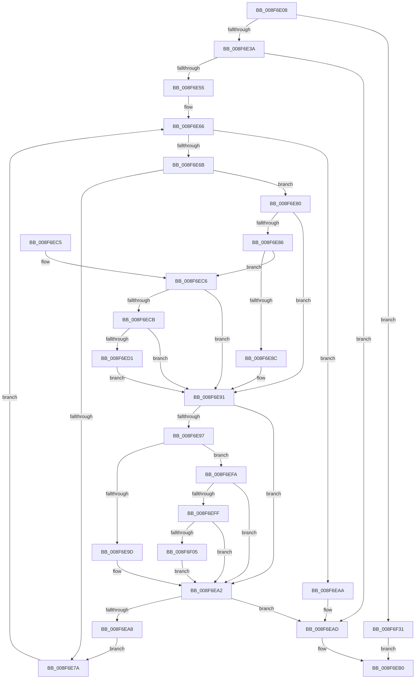

# CmIsRootEnumeratedDevice

- RVA: `0x008F6E08`–`0x008F6F38` (길이 `304` bytes)
- VA: `0x00000001408F6E08`
- 실행 섹션: `PAGE`
- PDB 이름 있음: `예`; PDB Function 태그: `아니요`
- unwind 정보 RVA: `0x000879F0`
- 디코드: `89`개 명령, `304/304` bytes 표시
- 미해석 바이트: `0` (있으면 어셈블리에 `.byte`로 보존)

> 이 문서는 커널 이미지의 기계어와 PDB 기호를 분석해 생성했습니다. 4번과 5번은 함수 원형과 자료형을 바이너리 사용 방식에서 추정한 C 해석이며 원본 소스 복구 결과는 아닙니다.

## 1. Dependencies

- 직접 호출 지점: **2**; 고유 호출 대상: **2**
- 직접 호출자로 확인된 함수: **10**
- RIP 상대 이미지 참조: **1**

### Outgoing calls
- `0x008F6E2A` → [RtlInitUnicodeStringEx](../../text/46/RtlInitUnicodeStringEx_function_00463960.md) (function, `0x00463960`)
- `0x008F6E3A` → [PsGetCurrentServerSiloGlobals](../../text/2F/PsGetCurrentServerSiloGlobals_function_002FE1F0.md) (function, `0x002FE1F0`)

### Direct callers
- [PiDevCfgCheckDeviceNeedsUpdate](../73/PiDevCfgCheckDeviceNeedsUpdate_function_00731DDC.md) at `0x0073200C`
- [PiDevCfgFindDeviceMigrationNode](../73/PiDevCfgFindDeviceMigrationNode_function_00732920.md) at `0x00732B38`
- [PiCMDeleteDeviceWorker](../73/PiCMDeleteDeviceWorker_function_0073B420.md) at `0x0073B62D`
- [PiControlGetUserFlagsFromDeviceNode](../8E/PiControlGetUserFlagsFromDeviceNode_function_008E5888.md) at `0x008E58CA`
- [PiPnpRtlSetObjectProperty](PiPnpRtlSetObjectProperty_function_008F62A0.md) at `0x008F6501`
- [PiPnpRtlSetDeviceRegProperty](../96/PiPnpRtlSetDeviceRegProperty_function_0096360C.md) at `0x00963722`
- [PiDevCfgMigrateDevice](../96/PiDevCfgMigrateDevice_function_00963E60.md) at `0x00963F68`
- [sub_00B1DC0E](../B1/Unknown_function_00B1DC0E.md) at `0x00B1DDB0`
- [sub_00B29934](../B2/Unknown_function_00B29934.md) at `0x00B2997F`
- [sub_00B29934](../B2/Unknown_function_00B29934.md) at `0x00B299FA`
- [PipResetDevice](../../init/C3/PipResetDevice_function_00C31F90.md) at `0x00C32061`

### Static image references
- `0x008F6E45` → RVA `0x00001C58` (`.rdata`; read)

## 2. Other-region calls and transfers

- 다른 실행 섹션으로 향하는 call: **2**
  - `0x008F6E2A` → [RtlInitUnicodeStringEx](../../text/46/RtlInitUnicodeStringEx_function_00463960.md) (`PAGE` → `.text`)
  - `0x008F6E3A` → [PsGetCurrentServerSiloGlobals](../../text/2F/PsGetCurrentServerSiloGlobals_function_002FE1F0.md) (`PAGE` → `.text`)
- 별도 외부 분기/꼬리 이동을 확인하지 못했습니다.

## 3. Assembly (complete function range)

```asm
008F6E08  48 8B C4                        mov rax, rsp
008F6E0B  48 89 58 08                     mov qword ptr [rax + 8], rbx
008F6E0F  48 89 68 10                     mov qword ptr [rax + 0x10], rbp
008F6E13  48 89 70 18                     mov qword ptr [rax + 0x18], rsi
008F6E17  57                              push rdi
008F6E18  48 83 EC 30                     sub rsp, 0x30
008F6E1C  0F 57 C0                        xorps xmm0, xmm0
008F6E1F  48 8B D1                        mov rdx, rcx
008F6E22  48 8D 48 E8                     lea rcx, [rax - 0x18]
008F6E26  0F 11 40 E8                     movups xmmword ptr [rax - 0x18], xmm0
008F6E2A  E8 31 CB B6 FF                  call 0x140463960
008F6E2F  45 33 D2                        xor r10d, r10d
008F6E32  85 C0                           test eax, eax
008F6E34  0F 88 F7 00 00 00               js 0x1408f6f31
008F6E3A  E8 B1 73 A0 FF                  call 0x1402fe1f0
008F6E3F  66 83 7C 24 20 0A               cmp word ptr [rsp + 0x20], 0xa
008F6E45  4C 8B 1D 0C AE 70 FF            mov r11, qword ptr [rip - 0x8f51f4]
008F6E4C  48 8B 98 B0 04 00 00            mov rbx, qword ptr [rax + 0x4b0]
008F6E53  72 58                           jb 0x1408f6ead
008F6E55  48 8B 7C 24 28                  mov rdi, qword ptr [rsp + 0x28]
008F6E5A  49 8D 73 0A                     lea rsi, [r11 + 0xa]
008F6E5E  49 2B FB                        sub rdi, r11
008F6E61  BD C0 00 00 00                  mov ebp, 0xc0
008F6E66  4C 3B DE                        cmp r11, rsi
008F6E69  73 3F                           jae 0x1408f6eaa
008F6E6B  45 0F B7 03                     movzx r8d, word ptr [r11]
008F6E6F  46 0F B7 0C 1F                  movzx r9d, word ptr [rdi + r11]
008F6E74  66 45 3B C1                     cmp r8w, r9w
008F6E78  75 06                           jne 0x1408f6e80
008F6E7A  49 83 C3 02                     add r11, 2
008F6E7E  EB E6                           jmp 0x1408f6e66
008F6E80  41 83 F8 61                     cmp r8d, 0x61
008F6E84  72 0B                           jb 0x1408f6e91
008F6E86  41 83 F8 7A                     cmp r8d, 0x7a
008F6E8A  77 3A                           ja 0x1408f6ec6
008F6E8C  66 41 83 E8 20                  sub r8w, 0x20
008F6E91  41 83 F9 61                     cmp r9d, 0x61
008F6E95  72 0B                           jb 0x1408f6ea2
008F6E97  41 83 F9 7A                     cmp r9d, 0x7a
008F6E9B  77 5D                           ja 0x1408f6efa
008F6E9D  66 41 83 E9 20                  sub r9w, 0x20
008F6EA2  66 45 3B C1                     cmp r8w, r9w
008F6EA6  75 05                           jne 0x1408f6ead
008F6EA8  EB D0                           jmp 0x1408f6e7a
008F6EAA  41 B2 01                        mov r10b, 1
008F6EAD  41 8A C2                        mov al, r10b
008F6EB0  48 8B 5C 24 40                  mov rbx, qword ptr [rsp + 0x40]
008F6EB5  48 8B 6C 24 48                  mov rbp, qword ptr [rsp + 0x48]
008F6EBA  48 8B 74 24 50                  mov rsi, qword ptr [rsp + 0x50]
008F6EBF  48 83 C4 30                     add rsp, 0x30
008F6EC3  5F                              pop rdi
008F6EC4  C3                              ret
008F6EC5  CC                              int3
008F6EC6  48 85 DB                        test rbx, rbx
008F6EC9  74 C6                           je 0x1408f6e91
008F6ECB  66 44 3B C5                     cmp r8w, bp
008F6ECF  72 C0                           jb 0x1408f6e91
008F6ED1  49 8B C0                        mov rax, r8
008F6ED4  41 8B D0                        mov edx, r8d
008F6ED7  48 C1 E8 08                     shr rax, 8
008F6EDB  83 E2 0F                        and edx, 0xf
008F6EDE  0F B7 0C 43                     movzx ecx, word ptr [rbx + rax*2]
008F6EE2  41 8B C0                        mov eax, r8d
008F6EE5  C1 E8 04                        shr eax, 4
008F6EE8  83 E0 0F                        and eax, 0xf
008F6EEB  03 C8                           add ecx, eax
008F6EED  0F B7 0C 4B                     movzx ecx, word ptr [rbx + rcx*2]
008F6EF1  03 CA                           add ecx, edx
008F6EF3  66 44 03 04 4B                  add r8w, word ptr [rbx + rcx*2]
008F6EF8  EB 97                           jmp 0x1408f6e91
008F6EFA  48 85 DB                        test rbx, rbx
008F6EFD  74 A3                           je 0x1408f6ea2
008F6EFF  66 44 3B CD                     cmp r9w, bp
008F6F03  72 9D                           jb 0x1408f6ea2
008F6F05  49 8B C1                        mov rax, r9
008F6F08  41 8B D1                        mov edx, r9d
008F6F0B  48 C1 E8 08                     shr rax, 8
008F6F0F  83 E2 0F                        and edx, 0xf
008F6F12  0F B7 0C 43                     movzx ecx, word ptr [rbx + rax*2]
008F6F16  41 8B C1                        mov eax, r9d
008F6F19  C1 E8 04                        shr eax, 4
008F6F1C  83 E0 0F                        and eax, 0xf
008F6F1F  03 C8                           add ecx, eax
008F6F21  0F B7 0C 4B                     movzx ecx, word ptr [rbx + rcx*2]
008F6F25  03 CA                           add ecx, edx
008F6F27  66 44 03 0C 4B                  add r9w, word ptr [rbx + rcx*2]
008F6F2C  E9 71 FF FF FF                  jmp 0x1408f6ea2
008F6F31  32 C0                           xor al, al
008F6F33  E9 78 FF FF FF                  jmp 0x1408f6eb0
```

## 4. C-style interpretation (structured pseudocode)

```c
__int64 __fastcall CmIsRootEnumeratedDevice(__int64 a1)
{
    __int64 result;
    __int64 v_r10;
    __int64 v_r11;
    __int64 v_rdi;
    __int64 v_rsp;
    unsigned __int64 v_stack_m10;
    unsigned __int16 v_stack_m18;
    unsigned __int64 v_stack_p10;
    unsigned __int64 v_stack_p18;
    unsigned __int64 v_stack_p8;

    *(unsigned __int64 *)(v_rsp + 8) = v_rbx;
    *(unsigned __int64 *)(v_rsp + 16) = v_rbp;
    *(unsigned __int64 *)(v_rsp + 24) = v_rsi;
    v_rsp = (v_rsp) - (48);
    *(unsigned __int64 *)(v_rsp - 24) = v_xmm0;
    result = RtlInitUnicodeStringEx(v_rsp - 24, a1, a3, a4);
    v_r10 = 0;
    if (sign_flag) goto loc_008F6F31;
    result = PsGetCurrentServerSiloGlobals(v_rsp - 24, a1, a3, a4);
    if (v_stack_m18 < 10) goto loc_008F6EAD;
    v_rdi = (v_stack_m10) - (*(unsigned __int64 *)(v_rip - 9392628));
loc_008F6E66:
    if ((*(unsigned __int64 *)(v_rip - 9392628)) >= (*(unsigned __int64 *)(v_rip - 9392628) + 10)) goto loc_008F6EAA;
    if (((unsigned __int16)(*(unsigned __int16 *)(*(unsigned __int64 *)(v_rip - 9392628)))) != ((unsigned __int16)(*(unsigned __int16 *)(v_rdi + *(unsigned __int64 *)(v_rip - 9392628) * 1)))) goto loc_008F6E80;
loc_008F6E7A:
    v_r11 = (*(unsigned __int64 *)(v_rip - 9392628)) + (2);
    goto loc_008F6E66;
loc_008F6E80:
    if (((unsigned int)(*(unsigned __int16 *)(*(unsigned __int64 *)(v_rip - 9392628)))) < 97) goto loc_008F6E91;
    if (((unsigned int)(*(unsigned __int16 *)(*(unsigned __int64 *)(v_rip - 9392628)))) > 122) goto loc_008F6EC6;
    a3 = (unsigned __int16)((*(unsigned __int16 *)(*(unsigned __int64 *)(v_rip - 9392628))) - (32));
loc_008F6E91:
    if (((unsigned int)(*(unsigned __int16 *)(v_rdi + *(unsigned __int64 *)(v_rip - 9392628) * 1))) < 97) goto loc_008F6EA2;
    if (((unsigned int)(*(unsigned __int16 *)(v_rdi + *(unsigned __int64 *)(v_rip - 9392628) * 1))) > 122) goto loc_008F6EFA;
    a4 = (unsigned __int16)((*(unsigned __int16 *)(v_rdi + *(unsigned __int64 *)(v_rip - 9392628) * 1)) - (32));
loc_008F6EA2:
    if (((unsigned __int16)(a3)) != ((unsigned __int16)(a4))) goto loc_008F6EAD;
    goto loc_008F6E7A;
loc_008F6EAA:
loc_008F6EAD:
loc_008F6EB0:
    v_rsp = (v_rsp) + (48);
    return 1;
loc_008F6EC6:
    if (v_stack_p8 == 0) goto loc_008F6E91;
    if (((unsigned __int16)(a3)) < ((unsigned __int16)(v_stack_p10))) goto loc_008F6E91;
    result = (a3) >> (8);
    a2 = (unsigned int)(((unsigned int)((unsigned int)(a3))) & (15));
    result = (unsigned int)(((unsigned int)((unsigned int)(a3))) >> (4));
    result = (unsigned int)((result) & (15));
    a1 = (unsigned int)((*(unsigned __int16 *)(v_stack_p8 + result * 2)) + ((unsigned int)(result)));
    a1 = (unsigned int)((*(unsigned __int16 *)(v_stack_p8 + a1 * 2)) + ((unsigned int)(a2)));
    a3 = (unsigned __int16)((a3) + (*(unsigned __int16 *)(v_stack_p8 + a1 * 2)));
    goto loc_008F6E91;
loc_008F6EFA:
    if (v_stack_p8 == 0) goto loc_008F6EA2;
    if (((unsigned __int16)(a4)) < ((unsigned __int16)(v_stack_p10))) goto loc_008F6EA2;
    result = (a4) >> (8);
    a2 = (unsigned int)(((unsigned int)((unsigned int)(a4))) & (15));
    result = (unsigned int)(((unsigned int)((unsigned int)(a4))) >> (4));
    result = (unsigned int)((result) & (15));
    a1 = (unsigned int)((*(unsigned __int16 *)(v_stack_p8 + result * 2)) + ((unsigned int)(result)));
    a1 = (unsigned int)((*(unsigned __int16 *)(v_stack_p8 + a1 * 2)) + ((unsigned int)(a2)));
    a4 = (unsigned __int16)((a4) + (*(unsigned __int16 *)(v_stack_p8 + a1 * 2)));
    goto loc_008F6EA2;
loc_008F6F31:
    result = 0;
    goto loc_008F6EB0;
}
```

## 5. (Beta) C Style

```c
int64_t CmIsRootEnumeratedDevice(int64_t Arg1)
{
    int64_t result;
    int64_t local_r10;
    int64_t local_r11;
    int64_t local_rdi;
    int64_t local_rsp;
    uint64_t v_stack_m10;
    uint16_t v_stack_m18;
    uint64_t v_stack_p10;
    uint64_t v_stack_p18;
    uint64_t v_stack_p8;

    *(uint64_t *)(local_rsp + 0x8) = local_rbx;
    *(uint64_t *)(local_rsp + 0x10) = local_rbp;
    *(uint64_t *)(local_rsp + 0x18) = local_rsi;
    local_rsp = (local_rsp) - (48);
    *(uint64_t *)(local_rsp - 0x18) = v_xmm0;
    result = RtlInitUnicodeStringEx(local_rsp - 24, Arg1, a3, a4);
    local_r10 = 0;
    if (sign_flag) goto loc_008F6F31;
    result = PsGetCurrentServerSiloGlobals(local_rsp - 24, Arg1, a3, a4);
    if (v_stack_m18 < 10) goto loc_008F6EAD;
    local_rdi = (v_stack_m10) - (*(uint64_t *)(v_rip - 0x8F51F4));
loc_008F6E66:
    if ((*(uint64_t *)(v_rip - 0x8F51F4)) >= (*(uint64_t *)(v_rip - 0x8F51F4) + 10)) goto loc_008F6EAA;
    if (((uint16_t)(*(uint16_t *)(*(uint64_t *)(v_rip - 0x8F51F4)))) != ((uint16_t)(*(uint16_t *)(local_rdi + *(uint64_t *)(v_rip - 0x8F51F4) * 1)))) goto loc_008F6E80;
loc_008F6E7A:
    local_r11 = (*(uint64_t *)(v_rip - 0x8F51F4)) + (2);
    goto loc_008F6E66;
loc_008F6E80:
    if (((uint32_t)(*(uint16_t *)(*(uint64_t *)(v_rip - 0x8F51F4)))) < 97) goto loc_008F6E91;
    if (((uint32_t)(*(uint16_t *)(*(uint64_t *)(v_rip - 0x8F51F4)))) > 122) goto loc_008F6EC6;
    a3 = (uint16_t)((*(uint16_t *)(*(uint64_t *)(v_rip - 0x8F51F4))) - (32));
loc_008F6E91:
    if (((uint32_t)(*(uint16_t *)(local_rdi + *(uint64_t *)(v_rip - 0x8F51F4) * 1))) < 97) goto loc_008F6EA2;
    if (((uint32_t)(*(uint16_t *)(local_rdi + *(uint64_t *)(v_rip - 0x8F51F4) * 1))) > 122) goto loc_008F6EFA;
    a4 = (uint16_t)((*(uint16_t *)(local_rdi + *(uint64_t *)(v_rip - 0x8F51F4) * 1)) - (32));
loc_008F6EA2:
    if (((uint16_t)(a3)) != ((uint16_t)(a4))) goto loc_008F6EAD;
    goto loc_008F6E7A;
loc_008F6EAA:
loc_008F6EAD:
loc_008F6EB0:
    local_rsp = (local_rsp) + (48);
    return 1;
loc_008F6EC6:
    if (v_stack_p8 == 0) goto loc_008F6E91;
    if (((uint16_t)(a3)) < ((uint16_t)(v_stack_p10))) goto loc_008F6E91;
    result = (a3) >> (8);
    a2 = (uint32_t)(((uint32_t)((uint32_t)(a3))) & (15));
    result = (uint32_t)(((uint32_t)((uint32_t)(a3))) >> (4));
    result = (uint32_t)((result) & (15));
    Arg1 = (uint32_t)((*(uint16_t *)(v_stack_p8 + result * 2)) + ((uint32_t)(result)));
    Arg1 = (uint32_t)((*(uint16_t *)(v_stack_p8 + Arg1 * 2)) + ((uint32_t)(a2)));
    a3 = (uint16_t)((a3) + (*(uint16_t *)(v_stack_p8 + Arg1 * 2)));
    goto loc_008F6E91;
loc_008F6EFA:
    if (v_stack_p8 == 0) goto loc_008F6EA2;
    if (((uint16_t)(a4)) < ((uint16_t)(v_stack_p10))) goto loc_008F6EA2;
    result = (a4) >> (8);
    a2 = (uint32_t)(((uint32_t)((uint32_t)(a4))) & (15));
    result = (uint32_t)(((uint32_t)((uint32_t)(a4))) >> (4));
    result = (uint32_t)((result) & (15));
    Arg1 = (uint32_t)((*(uint16_t *)(v_stack_p8 + result * 2)) + ((uint32_t)(result)));
    Arg1 = (uint32_t)((*(uint16_t *)(v_stack_p8 + Arg1 * 2)) + ((uint32_t)(a2)));
    a4 = (uint16_t)((a4) + (*(uint16_t *)(v_stack_p8 + Arg1 * 2)));
    goto loc_008F6EA2;
loc_008F6F31:
    result = 0;
    goto loc_008F6EB0;
}
```

## 6. Execution-region graph

[열기: 2D/3D 그래프와 함수 탐색 컨트롤 패널](../../../control-panel.html?section=page&rva=0x008F6E08&view=graph)

- 2D 그래프는 위에서 아래로 흐르고, 3D 그래프는 빈 공간을 드래그해 회전합니다. Shift+드래그는 이동, 휠은 확대·축소, 함수 노드 선택은 대상 보고서 이동입니다.

### Static fallback


