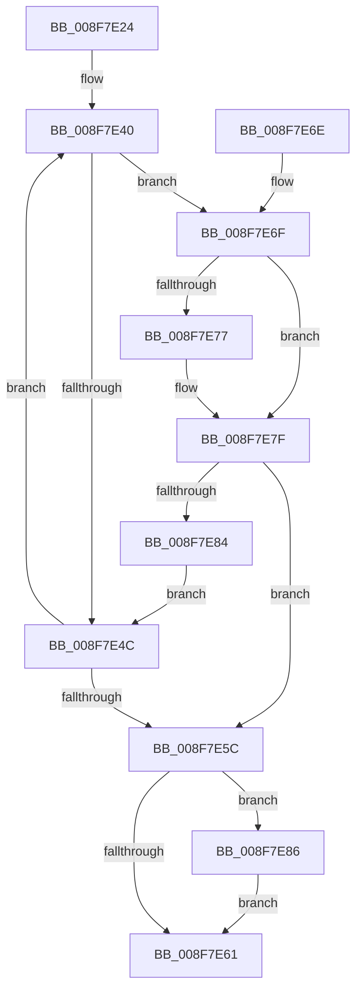

# CmMapPropertyKeyToRegProp

- RVA: `0x008F7E24`–`0x008F7E8C` (길이 `104` bytes)
- VA: `0x00000001408F7E24`
- 실행 섹션: `PAGE`
- PDB 이름 있음: `예`; PDB Function 태그: `아니요`
- unwind 정보 RVA: `0x00087B1C`
- 디코드: `33`개 명령, `104/104` bytes 표시
- 미해석 바이트: `0` (있으면 어셈블리에 `.byte`로 보존)

> 이 문서는 커널 이미지의 기계어와 PDB 기호를 분석해 생성했습니다. 4번과 5번은 함수 원형과 자료형을 바이너리 사용 방식에서 추정한 C 해석이며 원본 소스 복구 결과는 아닙니다.

## 1. Dependencies

- 직접 호출 지점: **0**; 고유 호출 대상: **0**
- 직접 호출자로 확인된 함수: **1**
- RIP 상대 이미지 참조: **1**

### Outgoing calls
- 직접 디코드된 call 명령이 없습니다.

### Direct callers
- [PnpRaiseNtPlugPlayDevicePropertyChangeEvent](PnpRaiseNtPlugPlayDevicePropertyChangeEvent_function_008F7D80.md) at `0x008F7DB3`

### Static image references
- `0x008F7E31` → RVA `0x00B4DEA0` (`CmDeviceRegPropMap`; read)

## 2. Other-region calls and transfers

- 다른 실행 섹션으로 향하는 call: **0**
- 별도 외부 분기/꼬리 이동을 확인하지 못했습니다.

## 3. Assembly (complete function range)

```asm
008F7E24  48 89 5C 24 08                  mov qword ptr [rsp + 8], rbx
008F7E29  48 89 7C 24 10                  mov qword ptr [rsp + 0x10], rdi
008F7E2E  8B 7A 10                        mov edi, dword ptr [rdx + 0x10]
008F7E31  4C 8D 0D 68 60 25 00            lea r9, [rip + 0x256068]
008F7E38  33 C9                           xor ecx, ecx
008F7E3A  48 8B DA                        mov rbx, rdx
008F7E3D  44 8B D1                        mov r10d, ecx
008F7E40  4D 8B 19                        mov r11, qword ptr [r9]
008F7E43  4D 8B C1                        mov r8, r9
008F7E46  41 3B 7B 10                     cmp edi, dword ptr [r11 + 0x10]
008F7E4A  74 23                           je 0x1408f7e6f
008F7E4C  41 FF C2                        inc r10d
008F7E4F  49 83 C1 18                     add r9, 0x18
008F7E53  4C 8B C1                        mov r8, rcx
008F7E56  41 83 FA 21                     cmp r10d, 0x21
008F7E5A  72 E4                           jb 0x1408f7e40
008F7E5C  4D 85 C0                        test r8, r8
008F7E5F  75 25                           jne 0x1408f7e86
008F7E61  48 8B 5C 24 08                  mov rbx, qword ptr [rsp + 8]
008F7E66  8B C1                           mov eax, ecx
008F7E68  48 8B 7C 24 10                  mov rdi, qword ptr [rsp + 0x10]
008F7E6D  C3                              ret
008F7E6E  CC                              int3
008F7E6F  48 8B 13                        mov rdx, qword ptr [rbx]
008F7E72  49 2B 13                        sub rdx, qword ptr [r11]
008F7E75  75 08                           jne 0x1408f7e7f
008F7E77  48 8B 53 08                     mov rdx, qword ptr [rbx + 8]
008F7E7B  49 2B 53 08                     sub rdx, qword ptr [r11 + 8]
008F7E7F  48 85 D2                        test rdx, rdx
008F7E82  74 D8                           je 0x1408f7e5c
008F7E84  EB C6                           jmp 0x1408f7e4c
008F7E86  41 8B 48 0C                     mov ecx, dword ptr [r8 + 0xc]
008F7E8A  EB D5                           jmp 0x1408f7e61
```

## 4. C-style interpretation (structured pseudocode)

```c
__int64 __fastcall CmMapPropertyKeyToRegProp(int a1, __int64 a2)
{
    __int64 v_r10;
    unsigned __int64 v_stack_p10;
    unsigned __int64 v_stack_p8;

    v_stack_p8 = v_rbx;
    v_stack_p10 = v_rdi;
    a1 = 0;
loc_008F7E40:
    if (((unsigned int)((unsigned int)(*(unsigned int *)(a2 + 16)))) == (*(unsigned int *)(*(unsigned __int64 *)(v_rip + 2449512) + 16))) goto loc_008F7E6F;
loc_008F7E4C:
    v_r10 = (unsigned int)((0) + 1);
    a4 = (v_rip + 2449512) + (24);
    if (((unsigned int)(v_r10)) < 33) goto loc_008F7E40;
loc_008F7E5C:
    if (0 != 0) goto loc_008F7E86;
loc_008F7E61:
    return 0;
loc_008F7E6F:
    a2 = (*(unsigned __int64 *)(v_stack_p8)) - (*(unsigned __int64 *)(*(unsigned __int64 *)(v_rip + 2449512)));
    if (!(condition_is_not_equal)) {
        a2 = *(unsigned __int64 *)(v_stack_p8 + 8);
        a2 = (a2) - (*(unsigned __int64 *)(*(unsigned __int64 *)(v_rip + 2449512) + 8));
    }
    if (a2 == 0) goto loc_008F7E5C;
    goto loc_008F7E4C;
loc_008F7E86:
    goto loc_008F7E61;
}
```

## 5. (Beta) C Style

```c
int64_t CmMapPropertyKeyToRegProp(int32_t Arg1, void *Arg2)
{
    uint8_t *arg2 = (uint8_t *)Arg2;

    int64_t local_r10;
    uint64_t v_stack_p10;
    uint64_t v_stack_p8;

    v_stack_p8 = local_rbx;
    v_stack_p10 = local_rdi;
    Arg1 = 0;
loc_008F7E40:
    if (((uint32_t)((uint32_t)(*(uint32_t *)(arg2 + 0x10)))) == (*(uint32_t *)(*(uint64_t *)(v_rip + 0x256068) + 0x10))) goto loc_008F7E6F;
loc_008F7E4C:
    local_r10 = (uint32_t)((0) + 1);
    a4 = (v_rip + 2449512) + (24);
    if (((uint32_t)(local_r10)) < 33) goto loc_008F7E40;
loc_008F7E5C:
    if (0 != 0) goto loc_008F7E86;
loc_008F7E61:
    return 0;
loc_008F7E6F:
    Arg2 = (*(uint64_t *)(v_stack_p8)) - (*(uint64_t *)(*(uint64_t *)(v_rip + 0x256068)));
    if (!(condition_is_not_equal)) {
        Arg2 = *(uint64_t *)(v_stack_p8 + 0x8);
        Arg2 = (Arg2) - (*(uint64_t *)(*(uint64_t *)(v_rip + 0x256068) + 0x8));
    }
    if (Arg2 == NULL) goto loc_008F7E5C;
    goto loc_008F7E4C;
loc_008F7E86:
    goto loc_008F7E61;
}
```

### 관측된 메모리 오프셋

구조체 형식이 확인되지 않은 접근은 인자 기준의 오프셋으로만 기록했습니다.

| 기준 인자 | 오프셋 표현 | 폭 (bit) | 접근 |
|---|---:|---:|---|
| `Arg2` | `+ 0x0` | `64` | `R` |
| `Arg2` | `+ 0x8` | `64` | `R` |
| `Arg2` | `+ 0x10` | `32` | `R` |

## 6. Execution-region graph

[열기: 2D/3D 그래프와 함수 탐색 컨트롤 패널](../../../control-panel.html?section=page&rva=0x008F7E24&view=graph)

- 2D 그래프는 위에서 아래로 흐르고, 3D 그래프는 빈 공간을 드래그해 회전합니다. Shift+드래그는 이동, 휠은 확대·축소, 함수 노드 선택은 대상 보고서 이동입니다.

### Static fallback


