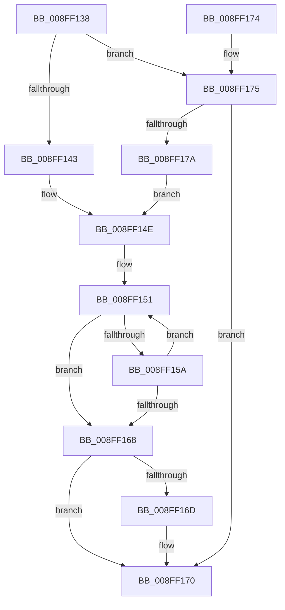

# CmMapRegPropToPropertyKey

- RVA: `0x008FF138`–`0x008FF189` (길이 `81` bytes)
- VA: `0x00000001408FF138`
- 실행 섹션: `PAGE`
- PDB 이름 있음: `예`; PDB Function 태그: `아니요`
- unwind 정보 RVA: `0x000DB714`
- 디코드: `26`개 명령, `81/81` bytes 표시
- 미해석 바이트: `0` (있으면 어셈블리에 `.byte`로 보존)

> 이 문서는 커널 이미지의 기계어와 PDB 기호를 분석해 생성했습니다. 4번과 5번은 함수 원형과 자료형을 바이너리 사용 방식에서 추정한 C 해석이며 원본 소스 복구 결과는 아닙니다.

## 1. Dependencies

- 직접 호출 지점: **0**; 고유 호출 대상: **0**
- 직접 호출자로 확인된 함수: **1**
- RIP 상대 이미지 참조: **2**

### Outgoing calls
- 직접 디코드된 call 명령이 없습니다.

### Direct callers
- [CmRaisePropertyChangeEvent](CmRaisePropertyChangeEvent_function_008FE93C.md) at `0x008FE970`

### Static image references
- `0x008FF143` → RVA `0x00B4DEA0` (`CmDeviceRegPropMap`; read)
- `0x008FF17A` → RVA `0x00B4C710` (`CmClassRegPropMap`; read)

## 2. Other-region calls and transfers

- 다른 실행 섹션으로 향하는 call: **0**
- 별도 외부 분기/꼬리 이동을 확인하지 못했습니다.

## 3. Assembly (complete function range)

```asm
008FF138  45 33 C0                        xor r8d, r8d
008FF13B  44 8B D2                        mov r10d, edx
008FF13E  83 E9 01                        sub ecx, 1
008FF141  75 32                           jne 0x1408ff175
008FF143  48 8D 0D 56 ED 24 00            lea rcx, [rip + 0x24ed56]
008FF14A  45 8D 48 21                     lea r9d, [r8 + 0x21]
008FF14E  41 8B D0                        mov edx, r8d
008FF151  48 8B C1                        mov rax, rcx
008FF154  44 39 51 0C                     cmp dword ptr [rcx + 0xc], r10d
008FF158  74 0E                           je 0x1408ff168
008FF15A  FF C2                           inc edx
008FF15C  48 83 C1 18                     add rcx, 0x18
008FF160  49 8B C0                        mov rax, r8
008FF163  41 3B D1                        cmp edx, r9d
008FF166  72 E9                           jb 0x1408ff151
008FF168  48 85 C0                        test rax, rax
008FF16B  74 03                           je 0x1408ff170
008FF16D  4C 8B 00                        mov r8, qword ptr [rax]
008FF170  49 8B C0                        mov rax, r8
008FF173  C3                              ret
008FF174  CC                              int3
008FF175  83 F9 01                        cmp ecx, 1
008FF178  75 F6                           jne 0x1408ff170
008FF17A  48 8D 0D 8F D5 24 00            lea rcx, [rip + 0x24d58f]
008FF181  41 B9 09 00 00 00               mov r9d, 9
008FF187  EB C5                           jmp 0x1408ff14e
```

## 4. C-style interpretation (structured pseudocode)

```c
__int64 __fastcall CmMapRegPropToPropertyKey(int a1, int a2, int a3)
{
    a3 = 0;
    a1 = (unsigned int)((a1) - (1));
    if (condition_is_not_equal) goto loc_008FF175;
loc_008FF14E:
loc_008FF151:
    if ((*(unsigned int *)(v_rip + 2420054 + 12)) == ((unsigned int)((unsigned int)(a2)))) goto loc_008FF168;
    a2 = (unsigned int)((0) + 1);
    a1 = (v_rip + 2420054) + (24);
    if (a2 < ((unsigned int)(a3 + 33))) goto loc_008FF151;
loc_008FF168:
    if (0 != 0) {
        a3 = *(unsigned __int64 *)(0);
    }
    return a3;
loc_008FF175:
    if (a1 != 1) goto loc_008FF170;
    goto loc_008FF14E;
}
```

## 5. (Beta) C Style

```c
int64_t CmMapRegPropToPropertyKey(int32_t Arg1, int32_t Arg2, int32_t Arg3)
{
    Arg3 = 0;
    Arg1 = (uint32_t)((Arg1) - (1));
    if (condition_is_not_equal) goto loc_008FF175;
loc_008FF14E:
loc_008FF151:
    if ((*(uint32_t *)(v_rip + 0x24ED56 + 0xC)) == ((uint32_t)((uint32_t)(Arg2)))) goto loc_008FF168;
    Arg2 = (uint32_t)((0) + 1);
    Arg1 = (v_rip + 2420054) + (24);
    if (Arg2 < ((uint32_t)(Arg3 + 33))) goto loc_008FF151;
loc_008FF168:
    if (0 != 0) {
        Arg3 = *(uint64_t *)(0);
    }
    return Arg3;
loc_008FF175:
    if (Arg1 != 1) goto loc_008FF170;
    goto loc_008FF14E;
}
```

## 6. Execution-region graph

[열기: 2D/3D 그래프와 함수 탐색 컨트롤 패널](../../../control-panel.html?section=page&rva=0x008FF138&view=graph)

- 2D 그래프는 위에서 아래로 흐르고, 3D 그래프는 빈 공간을 드래그해 회전합니다. Shift+드래그는 이동, 휠은 확대·축소, 함수 노드 선택은 대상 보고서 이동입니다.

### Static fallback


