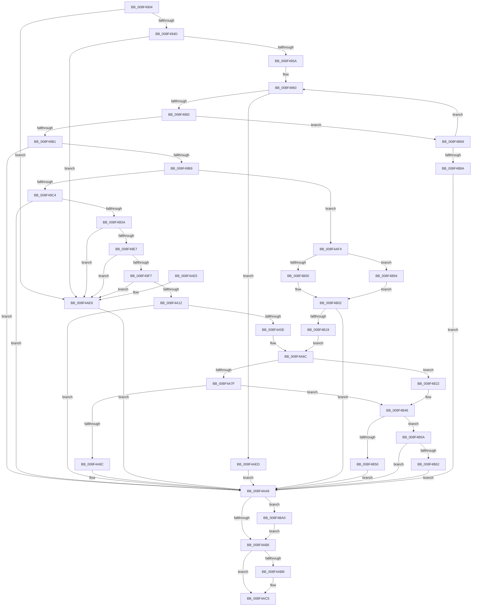

# CmOpenDeviceContainerRegKeyWorker

- RVA: `0x008F4904`–`0x008F4BAA` (길이 `678` bytes)
- VA: `0x00000001408F4904`
- 실행 섹션: `PAGE`
- PDB 이름 있음: `예`; PDB Function 태그: `아니요`
- unwind 정보 RVA: `0x00087720`
- 디코드: `179`개 명령, `678/678` bytes 표시
- 미해석 바이트: `0` (있으면 어셈블리에 `.byte`로 보존)

> 이 문서는 커널 이미지의 기계어와 PDB 기호를 분석해 생성했습니다. 4번과 5번은 함수 원형과 자료형을 바이너리 사용 방식에서 추정한 C 해석이며 원본 소스 복구 결과는 아닙니다.

## 1. Dependencies

- 직접 호출 지점: **12**; 고유 호출 대상: **10**
- 직접 호출자로 확인된 함수: **1**
- RIP 상대 이미지 참조: **2**

### Outgoing calls
- `0x008F496E` → [ExAllocatePool2](../../poolcode/B8/ExAllocatePool2_function_00B820F0.md) (function, `0x00B820F0`)
- `0x008F499F` → [CmGetDeviceContainerRegKeyPath](CmGetDeviceContainerRegKeyPath_function_008F4804.md) (function, `0x008F4804`)
- `0x008F49CB` → [RtlInitUnicodeStringEx](../../text/46/RtlInitUnicodeStringEx_function_00463960.md) (function, `0x00463960`)
- `0x008F4A05` → [RtlPrefixUnicodeString](RtlPrefixUnicodeString_function_008F4F70.md) (function, `0x008F4F70`)
- `0x008F4A38` → [RtlPrefixUnicodeString](RtlPrefixUnicodeString_function_008F4F70.md) (function, `0x008F4F70`)
- `0x008F4A53` → [_PnpCtxGetCachedContextBaseKey](../8E/_PnpCtxGetCachedContextBaseKey_function_008EFB2C.md) (function, `0x008EFB2C`)
- `0x008F4A8F` → [PnpCtxRegOpenKey](../8E/PnpCtxRegOpenKey_function_008EF7B8.md) (function, `0x008EF7B8`)
- `0x008F4AC0` → [ExFreePoolWithTag](../../poolcode/B8/ExFreePoolWithTag_function_00B82870.md) (function, `0x00B82870`)
- `0x008F4B0E` → [SysCtxRegOpenCurrentUserKey](SysCtxRegOpenCurrentUserKey_function_008F455C.md) (function, `0x008F455C`)
- `0x008F4B41` → [PnpCtxRegCreateTree](../93/PnpCtxRegCreateTree_function_00931CA0.md) (function, `0x00931CA0`)
- `0x008F4B6E` → [ExFreePoolWithTag](../../poolcode/B8/ExFreePoolWithTag_function_00B82870.md) (function, `0x00B82870`)
- `0x008F4BA0` → [ZwClose](../../text/6A/ZwClose_function_006AD2B0.md) (function, `0x006AD2B0`)

### Direct callers
- [_CmOpenDeviceContainerRegKey](_CmOpenDeviceContainerRegKey_function_008F5C80.md) at `0x008F5D46`

### Static image references
- `0x008F49FE` → RVA `0x00001A08` (`.rdata`; read)
- `0x008F4A31` → RVA `0x00001BD8` (`.rdata`; read)

## 2. Other-region calls and transfers

- 다른 실행 섹션으로 향하는 call: **5**
  - `0x008F496E` → [ExAllocatePool2](../../poolcode/B8/ExAllocatePool2_function_00B820F0.md) (`PAGE` → `POOLCODE`)
  - `0x008F49CB` → [RtlInitUnicodeStringEx](../../text/46/RtlInitUnicodeStringEx_function_00463960.md) (`PAGE` → `.text`)
  - `0x008F4AC0` → [ExFreePoolWithTag](../../poolcode/B8/ExFreePoolWithTag_function_00B82870.md) (`PAGE` → `POOLCODE`)
  - `0x008F4B6E` → [ExFreePoolWithTag](../../poolcode/B8/ExFreePoolWithTag_function_00B82870.md) (`PAGE` → `POOLCODE`)
  - `0x008F4BA0` → [ZwClose](../../text/6A/ZwClose_function_006AD2B0.md) (`PAGE` → `.text`)
- 별도 외부 분기/꼬리 이동을 확인하지 못했습니다.

## 3. Assembly (complete function range)

```asm
008F4904  48 8B C4                        mov rax, rsp
008F4907  48 89 58 08                     mov qword ptr [rax + 8], rbx
008F490B  48 89 70 10                     mov qword ptr [rax + 0x10], rsi
008F490F  48 89 78 18                     mov qword ptr [rax + 0x18], rdi
008F4913  44 89 48 20                     mov dword ptr [rax + 0x20], r9d
008F4917  55                              push rbp
008F4918  41 54                           push r12
008F491A  41 55                           push r13
008F491C  41 56                           push r14
008F491E  41 57                           push r15
008F4920  48 8B EC                        mov rbp, rsp
008F4923  48 83 EC 60                     sub rsp, 0x60
008F4927  33 FF                           xor edi, edi
008F4929  0F 57 C0                        xorps xmm0, xmm0
008F492C  21 7D 48                        and dword ptr [rbp + 0x48], edi
008F492F  45 8B F8                        mov r15d, r8d
008F4932  48 21 7D E8                     and qword ptr [rbp - 0x18], rdi
008F4936  4C 8B E2                        mov r12, rdx
008F4939  48 21 7D E0                     and qword ptr [rbp - 0x20], rdi
008F493D  4C 8B E9                        mov r13, rcx
008F4940  0F 11 45 F0                     movups xmmword ptr [rbp - 0x10], xmm0
008F4944  45 85 C0                        test r8d, r8d
008F4947  0F 84 99 01 00 00               je 0x1408f4ae6
008F494D  41 F7 C0 AF FE FF FF            test r8d, 0xfffffeaf
008F4954  0F 85 8C 01 00 00               jne 0x1408f4ae6
008F495A  41 BE 04 01 00 00               mov r14d, 0x104
008F4960  41 8B D6                        mov edx, r14d
008F4963  B9 00 01 00 00                  mov ecx, 0x100
008F4968  41 B8 50 4E 50 52               mov r8d, 0x52504e50
008F496E  E8 7D D7 28 00                  call 0x140b820f0
008F4973  48 8B F8                        mov rdi, rax
008F4976  48 8B F0                        mov rsi, rax
008F4979  48 85 C0                        test rax, rax
008F497C  0F 84 6B 01 00 00               je 0x1408f4aed
008F4982  41 8B CE                        mov ecx, r14d
008F4985  48 8D 45 48                     lea rax, [rbp + 0x48]
008F4989  48 89 44 24 38                  mov qword ptr [rsp + 0x38], rax
008F498E  45 8B C7                        mov r8d, r15d
008F4991  D1 E9                           shr ecx, 1
008F4993  49 8B D4                        mov rdx, r12
008F4996  89 4C 24 30                     mov dword ptr [rsp + 0x30], ecx
008F499A  48 89 74 24 28                  mov qword ptr [rsp + 0x28], rsi
008F499F  E8 60 FE FF FF                  call 0x1408f4804
008F49A4  8B D8                           mov ebx, eax
008F49A6  3D 23 00 00 C0                  cmp eax, 0xc0000023
008F49AB  0F 84 B8 01 00 00               je 0x1408f4b69
008F49B1  85 C0                           test eax, eax
008F49B3  0F 88 F0 00 00 00               js 0x1408f4aa9
008F49B9  41 0F BA E7 08                  bt r15d, 8
008F49BE  0F 82 30 01 00 00               jb 0x1408f4af4
008F49C4  48 8B D6                        mov rdx, rsi
008F49C7  48 8D 4D F0                     lea rcx, [rbp - 0x10]
008F49CB  E8 90 EF B6 FF                  call 0x140463960
008F49D0  8B D8                           mov ebx, eax
008F49D2  85 C0                           test eax, eax
008F49D4  0F 88 CF 00 00 00               js 0x1408f4aa9
008F49DA  0F B7 5D F0                     movzx ebx, word ptr [rbp - 0x10]
008F49DE  41 3B DE                        cmp ebx, r14d
008F49E1  0F 83 FF 00 00 00               jae 0x1408f4ae6
008F49E7  41 BC 32 00 00 00               mov r12d, 0x32
008F49ED  66 41 3B DC                     cmp bx, r12w
008F49F1  0F 86 EF 00 00 00               jbe 0x1408f4ae6
008F49F7  41 B0 01                        mov r8b, 1
008F49FA  48 8D 55 F0                     lea rdx, [rbp - 0x10]
008F49FE  48 8D 0D 03 D0 70 FF            lea rcx, [rip - 0x8f2ffd]
008F4A05  E8 66 05 00 00                  call 0x1408f4f70
008F4A0A  84 C0                           test al, al
008F4A0C  0F 84 D4 00 00 00               je 0x1408f4ae6
008F4A12  B8 CE FF 00 00                  mov eax, 0xffce
008F4A17  4C 8D 76 32                     lea r14, [rsi + 0x32]
008F4A1B  66 01 45 F2                     add word ptr [rbp - 0xe], ax
008F4A1F  48 8D 55 F0                     lea rdx, [rbp - 0x10]
008F4A23  66 03 D8                        add bx, ax
008F4A26  4C 89 75 F8                     mov qword ptr [rbp - 8], r14
008F4A2A  41 B0 01                        mov r8b, 1
008F4A2D  66 89 5D F0                     mov word ptr [rbp - 0x10], bx
008F4A31  48 8D 0D A0 D1 70 FF            lea rcx, [rip - 0x8f2e60]
008F4A38  E8 33 05 00 00                  call 0x1408f4f70
008F4A3D  8A C8                           mov cl, al
008F4A3F  4C 8D 45 E8                     lea r8, [rbp - 0x18]
008F4A43  F6 D9                           neg cl
008F4A45  44 8A F8                        mov r15b, al
008F4A48  49 8B CD                        mov rcx, r13
008F4A4B  1B D2                           sbb edx, edx
008F4A4D  83 E2 06                        and edx, 6
008F4A50  83 C2 04                        add edx, 4
008F4A53  E8 D4 B0 FF FF                  call 0x1408efb2c
008F4A58  8B D8                           mov ebx, eax
008F4A5A  85 C0                           test eax, eax
008F4A5C  78 4B                           js 0x1408f4aa9
008F4A5E  48 8B 55 E8                     mov rdx, qword ptr [rbp - 0x18]
008F4A62  45 84 FF                        test r15b, r15b
008F4A65  4C 0F 44 F6                     cmove r14, rsi
008F4A69  4D 03 F4                        add r14, r12
008F4A6C  45 33 C9                        xor r9d, r9d
008F4A6F  4D 8B C6                        mov r8, r14
008F4A72  49 8B CD                        mov rcx, r13
008F4A75  44 38 4D 58                     cmp byte ptr [rbp + 0x58], r9b
008F4A79  0F 85 A3 00 00 00               jne 0x1408f4b22
008F4A7F  48 8B 45 60                     mov rax, qword ptr [rbp + 0x60]
008F4A83  48 89 44 24 28                  mov qword ptr [rsp + 0x28], rax
008F4A88  8B 45 50                        mov eax, dword ptr [rbp + 0x50]
008F4A8B  89 44 24 20                     mov dword ptr [rsp + 0x20], eax
008F4A8F  E8 24 AD FF FF                  call 0x1408ef7b8
008F4A94  85 C0                           test eax, eax
008F4A96  0F 88 AA 00 00 00               js 0x1408f4b46
008F4A9C  48 8B 45 68                     mov rax, qword ptr [rbp + 0x68]
008F4AA0  48 8B FE                        mov rdi, rsi
008F4AA3  C7 00 02 00 00 00               mov dword ptr [rax], 2
008F4AA9  48 8B 4D E0                     mov rcx, qword ptr [rbp - 0x20]
008F4AAD  48 85 C9                        test rcx, rcx
008F4AB0  0F 85 EA 00 00 00               jne 0x1408f4ba0
008F4AB6  48 85 FF                        test rdi, rdi
008F4AB9  74 0A                           je 0x1408f4ac5
008F4ABB  33 D2                           xor edx, edx
008F4ABD  48 8B CF                        mov rcx, rdi
008F4AC0  E8 AB DD 28 00                  call 0x140b82870
008F4AC5  4C 8D 5C 24 60                  lea r11, [rsp + 0x60]
008F4ACA  8B C3                           mov eax, ebx
008F4ACC  49 8B 5B 30                     mov rbx, qword ptr [r11 + 0x30]
008F4AD0  49 8B 73 38                     mov rsi, qword ptr [r11 + 0x38]
008F4AD4  49 8B 7B 40                     mov rdi, qword ptr [r11 + 0x40]
008F4AD8  49 8B E3                        mov rsp, r11
008F4ADB  41 5F                           pop r15
008F4ADD  41 5E                           pop r14
008F4ADF  41 5D                           pop r13
008F4AE1  41 5C                           pop r12
008F4AE3  5D                              pop rbp
008F4AE4  C3                              ret
008F4AE5  CC                              int3
008F4AE6  BB 0D 00 00 C0                  mov ebx, 0xc000000d
008F4AEB  EB BC                           jmp 0x1408f4aa9
008F4AED  BB 17 00 00 C0                  mov ebx, 0xc0000017
008F4AF2  EB B5                           jmp 0x1408f4aa9
008F4AF4  4C 8B F6                        mov r14, rsi
008F4AF7  4D 85 ED                        test r13, r13
008F4AFA  0F 85 94 00 00 00               jne 0x1408f4b94
008F4B00  33 C9                           xor ecx, ecx
008F4B02  4C 8D 4D E0                     lea r9, [rbp - 0x20]
008F4B06  33 D2                           xor edx, edx
008F4B08  41 B8 00 00 00 02               mov r8d, 0x2000000
008F4B0E  E8 49 FA FF FF                  call 0x1408f455c
008F4B13  8B D8                           mov ebx, eax
008F4B15  85 C0                           test eax, eax
008F4B17  78 90                           js 0x1408f4aa9
008F4B19  48 8B 55 E0                     mov rdx, qword ptr [rbp - 0x20]
008F4B1D  E9 4A FF FF FF                  jmp 0x1408f4a6c
008F4B22  48 8B 45 68                     mov rax, qword ptr [rbp + 0x68]
008F4B26  48 89 44 24 38                  mov qword ptr [rsp + 0x38], rax
008F4B2B  48 8B 45 60                     mov rax, qword ptr [rbp + 0x60]
008F4B2F  48 89 44 24 30                  mov qword ptr [rsp + 0x30], rax
008F4B34  48 83 64 24 28 00               and qword ptr [rsp + 0x28], 0
008F4B3A  8B 45 50                        mov eax, dword ptr [rbp + 0x50]
008F4B3D  89 44 24 20                     mov dword ptr [rsp + 0x20], eax
008F4B41  E8 5A D1 03 00                  call 0x140931ca0
008F4B46  48 8B FE                        mov rdi, rsi
008F4B49  3D 7C 01 00 C0                  cmp eax, 0xc000017c
008F4B4E  75 0A                           jne 0x1408f4b5a
008F4B50  BB E5 00 00 C0                  mov ebx, 0xc00000e5
008F4B55  E9 4F FF FF FF                  jmp 0x1408f4aa9
008F4B5A  85 C0                           test eax, eax
008F4B5C  0F 89 47 FF FF FF               jns 0x1408f4aa9
008F4B62  8B D8                           mov ebx, eax
008F4B64  E9 40 FF FF FF                  jmp 0x1408f4aa9
008F4B69  33 D2                           xor edx, edx
008F4B6B  48 8B CF                        mov rcx, rdi
008F4B6E  E8 FD DC 28 00                  call 0x140b82870
008F4B73  44 8B 75 48                     mov r14d, dword ptr [rbp + 0x48]
008F4B77  33 FF                           xor edi, edi
008F4B79  4D 03 F6                        add r14, r14
008F4B7C  B8 FF FF FF FF                  mov eax, 0xffffffff
008F4B81  4C 3B F0                        cmp r14, rax
008F4B84  0F 86 D6 FD FF FF               jbe 0x1408f4960
008F4B8A  BB 95 00 00 C0                  mov ebx, 0xc0000095
008F4B8F  E9 15 FF FF FF                  jmp 0x1408f4aa9
008F4B94  49 8B 8D E0 00 00 00            mov rcx, qword ptr [r13 + 0xe0]
008F4B9B  E9 62 FF FF FF                  jmp 0x1408f4b02
008F4BA0  E8 0B 87 DB FF                  call 0x1406ad2b0
008F4BA5  E9 0C FF FF FF                  jmp 0x1408f4ab6
```

## 4. C-style interpretation (structured pseudocode)

```c
__int64 __fastcall CmOpenDeviceContainerRegKeyWorker(__int64 a1, __int64 a2, int a3, int a4, unsigned int a5, unsigned __int8 a6, __int64 a7, __int64 a8)
{
    __int64 result;
    __int64 v_r14;
    __int64 v_rbx;
    __int64 v_rdi;
    __int64 v_rsp;
    unsigned __int64 v_stack_m28;
    unsigned __int64 v_stack_m30;
    unsigned __int16 v_stack_m36;
    unsigned __int64 v_stack_m38;
    unsigned __int64 v_stack_m40;
    unsigned __int64 v_stack_m48;
    unsigned __int64 v_stack_m50;
    unsigned int v_stack_m58;
    unsigned __int64 v_stack_m60;
    unsigned int v_stack_m68;
    unsigned int v_stack_p20;

    *(unsigned __int64 *)(v_rsp + 8) = v_rbx;
    *(unsigned __int64 *)(v_rsp + 16) = v_rsi;
    *(unsigned __int64 *)(v_rsp + 24) = v_rdi;
    *(unsigned int *)(v_rsp + 32) = a4;
    v_rsp = (v_rsp) - (96);
    v_rdi = 0;
    v_stack_m38 = v_xmm0;
    if (a3 == 0) goto loc_008F4AE6;
    if (((a3) & (0xFFFFFEAFULL)) != 0) goto loc_008F4AE6;
loc_008F4960:
    result = ExAllocatePool2(256, 260, (unsigned int)(0x52504E50ULL), a4);
    if (result == 0) goto loc_008F4AED;
    v_stack_m50 = v_stack_p20;
    a1 = (unsigned int)((260) >> (1));
    v_stack_m58 = (unsigned int)(a1);
    v_stack_m60 = result;
    result = CmGetDeviceContainerRegKeyPath(a1, a2, (unsigned int)((unsigned int)((unsigned int)(a3))), a4);
    if (((unsigned int)(result)) == 0xC0000023ULL) goto loc_008F4B69;
    if (sign_flag) goto loc_008F4AA9;
    if (condition_is_below) goto loc_008F4AF4;
    result = RtlInitUnicodeStringEx(v_stack_m38, result, (unsigned int)((unsigned int)((unsigned int)(a3))), a4);
    if (sign_flag) goto loc_008F4AA9;
    if (((unsigned int)(v_stack_m38)) >= 260) goto loc_008F4AE6;
    if (((unsigned __int16)(v_stack_m38)) <= 50) goto loc_008F4AE6;
    result = RtlPrefixUnicodeString(v_rip - 9383933, v_stack_m38, 1, a4);
    if ((unsigned __int8)(result) == 0) goto loc_008F4AE6;
    v_rbx = (unsigned __int16)((v_stack_m38) + ((unsigned __int16)((unsigned int)(0xFFCEULL))));
    v_stack_m30 = result + 50;
    v_stack_m38 = (unsigned __int16)(v_rbx);
    result = RtlPrefixUnicodeString(v_rip - 9383520, v_stack_m38, 1, a4);
    a1 = (unsigned __int8)(-((unsigned __int8)(result)));
    a2 = (unsigned int)((v_stack_m38) & (6));
    a2 = (unsigned int)((a2) + (4));
    result = _PnpCtxGetCachedContextBaseKey(a1, a2, v_stack_m40, a4);
    if (sign_flag) goto loc_008F4AA9;
    v_r14 = result + 50;
    if ((unsigned __int8)((unsigned __int8)(result)) == 0) { v_r14 = result; }
    v_r14 = (v_r14) + (50);
loc_008F4A6C:
    a4 = 0;
    if (a6 != 0) goto loc_008F4B22;
    v_stack_m60 = a7;
    v_stack_m68 = (unsigned int)((unsigned int)(a5));
    result = PnpCtxRegOpenKey(a1, v_stack_m40, v_r14, a4);
    if (sign_flag) goto loc_008F4B46;
    *(unsigned int *)(a8) = 2;
loc_008F4AA9:
    if (v_stack_m48 != 0) goto loc_008F4BA0;
loc_008F4AB6:
    result = a8;
    if (result != 0) {
        a2 = 0;
        a1 = result;
        result = ExFreePoolWithTag(a1, a2, v_r14, a4);
    }
    return (unsigned int)((unsigned int)((unsigned int)((unsigned int)(result))));
loc_008F4AE6:
    goto loc_008F4AA9;
loc_008F4AED:
    goto loc_008F4AA9;
loc_008F4AF4:
    if (a1 != 0) goto loc_008F4B94;
    a1 = 0;
loc_008F4B02:
    a2 = 0;
    result = SysCtxRegOpenCurrentUserKey(a1, a2, (unsigned int)(0x2000000ULL), v_stack_m48);
    if (sign_flag) goto loc_008F4AA9;
    goto loc_008F4A6C;
loc_008F4B22:
    v_stack_m28 = a8;
    v_stack_m30 = a7;
    v_stack_m40 = (unsigned int)((unsigned int)(a5));
    result = PnpCtxRegCreateTree(a1, v_stack_m48, (unsigned int)(0x2000000ULL), v_stack_m48);
loc_008F4B46:
    if (((unsigned int)(result)) != 0xC000017CULL) goto loc_008F4B5A;
    goto loc_008F4AA9;
loc_008F4B5A:
    if (!sign_flag) goto loc_008F4AA9;
    goto loc_008F4AA9;
loc_008F4B69:
    a2 = 0;
    result = ExFreePoolWithTag(*(unsigned __int64 *)(v_stack_m28 + 56), a2, (unsigned int)(0x2000000ULL), v_stack_m48);
    v_rdi = 0;
    v_r14 = ((unsigned int)(v_stack_p20)) + ((unsigned int)(v_stack_p20));
    if (v_r14 <= ((unsigned int)(0xFFFFFFFFULL))) goto loc_008F4960;
    goto loc_008F4AA9;
loc_008F4B94:
    goto loc_008F4B02;
loc_008F4BA0:
    result = ZwClose(*(unsigned __int64 *)(a1 + 224), a2, (unsigned int)(0x2000000ULL), v_stack_m48);
    goto loc_008F4AB6;
}
```

## 5. (Beta) C Style

```c
int64_t CmOpenDeviceContainerRegKeyWorker(int64_t Arg1, int64_t Arg2, int32_t Arg3, int32_t Arg4, uint32_t Arg5, uint8_t Arg6, int64_t Arg7, void *Arg8)
{
    uint8_t *arg8 = (uint8_t *)Arg8;

    int64_t result;
    int64_t local_r14;
    int64_t local_rbx;
    int64_t local_rdi;
    int64_t local_rsp;
    uint64_t v_stack_m28;
    uint64_t v_stack_m30;
    uint16_t v_stack_m36;
    uint64_t v_stack_m38;
    uint64_t v_stack_m40;
    uint64_t v_stack_m48;
    uint64_t v_stack_m50;
    uint32_t v_stack_m58;
    uint64_t v_stack_m60;
    uint32_t v_stack_m68;
    uint32_t v_stack_p20;

    *(uint64_t *)(local_rsp + 0x8) = local_rbx;
    *(uint64_t *)(local_rsp + 0x10) = local_rsi;
    *(uint64_t *)(local_rsp + 0x18) = local_rdi;
    *(uint32_t *)(local_rsp + 0x20) = Arg4;
    local_rsp = (local_rsp) - (96);
    local_rdi = 0;
    v_stack_m38 = v_xmm0;
    if (Arg3 == 0) goto loc_008F4AE6;
    if (((Arg3) & (0xFFFFFEAFULL)) != 0) goto loc_008F4AE6;
loc_008F4960:
    result = ExAllocatePool2(256, 260, (uint32_t)(0x52504E50ULL), Arg4);
    if (result == 0) goto loc_008F4AED;
    v_stack_m50 = v_stack_p20;
    Arg1 = (uint32_t)((260) >> (1));
    v_stack_m58 = (uint32_t)(Arg1);
    v_stack_m60 = result;
    result = CmGetDeviceContainerRegKeyPath(Arg1, Arg2, (uint32_t)((uint32_t)((uint32_t)(Arg3))), Arg4);
    if (((uint32_t)(result)) == 0xC0000023ULL) goto loc_008F4B69;
    if (sign_flag) goto loc_008F4AA9;
    if (condition_is_below) goto loc_008F4AF4;
    result = RtlInitUnicodeStringEx(v_stack_m38, result, (uint32_t)((uint32_t)((uint32_t)(Arg3))), Arg4);
    if (sign_flag) goto loc_008F4AA9;
    if (((uint32_t)(v_stack_m38)) >= 260) goto loc_008F4AE6;
    if (((uint16_t)(v_stack_m38)) <= 50) goto loc_008F4AE6;
    result = RtlPrefixUnicodeString(v_rip - 9383933, v_stack_m38, 1, Arg4);
    if ((uint8_t)(result) == 0) goto loc_008F4AE6;
    local_rbx = (uint16_t)((v_stack_m38) + ((uint16_t)((uint32_t)(0xFFCEULL))));
    v_stack_m30 = result + 50;
    v_stack_m38 = (uint16_t)(local_rbx);
    result = RtlPrefixUnicodeString(v_rip - 9383520, v_stack_m38, 1, Arg4);
    Arg1 = (uint8_t)(-((uint8_t)(result)));
    Arg2 = (uint32_t)((v_stack_m38) & (6));
    Arg2 = (uint32_t)((Arg2) + (4));
    result = _PnpCtxGetCachedContextBaseKey(Arg1, Arg2, v_stack_m40, Arg4);
    if (sign_flag) goto loc_008F4AA9;
    local_r14 = result + 50;
    if ((uint8_t)((uint8_t)(result)) == 0) { local_r14 = result; }
    local_r14 = (local_r14) + (50);
loc_008F4A6C:
    Arg4 = 0;
    if (Arg6 != 0) goto loc_008F4B22;
    v_stack_m60 = Arg7;
    v_stack_m68 = (uint32_t)((uint32_t)(Arg5));
    result = PnpCtxRegOpenKey(Arg1, v_stack_m40, local_r14, Arg4);
    if (sign_flag) goto loc_008F4B46;
    *(uint32_t *)(arg8) = 2;
loc_008F4AA9:
    if (v_stack_m48 != 0) goto loc_008F4BA0;
loc_008F4AB6:
    result = Arg8;
    if (result != 0) {
        Arg2 = 0;
        Arg1 = result;
        result = ExFreePoolWithTag(Arg1, Arg2, local_r14, Arg4);
    }
    return (uint32_t)((uint32_t)((uint32_t)((uint32_t)(result))));
loc_008F4AE6:
    goto loc_008F4AA9;
loc_008F4AED:
    goto loc_008F4AA9;
loc_008F4AF4:
    if (Arg1 != 0) goto loc_008F4B94;
    Arg1 = 0;
loc_008F4B02:
    Arg2 = 0;
    result = SysCtxRegOpenCurrentUserKey(Arg1, Arg2, (uint32_t)(0x2000000ULL), v_stack_m48);
    if (sign_flag) goto loc_008F4AA9;
    goto loc_008F4A6C;
loc_008F4B22:
    v_stack_m28 = Arg8;
    v_stack_m30 = Arg7;
    v_stack_m40 = (uint32_t)((uint32_t)(Arg5));
    result = PnpCtxRegCreateTree(Arg1, v_stack_m48, (uint32_t)(0x2000000ULL), v_stack_m48);
loc_008F4B46:
    if (((uint32_t)(result)) != 0xC000017CULL) goto loc_008F4B5A;
    goto loc_008F4AA9;
loc_008F4B5A:
    if (!sign_flag) goto loc_008F4AA9;
    goto loc_008F4AA9;
loc_008F4B69:
    Arg2 = 0;
    result = ExFreePoolWithTag(*(uint64_t *)(v_stack_m28 + 0x38), Arg2, (uint32_t)(0x2000000ULL), v_stack_m48);
    local_rdi = 0;
    local_r14 = ((uint32_t)(v_stack_p20)) + ((uint32_t)(v_stack_p20));
    if (local_r14 <= ((uint32_t)(0xFFFFFFFFULL))) goto loc_008F4960;
    goto loc_008F4AA9;
loc_008F4B94:
    goto loc_008F4B02;
loc_008F4BA0:
    result = ZwClose(*(uint64_t *)(Arg1 + 0xE0), Arg2, (uint32_t)(0x2000000ULL), v_stack_m48);
    goto loc_008F4AB6;
}
```

### 관측된 메모리 오프셋

구조체 형식이 확인되지 않은 접근은 인자 기준의 오프셋으로만 기록했습니다.

| 기준 인자 | 오프셋 표현 | 폭 (bit) | 접근 |
|---|---:|---:|---|
| `Arg8` | `+ 0x0` | `32` | `W` |

## 6. Execution-region graph

[열기: 2D/3D 그래프와 함수 탐색 컨트롤 패널](../../../control-panel.html?section=page&rva=0x008F4904&view=graph)

- 2D 그래프는 위에서 아래로 흐르고, 3D 그래프는 빈 공간을 드래그해 회전합니다. Shift+드래그는 이동, 휠은 확대·축소, 함수 노드 선택은 대상 보고서 이동입니다.

### Static fallback


