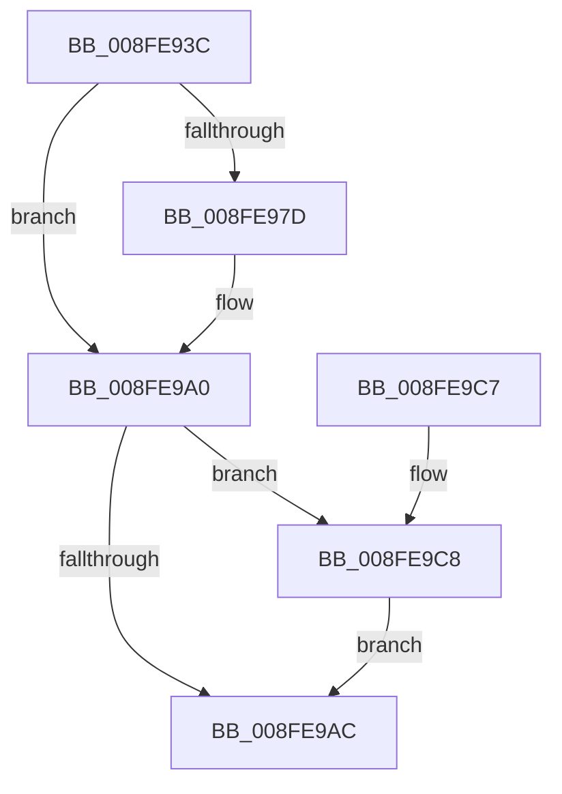

# CmRaisePropertyChangeEvent

- RVA: `0x008FE93C`–`0x008FE9F2` (길이 `182` bytes)
- VA: `0x00000001408FE93C`
- 실행 섹션: `PAGE`
- PDB 이름 있음: `예`; PDB Function 태그: `아니요`
- unwind 정보 RVA: `0x00088290`
- 디코드: `49`개 명령, `182/182` bytes 표시
- 미해석 바이트: `0` (있으면 어셈블리에 `.byte`로 보존)

> 이 문서는 커널 이미지의 기계어와 PDB 기호를 분석해 생성했습니다. 4번과 5번은 함수 원형과 자료형을 바이너리 사용 방식에서 추정한 C 해석이며 원본 소스 복구 결과는 아닙니다.

## 1. Dependencies

- 직접 호출 지점: **4**; 고유 호출 대상: **4**
- 직접 호출자로 확인된 함수: **3**
- RIP 상대 이미지 참조: **0**

### Outgoing calls
- `0x008FE970` → [CmMapRegPropToPropertyKey](CmMapRegPropToPropertyKey_function_008FF138.md) (function, `0x008FF138`)
- `0x008FE97F` → [_CmMapCmObjectTypeToPnpObjectType](_CmMapCmObjectTypeToPnpObjectType_function_008FF060.md) (function, `0x008FF060`)
- `0x008FE99B` → [PnpObjectRaisePropertyChangeEvent](PnpObjectRaisePropertyChangeEvent_function_008F7E94.md) (function, `0x008F7E94`)
- `0x008FE9EB` → [guard_dispatch_icall](../../text/6B/guard_dispatch_icall_function_006BAAD0.md) (function, `0x006BAAD0`)

### Direct callers
- [CmSetInstallerClassRegPropWorker](../82/CmSetInstallerClassRegPropWorker_function_0082ABF4.md) at `0x0082AE07`
- [PnpRaiseNtPlugPlayDevicePropertyChangeEvent](PnpRaiseNtPlugPlayDevicePropertyChangeEvent_function_008F7D80.md) at `0x008F7E14`
- [_CmSetDeviceRegPropWorker](_CmSetDeviceRegPropWorker_function_008FD804.md) at `0x008FD9C7`

### Static image references
- 디코드된 RIP-relative 메모리 참조가 없습니다.

## 2. Other-region calls and transfers

- 다른 실행 섹션으로 향하는 call: **1**
  - `0x008FE9EB` → [guard_dispatch_icall](../../text/6B/guard_dispatch_icall_function_006BAAD0.md) (`PAGE` → `.text`)
- 별도 외부 분기/꼬리 이동을 확인하지 못했습니다.

## 3. Assembly (complete function range)

```asm
008FE93C  48 8B C4                        mov rax, rsp
008FE93F  48 89 58 08                     mov qword ptr [rax + 8], rbx
008FE943  48 89 68 10                     mov qword ptr [rax + 0x10], rbp
008FE947  48 89 70 18                     mov qword ptr [rax + 0x18], rsi
008FE94B  48 89 78 20                     mov qword ptr [rax + 0x20], rdi
008FE94F  41 56                           push r14
008FE951  48 83 EC 40                     sub rsp, 0x40
008FE955  44 8B 74 24 70                  mov r14d, dword ptr [rsp + 0x70]
008FE95A  48 8B EA                        mov rbp, rdx
008FE95D  83 60 F4 00                     and dword ptr [rax - 0xc], 0
008FE961  48 8B D9                        mov rbx, rcx
008FE964  41 8B D6                        mov edx, r14d
008FE967  41 8B C8                        mov ecx, r8d
008FE96A  49 8B F1                        mov rsi, r9
008FE96D  41 8B F8                        mov edi, r8d
008FE970  E8 C3 07 00 00                  call 0x1408ff138
008FE975  4C 8B D8                        mov r11, rax
008FE978  48 85 C0                        test rax, rax
008FE97B  74 23                           je 0x1408fe9a0
008FE97D  8B CF                           mov ecx, edi
008FE97F  E8 DC 06 00 00                  call 0x1408ff060
008FE984  4C 89 5C 24 28                  mov qword ptr [rsp + 0x28], r11
008FE989  44 8B C0                        mov r8d, eax
008FE98C  48 83 64 24 20 00               and qword ptr [rsp + 0x20], 0
008FE992  48 8B CB                        mov rcx, rbx
008FE995  4C 8B CE                        mov r9, rsi
008FE998  48 8B D5                        mov rdx, rbp
008FE99B  E8 F4 94 FF FF                  call 0x1408f7e94
008FE9A0  48 8B 83 00 02 00 00            mov rax, qword ptr [rbx + 0x200]
008FE9A7  48 85 C0                        test rax, rax
008FE9AA  75 1C                           jne 0x1408fe9c8
008FE9AC  48 8B 5C 24 50                  mov rbx, qword ptr [rsp + 0x50]
008FE9B1  48 8B 6C 24 58                  mov rbp, qword ptr [rsp + 0x58]
008FE9B6  48 8B 74 24 60                  mov rsi, qword ptr [rsp + 0x60]
008FE9BB  48 8B 7C 24 68                  mov rdi, qword ptr [rsp + 0x68]
008FE9C0  48 83 C4 40                     add rsp, 0x40
008FE9C4  41 5E                           pop r14
008FE9C6  C3                              ret
008FE9C7  CC                              int3
008FE9C8  48 8D 4C 24 30                  lea rcx, [rsp + 0x30]
008FE9CD  48 89 74 24 30                  mov qword ptr [rsp + 0x30], rsi
008FE9D2  48 89 4C 24 20                  mov qword ptr [rsp + 0x20], rcx
008FE9D7  41 B9 04 00 00 00               mov r9d, 4
008FE9DD  48 8B CB                        mov rcx, rbx
008FE9E0  44 89 74 24 38                  mov dword ptr [rsp + 0x38], r14d
008FE9E5  44 8B C7                        mov r8d, edi
008FE9E8  48 8B D5                        mov rdx, rbp
008FE9EB  E8 E0 C0 DB FF                  call 0x1406baad0
008FE9F0  EB BA                           jmp 0x1408fe9ac
```

## 4. C-style interpretation (structured pseudocode)

```c
__int64 __fastcall CmRaisePropertyChangeEvent(__int64 a1, __int64 a2, int a3, __int64 a4, unsigned int a5)
{
    __int64 result;
    __int64 v_rsp;
    unsigned __int64 v_stack_m20;
    unsigned __int64 v_stack_m28;
    unsigned __int64 v_stack_p10;
    unsigned __int64 v_stack_p18;
    unsigned __int64 v_stack_p20;
    unsigned __int64 v_stack_p30;
    unsigned int v_stack_p38;
    unsigned __int64 v_stack_p8;

    *(unsigned __int64 *)(v_rsp + 8) = v_rbx;
    *(unsigned __int64 *)(v_rsp + 16) = v_rbp;
    *(unsigned __int64 *)(v_rsp + 24) = v_rsi;
    *(unsigned __int64 *)(v_rsp + 32) = v_rdi;
    v_rsp = (v_rsp) - (64);
    result = CmMapRegPropToPropertyKey((unsigned int)(a3), (unsigned int)((unsigned int)((unsigned int)(a5))), a3, a4);
    if (result != 0) {
        a1 = (unsigned int)((unsigned int)(a3));
        result = _CmMapCmObjectTypeToPnpObjectType(a1, (unsigned int)((unsigned int)((unsigned int)(a5))), a3, a4);
        v_stack_m20 = result;
        a3 = (unsigned int)(result);
        a1 = a1;
        a4 = a4;
        a2 = a2;
        result = PnpObjectRaisePropertyChangeEvent(a1, a2, a3, a4);
    }
    if (*(unsigned __int64 *)(a1 + 512) != 0) goto loc_008FE9C8;
loc_008FE9AC:
    v_rsp = (v_rsp) + (64);
    return *(unsigned __int64 *)(a1 + 512);
loc_008FE9C8:
    v_stack_p30 = v_stack_p18;
    v_stack_p20 = v_stack_p30;
    v_stack_p38 = (unsigned int)((unsigned int)(a5));
    result = guard_dispatch_icall(v_stack_p8, v_stack_p10, (unsigned int)((unsigned int)(v_stack_p20)), 4);
    goto loc_008FE9AC;
}
```

## 5. (Beta) C Style

```c
int64_t CmRaisePropertyChangeEvent(void *Arg1, int64_t Arg2, int32_t Arg3, int64_t Arg4, uint32_t Arg5)
{
    uint8_t *arg1 = (uint8_t *)Arg1;

    int64_t result;
    int64_t local_rsp;
    uint64_t v_stack_m20;
    uint64_t v_stack_m28;
    uint64_t v_stack_p10;
    uint64_t v_stack_p18;
    uint64_t v_stack_p20;
    uint64_t v_stack_p30;
    uint32_t v_stack_p38;
    uint64_t v_stack_p8;

    *(uint64_t *)(local_rsp + 0x8) = local_rbx;
    *(uint64_t *)(local_rsp + 0x10) = local_rbp;
    *(uint64_t *)(local_rsp + 0x18) = local_rsi;
    *(uint64_t *)(local_rsp + 0x20) = local_rdi;
    local_rsp = (local_rsp) - (64);
    result = CmMapRegPropToPropertyKey((uint32_t)(Arg3), (uint32_t)((uint32_t)((uint32_t)(Arg5))), Arg3, Arg4);
    if (result != 0) {
        Arg1 = (uint32_t)((uint32_t)(Arg3));
        result = _CmMapCmObjectTypeToPnpObjectType(Arg1, (uint32_t)((uint32_t)((uint32_t)(Arg5))), Arg3, Arg4);
        v_stack_m20 = result;
        Arg3 = (uint32_t)(result);
        Arg1 = Arg1;
        Arg4 = Arg4;
        Arg2 = Arg2;
        result = PnpObjectRaisePropertyChangeEvent(Arg1, Arg2, Arg3, Arg4);
    }
    if (*(uint64_t *)(arg1 + 0x200) != 0) goto loc_008FE9C8;
loc_008FE9AC:
    local_rsp = (local_rsp) + (64);
    return *(uint64_t *)(arg1 + 0x200);
loc_008FE9C8:
    v_stack_p30 = v_stack_p18;
    v_stack_p20 = v_stack_p30;
    v_stack_p38 = (uint32_t)((uint32_t)(Arg5));
    result = guard_dispatch_icall(v_stack_p8, v_stack_p10, (uint32_t)((uint32_t)(v_stack_p20)), 4);
    goto loc_008FE9AC;
}
```

### 관측된 메모리 오프셋

구조체 형식이 확인되지 않은 접근은 인자 기준의 오프셋으로만 기록했습니다.

| 기준 인자 | 오프셋 표현 | 폭 (bit) | 접근 |
|---|---:|---:|---|
| `Arg1` | `+ 0x200` | `64` | `R` |

## 6. Execution-region graph

[열기: 2D/3D 그래프와 함수 탐색 컨트롤 패널](../../../control-panel.html?section=page&rva=0x008FE93C&view=graph)

- 2D 그래프는 위에서 아래로 흐르고, 3D 그래프는 빈 공간을 드래그해 회전합니다. Shift+드래그는 이동, 휠은 확대·축소, 함수 노드 선택은 대상 보고서 이동입니다.

### Static fallback


