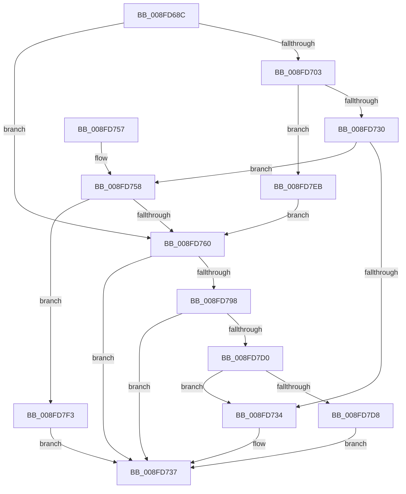

# CmSetDeviceRegProp

- RVA: `0x008FD68C`–`0x008FD7FD` (길이 `369` bytes)
- VA: `0x00000001408FD68C`
- 실행 섹션: `PAGE`
- PDB 이름 있음: `예`; PDB Function 태그: `아니요`
- unwind 정보 RVA: `0x00088120`
- 디코드: `106`개 명령, `369/369` bytes 표시
- 미해석 바이트: `0` (있으면 어셈블리에 `.byte`로 보존)

> 이 문서는 커널 이미지의 기계어와 PDB 기호를 분석해 생성했습니다. 4번과 5번은 함수 원형과 자료형을 바이너리 사용 방식에서 추정한 C 해석이며 원본 소스 복구 결과는 아닙니다.

## 1. Dependencies

- 직접 호출 지점: **5**; 고유 호출 대상: **4**
- 직접 호출자로 확인된 함수: **17**
- RIP 상대 이미지 참조: **1**

### Outgoing calls
- `0x008FD6CB` → [memset](../../text/6C/memset_function_006C6C40.md) (function, `0x006C6C40`)
- `0x008FD720` → [guard_dispatch_icall](../../text/6B/guard_dispatch_icall_function_006BAAD0.md) (function, `0x006BAAD0`)
- `0x008FD740` → [_security_check_cookie](../../text/6A/_security_check_cookie_function_006AC640.md) (function, `0x006AC640`)
- `0x008FD78C` → [_CmSetDeviceRegPropWorker](_CmSetDeviceRegPropWorker_function_008FD804.md) (function, `0x008FD804`)
- `0x008FD7BE` → [guard_dispatch_icall](../../text/6B/guard_dispatch_icall_function_006BAAD0.md) (function, `0x006BAAD0`)

### Direct callers
- [IoReportDetectedDevice](../72/IoReportDetectedDevice_function_00725CD0.md) at `0x0072623B`
- [IoReportDetectedDevice](../72/IoReportDetectedDevice_function_00725CD0.md) at `0x0072631F`
- [IoReportRootDevice](../72/IoReportRootDevice_function_00726780.md) at `0x0072699D`
- [IoReportRootDevice](../72/IoReportRootDevice_function_00726780.md) at `0x007269E3`
- [IoReportRootDevice](../72/IoReportRootDevice_function_00726780.md) at `0x00726A75`
- [PiDcResetChildDeviceContainers](../73/PiDcResetChildDeviceContainers_function_00731030.md) at `0x00731168`
- [IopCreateLegacyDeviceIds](../73/IopCreateLegacyDeviceIds_function_0073D3E4.md) at `0x0073D548`
- [PiDcUpdateDeviceContainerMembership](PiDcUpdateDeviceContainerMembership_function_008FD0A8.md) at `0x008FD1AE`
- [PnpSaveDeviceCapabilities](PnpSaveDeviceCapabilities_function_008FD478.md) at `0x008FD543`
- [PnpSaveDeviceCapabilities](PnpSaveDeviceCapabilities_function_008FD478.md) at `0x008FD590`
- [PnpSaveDeviceCapabilities](PnpSaveDeviceCapabilities_function_008FD478.md) at `0x008FD5D9`
- [PiPnpRtlSetDeviceRegProperty](../96/PiPnpRtlSetDeviceRegProperty_function_0096360C.md) at `0x009636F1`
- [_CmSetDeviceMappedPropertyFromRegProp](../A0/_CmSetDeviceMappedPropertyFromRegProp_function_00A0B2E8.md) at `0x00A0B3D9`
- [PiProcessNewDeviceNode](../A2/PiProcessNewDeviceNode_function_00A28F20.md) at `0x00A298A0`
- [PiProcessNewDeviceNode](../A2/PiProcessNewDeviceNode_function_00A28F20.md) at `0x00A2999A`
- [PiProcessNewDeviceNode](../A2/PiProcessNewDeviceNode_function_00A28F20.md) at `0x00A29AD8`
- [PiProcessNewDeviceNode](../A2/PiProcessNewDeviceNode_function_00A28F20.md) at `0x00A29F2C`
- [PiProcessNewDeviceNode](../A2/PiProcessNewDeviceNode_function_00A28F20.md) at `0x00A29F64`
- [PiProcessNewDeviceNode](../A2/PiProcessNewDeviceNode_function_00A28F20.md) at `0x00A29FFB`
- [sub_00B1F622](../B1/Unknown_function_00B1F622.md) at `0x00B1F7EB`
- [sub_00B1F622](../B1/Unknown_function_00B1F622.md) at `0x00B1F82D`
- [sub_00B1F622](../B1/Unknown_function_00B1F622.md) at `0x00B1F875`
- [sub_00B29934](../B2/Unknown_function_00B29934.md) at `0x00B29C91`
- [sub_00B2BA82](../B2/Unknown_function_00B2BA82.md) at `0x00B2BD4F`
- [sub_00B3807C](../B3/Unknown_function_00B3807C.md) at `0x00B38418`
- [sub_00B3807C](../B3/Unknown_function_00B3807C.md) at `0x00B386FC`
- [sub_00B47098](../B4/Unknown_function_00B47098.md) at `0x00B47175`
- [IopInitializePlugPlayServices](../../init/C2/IopInitializePlugPlayServices_function_00C2F298.md) at `0x00C2F9CC`
- [IopInitializePlugPlayServices](../../init/C2/IopInitializePlugPlayServices_function_00C2F298.md) at `0x00C2FA00`
- [PipMigrateResetDeviceCallback](../../init/C3/PipMigrateResetDeviceCallback_function_00C31D40.md) at `0x00C31E03`
- [PipResetDevice](../../init/C3/PipResetDevice_function_00C31F90.md) at `0x00C32159`

### Static image references
- `0x008FD6A3` → RVA `0x00E0A740` (`.data`; read)

## 2. Other-region calls and transfers

- 다른 실행 섹션으로 향하는 call: **4**
  - `0x008FD6CB` → [memset](../../text/6C/memset_function_006C6C40.md) (`PAGE` → `.text`)
  - `0x008FD720` → [guard_dispatch_icall](../../text/6B/guard_dispatch_icall_function_006BAAD0.md) (`PAGE` → `.text`)
  - `0x008FD740` → [_security_check_cookie](../../text/6A/_security_check_cookie_function_006AC640.md) (`PAGE` → `.text`)
  - `0x008FD7BE` → [guard_dispatch_icall](../../text/6B/guard_dispatch_icall_function_006BAAD0.md) (`PAGE` → `.text`)
- 별도 외부 분기/꼬리 이동을 확인하지 못했습니다.

## 3. Assembly (complete function range)

```asm
008FD68C  40 55                           push rbp
008FD68E  53                              push rbx
008FD68F  56                              push rsi
008FD690  57                              push rdi
008FD691  41 54                           push r12
008FD693  41 56                           push r14
008FD695  41 57                           push r15
008FD697  48 8D 6C 24 F9                  lea rbp, [rsp - 7]
008FD69C  48 81 EC B0 00 00 00            sub rsp, 0xb0
008FD6A3  48 8B 05 96 D0 50 00            mov rax, qword ptr [rip + 0x50d096]
008FD6AA  48 33 C4                        xor rax, rsp
008FD6AD  48 89 45 F7                     mov qword ptr [rbp - 9], rax
008FD6B1  48 8B 5D 6F                     mov rbx, qword ptr [rbp + 0x6f]
008FD6B5  4C 8B E2                        mov r12, rdx
008FD6B8  33 D2                           xor edx, edx
008FD6BA  49 8B F8                        mov rdi, r8
008FD6BD  4C 8B F9                        mov r15, rcx
008FD6C0  41 8B F1                        mov esi, r9d
008FD6C3  48 8D 4D 97                     lea rcx, [rbp - 0x69]
008FD6C7  44 8D 42 58                     lea r8d, [rdx + 0x58]
008FD6CB  E8 70 95 DC FF                  call 0x1406c6c40
008FD6D0  8B 45 67                        mov eax, dword ptr [rbp + 0x67]
008FD6D3  4D 8B B7 F8 01 00 00            mov r14, qword ptr [r15 + 0x1f8]
008FD6DA  89 45 B3                        mov dword ptr [rbp - 0x4d], eax
008FD6DD  8B 45 77                        mov eax, dword ptr [rbp + 0x77]
008FD6E0  89 45 BF                        mov dword ptr [rbp - 0x41], eax
008FD6E3  8B 45 7F                        mov eax, dword ptr [rbp + 0x7f]
008FD6E6  48 89 7D A7                     mov qword ptr [rbp - 0x59], rdi
008FD6EA  BF 20 01 00 C0                  mov edi, 0xc0000120
008FD6EF  89 75 AF                        mov dword ptr [rbp - 0x51], esi
008FD6F2  BE 01 00 00 00                  mov esi, 1
008FD6F7  89 45 C3                        mov dword ptr [rbp - 0x3d], eax
008FD6FA  48 89 5D B7                     mov qword ptr [rbp - 0x49], rbx
008FD6FE  4D 85 F6                        test r14, r14
008FD701  74 5D                           je 0x1408fd760
008FD703  48 8D 45 97                     lea rax, [rbp - 0x69]
008FD707  44 8B C6                        mov r8d, esi
008FD70A  48 89 44 24 28                  mov qword ptr [rsp + 0x28], rax
008FD70F  44 8D 4E 09                     lea r9d, [rsi + 9]
008FD713  49 8B C6                        mov rax, r14
008FD716  89 74 24 20                     mov dword ptr [rsp + 0x20], esi
008FD71A  49 8B D4                        mov rdx, r12
008FD71D  49 8B CF                        mov rcx, r15
008FD720  E8 AB D3 DB FF                  call 0x1406baad0
008FD725  3D 02 00 00 C0                  cmp eax, 0xc0000002
008FD72A  0F 84 BB 00 00 00               je 0x1408fd7eb
008FD730  3B C7                           cmp eax, edi
008FD732  75 24                           jne 0x1408fd758
008FD734  8B 5D 97                        mov ebx, dword ptr [rbp - 0x69]
008FD737  8B C3                           mov eax, ebx
008FD739  48 8B 4D F7                     mov rcx, qword ptr [rbp - 9]
008FD73D  48 33 CC                        xor rcx, rsp
008FD740  E8 FB EE DA FF                  call 0x1406ac640
008FD745  48 81 C4 B0 00 00 00            add rsp, 0xb0
008FD74C  41 5F                           pop r15
008FD74E  41 5E                           pop r14
008FD750  41 5C                           pop r12
008FD752  5F                              pop rdi
008FD753  5E                              pop rsi
008FD754  5B                              pop rbx
008FD755  5D                              pop rbp
008FD756  C3                              ret
008FD757  CC                              int3
008FD758  85 C0                           test eax, eax
008FD75A  0F 85 93 00 00 00               jne 0x1408fd7f3
008FD760  8B 45 C3                        mov eax, dword ptr [rbp - 0x3d]
008FD763  49 8B D4                        mov rdx, r12
008FD766  44 8B 4D AF                     mov r9d, dword ptr [rbp - 0x51]
008FD76A  49 8B CF                        mov rcx, r15
008FD76D  4C 8B 45 A7                     mov r8, qword ptr [rbp - 0x59]
008FD771  89 44 24 38                     mov dword ptr [rsp + 0x38], eax
008FD775  8B 45 BF                        mov eax, dword ptr [rbp - 0x41]
008FD778  89 44 24 30                     mov dword ptr [rsp + 0x30], eax
008FD77C  48 8B 45 B7                     mov rax, qword ptr [rbp - 0x49]
008FD780  48 89 44 24 28                  mov qword ptr [rsp + 0x28], rax
008FD785  8B 45 B3                        mov eax, dword ptr [rbp - 0x4d]
008FD788  89 44 24 20                     mov dword ptr [rsp + 0x20], eax
008FD78C  E8 73 00 00 00                  call 0x1408fd804
008FD791  8B D8                           mov ebx, eax
008FD793  4D 85 F6                        test r14, r14
008FD796  74 9F                           je 0x1408fd737
008FD798  89 45 97                        mov dword ptr [rbp - 0x69], eax
008FD79B  41 B9 0A 00 00 00               mov r9d, 0xa
008FD7A1  48 8D 45 97                     lea rax, [rbp - 0x69]
008FD7A5  44 8B C6                        mov r8d, esi
008FD7A8  48 89 44 24 28                  mov qword ptr [rsp + 0x28], rax
008FD7AD  49 8B D4                        mov rdx, r12
008FD7B0  49 8B C6                        mov rax, r14
008FD7B3  C7 44 24 20 02 00 00 00         mov dword ptr [rsp + 0x20], 2
008FD7BB  49 8B CF                        mov rcx, r15
008FD7BE  E8 0D D3 DB FF                  call 0x1406baad0
008FD7C3  8B C8                           mov ecx, eax
008FD7C5  3D 02 00 00 C0                  cmp eax, 0xc0000002
008FD7CA  0F 84 67 FF FF FF               je 0x1408fd737
008FD7D0  3B C7                           cmp eax, edi
008FD7D2  0F 84 5C FF FF FF               je 0x1408fd734
008FD7D8  8B C3                           mov eax, ebx
008FD7DA  85 C9                           test ecx, ecx
008FD7DC  BB E5 00 00 C0                  mov ebx, 0xc00000e5
008FD7E1  0F 45 C3                        cmovne eax, ebx
008FD7E4  8B D8                           mov ebx, eax
008FD7E6  E9 4C FF FF FF                  jmp 0x1408fd737
008FD7EB  45 33 F6                        xor r14d, r14d
008FD7EE  E9 6D FF FF FF                  jmp 0x1408fd760
008FD7F3  BB E5 00 00 C0                  mov ebx, 0xc00000e5
008FD7F8  E9 3A FF FF FF                  jmp 0x1408fd737
```

## 4. C-style interpretation (structured pseudocode)

```c
__int64 __fastcall CmSetDeviceRegProp(__int64 a1, __int64 a2, __int64 a3, int a4, unsigned int a5, __int64 a6, unsigned int a7, unsigned int a8)
{
    __int64 result;
    __int64 v_r14;
    __int64 v_rsp;
    unsigned __int64 v_stack_m3F;
    unsigned __int64 v_stack_m48;
    unsigned int v_stack_m7C;
    unsigned int v_stack_m80;
    unsigned __int64 v_stack_m88;
    unsigned int v_stack_m8C;
    unsigned int v_stack_m90;
    unsigned __int64 v_stack_m98;
    unsigned __int64 v_stack_mA8;
    unsigned __int64 v_stack_mC0;
    unsigned int v_stack_mC8;
    unsigned int v_stack_p20;
    unsigned __int64 v_stack_p28;
    unsigned int v_stack_p30;
    unsigned int v_stack_p38;

    v_rsp = (v_rsp) - (176);
    result = (*(unsigned __int64 *)(v_rip + 5296278)) ^ (v_rsp);
    v_stack_m48 = result;
    a2 = 0;
    result = memset(v_stack_mA8, a2, a2 + 88, a4);
    v_stack_m8C = (unsigned int)((unsigned int)(a5));
    v_stack_m80 = (unsigned int)((unsigned int)(a7));
    v_stack_m98 = a3;
    v_stack_m90 = (unsigned int)((unsigned int)(a4));
    v_stack_m7C = (unsigned int)((unsigned int)(a8));
    v_stack_m88 = a6;
    if (*(unsigned __int64 *)(a1 + 504) == 0) goto loc_008FD760;
    v_stack_mC0 = v_stack_mA8;
    v_stack_mC8 = 1;
    result = guard_dispatch_icall(a1, 0, 1, 1 + 9);
    if (((unsigned int)(result)) == 0xC0000002ULL) goto loc_008FD7EB;
    if (((unsigned int)(result)) != ((unsigned int)((unsigned int)(0xC0000120ULL)))) goto loc_008FD758;
loc_008FD734:
loc_008FD737:
    a1 = (v_stack_m48) ^ (v_rsp);
    result = _security_check_cookie(a1, 0, 1, 1 + 9);
    v_rsp = (v_rsp) + (176);
    return result;
loc_008FD758:
    if ((unsigned int)(result) != 0) goto loc_008FD7F3;
loc_008FD760:
    v_stack_p38 = (unsigned int)((unsigned int)(v_stack_m7C));
    v_stack_p30 = (unsigned int)((unsigned int)(v_stack_m80));
    v_stack_p28 = v_stack_m88;
    v_stack_p20 = (unsigned int)((unsigned int)(v_stack_m8C));
    result = _CmSetDeviceRegPropWorker(a1, 0, v_stack_m98, (unsigned int)(v_stack_m90));
    if (*(unsigned __int64 *)(a1 + 504) == 0) goto loc_008FD737;
    v_stack_mA8 = (unsigned int)(result);
    v_stack_p28 = v_stack_mA8;
    v_stack_p20 = 2;
    result = guard_dispatch_icall(a1, 0, 1, 10);
    if (((unsigned int)(result)) == 0xC0000002ULL) goto loc_008FD737;
    if (((unsigned int)(result)) == ((unsigned int)((unsigned int)(0xC0000120ULL)))) goto loc_008FD734;
    result = (unsigned int)((unsigned int)((unsigned int)((unsigned int)(result))));
    if ((unsigned int)((unsigned int)((unsigned int)(result))) != 0) { result = (unsigned int)((unsigned int)(0xC00000E5ULL)); }
    goto loc_008FD737;
loc_008FD7EB:
    v_r14 = 0;
    goto loc_008FD760;
loc_008FD7F3:
    goto loc_008FD737;
}
```

## 5. (Beta) C Style

```c
int64_t CmSetDeviceRegProp(void *Arg1, int64_t Arg2, int64_t Arg3, int32_t Arg4, uint32_t Arg5, int64_t Arg6, uint32_t Arg7, uint32_t Arg8)
{
    uint8_t *arg1 = (uint8_t *)Arg1;

    int64_t result;
    int64_t local_r14;
    int64_t local_rsp;
    uint64_t v_stack_m3F;
    uint64_t v_stack_m48;
    uint32_t v_stack_m7C;
    uint32_t v_stack_m80;
    uint64_t v_stack_m88;
    uint32_t v_stack_m8C;
    uint32_t v_stack_m90;
    uint64_t v_stack_m98;
    uint64_t v_stack_mA8;
    uint64_t v_stack_mC0;
    uint32_t v_stack_mC8;
    uint32_t v_stack_p20;
    uint64_t v_stack_p28;
    uint32_t v_stack_p30;
    uint32_t v_stack_p38;

    local_rsp = (local_rsp) - (176);
    result = (*(uint64_t *)(v_rip + 0x50D096)) ^ (local_rsp);
    v_stack_m48 = result;
    Arg2 = 0;
    result = memset(v_stack_mA8, Arg2, Arg2 + 88, Arg4);
    v_stack_m8C = (uint32_t)((uint32_t)(Arg5));
    v_stack_m80 = (uint32_t)((uint32_t)(Arg7));
    v_stack_m98 = Arg3;
    v_stack_m90 = (uint32_t)((uint32_t)(Arg4));
    v_stack_m7C = (uint32_t)((uint32_t)(Arg8));
    v_stack_m88 = Arg6;
    if (*(uint64_t *)(arg1 + 0x1F8) == 0) goto loc_008FD760;
    v_stack_mC0 = v_stack_mA8;
    v_stack_mC8 = 1;
    result = guard_dispatch_icall(Arg1, 0, 1, 1 + 9);
    if (((uint32_t)(result)) == 0xC0000002ULL) goto loc_008FD7EB;
    if (((uint32_t)(result)) != ((uint32_t)((uint32_t)(0xC0000120ULL)))) goto loc_008FD758;
loc_008FD734:
loc_008FD737:
    Arg1 = (v_stack_m48) ^ (local_rsp);
    result = _security_check_cookie(Arg1, 0, 1, 1 + 9);
    local_rsp = (local_rsp) + (176);
    return result;
loc_008FD758:
    if ((uint32_t)(result) != 0) goto loc_008FD7F3;
loc_008FD760:
    v_stack_p38 = (uint32_t)((uint32_t)(v_stack_m7C));
    v_stack_p30 = (uint32_t)((uint32_t)(v_stack_m80));
    v_stack_p28 = v_stack_m88;
    v_stack_p20 = (uint32_t)((uint32_t)(v_stack_m8C));
    result = _CmSetDeviceRegPropWorker(Arg1, 0, v_stack_m98, (uint32_t)(v_stack_m90));
    if (*(uint64_t *)(arg1 + 0x1F8) == 0) goto loc_008FD737;
    v_stack_mA8 = (uint32_t)(result);
    v_stack_p28 = v_stack_mA8;
    v_stack_p20 = 2;
    result = guard_dispatch_icall(Arg1, 0, 1, 10);
    if (((uint32_t)(result)) == 0xC0000002ULL) goto loc_008FD737;
    if (((uint32_t)(result)) == ((uint32_t)((uint32_t)(0xC0000120ULL)))) goto loc_008FD734;
    result = (uint32_t)((uint32_t)((uint32_t)((uint32_t)(result))));
    if ((uint32_t)((uint32_t)((uint32_t)(result))) != 0) { result = (uint32_t)((uint32_t)(0xC00000E5ULL)); }
    goto loc_008FD737;
loc_008FD7EB:
    local_r14 = 0;
    goto loc_008FD760;
loc_008FD7F3:
    goto loc_008FD737;
}
```

### 관측된 메모리 오프셋

구조체 형식이 확인되지 않은 접근은 인자 기준의 오프셋으로만 기록했습니다.

| 기준 인자 | 오프셋 표현 | 폭 (bit) | 접근 |
|---|---:|---:|---|
| `Arg1` | `+ 0x1F8` | `64` | `R` |

## 6. Execution-region graph

[열기: 2D/3D 그래프와 함수 탐색 컨트롤 패널](../../../control-panel.html?section=page&rva=0x008FD68C&view=graph)

- 2D 그래프는 위에서 아래로 흐르고, 3D 그래프는 빈 공간을 드래그해 회전합니다. Shift+드래그는 이동, 휠은 확대·축소, 함수 노드 선택은 대상 보고서 이동입니다.

### Static fallback


