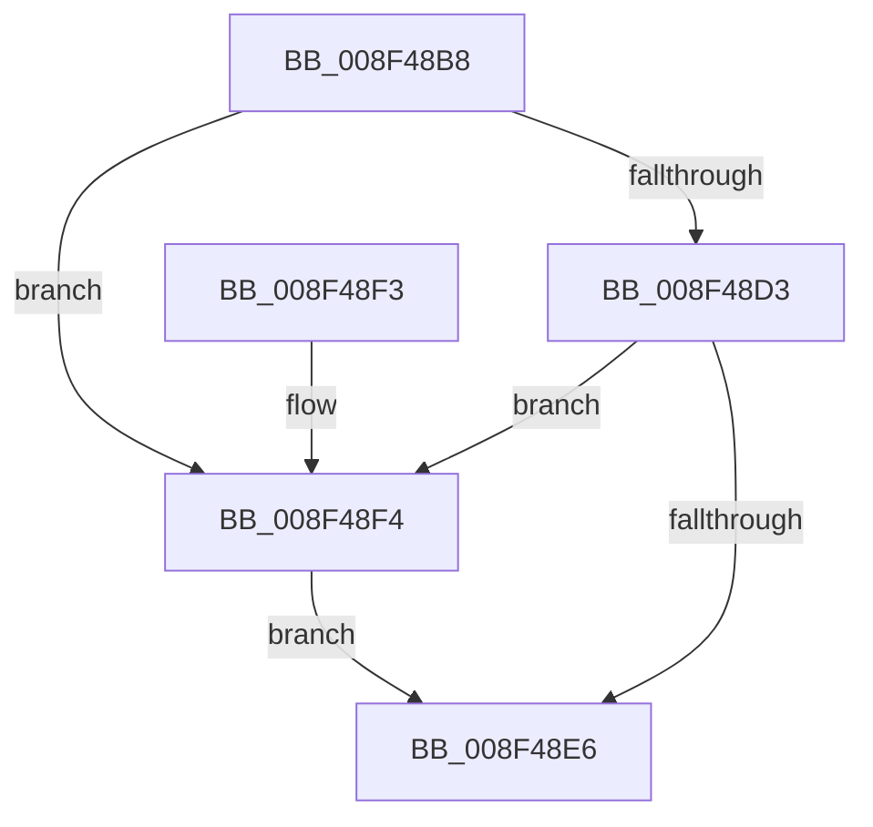

# CmValidateDeviceContainerName

- RVA: `0x008F48B8`–`0x008F48FB` (길이 `67` bytes)
- VA: `0x00000001408F48B8`
- 실행 섹션: `PAGE`
- PDB 이름 있음: `예`; PDB Function 태그: `아니요`
- unwind 정보 RVA: `0x0006CF28`
- 디코드: `22`개 명령, `67/67` bytes 표시
- 미해석 바이트: `0` (있으면 어셈블리에 `.byte`로 보존)

> 이 문서는 커널 이미지의 기계어와 PDB 기호를 분석해 생성했습니다. 4번과 5번은 함수 원형과 자료형을 바이너리 사용 방식에서 추정한 C 해석이며 원본 소스 복구 결과는 아닙니다.

## 1. Dependencies

- 직접 호출 지점: **2**; 고유 호출 대상: **2**
- 직접 호출자로 확인된 함수: **3**
- RIP 상대 이미지 참조: **1**

### Outgoing calls
- `0x008F48C8` → [PnpIsValidGuidString](PnpIsValidGuidString_function_008F37F8.md) (function, `0x008F37F8`)
- `0x008F48DD` → [wcscmp](../../text/50/wcscmp_function_00501AF0.md) (function, `0x00501AF0`)

### Direct callers
- [CmContainerListGenericObjectCallback](../82/CmContainerListGenericObjectCallback_function_0082AE90.md) at `0x0082AEAF`
- [CmGetDeviceContainerRegKeyPath](CmGetDeviceContainerRegKeyPath_function_008F4804.md) at `0x008F4825`
- [_PnpDispatchDeviceContainer](_PnpDispatchDeviceContainer_function_008F6880.md) at `0x008F6967`

### Static image references
- `0x008F48D6` → RVA `0x00AFDCF0` (` ?? ::NNGAKEGL::`string'`; read)

## 2. Other-region calls and transfers

- 다른 실행 섹션으로 향하는 call: **1**
  - `0x008F48DD` → [wcscmp](../../text/50/wcscmp_function_00501AF0.md) (`PAGE` → `.text`)
- 별도 외부 분기/꼬리 이동을 확인하지 못했습니다.

## 3. Assembly (complete function range)

```asm
008F48B8  48 89 5C 24 08                  mov qword ptr [rsp + 8], rbx
008F48BD  57                              push rdi
008F48BE  48 83 EC 20                     sub rsp, 0x20
008F48C2  48 8B CA                        mov rcx, rdx
008F48C5  48 8B FA                        mov rdi, rdx
008F48C8  E8 2B EF FF FF                  call 0x1408f37f8
008F48CD  33 DB                           xor ebx, ebx
008F48CF  84 C0                           test al, al
008F48D1  74 21                           je 0x1408f48f4
008F48D3  48 8B D7                        mov rdx, rdi
008F48D6  48 8D 0D 13 94 20 00            lea rcx, [rip + 0x209413]
008F48DD  E8 0E D2 C0 FF                  call 0x140501af0
008F48E2  85 C0                           test eax, eax
008F48E4  74 0E                           je 0x1408f48f4
008F48E6  8B C3                           mov eax, ebx
008F48E8  48 8B 5C 24 30                  mov rbx, qword ptr [rsp + 0x30]
008F48ED  48 83 C4 20                     add rsp, 0x20
008F48F1  5F                              pop rdi
008F48F2  C3                              ret
008F48F3  CC                              int3
008F48F4  BB 33 00 00 C0                  mov ebx, 0xc0000033
008F48F9  EB EB                           jmp 0x1408f48e6
```

## 4. C-style interpretation (structured pseudocode)

```c
__int64 __fastcall CmValidateDeviceContainerName(__int64 a1, __int64 a2)
{
    __int64 result;
    __int64 v_rbx;
    __int64 v_rsp;
    unsigned __int64 v_stack_p8;

    v_stack_p8 = v_rbx;
    v_rsp = (v_rsp) - (32);
    result = PnpIsValidGuidString(a2, a2, a3, a4);
    v_rbx = 0;
    if ((unsigned __int8)(result) == 0) goto loc_008F48F4;
    result = wcscmp(v_rip + 2135059, a2, a3, a4);
    if ((unsigned int)(result) == 0) goto loc_008F48F4;
loc_008F48E6:
    v_rsp = (v_rsp) + (32);
    return 0;
loc_008F48F4:
    goto loc_008F48E6;
}
```

## 5. (Beta) C Style

```c
int64_t CmValidateDeviceContainerName(int64_t Arg1, int64_t Arg2)
{
    int64_t result;
    int64_t local_rbx;
    int64_t local_rsp;
    uint64_t v_stack_p8;

    v_stack_p8 = local_rbx;
    local_rsp = (local_rsp) - (32);
    result = PnpIsValidGuidString(Arg2, Arg2, a3, a4);
    local_rbx = 0;
    if ((uint8_t)(result) == 0) goto loc_008F48F4;
    result = wcscmp(v_rip + 2135059, Arg2, a3, a4);
    if ((uint32_t)(result) == 0) goto loc_008F48F4;
loc_008F48E6:
    local_rsp = (local_rsp) + (32);
    return 0;
loc_008F48F4:
    goto loc_008F48E6;
}
```

## 6. Execution-region graph

[열기: 2D/3D 그래프와 함수 탐색 컨트롤 패널](../../../control-panel.html?section=page&rva=0x008F48B8&view=graph)

- 2D 그래프는 위에서 아래로 흐르고, 3D 그래프는 빈 공간을 드래그해 회전합니다. Shift+드래그는 이동, 휠은 확대·축소, 함수 노드 선택은 대상 보고서 이동입니다.

### Static fallback


