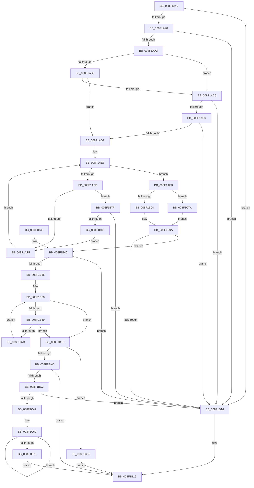

# CmValidateDeviceInterfaceName

- RVA: `0x008F1A40`–`0x008F1CAD` (길이 `621` bytes)
- VA: `0x00000001408F1A40`
- 실행 섹션: `PAGE`
- PDB 이름 있음: `예`; PDB Function 태그: `아니요`
- unwind 정보 RVA: `0x0008728C`
- 디코드: `161`개 명령, `621/621` bytes 표시
- 미해석 바이트: `0` (있으면 어셈블리에 `.byte`로 보존)

> 이 문서는 커널 이미지의 기계어와 PDB 기호를 분석해 생성했습니다. 4번과 5번은 함수 원형과 자료형을 바이너리 사용 방식에서 추정한 C 해석이며 원본 소스 복구 결과는 아닙니다.

## 1. Dependencies

- 직접 호출 지점: **7**; 고유 호출 대상: **5**
- 직접 호출자로 확인된 함수: **12**
- RIP 상대 이미지 참조: **4**

### Outgoing calls
- `0x008F1A83` → [RtlInitUnicodeStringEx](../../text/46/RtlInitUnicodeStringEx_function_00463960.md) (function, `0x00463960`)
- `0x008F1AA2` → [PsGetCurrentServerSiloGlobals](../../text/2F/PsGetCurrentServerSiloGlobals_function_002FE1F0.md) (function, `0x002FE1F0`)
- `0x008F1AC5` → [PsGetCurrentServerSiloGlobals](../../text/2F/PsGetCurrentServerSiloGlobals_function_002FE1F0.md) (function, `0x002FE1F0`)
- `0x008F1B22` → [_security_check_cookie](../../text/6A/_security_check_cookie_function_006AC640.md) (function, `0x006AC640`)
- `0x008F1BB4` → [RtlInitUnicodeStringEx](../../text/46/RtlInitUnicodeStringEx_function_00463960.md) (function, `0x00463960`)
- `0x008F1C39` → [ScanHexFormat](ScanHexFormat_function_008F29C0.md) (function, `0x008F29C0`)
- `0x008F1CA3` → [RtlStringExHandleOtherFlagsW](../../text/41/RtlStringExHandleOtherFlagsW_function_0041E3F0.md) (function, `0x0041E3F0`)

### Direct callers
- [CmDeviceClassesSubkeyCallback](../82/CmDeviceClassesSubkeyCallback_function_0082C940.md) at `0x0082CD41`
- [_PnpDispatchDeviceInterface](../8E/_PnpDispatchDeviceInterface_function_008E0DB0.md) at `0x008E0EF4`
- [IopGetDeviceInterfaces](IopGetDeviceInterfaces_function_008F0120.md) at `0x008F076B`
- [IoGetDeviceInterfaceAlias](IoGetDeviceInterfaceAlias_function_008F5570.md) at `0x008F5682`
- [CmGetDeviceInterfaceReferenceString](CmGetDeviceInterfaceReferenceString_function_008F5AF8.md) at `0x008F5B1A`
- [CmGetDeviceInterfacePathFormat](CmGetDeviceInterfacePathFormat_function_008F5BE8.md) at `0x008F5C00`
- [PiSwDeviceInterfacesUpdateState](../94/PiSwDeviceInterfacesUpdateState_function_0094E744.md) at `0x0094E7B2`
- [PiSwDeviceInterfaceSetState](../94/PiSwDeviceInterfaceSetState_function_0094ED48.md) at `0x0094EDDF`
- [IopRegisterDeviceInterface](../95/IopRegisterDeviceInterface_function_009501B0.md) at `0x00950618`
- [CmGetDeviceInterfaceSymbolicLinkName](../95/CmGetDeviceInterfaceSymbolicLinkName_function_00951DA4.md) at `0x00951DC1`
- [PiUEventCopyEventData](../9C/PiUEventCopyEventData_function_009C2E90.md) at `0x009C3039`
- [CmSetDeviceInterfacePathFormat](../A5/CmSetDeviceInterfacePathFormat_function_00A5FE7C.md) at `0x00A5FE8C`

### Static image references
- `0x008F1A5A` → RVA `0x00E0A740` (`.data`; read)
- `0x008F1AB6` → RVA `0x00001A30` (`.rdata`; read)
- `0x008F1AD0` → RVA `0x00001A40` (`.rdata`; read)
- `0x008F1BD8` → RVA `0x00B4D0B0` (`GuidFormat`; read)

## 2. Other-region calls and transfers

- 다른 실행 섹션으로 향하는 call: **6**
  - `0x008F1A83` → [RtlInitUnicodeStringEx](../../text/46/RtlInitUnicodeStringEx_function_00463960.md) (`PAGE` → `.text`)
  - `0x008F1AA2` → [PsGetCurrentServerSiloGlobals](../../text/2F/PsGetCurrentServerSiloGlobals_function_002FE1F0.md) (`PAGE` → `.text`)
  - `0x008F1AC5` → [PsGetCurrentServerSiloGlobals](../../text/2F/PsGetCurrentServerSiloGlobals_function_002FE1F0.md) (`PAGE` → `.text`)
  - `0x008F1B22` → [_security_check_cookie](../../text/6A/_security_check_cookie_function_006AC640.md) (`PAGE` → `.text`)
  - `0x008F1BB4` → [RtlInitUnicodeStringEx](../../text/46/RtlInitUnicodeStringEx_function_00463960.md) (`PAGE` → `.text`)
  - `0x008F1CA3` → [RtlStringExHandleOtherFlagsW](../../text/41/RtlStringExHandleOtherFlagsW_function_0041E3F0.md) (`PAGE` → `.text`)
- 별도 외부 분기/꼬리 이동을 확인하지 못했습니다.

## 3. Assembly (complete function range)

```asm
008F1A40  48 89 5C 24 08                  mov qword ptr [rsp + 8], rbx
008F1A45  48 89 74 24 18                  mov qword ptr [rsp + 0x18], rsi
008F1A4A  55                              push rbp
008F1A4B  57                              push rdi
008F1A4C  41 56                           push r14
008F1A4E  48 8D 6C 24 B9                  lea rbp, [rsp - 0x47]
008F1A53  48 81 EC 00 01 00 00            sub rsp, 0x100
008F1A5A  48 8B 05 DF 8C 51 00            mov rax, qword ptr [rip + 0x518cdf]
008F1A61  48 33 C4                        xor rax, rsp
008F1A64  48 89 45 37                     mov qword ptr [rbp + 0x37], rax
008F1A68  0F 57 C0                        xorps xmm0, xmm0
008F1A6B  48 8D 4D B7                     lea rcx, [rbp - 0x49]
008F1A6F  45 33 F6                        xor r14d, r14d
008F1A72  48 8B FA                        mov rdi, rdx
008F1A75  0F 11 45 B7                     movups xmmword ptr [rbp - 0x49], xmm0
008F1A79  41 8B F6                        mov esi, r14d
008F1A7C  41 8B DE                        mov ebx, r14d
008F1A7F  0F 11 45 C7                     movups xmmword ptr [rbp - 0x39], xmm0
008F1A83  E8 D8 1E B7 FF                  call 0x140463960
008F1A88  85 C0                           test eax, eax
008F1A8A  0F 88 84 00 00 00               js 0x1408f1b14
008F1A90  0F B7 45 B9                     movzx eax, word ptr [rbp - 0x47]
008F1A94  B9 FE FF 00 00                  mov ecx, 0xfffe
008F1A99  66 23 C1                        and ax, cx
008F1A9C  66 83 F8 62                     cmp ax, 0x62
008F1AA0  72 72                           jb 0x1408f1b14
008F1AA2  E8 49 C7 A0 FF                  call 0x1402fe1f0
008F1AA7  44 0F B7 45 B7                  movzx r8d, word ptr [rbp - 0x49]
008F1AAC  48 8B 55 BF                     mov rdx, qword ptr [rbp - 0x41]
008F1AB0  41 83 F8 08                     cmp r8d, 8
008F1AB4  72 0F                           jb 0x1408f1ac5
008F1AB6  48 8B 05 73 FF 70 FF            mov rax, qword ptr [rip - 0x8f008d]
008F1ABD  48 8B 08                        mov rcx, qword ptr [rax]
008F1AC0  48 3B 0A                        cmp rcx, qword ptr [rdx]
008F1AC3  74 1A                           je 0x1408f1adf
008F1AC5  E8 26 C7 A0 FF                  call 0x1402fe1f0
008F1ACA  41 83 F8 08                     cmp r8d, 8
008F1ACE  72 44                           jb 0x1408f1b14
008F1AD0  48 8B 05 69 FF 70 FF            mov rax, qword ptr [rip - 0x8f0097]
008F1AD7  48 8B 08                        mov rcx, qword ptr [rax]
008F1ADA  48 3B 0A                        cmp rcx, qword ptr [rdx]
008F1ADD  75 35                           jne 0x1408f1b14
008F1ADF  48 8D 47 08                     lea rax, [rdi + 8]
008F1AE3  0F B7 08                        movzx ecx, word ptr [rax]
008F1AE6  66 85 C9                        test cx, cx
008F1AE9  74 10                           je 0x1408f1afb
008F1AEB  66 83 F9 5C                     cmp cx, 0x5c
008F1AEF  0F 84 8A 00 00 00               je 0x1408f1b7f
008F1AF5  48 83 C0 02                     add rax, 2
008F1AF9  EB E8                           jmp 0x1408f1ae3
008F1AFB  48 85 DB                        test rbx, rbx
008F1AFE  0F 84 76 01 00 00               je 0x1408f1c7a
008F1B04  48 2B DF                        sub rbx, rdi
008F1B07  48 D1 FB                        sar rbx, 1
008F1B0A  B8 FF FF FF FF                  mov eax, 0xffffffff
008F1B0F  48 3B D8                        cmp rbx, rax
008F1B12  76 2C                           jbe 0x1408f1b40
008F1B14  BB 33 00 00 C0                  mov ebx, 0xc0000033
008F1B19  8B C3                           mov eax, ebx
008F1B1B  48 8B 4D 37                     mov rcx, qword ptr [rbp + 0x37]
008F1B1F  48 33 CC                        xor rcx, rsp
008F1B22  E8 19 AB DB FF                  call 0x1406ac640
008F1B27  4C 8D 9C 24 00 01 00 00         lea r11, [rsp + 0x100]
008F1B2F  49 8B 5B 20                     mov rbx, qword ptr [r11 + 0x20]
008F1B33  49 8B 73 30                     mov rsi, qword ptr [r11 + 0x30]
008F1B37  49 8B E3                        mov rsp, r11
008F1B3A  41 5E                           pop r14
008F1B3C  5F                              pop rdi
008F1B3D  5D                              pop rbp
008F1B3E  C3                              ret
008F1B3F  CC                              int3
008F1B40  83 FB 30                        cmp ebx, 0x30
008F1B43  72 CF                           jb 0x1408f1b14
008F1B45  8B C3                           mov eax, ebx
008F1B47  48 8D 4D E7                     lea rcx, [rbp - 0x19]
008F1B4B  48 83 C0 DA                     add rax, -0x26
008F1B4F  41 B8 27 00 00 00               mov r8d, 0x27
008F1B55  4C 8D 0C 47                     lea r9, [rdi + rax*2]
008F1B59  48 8D 45 E7                     lea rax, [rbp - 0x19]
008F1B5D  4C 2B C8                        sub r9, rax
008F1B60  49 8D 50 FF                     lea rdx, [r8 - 1]
008F1B64  48 85 D2                        test rdx, rdx
008F1B67  74 25                           je 0x1408f1b8e
008F1B69  41 0F B7 04 09                  movzx eax, word ptr [r9 + rcx]
008F1B6E  66 85 C0                        test ax, ax
008F1B71  74 1B                           je 0x1408f1b8e
008F1B73  66 89 01                        mov word ptr [rcx], ax
008F1B76  4C 8B C2                        mov r8, rdx
008F1B79  48 83 C1 02                     add rcx, 2
008F1B7D  EB E1                           jmp 0x1408f1b60
008F1B7F  FF C6                           inc esi
008F1B81  83 FE 01                        cmp esi, 1
008F1B84  77 8E                           ja 0x1408f1b14
008F1B86  48 8B D8                        mov rbx, rax
008F1B89  E9 67 FF FF FF                  jmp 0x1408f1af5
008F1B8E  4D 85 C0                        test r8, r8
008F1B91  48 8D 41 FE                     lea rax, [rcx - 2]
008F1B95  BB 05 00 00 80                  mov ebx, 0x80000005
008F1B9A  48 0F 45 C1                     cmovne rax, rcx
008F1B9E  41 0F 45 DE                     cmovne ebx, r14d
008F1BA2  66 44 89 30                     mov word ptr [rax], r14w
008F1BA6  0F 84 D9 00 00 00               je 0x1408f1c85
008F1BAC  48 8D 55 E7                     lea rdx, [rbp - 0x19]
008F1BB0  48 8D 4D B7                     lea rcx, [rbp - 0x49]
008F1BB4  E8 A7 1D B7 FF                  call 0x140463960
008F1BB9  8B D8                           mov ebx, eax
008F1BBB  85 C0                           test eax, eax
008F1BBD  0F 88 56 FF FF FF               js 0x1408f1b19
008F1BC3  0F B7 55 B7                     movzx edx, word ptr [rbp - 0x49]
008F1BC7  48 8D 45 E5                     lea rax, [rbp - 0x1b]
008F1BCB  48 8B 4D BF                     mov rcx, qword ptr [rbp - 0x41]
008F1BCF  4C 8D 4D C7                     lea r9, [rbp - 0x39]
008F1BD3  48 89 44 24 68                  mov qword ptr [rsp + 0x68], rax
008F1BD8  4C 8D 05 D1 B4 25 00            lea r8, [rip + 0x25b4d1]
008F1BDF  48 8D 45 E3                     lea rax, [rbp - 0x1d]
008F1BE3  D1 EA                           shr edx, 1
008F1BE5  48 89 44 24 60                  mov qword ptr [rsp + 0x60], rax
008F1BEA  0F 57 C0                        xorps xmm0, xmm0
008F1BED  48 8D 45 E1                     lea rax, [rbp - 0x1f]
008F1BF1  48 89 44 24 58                  mov qword ptr [rsp + 0x58], rax
008F1BF6  48 8D 45 DF                     lea rax, [rbp - 0x21]
008F1BFA  48 89 44 24 50                  mov qword ptr [rsp + 0x50], rax
008F1BFF  48 8D 45 DD                     lea rax, [rbp - 0x23]
008F1C03  48 89 44 24 48                  mov qword ptr [rsp + 0x48], rax
008F1C08  48 8D 45 DB                     lea rax, [rbp - 0x25]
008F1C0C  48 89 44 24 40                  mov qword ptr [rsp + 0x40], rax
008F1C11  48 8D 45 D9                     lea rax, [rbp - 0x27]
008F1C15  48 89 44 24 38                  mov qword ptr [rsp + 0x38], rax
008F1C1A  48 8D 45 D7                     lea rax, [rbp - 0x29]
008F1C1E  48 89 44 24 30                  mov qword ptr [rsp + 0x30], rax
008F1C23  48 8D 45 CD                     lea rax, [rbp - 0x33]
008F1C27  48 89 44 24 28                  mov qword ptr [rsp + 0x28], rax
008F1C2C  48 8D 45 CB                     lea rax, [rbp - 0x35]
008F1C30  48 89 44 24 20                  mov qword ptr [rsp + 0x20], rax
008F1C35  0F 11 45 D7                     movups xmmword ptr [rbp - 0x29], xmm0
008F1C39  E8 82 0D 00 00                  call 0x1408f29c0
008F1C3E  83 F8 FF                        cmp eax, -1
008F1C41  0F 84 CD FE FF FF               je 0x1408f1b14
008F1C47  45 8B C6                        mov r8d, r14d
008F1C4A  48 8D 4D D0                     lea rcx, [rbp - 0x30]
008F1C4E  48 8D 55 D9                     lea rdx, [rbp - 0x27]
008F1C52  0F 1F 40 00                     nop dword ptr [rax]
008F1C56  66 66 0F 1F 84 00 00 00 00 00   nop word ptr [rax + rax]
008F1C60  41 83 C0 08                     add r8d, 8
008F1C64  48 8D 49 08                     lea rcx, [rcx + 8]
008F1C68  48 8D 52 10                     lea rdx, [rdx + 0x10]
008F1C6C  41 83 F8 08                     cmp r8d, 8
008F1C70  72 EE                           jb 0x1408f1c60
008F1C72  41 8B DE                        mov ebx, r14d
008F1C75  E9 9F FE FF FF                  jmp 0x1408f1b19
008F1C7A  49 8B D8                        mov rbx, r8
008F1C7D  48 D1 EB                        shr rbx, 1
008F1C80  E9 85 FE FF FF                  jmp 0x1408f1b0a
008F1C85  48 8D 45 B7                     lea rax, [rbp - 0x49]
008F1C89  C7 44 24 28 00 08 00 00         mov dword ptr [rsp + 0x28], 0x800
008F1C91  4C 8D 4D D7                     lea r9, [rbp - 0x29]
008F1C95  48 89 44 24 20                  mov qword ptr [rsp + 0x20], rax
008F1C9A  BA 4E 00 00 00                  mov edx, 0x4e
008F1C9F  48 8D 4D E7                     lea rcx, [rbp - 0x19]
008F1CA3  E8 48 C7 B2 FF                  call 0x14041e3f0
008F1CA8  E9 6C FE FF FF                  jmp 0x1408f1b19
```

## 4. C-style interpretation (structured pseudocode)

```c
__int64 __fastcall CmValidateDeviceInterfaceName(__int64 a1, __int64 a2)
{
    __int64 result;
    __int64 v_r14;
    __int64 v_rbx;
    __int64 v_rsi;
    __int64 v_rsp;
    unsigned __int64 v_stack_m18;
    unsigned __int64 v_stack_m28;
    unsigned __int64 v_stack_m5F;
    unsigned __int64 v_stack_m78;
    unsigned __int64 v_stack_m7A;
    unsigned __int64 v_stack_m7C;
    unsigned __int64 v_stack_m7E;
    unsigned __int64 v_stack_m80;
    unsigned __int64 v_stack_m82;
    unsigned __int64 v_stack_m84;
    unsigned __int64 v_stack_m86;
    unsigned __int64 v_stack_m88;
    unsigned __int64 v_stack_m8F;
    unsigned __int64 v_stack_m92;
    unsigned __int64 v_stack_m94;
    unsigned __int64 v_stack_m98;
    unsigned __int64 v_stack_mA0;
    unsigned __int16 v_stack_mA6;
    unsigned __int64 v_stack_mA8;
    unsigned __int64 v_stack_mB0;
    unsigned __int64 v_stack_mB8;
    unsigned __int64 v_stack_mC0;
    unsigned __int64 v_stack_mC8;
    unsigned __int64 v_stack_mD0;
    unsigned __int64 v_stack_mD8;
    unsigned __int64 v_stack_mE0;
    unsigned __int64 v_stack_p18;
    unsigned __int64 v_stack_p8;

    v_stack_p8 = v_rbx;
    v_stack_p18 = v_rsi;
    v_rsp = (v_rsp) - (256);
    result = (*(unsigned __int64 *)(v_rip + 5344479)) ^ (v_rsp);
    v_stack_m28 = result;
    v_r14 = 0;
    v_stack_mA8 = v_xmm0;
    v_stack_m98 = v_xmm0;
    result = RtlInitUnicodeStringEx(v_stack_mA8, a2, a3, a4);
    if (sign_flag) goto loc_008F1B14;
    result = (unsigned __int16)((v_stack_mA6) & ((unsigned __int16)((unsigned int)(0xFFFEULL))));
    if (((unsigned __int16)(result)) < 98) goto loc_008F1B14;
    result = PsGetCurrentServerSiloGlobals((unsigned int)(0xFFFEULL), a2, a3, a4);
    if (((unsigned int)(v_stack_mA8)) < 8) goto loc_008F1AC5;
    if ((*(unsigned __int64 *)(*(unsigned __int64 *)(v_rip - 9371789))) == (*(unsigned __int64 *)(v_stack_mA0))) goto loc_008F1ADF;
loc_008F1AC5:
    result = PsGetCurrentServerSiloGlobals(*(unsigned __int64 *)(*(unsigned __int64 *)(v_rip - 9371789)), v_stack_mA0, v_stack_mA8, a4);
    if (((unsigned int)(v_stack_mA8)) < 8) goto loc_008F1B14;
    if ((*(unsigned __int64 *)(*(unsigned __int64 *)(v_rip - 9371799))) != (*(unsigned __int64 *)(v_stack_mA0))) goto loc_008F1B14;
loc_008F1ADF:
loc_008F1AE3:
    if ((unsigned __int16)(*(unsigned __int16 *)(a2 + 8)) == 0) goto loc_008F1AFB;
    if (((unsigned __int16)(*(unsigned __int16 *)(a2 + 8))) == 92) goto loc_008F1B7F;
loc_008F1AF5:
    result = (a2 + 8) + (2);
    goto loc_008F1AE3;
loc_008F1AFB:
    if (0 == 0) goto loc_008F1C7A;
    v_rbx = (0) - (a2);
    v_rbx = (v_rbx) >> (1);
loc_008F1B0A:
    if (v_rbx <= ((unsigned int)(0xFFFFFFFFULL))) goto loc_008F1B40;
loc_008F1B14:
loc_008F1B19:
    a1 = (v_stack_m28) ^ (v_rsp);
    result = _security_check_cookie(a1, v_stack_mA0, v_stack_mA8, a4);
    return result;
loc_008F1B40:
    if (((unsigned int)(*(unsigned __int64 *)(v_stack_m18 + 32))) < 48) goto loc_008F1B14;
    result = ((unsigned int)((unsigned int)(*(unsigned __int64 *)(v_stack_m18 + 32)))) + (-38);
    a4 = (a2 + result * 2) - (v_stack_m78);
loc_008F1B60:
    if (39 - 1 == 0) goto loc_008F1B8E;
    if ((unsigned __int16)(*(unsigned __int16 *)(a4 + v_stack_m78 * 1)) == 0) goto loc_008F1B8E;
    *(unsigned __int16 *)(v_stack_m78) = (unsigned __int16)(*(unsigned __int16 *)(a4 + v_stack_m78 * 1));
    a1 = (v_stack_m78) + (2);
    goto loc_008F1B60;
loc_008F1B7F:
    v_rsi = (unsigned int)((*(unsigned __int64 *)(v_stack_m18 + 48)) + 1);
    if (((unsigned int)(v_rsi)) > 1) goto loc_008F1B14;
    goto loc_008F1AF5;
loc_008F1B8E:
    result = a1 - 2;
    if (39 - 1 != 0) { result = a1; }
    v_rbx = (unsigned int)(0x80000005ULL);
    if (39 - 1 != 0) { v_rbx = 0; }
    *(unsigned __int16 *)(result) = 0;
    if (39 - 1 == 0) goto loc_008F1C85;
    result = RtlInitUnicodeStringEx(v_stack_mA8, v_stack_m78, 39 - 1, a4);
    if (sign_flag) goto loc_008F1B19;
    v_stack_m98 = v_stack_m7A;
    a2 = (unsigned int)((v_stack_mA8) >> (1));
    v_stack_mA0 = v_stack_m7C;
    v_stack_mA8 = v_stack_m7E;
    v_stack_mB0 = v_stack_m80;
    v_stack_mB8 = v_stack_m82;
    v_stack_mC0 = v_stack_m84;
    v_stack_mC8 = v_stack_m86;
    v_stack_mD0 = v_stack_m88;
    v_stack_mD8 = v_stack_m92;
    v_stack_mE0 = v_stack_m94;
    v_stack_m88 = v_xmm0;
    result = ScanHexFormat(v_stack_mA0, a2, v_rip + 2471121, v_stack_m98);
    if (((unsigned int)(result)) == -1) goto loc_008F1B14;
loc_008F1C60:
    a3 = (unsigned int)((0) + (8));
    if (((unsigned int)(a3)) < 8) goto loc_008F1C60;
    goto loc_008F1B19;
loc_008F1C7A:
    v_rbx = (a3) >> (1);
    goto loc_008F1B0A;
loc_008F1C85:
    v_stack_mD8 = 0x800ULL;
    v_stack_mE0 = v_stack_mA8;
    result = RtlStringExHandleOtherFlagsW(v_stack_m78, 78, a3, v_stack_m88);
    goto loc_008F1B19;
}
```

## 5. (Beta) C Style

```c
int64_t CmValidateDeviceInterfaceName(int64_t Arg1, void *Arg2)
{
    uint8_t *arg2 = (uint8_t *)Arg2;

    int64_t result;
    int64_t local_r14;
    int64_t local_rbx;
    int64_t local_rsi;
    int64_t local_rsp;
    uint64_t v_stack_m18;
    uint64_t v_stack_m28;
    uint64_t v_stack_m5F;
    uint64_t v_stack_m78;
    uint64_t v_stack_m7A;
    uint64_t v_stack_m7C;
    uint64_t v_stack_m7E;
    uint64_t v_stack_m80;
    uint64_t v_stack_m82;
    uint64_t v_stack_m84;
    uint64_t v_stack_m86;
    uint64_t v_stack_m88;
    uint64_t v_stack_m8F;
    uint64_t v_stack_m92;
    uint64_t v_stack_m94;
    uint64_t v_stack_m98;
    uint64_t v_stack_mA0;
    uint16_t v_stack_mA6;
    uint64_t v_stack_mA8;
    uint64_t v_stack_mB0;
    uint64_t v_stack_mB8;
    uint64_t v_stack_mC0;
    uint64_t v_stack_mC8;
    uint64_t v_stack_mD0;
    uint64_t v_stack_mD8;
    uint64_t v_stack_mE0;
    uint64_t v_stack_p18;
    uint64_t v_stack_p8;

    v_stack_p8 = local_rbx;
    v_stack_p18 = local_rsi;
    local_rsp = (local_rsp) - (256);
    result = (*(uint64_t *)(v_rip + 0x518CDF)) ^ (local_rsp);
    v_stack_m28 = result;
    local_r14 = 0;
    v_stack_mA8 = v_xmm0;
    v_stack_m98 = v_xmm0;
    result = RtlInitUnicodeStringEx(v_stack_mA8, Arg2, a3, a4);
    if (sign_flag) goto loc_008F1B14;
    result = (uint16_t)((v_stack_mA6) & ((uint16_t)((uint32_t)(0xFFFEULL))));
    if (((uint16_t)(result)) < 98) goto loc_008F1B14;
    result = PsGetCurrentServerSiloGlobals((uint32_t)(0xFFFEULL), Arg2, a3, a4);
    if (((uint32_t)(v_stack_mA8)) < 8) goto loc_008F1AC5;
    if ((*(uint64_t *)(*(uint64_t *)(v_rip - 0x8F008D))) == (*(uint64_t *)(v_stack_mA0))) goto loc_008F1ADF;
loc_008F1AC5:
    result = PsGetCurrentServerSiloGlobals(*(uint64_t *)(*(uint64_t *)(v_rip - 0x8F008D)), v_stack_mA0, v_stack_mA8, a4);
    if (((uint32_t)(v_stack_mA8)) < 8) goto loc_008F1B14;
    if ((*(uint64_t *)(*(uint64_t *)(v_rip - 0x8F0097))) != (*(uint64_t *)(v_stack_mA0))) goto loc_008F1B14;
loc_008F1ADF:
loc_008F1AE3:
    if ((uint16_t)(*(uint16_t *)(arg2 + 0x8)) == 0) goto loc_008F1AFB;
    if (((uint16_t)(*(uint16_t *)(arg2 + 0x8))) == 92) goto loc_008F1B7F;
loc_008F1AF5:
    result = (Arg2 + 8) + (2);
    goto loc_008F1AE3;
loc_008F1AFB:
    if (0 == 0) goto loc_008F1C7A;
    local_rbx = (0) - (Arg2);
    local_rbx = (local_rbx) >> (1);
loc_008F1B0A:
    if (local_rbx <= ((uint32_t)(0xFFFFFFFFULL))) goto loc_008F1B40;
loc_008F1B14:
loc_008F1B19:
    Arg1 = (v_stack_m28) ^ (local_rsp);
    result = _security_check_cookie(Arg1, v_stack_mA0, v_stack_mA8, a4);
    return result;
loc_008F1B40:
    if (((uint32_t)(*(uint64_t *)(v_stack_m18 + 0x20))) < 48) goto loc_008F1B14;
    result = ((uint32_t)((uint32_t)(*(uint64_t *)(v_stack_m18 + 0x20)))) + (-38);
    a4 = (Arg2 + result * 2) - (v_stack_m78);
loc_008F1B60:
    if (39 - 1 == 0) goto loc_008F1B8E;
    if ((uint16_t)(*(uint16_t *)(a4 + v_stack_m78 * 1)) == 0) goto loc_008F1B8E;
    *(uint16_t *)(v_stack_m78) = (uint16_t)(*(uint16_t *)(a4 + v_stack_m78 * 1));
    Arg1 = (v_stack_m78) + (2);
    goto loc_008F1B60;
loc_008F1B7F:
    local_rsi = (uint32_t)((*(uint64_t *)(v_stack_m18 + 0x30)) + 1);
    if (((uint32_t)(local_rsi)) > 1) goto loc_008F1B14;
    goto loc_008F1AF5;
loc_008F1B8E:
    result = Arg1 - 2;
    if (39 - 1 != 0) { result = Arg1; }
    local_rbx = (uint32_t)(0x80000005ULL);
    if (39 - 1 != 0) { local_rbx = 0; }
    *(uint16_t *)(result) = 0;
    if (39 - 1 == 0) goto loc_008F1C85;
    result = RtlInitUnicodeStringEx(v_stack_mA8, v_stack_m78, 39 - 1, a4);
    if (sign_flag) goto loc_008F1B19;
    v_stack_m98 = v_stack_m7A;
    Arg2 = (uint32_t)((v_stack_mA8) >> (1));
    v_stack_mA0 = v_stack_m7C;
    v_stack_mA8 = v_stack_m7E;
    v_stack_mB0 = v_stack_m80;
    v_stack_mB8 = v_stack_m82;
    v_stack_mC0 = v_stack_m84;
    v_stack_mC8 = v_stack_m86;
    v_stack_mD0 = v_stack_m88;
    v_stack_mD8 = v_stack_m92;
    v_stack_mE0 = v_stack_m94;
    v_stack_m88 = v_xmm0;
    result = ScanHexFormat(v_stack_mA0, Arg2, v_rip + 2471121, v_stack_m98);
    if (((uint32_t)(result)) == -1) goto loc_008F1B14;
loc_008F1C60:
    a3 = (uint32_t)((0) + (8));
    if (((uint32_t)(a3)) < 8) goto loc_008F1C60;
    goto loc_008F1B19;
loc_008F1C7A:
    local_rbx = (a3) >> (1);
    goto loc_008F1B0A;
loc_008F1C85:
    v_stack_mD8 = 0x800ULL;
    v_stack_mE0 = v_stack_mA8;
    result = RtlStringExHandleOtherFlagsW(v_stack_m78, 78, a3, v_stack_m88);
    goto loc_008F1B19;
}
```

### 관측된 메모리 오프셋

구조체 형식이 확인되지 않은 접근은 인자 기준의 오프셋으로만 기록했습니다.

| 기준 인자 | 오프셋 표현 | 폭 (bit) | 접근 |
|---|---:|---:|---|
| `Arg2` | `+ 0x0` | `16` | `R` |
| `Arg2` | `+ 0x0 + rax*2` | `64` | `R` |
| `Arg2` | `+ 0x0 + rcx*1` | `16` | `R` |
| `Arg2` | `+ 0x8` | `64` | `R` |

## 6. Execution-region graph

[열기: 2D/3D 그래프와 함수 탐색 컨트롤 패널](../../../control-panel.html?section=page&rva=0x008F1A40&view=graph)

- 2D 그래프는 위에서 아래로 흐르고, 3D 그래프는 빈 공간을 드래그해 회전합니다. Shift+드래그는 이동, 휠은 확대·축소, 함수 노드 선택은 대상 보고서 이동입니다.

### Static fallback


