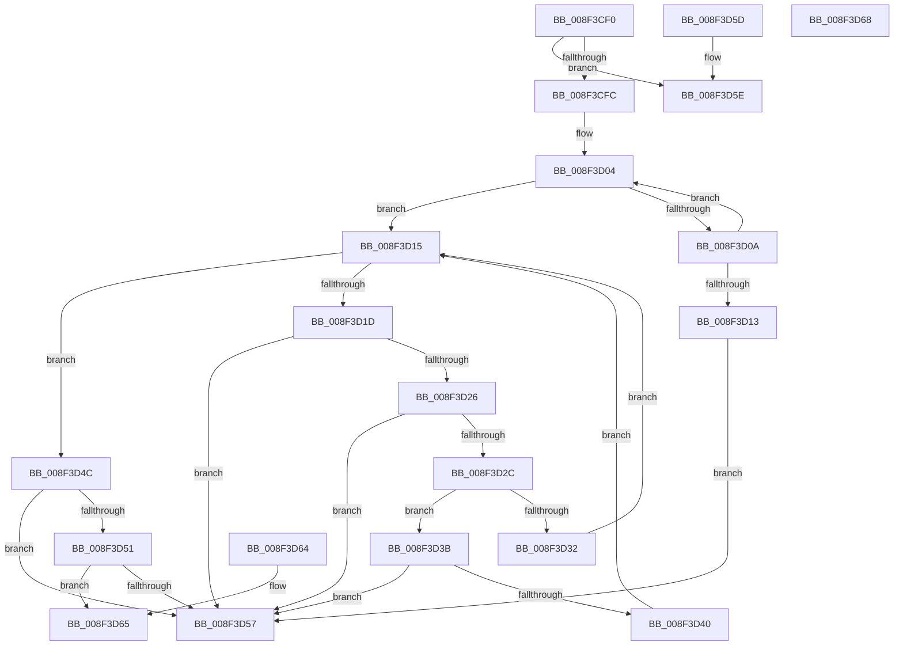

# CmValidateDeviceName

- RVA: `0x008F3CF0`–`0x008F3D69` (길이 `121` bytes)
- VA: `0x00000001408F3CF0`
- 실행 섹션: `PAGE`
- PDB 이름 있음: `예`; PDB Function 태그: `아니요`
- unwind 정보 RVA: `0x000DB714`
- 디코드: `44`개 명령, `121/121` bytes 표시
- 미해석 바이트: `0` (있으면 어셈블리에 `.byte`로 보존)

> 이 문서는 커널 이미지의 기계어와 PDB 기호를 분석해 생성했습니다. 4번과 5번은 함수 원형과 자료형을 바이너리 사용 방식에서 추정한 C 해석이며 원본 소스 복구 결과는 아닙니다.

## 1. Dependencies

- 직접 호출 지점: **0**; 고유 호출 대상: **0**
- 직접 호출자로 확인된 함수: **11**
- RIP 상대 이미지 참조: **0**

### Outgoing calls
- 직접 디코드된 call 명령이 없습니다.

### Direct callers
- [PiCMDeleteDeviceWorker](../73/PiCMDeleteDeviceWorker_function_0073B420.md) at `0x0073B45F`
- [PiCMGenerateDeviceInstance](../73/PiCMGenerateDeviceInstance_function_0073B69C.md) at `0x0073B90C`
- [CmEnumSubkeyCallback](../82/CmEnumSubkeyCallback_function_0082CE50.md) at `0x0082D031`
- [sub_008E1F8B](../8E/Unknown_function_008E1F8B.md) at `0x008E1FB2`
- [CmGetDeviceInterfaceName](CmGetDeviceInterfaceName_function_008F3870.md) at `0x008F38B4`
- [PiCMRegisterDeviceInterface](../96/PiCMRegisterDeviceInterface_function_00962A94.md) at `0x00962B86`
- [PiCMDeviceAction](../96/PiCMDeviceAction_function_0096488C.md) at `0x009649AD`
- [PiCMGetDeviceDepth](../A9/PiCMGetDeviceDepth_function_00A96B98.md) at `0x00A96C52`
- [PiCMCreateDevice](../AC/PiCMCreateDevice_function_00ACB824.md) at `0x00ACB9CF`
- [PiCMQueryRemove](../AD/PiCMQueryRemove_function_00AD43F4.md) at `0x00AD44DC`
- [PiCMSetDeviceProblem](../AD/PiCMSetDeviceProblem_function_00ADA9E0.md) at `0x00ADAA92`

### Static image references
- 디코드된 RIP-relative 메모리 참조가 없습니다.

## 2. Other-region calls and transfers

- 다른 실행 섹션으로 향하는 call: **0**
- 별도 외부 분기/꼬리 이동을 확인하지 못했습니다.

## 3. Assembly (complete function range)

```asm
008F3CF0  45 33 C0                        xor r8d, r8d
008F3CF3  45 8D 48 01                     lea r9d, [r8 + 1]
008F3CF7  48 85 D2                        test rdx, rdx
008F3CFA  74 62                           je 0x1408f3d5e
008F3CFC  B9 C8 00 00 00                  mov ecx, 0xc8
008F3D01  48 8B C2                        mov rax, rdx
008F3D04  66 44 39 00                     cmp word ptr [rax], r8w
008F3D08  74 0B                           je 0x1408f3d15
008F3D0A  48 83 C0 02                     add rax, 2
008F3D0E  49 2B C9                        sub rcx, r9
008F3D11  75 F1                           jne 0x1408f3d04
008F3D13  EB 42                           jmp 0x1408f3d57
008F3D15  0F B7 02                        movzx eax, word ptr [rdx]
008F3D18  66 85 C0                        test ax, ax
008F3D1B  74 2F                           je 0x1408f3d4c
008F3D1D  8D 48 DF                        lea ecx, [rax - 0x21]
008F3D20  66 83 F9 5E                     cmp cx, 0x5e
008F3D24  77 31                           ja 0x1408f3d57
008F3D26  66 83 F8 2C                     cmp ax, 0x2c
008F3D2A  74 2B                           je 0x1408f3d57
008F3D2C  66 83 F8 5C                     cmp ax, 0x5c
008F3D30  74 09                           je 0x1408f3d3b
008F3D32  41 FF C0                        inc r8d
008F3D35  48 83 C2 02                     add rdx, 2
008F3D39  EB DA                           jmp 0x1408f3d15
008F3D3B  45 85 C0                        test r8d, r8d
008F3D3E  74 17                           je 0x1408f3d57
008F3D40  45 33 C0                        xor r8d, r8d
008F3D43  41 FF C1                        inc r9d
008F3D46  48 83 C2 02                     add rdx, 2
008F3D4A  EB C9                           jmp 0x1408f3d15
008F3D4C  45 85 C0                        test r8d, r8d
008F3D4F  74 06                           je 0x1408f3d57
008F3D51  41 83 F9 03                     cmp r9d, 3
008F3D55  74 0E                           je 0x1408f3d65
008F3D57  B8 33 00 00 C0                  mov eax, 0xc0000033
008F3D5C  C3                              ret
008F3D5D  CC                              int3
008F3D5E  B8 0D 00 00 C0                  mov eax, 0xc000000d
008F3D63  C3                              ret
008F3D64  CC                              int3
008F3D65  33 C0                           xor eax, eax
008F3D67  C3                              ret
008F3D68  CC                              int3
```

## 4. C-style interpretation (structured pseudocode)

```c
__int64 __fastcall CmValidateDeviceName(__int64 a1, __int64 a2, int a3)
{
    __int64 result;

    a3 = 0;
    if (a2 == 0) goto loc_008F3D5E;
loc_008F3D04:
    if ((*(unsigned __int16 *)(a2)) == 0) goto loc_008F3D15;
    result = (a2) + (2);
    a1 = (200) - (a3 + 1);
    if (condition_is_not_equal) goto loc_008F3D04;
    goto loc_008F3D57;
loc_008F3D15:
    if ((unsigned __int16)(*(unsigned __int16 *)(a2)) == 0) goto loc_008F3D4C;
    if (((unsigned __int16)(*(unsigned __int16 *)(a2) - 33)) > 94) goto loc_008F3D57;
    if (((unsigned __int16)(*(unsigned __int16 *)(a2))) == 44) goto loc_008F3D57;
    if (((unsigned __int16)(*(unsigned __int16 *)(a2))) == 92) goto loc_008F3D3B;
    a3 = (unsigned int)((a3) + 1);
    a2 = (a2) + (2);
    goto loc_008F3D15;
loc_008F3D3B:
    if (a3 == 0) goto loc_008F3D57;
    a3 = 0;
    a4 = (unsigned int)((a3 + 1) + 1);
    a2 = (a2) + (2);
    goto loc_008F3D15;
loc_008F3D4C:
    if (0 == 0) goto loc_008F3D57;
    if (((unsigned int)(a4)) == 3) goto loc_008F3D65;
loc_008F3D57:
    return (unsigned int)(0xC0000033ULL);
loc_008F3D5E:
    return (unsigned int)(0xC000000DULL);
loc_008F3D65:
    result = 0;
    return result;
}
```

## 5. (Beta) C Style

```c
int64_t CmValidateDeviceName(int64_t Arg1, int64_t Arg2, int32_t Arg3)
{
    int64_t result;

    Arg3 = 0;
    if (Arg2 == 0) goto loc_008F3D5E;
loc_008F3D04:
    if ((*(uint16_t *)(Arg2)) == 0) goto loc_008F3D15;
    result = (Arg2) + (2);
    Arg1 = (200) - (Arg3 + 1);
    if (condition_is_not_equal) goto loc_008F3D04;
    goto loc_008F3D57;
loc_008F3D15:
    if ((uint16_t)(*(uint16_t *)(Arg2)) == 0) goto loc_008F3D4C;
    if (((uint16_t)(*(uint16_t *)(Arg2) - 33)) > 94) goto loc_008F3D57;
    if (((uint16_t)(*(uint16_t *)(Arg2))) == 44) goto loc_008F3D57;
    if (((uint16_t)(*(uint16_t *)(Arg2))) == 92) goto loc_008F3D3B;
    Arg3 = (uint32_t)((Arg3) + 1);
    Arg2 = (Arg2) + (2);
    goto loc_008F3D15;
loc_008F3D3B:
    if (Arg3 == 0) goto loc_008F3D57;
    Arg3 = 0;
    a4 = (uint32_t)((Arg3 + 1) + 1);
    Arg2 = (Arg2) + (2);
    goto loc_008F3D15;
loc_008F3D4C:
    if (0 == 0) goto loc_008F3D57;
    if (((uint32_t)(a4)) == 3) goto loc_008F3D65;
loc_008F3D57:
    return (uint32_t)(0xC0000033ULL);
loc_008F3D5E:
    return (uint32_t)(0xC000000DULL);
loc_008F3D65:
    result = 0;
    return result;
}
```

## 6. Execution-region graph

[열기: 2D/3D 그래프와 함수 탐색 컨트롤 패널](../../../control-panel.html?section=page&rva=0x008F3CF0&view=graph)

- 2D 그래프는 위에서 아래로 흐르고, 3D 그래프는 빈 공간을 드래그해 회전합니다. Shift+드래그는 이동, 휠은 확대·축소, 함수 노드 선택은 대상 보고서 이동입니다.

### Static fallback


