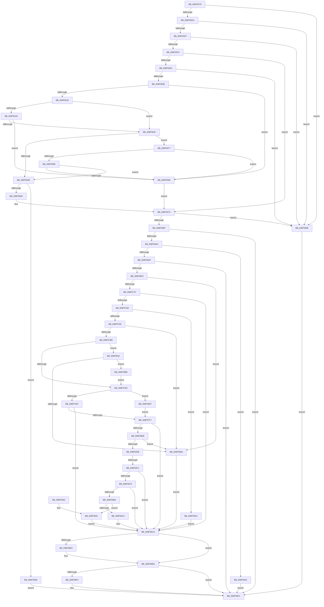

# IoGetDeviceInterfaceAlias

- RVA: `0x008F5570`–`0x008F59E9` (길이 `1,145` bytes)
- VA: `0x00000001408F5570`
- 실행 섹션: `PAGE`
- PDB 이름 있음: `예`; PDB Function 태그: `예`
- unwind 정보 RVA: `0x000877E4`
- 디코드: `282`개 명령, `1,145/1,145` bytes 표시
- 미해석 바이트: `0` (있으면 어셈블리에 `.byte`로 보존)

> 이 문서는 커널 이미지의 기계어와 PDB 기호를 분석해 생성했습니다. 4번과 5번은 함수 원형과 자료형을 바이너리 사용 방식에서 추정한 C 해석이며 원본 소스 복구 결과는 아닙니다.

## 1. Dependencies

- 직접 호출 지점: **29**; 고유 호출 대상: **21**
- 직접 호출자로 확인된 함수: **1**
- RIP 상대 이미지 참조: **4**

### Outgoing calls
- `0x008F564C` → [ExAllocatePool2](../../poolcode/B8/ExAllocatePool2_function_00B820F0.md) (function, `0x00B820F0`)
- `0x008F5668` → [memcpy](../../text/6C/memcpy_function_006C6840.md) (function, `0x006C6840`)
- `0x008F5682` → [CmValidateDeviceInterfaceName](CmValidateDeviceInterfaceName_function_008F1A40.md) (function, `0x008F1A40`)
- `0x008F5693` → [SeCaptureSubjectContext](../86/SeCaptureSubjectContext_function_0086B820.md) (function, `0x0086B820`)
- `0x008F56BC` → [PiPnpRtlApplyMandatoryFilters](../8E/PiPnpRtlApplyMandatoryFilters_function_008E5C80.md) (function, `0x008E5C80`)
- `0x008F56C7` → [SeReleaseSubjectContext](../86/SeReleaseSubjectContext_function_0086B710.md) (function, `0x0086B710`)
- `0x008F56E6` → [PnpStringFromGuid](PnpStringFromGuid_function_008F5A2C.md) (function, `0x008F5A2C`)
- `0x008F570F` → [ExAcquireResourceExclusiveLite](../../text/21/ExAcquireResourceExclusiveLite_function_00214E20.md) (function, `0x00214E20`)
- `0x008F5726` → [ExAllocatePool2](../../poolcode/B8/ExAllocatePool2_function_00B820F0.md) (function, `0x00B820F0`)
- `0x008F577B` → [PnpGetObjectProperty](../8E/PnpGetObjectProperty_function_008E2180.md) (function, `0x008E2180`)
- `0x008F57AD` → [ExAllocatePool2](../../poolcode/B8/ExAllocatePool2_function_00B820F0.md) (function, `0x00B820F0`)
- `0x008F57D1` → [CmGetDeviceInterfaceReferenceString](CmGetDeviceInterfaceReferenceString_function_008F5AF8.md) (function, `0x008F5AF8`)
- `0x008F57FF` → [CmGetDeviceInterfacePathFormat](CmGetDeviceInterfacePathFormat_function_008F5BE8.md) (function, `0x008F5BE8`)
- `0x008F5827` → [ExAllocatePool2](../../poolcode/B8/ExAllocatePool2_function_00B820F0.md) (function, `0x00B820F0`)
- `0x008F585F` → [CmGetDeviceInterfaceName](CmGetDeviceInterfaceName_function_008F3870.md) (function, `0x008F3870`)
- `0x008F587F` → [RtlInitUnicodeStringEx](../../text/46/RtlInitUnicodeStringEx_function_00463960.md) (function, `0x00463960`)
- `0x008F58B7` → [_CmOpenDeviceInterfaceRegKey](_CmOpenDeviceInterfaceRegKey_function_008F31F4.md) (function, `0x008F31F4`)
- `0x008F58C5` → [RtlFreeAnsiString](../9C/RtlFreeAnsiString_function_009C0800.md) (function, `0x009C0800`)
- `0x008F58D1` → [ExReleaseResourceLite](../../text/25/ExReleaseResourceLite_function_0025FA10.md) (function, `0x0025FA10`)
- `0x008F58D6` → [KeLeaveCriticalRegion](../../text/25/KeLeaveCriticalRegion_function_0025D8B0.md) (function, `0x0025D8B0`)
- `0x008F58E8` → [ExFreePoolWithTag](../../poolcode/B8/ExFreePoolWithTag_function_00B82870.md) (function, `0x00B82870`)
- `0x008F58F7` → [ExFreePoolWithTag](../../poolcode/B8/ExFreePoolWithTag_function_00B82870.md) (function, `0x00B82870`)
- `0x008F5902` → [PnpUnicodeStringToWstrFree](PnpUnicodeStringToWstrFree_function_008F59F0.md) (function, `0x008F59F0`)
- `0x008F5910` → [_security_check_cookie](../../text/6A/_security_check_cookie_function_006AC640.md) (function, `0x006AC640`)
- `0x008F5936` → [ZwClose](../../text/6A/ZwClose_function_006AD2B0.md) (function, `0x006AD2B0`)
- `0x008F5949` → [ExFreePoolWithTag](../../poolcode/B8/ExFreePoolWithTag_function_00B82870.md) (function, `0x00B82870`)
- `0x008F5960` → [ExAllocatePool2](../../poolcode/B8/ExAllocatePool2_function_00B820F0.md) (function, `0x00B820F0`)
- `0x008F59CB` → [CmGetDeviceInterfaceReferenceString](CmGetDeviceInterfaceReferenceString_function_008F5AF8.md) (function, `0x008F5AF8`)
- `0x008F59DC` → [ExFreePoolWithTag](../../poolcode/B8/ExFreePoolWithTag_function_00B82870.md) (function, `0x00B82870`)

### Direct callers
- [PiCMGetDeviceInterfaceAlias](../A4/PiCMGetDeviceInterfaceAlias_function_00A47904.md) at `0x00A479FA`

### Static image references
- `0x008F558C` → RVA `0x00E0A740` (`.data`; read)
- `0x008F5698` → RVA `0x00E66398` (`.data`; read)
- `0x008F56FE` → RVA `0x00F8C600` (`.data`; read)
- `0x008F576A` → RVA `0x00011490` (`.rdata`; read)

## 2. Other-region calls and transfers

- 다른 실행 섹션으로 향하는 call: **16**
  - `0x008F564C` → [ExAllocatePool2](../../poolcode/B8/ExAllocatePool2_function_00B820F0.md) (`PAGE` → `POOLCODE`)
  - `0x008F5668` → [memcpy](../../text/6C/memcpy_function_006C6840.md) (`PAGE` → `.text`)
  - `0x008F570F` → [ExAcquireResourceExclusiveLite](../../text/21/ExAcquireResourceExclusiveLite_function_00214E20.md) (`PAGE` → `.text`)
  - `0x008F5726` → [ExAllocatePool2](../../poolcode/B8/ExAllocatePool2_function_00B820F0.md) (`PAGE` → `POOLCODE`)
  - `0x008F57AD` → [ExAllocatePool2](../../poolcode/B8/ExAllocatePool2_function_00B820F0.md) (`PAGE` → `POOLCODE`)
  - `0x008F5827` → [ExAllocatePool2](../../poolcode/B8/ExAllocatePool2_function_00B820F0.md) (`PAGE` → `POOLCODE`)
  - `0x008F587F` → [RtlInitUnicodeStringEx](../../text/46/RtlInitUnicodeStringEx_function_00463960.md) (`PAGE` → `.text`)
  - `0x008F58D1` → [ExReleaseResourceLite](../../text/25/ExReleaseResourceLite_function_0025FA10.md) (`PAGE` → `.text`)
  - `0x008F58D6` → [KeLeaveCriticalRegion](../../text/25/KeLeaveCriticalRegion_function_0025D8B0.md) (`PAGE` → `.text`)
  - `0x008F58E8` → [ExFreePoolWithTag](../../poolcode/B8/ExFreePoolWithTag_function_00B82870.md) (`PAGE` → `POOLCODE`)
  - `0x008F58F7` → [ExFreePoolWithTag](../../poolcode/B8/ExFreePoolWithTag_function_00B82870.md) (`PAGE` → `POOLCODE`)
  - `0x008F5910` → [_security_check_cookie](../../text/6A/_security_check_cookie_function_006AC640.md) (`PAGE` → `.text`)
  - `0x008F5936` → [ZwClose](../../text/6A/ZwClose_function_006AD2B0.md) (`PAGE` → `.text`)
  - `0x008F5949` → [ExFreePoolWithTag](../../poolcode/B8/ExFreePoolWithTag_function_00B82870.md) (`PAGE` → `POOLCODE`)
  - `0x008F5960` → [ExAllocatePool2](../../poolcode/B8/ExAllocatePool2_function_00B820F0.md) (`PAGE` → `POOLCODE`)
  - `0x008F59DC` → [ExFreePoolWithTag](../../poolcode/B8/ExFreePoolWithTag_function_00B82870.md) (`PAGE` → `POOLCODE`)
- call이 아닌 외부 분기/꼬리 이동: **1**
  - `0x008F586B` → [sub_00B1EAB0](../B1/Unknown_function_00B1EAB0.md) (`tail-transfer`)

## 3. Assembly (complete function range)

```asm
008F5570  48 89 5C 24 20                  mov qword ptr [rsp + 0x20], rbx
008F5575  55                              push rbp
008F5576  56                              push rsi
008F5577  57                              push rdi
008F5578  41 54                           push r12
008F557A  41 55                           push r13
008F557C  41 56                           push r14
008F557E  41 57                           push r15
008F5580  48 8D 6C 24 F0                  lea rbp, [rsp - 0x10]
008F5585  48 81 EC 10 01 00 00            sub rsp, 0x110
008F558C  48 8B 05 AD 51 51 00            mov rax, qword ptr [rip + 0x5151ad]
008F5593  48 33 C4                        xor rax, rsp
008F5596  48 89 45 00                     mov qword ptr [rbp], rax
008F559A  45 33 E4                        xor r12d, r12d
008F559D  4C 89 45 80                     mov qword ptr [rbp - 0x80], r8
008F55A1  44 88 64 24 60                  mov byte ptr [rsp + 0x60], r12b
008F55A6  0F 57 C0                        xorps xmm0, xmm0
008F55A9  4C 89 64 24 78                  mov qword ptr [rsp + 0x78], r12
008F55AE  4C 8B F2                        mov r14, rdx
008F55B1  44 88 64 24 61                  mov byte ptr [rsp + 0x61], r12b
008F55B6  4C 8B F9                        mov r15, rcx
008F55B9  44 89 64 24 70                  mov dword ptr [rsp + 0x70], r12d
008F55BE  41 8B F4                        mov esi, r12d
008F55C1  44 89 64 24 74                  mov dword ptr [rsp + 0x74], r12d
008F55C6  41 8B FC                        mov edi, r12d
008F55C9  0F 11 45 88                     movups xmmword ptr [rbp - 0x78], xmm0
008F55CD  0F 11 45 98                     movups xmmword ptr [rbp - 0x68], xmm0
008F55D1  48 85 C9                        test rcx, rcx
008F55D4  0F 84 BE 03 00 00               je 0x1408f5998
008F55DA  48 8B 49 08                     mov rcx, qword ptr [rcx + 8]
008F55DE  48 85 C9                        test rcx, rcx
008F55E1  0F 84 B1 03 00 00               je 0x1408f5998
008F55E7  41 0F B7 17                     movzx edx, word ptr [r15]
008F55EB  66 85 D2                        test dx, dx
008F55EE  0F 84 A4 03 00 00               je 0x1408f5998
008F55F4  45 0F B7 47 02                  movzx r8d, word ptr [r15 + 2]
008F55F9  45 8D 4C 24 02                  lea r9d, [r12 + 2]
008F55FE  66 45 3B C1                     cmp r8w, r9w
008F5602  72 78                           jb 0x1408f567c
008F5604  66 41 3B D0                     cmp dx, r8w
008F5608  0F 87 8A 03 00 00               ja 0x1408f5998
008F560E  66 44 39 21                     cmp word ptr [rcx], r12w
008F5612  0F 84 78 03 00 00               je 0x1408f5990
008F5618  66 41 3B D0                     cmp dx, r8w
008F561C  75 11                           jne 0x1408f562f
008F561E  8B C2                           mov eax, edx
008F5620  48 D1 E8                        shr rax, 1
008F5623  66 44 39 64 41 FE               cmp word ptr [rcx + rax*2 - 2], r12w
008F5629  0F 84 61 03 00 00               je 0x1408f5990
008F562F  49 8B C0                        mov rax, r8
008F5632  49 2B C1                        sub rax, r9
008F5635  48 3B D0                        cmp rdx, rax
008F5638  0F 86 39 03 00 00               jbe 0x1408f5977
008F563E  49 03 D1                        add rdx, r9
008F5641  B9 00 01 00 00                  mov ecx, 0x100
008F5646  41 B8 50 70 73 75               mov r8d, 0x75737050
008F564C  E8 9F CA 28 00                  call 0x140b820f0
008F5651  48 8B D8                        mov rbx, rax
008F5654  48 85 C0                        test rax, rax
008F5657  0F 84 E0 02 00 00               je 0x1408f593d
008F565D  45 0F B7 07                     movzx r8d, word ptr [r15]
008F5661  48 8B C8                        mov rcx, rax
008F5664  49 8B 57 08                     mov rdx, qword ptr [r15 + 8]
008F5668  E8 D3 11 DD FF                  call 0x1406c6840
008F566D  41 0F B7 07                     movzx eax, word ptr [r15]
008F5671  48 8B FB                        mov rdi, rbx
008F5674  48 D1 E8                        shr rax, 1
008F5677  66 44 89 24 43                  mov word ptr [rbx + rax*2], r12w
008F567C  48 8B D7                        mov rdx, rdi
008F567F  4C 8B EF                        mov r13, rdi
008F5682  E8 B9 C3 FF FF                  call 0x1408f1a40
008F5687  85 C0                           test eax, eax
008F5689  0F 88 09 03 00 00               js 0x1408f5998
008F568F  48 8D 4D 88                     lea rcx, [rbp - 0x78]
008F5693  E8 88 61 F7 FF                  call 0x14086b820
008F5698  48 8B 0D F9 0C 57 00            mov rcx, qword ptr [rip + 0x570cf9]
008F569F  48 8D 44 24 60                  lea rax, [rsp + 0x60]
008F56A4  48 89 44 24 28                  mov qword ptr [rsp + 0x28], rax
008F56A9  45 33 C9                        xor r9d, r9d
008F56AC  48 8D 45 88                     lea rax, [rbp - 0x78]
008F56B0  48 8B D7                        mov rdx, rdi
008F56B3  48 89 44 24 20                  mov qword ptr [rsp + 0x20], rax
008F56B8  45 8D 41 03                     lea r8d, [r9 + 3]
008F56BC  E8 BF 05 FF FF                  call 0x1408e5c80
008F56C1  48 8D 4D 88                     lea rcx, [rbp - 0x78]
008F56C5  8B D8                           mov ebx, eax
008F56C7  E8 44 60 F7 FF                  call 0x14086b710
008F56CC  85 DB                           test ebx, ebx
008F56CE  0F 88 28 02 00 00               js 0x1408f58fc
008F56D4  44 38 64 24 60                  cmp byte ptr [rsp + 0x60], r12b
008F56D9  0F 84 C3 02 00 00               je 0x1408f59a2
008F56DF  48 8D 55 B0                     lea rdx, [rbp - 0x50]
008F56E3  49 8B CE                        mov rcx, r14
008F56E6  E8 41 03 00 00                  call 0x1408f5a2c
008F56EB  8B D8                           mov ebx, eax
008F56ED  85 C0                           test eax, eax
008F56EF  0F 88 07 02 00 00               js 0x1408f58fc
008F56F5  65 48 8B 04 25 88 01 00 00      mov rax, qword ptr gs:[0x188]
008F56FE  48 8D 0D FB 6E 69 00            lea rcx, [rip + 0x696efb]
008F5705  B2 01                           mov dl, 1
008F5707  66 FF 88 E4 01 00 00            dec word ptr [rax + 0x1e4]
008F570E  90                              nop
008F570F  E8 0C F7 91 FF                  call 0x140214e20
008F5714  BB 90 01 00 00                  mov ebx, 0x190
008F5719  41 B8 50 70 20 20               mov r8d, 0x20207050
008F571F  8B D3                           mov edx, ebx
008F5721  B9 00 01 00 00                  mov ecx, 0x100
008F5726  E8 C5 C9 28 00                  call 0x140b820f0
008F572B  4C 8B F0                        mov r14, rax
008F572E  48 85 C0                        test rax, rax
008F5731  0F 84 36 02 00 00               je 0x1408f596d
008F5737  48 8B 0D 5A 0C 57 00            mov rcx, qword ptr [rip + 0x570c5a]
008F573E  48 8D 44 24 74                  lea rax, [rsp + 0x74]
008F5743  44 89 64 24 50                  mov dword ptr [rsp + 0x50], r12d
008F5748  45 33 C9                        xor r9d, r9d
008F574B  48 89 44 24 48                  mov qword ptr [rsp + 0x48], rax
008F5750  48 8B D7                        mov rdx, rdi
008F5753  89 5C 24 40                     mov dword ptr [rsp + 0x40], ebx
008F5757  48 8D 44 24 70                  lea rax, [rsp + 0x70]
008F575C  4C 89 74 24 38                  mov qword ptr [rsp + 0x38], r14
008F5761  48 89 44 24 30                  mov qword ptr [rsp + 0x30], rax
008F5766  45 8D 41 03                     lea r8d, [r9 + 3]
008F576A  48 8D 05 1F BD 71 FF            lea rax, [rip - 0x8e42e1]
008F5771  48 89 44 24 28                  mov qword ptr [rsp + 0x28], rax
008F5776  4C 89 64 24 20                  mov qword ptr [rsp + 0x20], r12
008F577B  E8 00 CA FE FF                  call 0x1408e2180
008F5780  8B D8                           mov ebx, eax
008F5782  85 C0                           test eax, eax
008F5784  0F 88 40 01 00 00               js 0x1408f58ca
008F578A  83 7C 24 70 12                  cmp dword ptr [rsp + 0x70], 0x12
008F578F  0F 85 17 02 00 00               jne 0x1408f59ac
008F5795  B8 00 01 00 00                  mov eax, 0x100
008F579A  BB 80 00 00 00                  mov ebx, 0x80
008F579F  8B D0                           mov edx, eax
008F57A1  89 5C 24 68                     mov dword ptr [rsp + 0x68], ebx
008F57A5  8B C8                           mov ecx, eax
008F57A7  41 B8 50 70 20 20               mov r8d, 0x20207050
008F57AD  E8 3E C9 28 00                  call 0x140b820f0
008F57B2  48 8B F0                        mov rsi, rax
008F57B5  48 85 C0                        test rax, rax
008F57B8  0F 84 AF 01 00 00               je 0x1408f596d
008F57BE  48 8D 44 24 68                  lea rax, [rsp + 0x68]
008F57C3  44 8B CB                        mov r9d, ebx
008F57C6  4C 8B C6                        mov r8, rsi
008F57C9  48 89 44 24 20                  mov qword ptr [rsp + 0x20], rax
008F57CE  48 8B D7                        mov rdx, rdi
008F57D1  E8 22 03 00 00                  call 0x1408f5af8
008F57D6  8B D8                           mov ebx, eax
008F57D8  3D 23 00 00 C0                  cmp eax, 0xc0000023
008F57DD  0F 84 61 01 00 00               je 0x1408f5944
008F57E3  81 FB 34 00 00 C0               cmp ebx, 0xc0000034
008F57E9  0F 84 E8 01 00 00               je 0x1408f59d7
008F57EF  85 DB                           test ebx, ebx
008F57F1  0F 88 D3 00 00 00               js 0x1408f58ca
008F57F7  4C 8D 44 24 61                  lea r8, [rsp + 0x61]
008F57FC  48 8B D7                        mov rdx, rdi
008F57FF  E8 E4 03 00 00                  call 0x1408f5be8
008F5804  8B D8                           mov ebx, eax
008F5806  85 C0                           test eax, eax
008F5808  0F 88 BC 00 00 00               js 0x1408f58ca
008F580E  BB 00 02 00 00                  mov ebx, 0x200
008F5813  BA 00 04 00 00                  mov edx, 0x400
008F5818  B9 00 01 00 00                  mov ecx, 0x100
008F581D  89 5C 24 68                     mov dword ptr [rsp + 0x68], ebx
008F5821  41 B8 50 70 20 20               mov r8d, 0x20207050
008F5827  E8 C4 C8 28 00                  call 0x140b820f0
008F582C  48 8B F8                        mov rdi, rax
008F582F  48 85 C0                        test rax, rax
008F5832  0F 84 35 01 00 00               je 0x1408f596d
008F5838  44 8A 64 24 61                  mov r12b, byte ptr [rsp + 0x61]
008F583D  48 8D 44 24 68                  lea rax, [rsp + 0x68]
008F5842  48 89 44 24 38                  mov qword ptr [rsp + 0x38], rax
008F5847  48 8D 55 B0                     lea rdx, [rbp - 0x50]
008F584B  89 5C 24 30                     mov dword ptr [rsp + 0x30], ebx
008F584F  4C 8B CE                        mov r9, rsi
008F5852  48 89 7C 24 28                  mov qword ptr [rsp + 0x28], rdi
008F5857  4D 8B C6                        mov r8, r14
008F585A  44 88 64 24 20                  mov byte ptr [rsp + 0x20], r12b
008F585F  E8 0C E0 FF FF                  call 0x1408f3870
008F5864  8B D8                           mov ebx, eax
008F5866  3D 23 00 00 C0                  cmp eax, 0xc0000023
008F586B  0F 84 3F 92 22 00               je 0x140b1eab0
008F5871  85 DB                           test ebx, ebx
008F5873  78 55                           js 0x1408f58ca
008F5875  4C 8B 65 80                     mov r12, qword ptr [rbp - 0x80]
008F5879  48 8B D7                        mov rdx, rdi
008F587C  49 8B CC                        mov rcx, r12
008F587F  E8 DC E0 B6 FF                  call 0x140463960
008F5884  8B D8                           mov ebx, eax
008F5886  85 C0                           test eax, eax
008F5888  78 40                           js 0x1408f58ca
008F588A  48 83 64 24 38 00               and qword ptr [rsp + 0x38], 0
008F5890  48 8D 44 24 78                  lea rax, [rsp + 0x78]
008F5895  48 8B 0D FC 0A 57 00            mov rcx, qword ptr [rip + 0x570afc]
008F589C  41 B8 30 00 00 00               mov r8d, 0x30
008F58A2  48 89 44 24 30                  mov qword ptr [rsp + 0x30], rax
008F58A7  48 8B D7                        mov rdx, rdi
008F58AA  C6 44 24 28 00                  mov byte ptr [rsp + 0x28], 0
008F58AF  C7 44 24 20 19 00 02 00         mov dword ptr [rsp + 0x20], 0x20019
008F58B7  E8 38 D9 FF FF                  call 0x1408f31f4
008F58BC  8B D8                           mov ebx, eax
008F58BE  85 C0                           test eax, eax
008F58C0  79 6F                           jns 0x1408f5931
008F58C2  49 8B CC                        mov rcx, r12
008F58C5  E8 36 AF 0C 00                  call 0x1409c0800
008F58CA  48 8D 0D 2F 6D 69 00            lea rcx, [rip + 0x696d2f]
008F58D1  E8 3A A1 96 FF                  call 0x14025fa10
008F58D6  E8 D5 7F 96 FF                  call 0x14025d8b0
008F58DB  49 8B FD                        mov rdi, r13
008F58DE  48 85 F6                        test rsi, rsi
008F58E1  74 0A                           je 0x1408f58ed
008F58E3  33 D2                           xor edx, edx
008F58E5  48 8B CE                        mov rcx, rsi
008F58E8  E8 83 CF 28 00                  call 0x140b82870
008F58ED  4D 85 F6                        test r14, r14
008F58F0  74 0A                           je 0x1408f58fc
008F58F2  33 D2                           xor edx, edx
008F58F4  49 8B CE                        mov rcx, r14
008F58F7  E8 74 CF 28 00                  call 0x140b82870
008F58FC  49 8B D7                        mov rdx, r15
008F58FF  48 8B CF                        mov rcx, rdi
008F5902  E8 E9 00 00 00                  call 0x1408f59f0
008F5907  8B C3                           mov eax, ebx
008F5909  48 8B 4D 00                     mov rcx, qword ptr [rbp]
008F590D  48 33 CC                        xor rcx, rsp
008F5910  E8 2B 6D DB FF                  call 0x1406ac640
008F5915  48 8B 9C 24 68 01 00 00         mov rbx, qword ptr [rsp + 0x168]
008F591D  48 81 C4 10 01 00 00            add rsp, 0x110
008F5924  41 5F                           pop r15
008F5926  41 5E                           pop r14
008F5928  41 5D                           pop r13
008F592A  41 5C                           pop r12
008F592C  5F                              pop rdi
008F592D  5E                              pop rsi
008F592E  5D                              pop rbp
008F592F  C3                              ret
008F5930  CC                              int3
008F5931  48 8B 4C 24 78                  mov rcx, qword ptr [rsp + 0x78]
008F5936  E8 75 79 DB FF                  call 0x1406ad2b0
008F593B  EB 8D                           jmp 0x1408f58ca
008F593D  BB 9A 00 00 C0                  mov ebx, 0xc000009a
008F5942  EB B8                           jmp 0x1408f58fc
008F5944  33 D2                           xor edx, edx
008F5946  48 8B CE                        mov rcx, rsi
008F5949  E8 22 CF 28 00                  call 0x140b82870
008F594E  8B 54 24 68                     mov edx, dword ptr [rsp + 0x68]
008F5952  B9 00 01 00 00                  mov ecx, 0x100
008F5957  48 03 D2                        add rdx, rdx
008F595A  41 B8 50 70 20 20               mov r8d, 0x20207050
008F5960  E8 8B C7 28 00                  call 0x140b820f0
008F5965  48 8B F0                        mov rsi, rax
008F5968  48 85 C0                        test rax, rax
008F596B  75 49                           jne 0x1408f59b6
008F596D  BB 9A 00 00 C0                  mov ebx, 0xc000009a
008F5972  E9 53 FF FF FF                  jmp 0x1408f58ca
008F5977  48 8B C2                        mov rax, rdx
008F597A  48 D1 E8                        shr rax, 1
008F597D  66 44 39 64 41 FE               cmp word ptr [rcx + rax*2 - 2], r12w
008F5983  74 0B                           je 0x1408f5990
008F5985  66 44 39 24 41                  cmp word ptr [rcx + rax*2], r12w
008F598A  0F 85 AE FC FF FF               jne 0x1408f563e
008F5990  48 8B F9                        mov rdi, rcx
008F5993  E9 E4 FC FF FF                  jmp 0x1408f567c
008F5998  BB 0D 00 00 C0                  mov ebx, 0xc000000d
008F599D  E9 5A FF FF FF                  jmp 0x1408f58fc
008F59A2  BB 22 00 00 C0                  mov ebx, 0xc0000022
008F59A7  E9 50 FF FF FF                  jmp 0x1408f58fc
008F59AC  BB EF 00 00 C0                  mov ebx, 0xc00000ef
008F59B1  E9 14 FF FF FF                  jmp 0x1408f58ca
008F59B6  44 8B 4C 24 68                  mov r9d, dword ptr [rsp + 0x68]
008F59BB  48 8D 44 24 68                  lea rax, [rsp + 0x68]
008F59C0  4C 8B C6                        mov r8, rsi
008F59C3  48 89 44 24 20                  mov qword ptr [rsp + 0x20], rax
008F59C8  48 8B D7                        mov rdx, rdi
008F59CB  E8 28 01 00 00                  call 0x1408f5af8
008F59D0  8B D8                           mov ebx, eax
008F59D2  E9 0C FE FF FF                  jmp 0x1408f57e3
008F59D7  33 D2                           xor edx, edx
008F59D9  48 8B CE                        mov rcx, rsi
008F59DC  E8 8F CE 28 00                  call 0x140b82870
008F59E1  49 8B F4                        mov rsi, r12
008F59E4  E9 0E FE FF FF                  jmp 0x1408f57f7
```

## 4. C-style interpretation (structured pseudocode)

```c
__int64 __fastcall IoGetDeviceInterfaceAlias(__int64 a1, __int64 a2, __int64 a3)
{
    __int64 result;
    __int64 v_r12;
    __int64 v_rsp;
    unsigned __int64 v_stack_m100;
    unsigned int v_stack_m108;
    unsigned __int64 v_stack_m110;
    unsigned __int64 v_stack_m118;
    unsigned __int64 v_stack_m120;
    unsigned __int64 v_stack_m128;
    unsigned __int64 v_stack_m48;
    unsigned __int64 v_stack_m98;
    unsigned __int64 v_stack_mB0;
    unsigned __int64 v_stack_mC0;
    unsigned __int64 v_stack_mC8;
    unsigned __int64 v_stack_mD0;
    unsigned int v_stack_mD4;
    unsigned int v_stack_mD8;
    unsigned int v_stack_mE0;
    unsigned __int8 v_stack_mE7;
    unsigned __int8 v_stack_mE8;
    unsigned int v_stack_mF8;
    unsigned __int64 v_stack_p20;
    unsigned int v_stack_p68;
    unsigned __int64 v_stack_p78;

    v_stack_p20 = v_rbx;
    v_rsp = (v_rsp) - (272);
    result = (*(unsigned __int64 *)(v_rip + 5329325)) ^ (v_rsp);
    v_stack_m48 = result;
    v_r12 = 0;
    v_stack_mC8 = a3;
    v_stack_mE8 = 0;
    v_stack_mD0 = 0;
    v_stack_mE7 = 0;
    v_stack_mD8 = 0;
    v_stack_mD4 = 0;
    v_stack_mC0 = v_xmm0;
    v_stack_mB0 = v_xmm0;
    if (a1 == 0) goto loc_008F5998;
    if (*(unsigned __int64 *)(a1 + 8) == 0) goto loc_008F5998;
    if ((unsigned __int16)(*(unsigned __int16 *)(a1)) == 0) goto loc_008F5998;
    if (((unsigned __int16)(*(unsigned __int16 *)(a1 + 2))) < ((unsigned __int16)(v_r12 + 2))) goto loc_008F567C;
    if (((unsigned __int16)(*(unsigned __int16 *)(a1))) > ((unsigned __int16)(*(unsigned __int16 *)(a1 + 2)))) goto loc_008F5998;
    if ((*(unsigned __int16 *)(*(unsigned __int64 *)(a1 + 8))) == 0) goto loc_008F5990;
    if (((unsigned __int16)(*(unsigned __int16 *)(a1))) != ((unsigned __int16)(*(unsigned __int16 *)(a1 + 2)))) goto loc_008F562F;
    result = ((unsigned int)((unsigned int)(*(unsigned __int16 *)(a1)))) >> (1);
    if ((*(unsigned __int16 *)(*(unsigned __int64 *)(a1 + 8) + result * 2 - 2)) == 0) goto loc_008F5990;
loc_008F562F:
    result = (*(unsigned __int16 *)(a1 + 2)) - (v_r12 + 2);
    if ((*(unsigned __int16 *)(a1)) <= result) goto loc_008F5977;
loc_008F563E:
    a2 = (*(unsigned __int16 *)(a1)) + (v_r12 + 2);
    result = ExAllocatePool2(256, a2, (unsigned int)(0x75737050ULL), v_r12 + 2);
    if (result == 0) goto loc_008F593D;
    result = memcpy(result, *(unsigned __int64 *)(a1 + 8), *(unsigned __int16 *)(a1), v_r12 + 2);
    result = (*(unsigned __int16 *)(a1)) >> (1);
    *(unsigned __int16 *)(result + result * 2) = 0;
loc_008F567C:
    result = CmValidateDeviceInterfaceName(result, result, *(unsigned __int16 *)(a1), v_r12 + 2);
    if (sign_flag) goto loc_008F5998;
    result = SeCaptureSubjectContext(v_stack_mC0, result, *(unsigned __int16 *)(a1), v_r12 + 2);
    v_stack_m120 = v_stack_mE8;
    a4 = 0;
    v_stack_m128 = v_stack_mC0;
    result = PiPnpRtlApplyMandatoryFilters(*(unsigned __int64 *)(v_rip + 5704953), result, a4 + 3, a4);
    result = SeReleaseSubjectContext(v_stack_mC0, result, a4 + 3, a4);
    if (sign_flag) goto loc_008F58FC;
    if (v_stack_mE8 == 0) goto loc_008F59A2;
    result = PnpStringFromGuid(a2, v_stack_m98, a4 + 3, a4);
    if (sign_flag) goto loc_008F58FC;
    result = ExAcquireResourceExclusiveLite(v_rip + 6909691, 1, a4 + 3, a4);
    result = ExAllocatePool2(256, 400, (unsigned int)(0x20207050ULL), a4);
    if (result == 0) goto loc_008F596D;
    v_stack_mF8 = 0;
    a4 = 0;
    v_stack_m100 = v_stack_mD4;
    v_stack_m108 = 400;
    v_stack_m110 = result;
    v_stack_m118 = v_stack_mD8;
    v_stack_m120 = v_rip - 9323233;
    v_stack_m128 = 0;
    result = PnpGetObjectProperty(*(unsigned __int64 *)(v_rip + 5704794), result, a4 + 3, a4);
    if (sign_flag) goto loc_008F58CA;
    if (v_stack_mD8 != 18) goto loc_008F59AC;
    v_stack_mE0 = 128;
    result = ExAllocatePool2(256, 256, (unsigned int)(0x20207050ULL), a4);
    if (result == 0) goto loc_008F596D;
    v_stack_m128 = v_stack_mE0;
    result = CmGetDeviceInterfaceReferenceString(256, result, result, 128);
    if (((unsigned int)(result)) == 0xC0000023ULL) goto loc_008F5944;
loc_008F57E3:
    if (((unsigned int)((unsigned int)((unsigned int)(result)))) == 0xC0000034ULL) goto loc_008F59D7;
    if (sign_flag) goto loc_008F58CA;
loc_008F57F7:
    result = CmGetDeviceInterfacePathFormat(256, result, v_stack_mE7, 128);
    if (sign_flag) goto loc_008F58CA;
    v_stack_mE0 = 512;
    result = ExAllocatePool2(256, (unsigned int)(0x400ULL), (unsigned int)(0x20207050ULL), 128);
    if (result == 0) goto loc_008F596D;
    v_stack_m110 = v_stack_mE0;
    v_stack_m118 = 512;
    v_stack_m120 = result;
    v_stack_m128 = (unsigned __int8)(v_stack_mE7);
    result = CmGetDeviceInterfaceName(256, v_stack_m98, result, result);
    if (sign_flag) goto loc_008F58CA;
    result = RtlInitUnicodeStringEx(v_stack_mC8, result, result, result);
    if (sign_flag) goto loc_008F58CA;
    v_stack_m118 = v_stack_mD0;
    v_stack_m120 = 0;
    v_stack_m128 = 0x20019ULL;
    result = _CmOpenDeviceInterfaceRegKey(*(unsigned __int64 *)(v_rip + 5704444), result, 48, result);
    if (!sign_flag) goto loc_008F5931;
    result = RtlFreeAnsiString(v_stack_mC8, result, 48, result);
loc_008F58CA:
    result = ExReleaseResourceLite(v_rip + 6909231, result, 48, result);
    result = KeLeaveCriticalRegion(v_rip + 6909231, result, 48, result);
    if (result != 0) {
        a2 = 0;
        a1 = result;
        result = ExFreePoolWithTag(a1, a2, 48, result);
    }
    if (result != 0) {
        a2 = 0;
        a1 = result;
        result = ExFreePoolWithTag(a1, a2, 48, result);
    }
    result = PnpUnicodeStringToWstrFree(result, a1, 48, result);
    a1 = (v_stack_m48) ^ (v_rsp);
    result = _security_check_cookie(a1, a1, 48, result);
    v_rsp = (v_rsp) + (272);
    return result;
loc_008F5931:
    result = ZwClose(v_stack_p78, a1, 48, result);
    goto loc_008F58CA;
loc_008F593D:
    goto loc_008F58FC;
loc_008F5944:
    a2 = 0;
    result = ExFreePoolWithTag(result, a2, 48, result);
    a2 = ((unsigned int)(v_stack_p68)) + ((unsigned int)(v_stack_p68));
    result = ExAllocatePool2(256, a2, (unsigned int)(0x20207050ULL), result);
    if (result != 0) goto loc_008F59B6;
loc_008F596D:
    goto loc_008F58CA;
loc_008F5977:
    result = (a2) >> (1);
    if ((*(unsigned __int16 *)(256 + result * 2 - 2)) == ((unsigned __int16)(v_stack_mC8))) goto loc_008F5990;
    if ((*(unsigned __int16 *)(256 + result * 2)) != ((unsigned __int16)(v_stack_mC8))) goto loc_008F563E;
loc_008F5990:
    goto loc_008F567C;
loc_008F5998:
    goto loc_008F58FC;
loc_008F59A2:
    goto loc_008F58FC;
loc_008F59AC:
    goto loc_008F58CA;
loc_008F59B6:
    v_stack_p20 = v_stack_p68;
    result = CmGetDeviceInterfaceReferenceString(256, 256, result, (unsigned int)(v_stack_p68));
    goto loc_008F57E3;
loc_008F59D7:
    a2 = 0;
    result = ExFreePoolWithTag(result, a2, result, (unsigned int)(v_stack_p68));
    goto loc_008F57F7;
}
```

## 5. (Beta) C Style

```c
int64_t IoGetDeviceInterfaceAlias(void *Arg1, int64_t Arg2, int64_t Arg3)
{
    uint8_t *arg1 = (uint8_t *)Arg1;

    int64_t result;
    int64_t local_r12;
    int64_t local_rsp;
    uint64_t v_stack_m100;
    uint32_t v_stack_m108;
    uint64_t v_stack_m110;
    uint64_t v_stack_m118;
    uint64_t v_stack_m120;
    uint64_t v_stack_m128;
    uint64_t v_stack_m48;
    uint64_t v_stack_m98;
    uint64_t v_stack_mB0;
    uint64_t v_stack_mC0;
    uint64_t v_stack_mC8;
    uint64_t v_stack_mD0;
    uint32_t v_stack_mD4;
    uint32_t v_stack_mD8;
    uint32_t v_stack_mE0;
    uint8_t v_stack_mE7;
    uint8_t v_stack_mE8;
    uint32_t v_stack_mF8;
    uint64_t v_stack_p20;
    uint32_t v_stack_p68;
    uint64_t v_stack_p78;

    v_stack_p20 = local_rbx;
    local_rsp = (local_rsp) - (272);
    result = (*(uint64_t *)(v_rip + 0x5151AD)) ^ (local_rsp);
    v_stack_m48 = result;
    local_r12 = 0;
    v_stack_mC8 = Arg3;
    v_stack_mE8 = 0;
    v_stack_mD0 = 0;
    v_stack_mE7 = 0;
    v_stack_mD8 = 0;
    v_stack_mD4 = 0;
    v_stack_mC0 = v_xmm0;
    v_stack_mB0 = v_xmm0;
    if (Arg1 == NULL) goto loc_008F5998;
    if (*(uint64_t *)(arg1 + 0x8) == 0) goto loc_008F5998;
    if ((uint16_t)(*(uint16_t *)(arg1)) == 0) goto loc_008F5998;
    if (((uint16_t)(*(uint16_t *)(arg1 + 0x2))) < ((uint16_t)(local_r12 + 2))) goto loc_008F567C;
    if (((uint16_t)(*(uint16_t *)(arg1))) > ((uint16_t)(*(uint16_t *)(arg1 + 0x2)))) goto loc_008F5998;
    if ((*(uint16_t *)(*(uint64_t *)(arg1 + 0x8))) == 0) goto loc_008F5990;
    if (((uint16_t)(*(uint16_t *)(arg1))) != ((uint16_t)(*(uint16_t *)(arg1 + 0x2)))) goto loc_008F562F;
    result = ((uint32_t)((uint32_t)(*(uint16_t *)(arg1)))) >> (1);
    if ((*(uint16_t *)(*(uint64_t *)(arg1 + 0x8) + result * 2 - 0x2)) == 0) goto loc_008F5990;
loc_008F562F:
    result = (*(uint16_t *)(arg1 + 0x2)) - (local_r12 + 2);
    if ((*(uint16_t *)(arg1)) <= result) goto loc_008F5977;
loc_008F563E:
    Arg2 = (*(uint16_t *)(arg1)) + (local_r12 + 2);
    result = ExAllocatePool2(256, Arg2, (uint32_t)(0x75737050ULL), local_r12 + 2);
    if (result == 0) goto loc_008F593D;
    result = memcpy(result, *(uint64_t *)(arg1 + 0x8), *(uint16_t *)(arg1), local_r12 + 2);
    result = (*(uint16_t *)(arg1)) >> (1);
    *(uint16_t *)(result + result * 2) = 0;
loc_008F567C:
    result = CmValidateDeviceInterfaceName(result, result, *(uint16_t *)(arg1), local_r12 + 2);
    if (sign_flag) goto loc_008F5998;
    result = SeCaptureSubjectContext(v_stack_mC0, result, *(uint16_t *)(arg1), local_r12 + 2);
    v_stack_m120 = v_stack_mE8;
    a4 = 0;
    v_stack_m128 = v_stack_mC0;
    result = PiPnpRtlApplyMandatoryFilters(*(uint64_t *)(v_rip + 0x570CF9), result, a4 + 3, a4);
    result = SeReleaseSubjectContext(v_stack_mC0, result, a4 + 3, a4);
    if (sign_flag) goto loc_008F58FC;
    if (v_stack_mE8 == 0) goto loc_008F59A2;
    result = PnpStringFromGuid(Arg2, v_stack_m98, a4 + 3, a4);
    if (sign_flag) goto loc_008F58FC;
    result = ExAcquireResourceExclusiveLite(v_rip + 6909691, 1, a4 + 3, a4);
    result = ExAllocatePool2(256, 400, (uint32_t)(0x20207050ULL), a4);
    if (result == 0) goto loc_008F596D;
    v_stack_mF8 = 0;
    a4 = 0;
    v_stack_m100 = v_stack_mD4;
    v_stack_m108 = 400;
    v_stack_m110 = result;
    v_stack_m118 = v_stack_mD8;
    v_stack_m120 = v_rip - 9323233;
    v_stack_m128 = 0;
    result = PnpGetObjectProperty(*(uint64_t *)(v_rip + 0x570C5A), result, a4 + 3, a4);
    if (sign_flag) goto loc_008F58CA;
    if (v_stack_mD8 != 18) goto loc_008F59AC;
    v_stack_mE0 = 128;
    result = ExAllocatePool2(256, 256, (uint32_t)(0x20207050ULL), a4);
    if (result == 0) goto loc_008F596D;
    v_stack_m128 = v_stack_mE0;
    result = CmGetDeviceInterfaceReferenceString(256, result, result, 128);
    if (((uint32_t)(result)) == 0xC0000023ULL) goto loc_008F5944;
loc_008F57E3:
    if (((uint32_t)((uint32_t)((uint32_t)(result)))) == 0xC0000034ULL) goto loc_008F59D7;
    if (sign_flag) goto loc_008F58CA;
loc_008F57F7:
    result = CmGetDeviceInterfacePathFormat(256, result, v_stack_mE7, 128);
    if (sign_flag) goto loc_008F58CA;
    v_stack_mE0 = 512;
    result = ExAllocatePool2(256, (uint32_t)(0x400ULL), (uint32_t)(0x20207050ULL), 128);
    if (result == 0) goto loc_008F596D;
    v_stack_m110 = v_stack_mE0;
    v_stack_m118 = 512;
    v_stack_m120 = result;
    v_stack_m128 = (uint8_t)(v_stack_mE7);
    result = CmGetDeviceInterfaceName(256, v_stack_m98, result, result);
    if (sign_flag) goto loc_008F58CA;
    result = RtlInitUnicodeStringEx(v_stack_mC8, result, result, result);
    if (sign_flag) goto loc_008F58CA;
    v_stack_m118 = v_stack_mD0;
    v_stack_m120 = 0;
    v_stack_m128 = 0x20019ULL;
    result = _CmOpenDeviceInterfaceRegKey(*(uint64_t *)(v_rip + 0x570AFC), result, 48, result);
    if (!sign_flag) goto loc_008F5931;
    result = RtlFreeAnsiString(v_stack_mC8, result, 48, result);
loc_008F58CA:
    result = ExReleaseResourceLite(v_rip + 6909231, result, 48, result);
    result = KeLeaveCriticalRegion(v_rip + 6909231, result, 48, result);
    if (result != 0) {
        Arg2 = 0;
        Arg1 = result;
        result = ExFreePoolWithTag(Arg1, Arg2, 48, result);
    }
    if (result != 0) {
        Arg2 = 0;
        Arg1 = result;
        result = ExFreePoolWithTag(Arg1, Arg2, 48, result);
    }
    result = PnpUnicodeStringToWstrFree(result, Arg1, 48, result);
    Arg1 = (v_stack_m48) ^ (local_rsp);
    result = _security_check_cookie(Arg1, Arg1, 48, result);
    local_rsp = (local_rsp) + (272);
    return result;
loc_008F5931:
    result = ZwClose(v_stack_p78, Arg1, 48, result);
    goto loc_008F58CA;
loc_008F593D:
    goto loc_008F58FC;
loc_008F5944:
    Arg2 = 0;
    result = ExFreePoolWithTag(result, Arg2, 48, result);
    Arg2 = ((uint32_t)(v_stack_p68)) + ((uint32_t)(v_stack_p68));
    result = ExAllocatePool2(256, Arg2, (uint32_t)(0x20207050ULL), result);
    if (result != 0) goto loc_008F59B6;
loc_008F596D:
    goto loc_008F58CA;
loc_008F5977:
    result = (Arg2) >> (1);
    if ((*(uint16_t *)(256 + result * 2 - 0x2)) == ((uint16_t)(v_stack_mC8))) goto loc_008F5990;
    if ((*(uint16_t *)(256 + result * 2)) != ((uint16_t)(v_stack_mC8))) goto loc_008F563E;
loc_008F5990:
    goto loc_008F567C;
loc_008F5998:
    goto loc_008F58FC;
loc_008F59A2:
    goto loc_008F58FC;
loc_008F59AC:
    goto loc_008F58CA;
loc_008F59B6:
    v_stack_p20 = v_stack_p68;
    result = CmGetDeviceInterfaceReferenceString(256, 256, result, (uint32_t)(v_stack_p68));
    goto loc_008F57E3;
loc_008F59D7:
    Arg2 = 0;
    result = ExFreePoolWithTag(result, Arg2, result, (uint32_t)(v_stack_p68));
    goto loc_008F57F7;
}
```

### 관측된 메모리 오프셋

구조체 형식이 확인되지 않은 접근은 인자 기준의 오프셋으로만 기록했습니다.

| 기준 인자 | 오프셋 표현 | 폭 (bit) | 접근 |
|---|---:|---:|---|
| `Arg1` | `+ 0x0` | `16` | `R` |
| `Arg1` | `+ 0x2` | `16` | `R` |
| `Arg1` | `+ 0x8` | `64` | `R` |

## 6. Execution-region graph

[열기: 2D/3D 그래프와 함수 탐색 컨트롤 패널](../../../control-panel.html?section=page&rva=0x008F5570&view=graph)

- 2D 그래프는 위에서 아래로 흐르고, 3D 그래프는 빈 공간을 드래그해 회전합니다. Shift+드래그는 이동, 휠은 확대·축소, 함수 노드 선택은 대상 보고서 이동입니다.

### Static fallback


