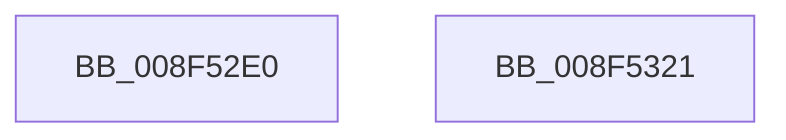

# IoSetDeviceInterfacePropertyData

- RVA: `0x008F52E0`–`0x008F5322` (길이 `66` bytes)
- VA: `0x00000001408F52E0`
- 실행 섹션: `PAGE`
- PDB 이름 있음: `예`; PDB Function 태그: `아니요`
- unwind 정보 RVA: `0x00063458`
- 디코드: `17`개 명령, `66/66` bytes 표시
- 미해석 바이트: `0` (있으면 어셈블리에 `.byte`로 보존)

> 이 문서는 커널 이미지의 기계어와 PDB 기호를 분석해 생성했습니다. 4번과 5번은 함수 원형과 자료형을 바이너리 사용 방식에서 추정한 C 해석이며 원본 소스 복구 결과는 아닙니다.

## 1. Dependencies

- 직접 호출 지점: **1**; 고유 호출 대상: **1**
- 직접 호출자로 확인된 함수: **0**
- RIP 상대 이미지 참조: **0**

### Outgoing calls
- `0x008F5317` → [PnpSetDeviceInterfacePropertyData](PnpSetDeviceInterfacePropertyData_function_008F5328.md) (function, `0x008F5328`)

### Direct callers
- 이 함수 시작 RVA로 연결되는 직접 call은 확인되지 않았습니다. 간접 호출은 완전히 역산할 수 없습니다.

### Static image references
- 디코드된 RIP-relative 메모리 참조가 없습니다.

## 2. Other-region calls and transfers

- 다른 실행 섹션으로 향하는 call: **0**
- 별도 외부 분기/꼬리 이동을 확인하지 못했습니다.

## 3. Assembly (complete function range)

```asm
008F52E0  48 83 EC 48                     sub rsp, 0x48
008F52E4  4C 8B 9C 24 80 00 00 00         mov r11, qword ptr [rsp + 0x80]
008F52EC  4C 89 5C 24 30                  mov qword ptr [rsp + 0x30], r11
008F52F1  49 8B C3                        mov rax, r11
008F52F4  48 F7 D8                        neg rax
008F52F7  49 8B C3                        mov rax, r11
008F52FA  45 1B D2                        sbb r10d, r10d
008F52FD  44 23 54 24 78                  and r10d, dword ptr [rsp + 0x78]
008F5302  48 F7 D8                        neg rax
008F5305  44 89 54 24 28                  mov dword ptr [rsp + 0x28], r10d
008F530A  45 1B C9                        sbb r9d, r9d
008F530D  44 23 4C 24 70                  and r9d, dword ptr [rsp + 0x70]
008F5312  44 89 4C 24 20                  mov dword ptr [rsp + 0x20], r9d
008F5317  E8 0C 00 00 00                  call 0x1408f5328
008F531C  48 83 C4 48                     add rsp, 0x48
008F5320  C3                              ret
008F5321  CC                              int3
```

## 4. C-style interpretation (structured pseudocode)

```c
__int64 __fastcall IoSetDeviceInterfacePropertyData(__int64 a1, __int64 a2, __int64 a3, int a4, unsigned int a5, unsigned int a6, __int64 a7)
{
    __int64 result;
    __int64 v_r10;
    __int64 v_rsp;
    unsigned __int64 v_stack_m18;
    unsigned int v_stack_m20;
    unsigned int v_stack_m28;

    v_rsp = (v_rsp) - (72);
    v_stack_m18 = a7;
    result = -(a7);
    v_r10 = (unsigned int)((v_r10) & (a6));
    result = -(a7);
    v_stack_m20 = (unsigned int)(v_r10);
    a4 = (unsigned int)((a4) & (a5));
    v_stack_m28 = a4;
    result = PnpSetDeviceInterfacePropertyData(a1, a2, a3, a4);
    v_rsp = (v_rsp) + (72);
    return result;
}
```

## 5. (Beta) C Style

```c
int64_t IoSetDeviceInterfacePropertyData(int64_t Arg1, int64_t Arg2, int64_t Arg3, int32_t Arg4, uint32_t Arg5, uint32_t Arg6, int64_t Arg7)
{
    int64_t result;
    int64_t local_r10;
    int64_t local_rsp;
    uint64_t v_stack_m18;
    uint32_t v_stack_m20;
    uint32_t v_stack_m28;

    local_rsp = (local_rsp) - (72);
    v_stack_m18 = Arg7;
    result = -(Arg7);
    local_r10 = (uint32_t)((local_r10) & (Arg6));
    result = -(Arg7);
    v_stack_m20 = (uint32_t)(local_r10);
    Arg4 = (uint32_t)((Arg4) & (Arg5));
    v_stack_m28 = Arg4;
    result = PnpSetDeviceInterfacePropertyData(Arg1, Arg2, Arg3, Arg4);
    local_rsp = (local_rsp) + (72);
    return result;
}
```

## 6. Execution-region graph

[열기: 2D/3D 그래프와 함수 탐색 컨트롤 패널](../../../control-panel.html?section=page&rva=0x008F52E0&view=graph)

- 2D 그래프는 위에서 아래로 흐르고, 3D 그래프는 빈 공간을 드래그해 회전합니다. Shift+드래그는 이동, 휠은 확대·축소, 함수 노드 선택은 대상 보고서 이동입니다.

### Static fallback


