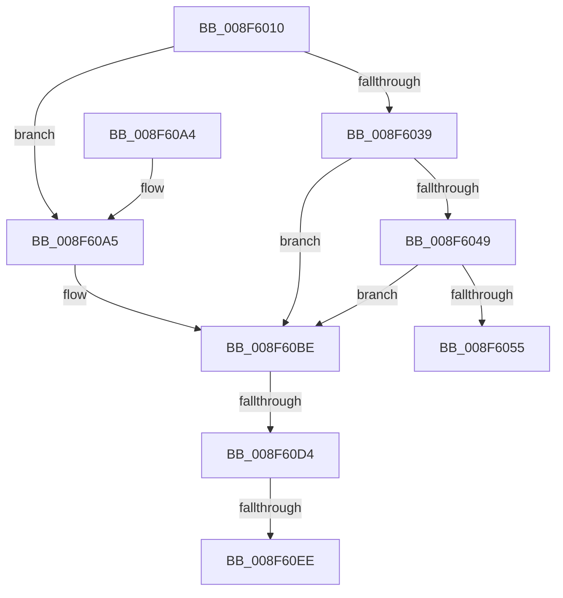

# IoSetDevicePropertyData

- RVA: `0x008F6010`–`0x008F610C` (길이 `252` bytes)
- VA: `0x00000001408F6010`
- 실행 섹션: `PAGE`
- PDB 이름 있음: `예`; PDB Function 태그: `예`
- unwind 정보 RVA: `0x000878D0`
- 디코드: `68`개 명령, `252/252` bytes 표시
- 미해석 바이트: `0` (있으면 어셈블리에 `.byte`로 보존)

> 이 문서는 커널 이미지의 기계어와 PDB 기호를 분석해 생성했습니다. 4번과 5번은 함수 원형과 자료형을 바이너리 사용 방식에서 추정한 C 해석이며 원본 소스 복구 결과는 아닙니다.

## 1. Dependencies

- 직접 호출 지점: **6**; 고유 호출 대상: **3**
- 직접 호출자로 확인된 함수: **1**
- RIP 상대 이미지 참조: **0**

### Outgoing calls
- `0x008F608A` → [PnpSetDevicePropertyData](PnpSetDevicePropertyData_function_008F6114.md) (function, `0x008F6114`)
- `0x008F60B8` → [KeBugCheckEx](../../text/4F/KeBugCheckEx_function_004FD660.md) (function, `0x004FD660`)
- `0x008F60C2` → [IoAddTriageDumpDataBlock](../../text/42/IoAddTriageDumpDataBlock_function_00428374.md) (function, `0x00428374`)
- `0x008F60D8` → [IoAddTriageDumpDataBlock](../../text/42/IoAddTriageDumpDataBlock_function_00428374.md) (function, `0x00428374`)
- `0x008F60F0` → [IoAddTriageDumpDataBlock](../../text/42/IoAddTriageDumpDataBlock_function_00428374.md) (function, `0x00428374`)
- `0x008F6101` → [IoAddTriageDumpDataBlock](../../text/42/IoAddTriageDumpDataBlock_function_00428374.md) (function, `0x00428374`)

### Direct callers
- [HalpInterruptConnect](../../text/54/HalpInterruptConnect_function_005426F8.md) at `0x0054284A`

### Static image references
- 디코드된 RIP-relative 메모리 참조가 없습니다.

## 2. Other-region calls and transfers

- 다른 실행 섹션으로 향하는 call: **5**
  - `0x008F60B8` → [KeBugCheckEx](../../text/4F/KeBugCheckEx_function_004FD660.md) (`PAGE` → `.text`)
  - `0x008F60C2` → [IoAddTriageDumpDataBlock](../../text/42/IoAddTriageDumpDataBlock_function_00428374.md) (`PAGE` → `.text`)
  - `0x008F60D8` → [IoAddTriageDumpDataBlock](../../text/42/IoAddTriageDumpDataBlock_function_00428374.md) (`PAGE` → `.text`)
  - `0x008F60F0` → [IoAddTriageDumpDataBlock](../../text/42/IoAddTriageDumpDataBlock_function_00428374.md) (`PAGE` → `.text`)
  - `0x008F6101` → [IoAddTriageDumpDataBlock](../../text/42/IoAddTriageDumpDataBlock_function_00428374.md) (`PAGE` → `.text`)
- call이 아닌 외부 분기/꼬리 이동: **3**
  - `0x008F60CE` → [sub_00B1EB18](../B1/Unknown_function_00B1EB18.md) (`tail-transfer`)
  - `0x008F60E8` → [sub_00B1EB18](../B1/Unknown_function_00B1EB18.md) (`tail-transfer`)
  - `0x008F6107` → [sub_00B1EB18](../B1/Unknown_function_00B1EB18.md) (`tail-transfer`)

## 3. Assembly (complete function range)

```asm
008F6010  4C 8B DC                        mov r11, rsp
008F6013  49 89 5B 08                     mov qword ptr [r11 + 8], rbx
008F6017  49 89 6B 10                     mov qword ptr [r11 + 0x10], rbp
008F601B  49 89 73 18                     mov qword ptr [r11 + 0x18], rsi
008F601F  57                              push rdi
008F6020  48 83 EC 40                     sub rsp, 0x40
008F6024  33 F6                           xor esi, esi
008F6026  45 8B C8                        mov r9d, r8d
008F6029  4C 8B D2                        mov r10, rdx
008F602C  48 8B D9                        mov rbx, rcx
008F602F  BD 02 00 00 00                  mov ebp, 2
008F6034  48 85 C9                        test rcx, rcx
008F6037  74 6C                           je 0x1408f60a5
008F6039  48 8B 81 38 01 00 00            mov rax, qword ptr [rcx + 0x138]
008F6040  48 8B 40 28                     mov rax, qword ptr [rax + 0x28]
008F6044  48 85 C0                        test rax, rax
008F6047  74 75                           je 0x1408f60be
008F6049  F7 80 8C 01 00 00 00 00 02 00   test dword ptr [rax + 0x18c], 0x20000
008F6053  75 69                           jne 0x1408f60be
008F6055  4C 8B 84 24 80 00 00 00         mov r8, qword ptr [rsp + 0x80]
008F605D  4D 89 43 E8                     mov qword ptr [r11 - 0x18], r8
008F6061  49 8B C0                        mov rax, r8
008F6064  48 F7 D8                        neg rax
008F6067  49 8B C0                        mov rax, r8
008F606A  45 8B C1                        mov r8d, r9d
008F606D  1B D2                           sbb edx, edx
008F606F  23 54 24 78                     and edx, dword ptr [rsp + 0x78]
008F6073  89 54 24 28                     mov dword ptr [rsp + 0x28], edx
008F6077  48 F7 D8                        neg rax
008F607A  49 8B D2                        mov rdx, r10
008F607D  1B C9                           sbb ecx, ecx
008F607F  23 4C 24 70                     and ecx, dword ptr [rsp + 0x70]
008F6083  89 4C 24 20                     mov dword ptr [rsp + 0x20], ecx
008F6087  48 8B CB                        mov rcx, rbx
008F608A  E8 85 00 00 00                  call 0x1408f6114
008F608F  48 8B 5C 24 50                  mov rbx, qword ptr [rsp + 0x50]
008F6094  48 8B 6C 24 58                  mov rbp, qword ptr [rsp + 0x58]
008F6099  48 8B 74 24 60                  mov rsi, qword ptr [rsp + 0x60]
008F609E  48 83 C4 40                     add rsp, 0x40
008F60A2  5F                              pop rdi
008F60A3  C3                              ret
008F60A4  CC                              int3
008F60A5  45 33 C9                        xor r9d, r9d
008F60A8  48 89 74 24 20                  mov qword ptr [rsp + 0x20], rsi
008F60AD  4C 8B C3                        mov r8, rbx
008F60B0  48 8B D5                        mov rdx, rbp
008F60B3  B9 CA 00 00 00                  mov ecx, 0xca
008F60B8  E8 A3 75 C0 FF                  call 0x1404fd660
008F60BD  CC                              int3
008F60BE  0F B7 51 02                     movzx edx, word ptr [rcx + 2]
008F60C2  E8 AD 22 B3 FF                  call 0x140428374
008F60C7  48 8B 4B 08                     mov rcx, qword ptr [rbx + 8]
008F60CB  48 85 C9                        test rcx, rcx
008F60CE  0F 84 44 8A 22 00               je 0x140b1eb18
008F60D4  0F BF 51 02                     movsx edx, word ptr [rcx + 2]
008F60D8  E8 97 22 B3 FF                  call 0x140428374
008F60DD  48 8B 4B 08                     mov rcx, qword ptr [rbx + 8]
008F60E1  48 83 C1 38                     add rcx, 0x38
008F60E5  66 39 31                        cmp word ptr [rcx], si
008F60E8  0F 84 2A 8A 22 00               je 0x140b1eb18
008F60EE  8B D5                           mov edx, ebp
008F60F0  E8 7F 22 B3 FF                  call 0x140428374
008F60F5  48 8B 4B 08                     mov rcx, qword ptr [rbx + 8]
008F60F9  0F B7 51 38                     movzx edx, word ptr [rcx + 0x38]
008F60FD  48 8B 49 40                     mov rcx, qword ptr [rcx + 0x40]
008F6101  E8 6E 22 B3 FF                  call 0x140428374
008F6106  90                              nop
008F6107  E9 0C 8A 22 00                  jmp 0x140b1eb18
```

## 4. C-style interpretation (structured pseudocode)

```c
__int64 __fastcall IoSetDevicePropertyData(__int64 a1, __int64 a2, int a3, __int64 a4, unsigned int a5, unsigned int a6, __int64 a7)
{
    __int64 result;
    __int64 v_rsi;
    __int64 v_rsp;
    unsigned int v_stack_m20;
    unsigned int v_stack_m28;
    unsigned __int64 v_stack_p10;
    unsigned __int64 v_stack_p18;
    unsigned __int64 v_stack_p20;
    unsigned __int64 v_stack_p8;

    *(unsigned __int64 *)(v_rsp + 8) = v_rbx;
    *(unsigned __int64 *)(v_rsp + 16) = v_rbp;
    *(unsigned __int64 *)(v_rsp + 24) = v_rsi;
    v_rsp = (v_rsp) - (64);
    v_rsi = 0;
    if (a1 == 0) goto loc_008F60A5;
    if (*(unsigned __int64 *)(*(unsigned __int64 *)(a1 + 312) + 40) == 0) goto loc_008F60BE;
    if (((*(unsigned int *)(*(unsigned __int64 *)(*(unsigned __int64 *)(a1 + 312) + 40) + 396)) & (0x20000ULL)) != 0) goto loc_008F60BE;
    *(unsigned __int64 *)(v_rsp - 24) = a7;
    result = -(a7);
    a2 = (unsigned int)((a2) & (a6));
    v_stack_m20 = (unsigned int)(a2);
    result = -(a7);
    a1 = (unsigned int)((a1) & (a5));
    v_stack_m28 = (unsigned int)(a1);
    result = PnpSetDevicePropertyData(a1, a2, (unsigned int)((unsigned int)((unsigned int)(a3))), (unsigned int)(a3));
    v_rsp = (v_rsp) + (64);
    return result;
loc_008F60A5:
    a4 = 0;
    v_stack_p20 = v_stack_p18;
    result = KeBugCheckEx(202, v_stack_p10, v_stack_p8, a4);
loc_008F60BE:
    result = IoAddTriageDumpDataBlock(202, *(unsigned __int16 *)(202 + 2), v_stack_p8, a4);
    result = IoAddTriageDumpDataBlock(*(unsigned __int64 *)(v_stack_p8 + 8), (__int16)(*(unsigned __int16 *)(*(unsigned __int64 *)(v_stack_p8 + 8) + 2)), v_stack_p8, a4);
    a1 = (*(unsigned __int64 *)(v_stack_p8 + 8)) + (56);
    result = IoAddTriageDumpDataBlock(a1, (unsigned int)((unsigned int)(v_stack_p10)), v_stack_p8, a4);
    result = IoAddTriageDumpDataBlock(*(unsigned __int64 *)(*(unsigned __int64 *)(v_stack_p8 + 8) + 64), *(unsigned __int16 *)(*(unsigned __int64 *)(v_stack_p8 + 8) + 56), v_stack_p8, a4);
}
```

## 5. (Beta) C Style

```c
int64_t IoSetDevicePropertyData(void *Arg1, int64_t Arg2, int32_t Arg3, int64_t Arg4, uint32_t Arg5, uint32_t Arg6, int64_t Arg7)
{
    uint8_t *arg1 = (uint8_t *)Arg1;

    int64_t result;
    int64_t local_rsi;
    int64_t local_rsp;
    uint32_t v_stack_m20;
    uint32_t v_stack_m28;
    uint64_t v_stack_p10;
    uint64_t v_stack_p18;
    uint64_t v_stack_p20;
    uint64_t v_stack_p8;

    *(uint64_t *)(local_rsp + 0x8) = local_rbx;
    *(uint64_t *)(local_rsp + 0x10) = local_rbp;
    *(uint64_t *)(local_rsp + 0x18) = local_rsi;
    local_rsp = (local_rsp) - (64);
    local_rsi = 0;
    if (Arg1 == NULL) goto loc_008F60A5;
    if (*(uint64_t *)(*(uint64_t *)(arg1 + 0x138) + 0x28) == 0) goto loc_008F60BE;
    if (((*(uint32_t *)(*(uint64_t *)(*(uint64_t *)(arg1 + 0x138) + 0x28) + 0x18C)) & (0x20000ULL)) != 0) goto loc_008F60BE;
    *(uint64_t *)(local_rsp - 0x18) = Arg7;
    result = -(Arg7);
    Arg2 = (uint32_t)((Arg2) & (Arg6));
    v_stack_m20 = (uint32_t)(Arg2);
    result = -(Arg7);
    Arg1 = (uint32_t)((Arg1) & (Arg5));
    v_stack_m28 = (uint32_t)(Arg1);
    result = PnpSetDevicePropertyData(Arg1, Arg2, (uint32_t)((uint32_t)((uint32_t)(Arg3))), (uint32_t)(Arg3));
    local_rsp = (local_rsp) + (64);
    return result;
loc_008F60A5:
    Arg4 = 0;
    v_stack_p20 = v_stack_p18;
    result = KeBugCheckEx(202, v_stack_p10, v_stack_p8, Arg4);
loc_008F60BE:
    result = IoAddTriageDumpDataBlock(202, *(uint16_t *)(202 + 0x2), v_stack_p8, Arg4);
    result = IoAddTriageDumpDataBlock(*(uint64_t *)(v_stack_p8 + 0x8), (int16_t)(*(uint16_t *)(*(uint64_t *)(v_stack_p8 + 0x8) + 0x2)), v_stack_p8, Arg4);
    Arg1 = (*(uint64_t *)(v_stack_p8 + 0x8)) + (56);
    result = IoAddTriageDumpDataBlock(Arg1, (uint32_t)((uint32_t)(v_stack_p10)), v_stack_p8, Arg4);
    result = IoAddTriageDumpDataBlock(*(uint64_t *)(*(uint64_t *)(v_stack_p8 + 0x8) + 0x40), *(uint16_t *)(*(uint64_t *)(v_stack_p8 + 0x8) + 0x38), v_stack_p8, Arg4);
}
```

### 관측된 메모리 오프셋

구조체 형식이 확인되지 않은 접근은 인자 기준의 오프셋으로만 기록했습니다.

| 기준 인자 | 오프셋 표현 | 폭 (bit) | 접근 |
|---|---:|---:|---|
| `Arg1` | `+ 0x8` | `64` | `R` |

## 6. Execution-region graph

[열기: 2D/3D 그래프와 함수 탐색 컨트롤 패널](../../../control-panel.html?section=page&rva=0x008F6010&view=graph)

- 2D 그래프는 위에서 아래로 흐르고, 3D 그래프는 빈 공간을 드래그해 회전합니다. Shift+드래그는 이동, 휠은 확대·축소, 함수 노드 선택은 대상 보고서 이동입니다.

### Static fallback


